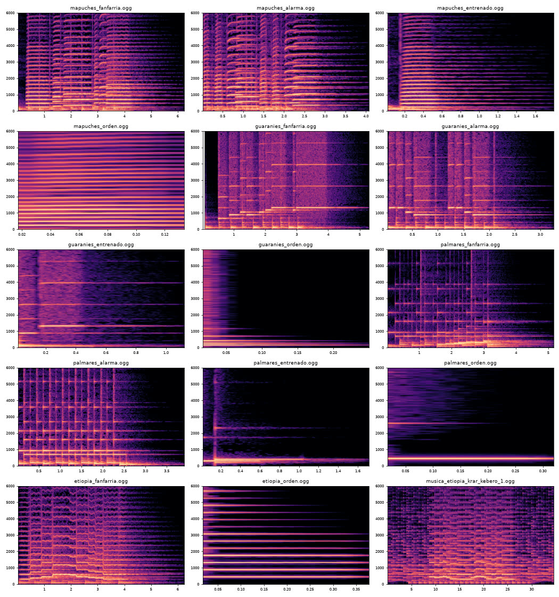

# 4h · Sonido con respeto: nada sagrado en los sonidos de tropa

## Pedido
El paso de sonido ([4g](4g-sonido.md)) puso instrumentos rituales en los sonidos más triviales del juego: la orden de cada clic derecho, la alarma, la unidad entrenada y la fanfarria de edad. Lo señaló el jugador de historia en la [tercera ronda](../22-testers/ronda-3/03-historia-y-estetica.md), en la sección "Sonido: lo sagrado". También lo planteaban las consultas C-53 a C-55. Mientras el autor y las comunidades no contesten, se toma **la opción prudente**:

1. **Mapuches (C-53 b):** sin kultrun en ningún sonido. Trutruka, kull-kull y kakelkultrun.
2. **Guaraníes:** sin mbaraka ni takuapu, que son instrumentos rituales del *opy* mbyá. Alternativas que no son rituales, y una consulta propuesta.
3. **Etiopía (C-54 b):** sin begena en la música de paz. Krar con kebero y masenqo, en el mismo modo (ambassel).
4. **Palmares (C-55 b):** sin berimbau ni toques de capoeira del siglo XIX. Tambores de raíz angoleña y lamelófonos o marimba.
5. Revisar con el mismo criterio Tawantinsuyu y Ayutthaya.

**El criterio.** Casi todos los instrumentos de estos pueblos suenan también en alguna ceremonia. Eso no alcanza para sacarlos. Se sacan los que son **objeto sagrado en sí**: el instrumento personal de una especialista ritual (el kultrun de la machi), el que solo se toca en la casa de rezo (mbaraka y takuapu en el opy) o el que está atado a una oración (la begena de la Cuaresma). Se sacan también los toques que pertenecen a otra época y a otra práctica (el berimbau y los toques de capoeira en el Palmares del siglo XVII). Lo que queda se usa como "pulso" o "llamado" genérico, sin imitar ningún toque ceremonial.

## Qué cambió por pueblo

| Pueblo | Antes | Ahora | Archivos |
|---|---|---|---|
| Mapuches | kultrun y trutruka | trutruka, **kull-kull** y **kakelkultrun** | los cuatro sonidos |
| Guaraníes | mbaraka y takuapu | **mimby** (flauta de caña) y **angu'apu** (tambor de tronco) | los cuatro sonidos |
| Etiopía | begena en la música de paz; orden con kebero | **krar** en la música y en la fanfarria; orden con un punteo de krar | música, fanfarria y orden (alarma y entrenado, iguales) |
| Palmares | berimbau con caxixi, atabaque, célula de angola y São Bento Grande | **ngoma**, **ngongi** (campana doble), **marimba** y **kisanji** | los cuatro sonidos |
| Tawantinsuyu | quena, sikus, wankara | sin cambios | — |
| Ayutthaya | khong wong yai, ranat ek, ching | sin cambios | — |

Los modelos que salieron (kultrun, mbaraka, takuapu, begena, berimbau, caxixi y atabaque) se borraron de `tools/audio/instrumentos.py`. Así no vuelven por descuido. Si una consulta se contesta con la opción a), están en el commit `456a59b` (paso 4g).

### Mapuches: trutruka, kull-kull y kakelkultrun
- **Kakelkultrun** (`ins.kakelkultrun`): tambor de dos parches tocado con palo, de cuerpo cilíndrico y abierto, sin el cuenco del kultrun. Se modela con dos juegos de modos de membrana casi iguales (98 y 101 Hz) que laten entre sí, más un golpe de aire grave y el chasquido del palo. Tiene dos golpes: al centro y cerca del borde (más seco). Toma el lugar que tenía el kultrun como pulso.
- **Kull-kull** (`ins.kull_kull`): cuerno de vacuno soplado. Es un tubo corto y cónico: una nota ronca y nasal (~247 Hz) que sube al atacar, y salta a la octava si se sopla fuerte. Tiene una ronquera irregular de amplitud y la boca del cuerno realza la zona de 1 a 2 kHz. Es más agudo y más corto que la trutruka, y así los dos se distinguen.
- **Partituras**:
  - **fanfarria**: pulso de kakelkultrun (centro y borde alternados), llamado de trutruka (4-5-6-4) y el kull-kull que le contesta (nota y octava);
  - **alarma**: kakelkultrun que acelera y crece, llamados cortos y repetidos de kull-kull, y la trutruka que sostiene abajo;
  - **entrenado**: dos golpes de kakelkultrun y un toque breve de trutruka;
  - **orden**: un toque muy corto de kull-kull.
- **Fuentes**:
  - María Ester Grebe, *Instrumentos musicales precolombinos de Chile* (1974), y sus trabajos de organología mapuche en la *Revista Musical Chilena* [verificar], para la trutruka, el kull-kull y el kakelkultrun.
  - Fichas del Museo Chileno de Arte Precolombino sobre kultrun, kull-kull y trutruka [verificar].
  - Crónicas del siglo XVII sobre la guerra: Diego de Rosales, *Historia general del Reino de Chile* (c. 1674), y Alonso de Ovalle, *Histórica relación del Reino de Chile* (1646). Hablan de trompetas, cornetas y pifilkas para convocar y en el combate [verificar los pasajes].
- **[verificar] el kakelkultrun.** Que sea profano lo dice el informe de historia. Recuerdo descripciones que lo ubican también en el *ngillatun*, aunque nunca como objeto de la machi. Si es así, no es neutro, pero tampoco tiene la carga del kultrun. Y si no es de origen prehispánico (el doble parche hace pensar en la caja española), igual entra en la época del juego, como el cuerno de vacuno del kull-kull.
- La **pifilka** sigue en la música de combate mapuche (grabaciones de Juan Huichal, `assets/audio/musica/README.md`), con su consulta ya abierta. Este paso no la toca.

### Guaraníes: mimby y angu'apu
- **Mimby** (`ins.mimby`): flauta de caña [verificar si también de hueso en la época]. Es más aguda (660 a 1320 Hz) y más soplada que la quena andina, sin vibrato. Tiene un ascenso leve de altura al atacar y un tono de filo, una banda estrecha de ruido por encima de la nota. Toca una escala de cuatro notas sin semitonos sobre la: mi, la, do, re, mi. Es una decisión de diseño **[verificar]**: no encontré una escala guaraní documentada para el siglo XVII.
- **Angu'apu** (`ins.angu_apu`): tambor de tronco ahuecado con parche, tocado con la mano o un palo. Tiene una membrana grave (84 Hz) y modos cortos de madera gruesa. Dos golpes: grave, y seco al borde.
- **Partituras**:
  - **fanfarria**: el angu'apu que acelera y crece (la misma forma que tenía el takuapu), y un llamado de mimby que sube con adornos cortos y cierra arriba;
  - **alarma**: angu'apu rápido en grupos de cuatro y un llamado agudo e insistente de mimby (mi mi do la), dos veces;
  - **entrenado**: un golpe de angu'apu y dos notas de mimby;
  - **orden**: un golpe seco de angu'apu, al borde. Es el sonido "sin instrumento identificable" que se pedía como alternativa: un golpe de madera y cuero.
- **Fuentes**:
  - Antonio Ruiz de Montoya, *Tesoro de la lengua guaraní* (1639), para los nombres: *mimby*, flauta; *angu'apu*, tambor (de *angu'a*, mortero) [verificar las dos entradas y la grafía].
  - Para la guerra: crónicas y cartas jesuíticas (las *Cartas anuas* de la provincia del Paraguay) que mencionan flautas, trompetas de caña y tambores en las milicias de las reducciones [verificar].
  - Sobre el uso ritual de mbaraka y takuapu: León Cadogan, *Ayvu Rapyta* (1959), e Irma Ruiz sobre la música ritual mbyá [verificar las dos; ya estaban en 4g].
- **Cuidado que queda**: entre los mbyá de hoy, las flautas (*mimby*) también tienen usos ceremoniales [verificar]. El tambor de tronco con parche es el reemplazo más neutro y por eso va en "orden", el sonido que más se repite.
- **Fuera del alcance de este paso**: el hito guaraní del arte por edad (`data/arte_hitos.json`, `karai_palabra`) dibuja "el mbaraka del karai en la plaza". Es visual, no sonoro, pero el mismo criterio podría pedir revisarlo. Va como consulta.

### Etiopía: krar en lugar de begena
- **Krar** (`ins.krar`): lira de cinco o seis cuerdas de los *azmari*, punteada con plectro. Es más aguda y más brillante que la begena y no tiene su zumbido de cuero. La caja de cuenco, cubierta de cuero, se modela con resonancias en 260, 620 y 1500 Hz (Karplus-Strong con un golpe de plectro).
- **Música de paz** (`musica_etiopia_krar_kebero_1.ogg`, antes `musica_etiopia_begena_kebero_1.ogg`): la misma forma de dieciséis compases de 6/8 en **ambassel** sobre re. El krar toca el ostinato que tenía la begena, una octava arriba porque ese es su registro. El kebero y el masenqo quedan iguales. Mismo largo (34,6 s), mismo empalme del loop, mismo paneo (el krar a la izquierda).
- **Fanfarria**: la misma frase de masenqo en **bati mayor** sobre el kebero. Se suma un punteo de krar en el primer tiempo de cada compás (re, la, re) y un acorde final (la, re, re).
- **Orden**: un punteo de krar (la) en lugar del golpe de kebero. El kebero grande es también tambor de la liturgia ortodoxa [verificar]. No se lo sacó del todo: sigue en la fanfarria, la alarma y el entrenado, y en la música de paz. Pero ya no suena en cada clic. Va como consulta.
- **Alarma y entrenado**: sin cambios (kebero y masenqo). Los archivos salen idénticos.
- **Fuentes**:
  - Ashenafi Kebede, *The Music of Ethiopia: Its Development and Cultural Setting* (1971), y Timkehet Teffera, trabajos sobre los cordófonos etíopes (krar, begena, masenqo) [verificar las dos].
  - Que el krar sea el instrumento profano de los azmari, y que en la tradición ortodoxa se lo oponga a la begena de la oración: lo dice el informe de historia, y coincide con lo que recuerdo de Kebede [verificar].
- El cuidado de 4g se mantiene: nada de voces ni nada que imite el zema.

### Palmares: raíz angoleña
- **Ngoma** (`ins.ngoma`): tambor alto de un parche tocado con las manos, de tradición congo-angoleña. Hay uno grande (~78 Hz) y uno chico (~118 Hz), con tres golpes: **abierto** (la nota), **grave** (mano al centro, la altura cae) y **seco** (palmada al borde). Reemplaza al atabaque, con nombre y afinación propios.
- **Ngongi** (`ins.ngongi`): campana doble de hierro forjado, golpeada con un palo. Hierro y no bronce: los parciales son inarmónicos y se apagan rápido. Dos notas (690 y 920 Hz). Es la antecesora del gonguê y del agogô brasileños [verificar]. Toca una línea de tiempo en 12/8 (x . x . x x . x . x . x), común en África central y occidental [verificar que se use en la tradición angoleña].
- **Marimba** (`ins.marimba`): xilófono angoleño de tablas sobre calabazas. Cada calabaza lleva una membrana que zumba (mirlitón) [verificar]. Se modela con parciales de barra afinada a mano (1 y ~3,9) y el zumbido, un recorte asimétrico filtrado.
- **Kisanji** (`ins.kisanji`): lamelófono de lengüetas de hierro, con un parcial alto muy inarmónico (~5,9) que se apaga enseguida y un leve cascabeleo. **Ojo con el nombre**: en el Congo, *nsambi* designa el pluriarco (laúd de arcos), no el lamelófono [verificar]. Por eso el juego dice kisanji.
- **Escala** de marimba y kisanji: cinco notas sobre sol (sol, la, do, re, mi). Es una aproximación temperada [verificar: las afinaciones angoleñas no lo son].
- **Partituras**:
  - **fanfarria**: dos ciclos de la campana con las dos ngoma, una frase de marimba que sube en el segundo ciclo y un cierre de ngoma grande, marimba en octava y campana;
  - **alarma**: la campana en dos notas alternadas, rápida e insistente, sobre ngoma en semicorcheas, y dos golpes graves al final;
  - **entrenado**: dos notas de kisanji (re, sol) con un abierto de la ngoma chica;
  - **orden**: una nota de kisanji.
- **Fuentes**:
  - Giovanni Antonio Cavazzi da Montecuccolo, *Istorica descrizione de' tre regni Congo, Matamba et Angola* (1687). Describe y dibuja instrumentos del Congo y del Ndongo del siglo XVII; recuerdo marimba, tambores y campana doble [verificar cuáles].
  - Gerhard Kubik, trabajos sobre los lamelófonos y xilófonos angoleños, y *Angolan Traits in Black Music, Games and Dances of Brazil* (1979) [verificar].
  - Para el nombre Angola Janga y la raíz centroafricana de Palmares: el informe de historia, y la historiografía de Palmares (Décio Freitas, *Palmares: a guerra dos escravos*, 1973) [verificar].
- **Cuidados que quedan**:
  - El ngongi era insignia de autoridad entre los jefes del Congo, y se usaba también para dar señales en la guerra [verificar]. Para una alarma es justamente el uso documentado. No se imita ningún toque de corte.
  - *Ngoma* nombra al tambor y, en buena parte de África central, también a cultos de sanación. Acá se usa el tambor, con un patrón genérico.
- **La música de Palmares no cambia en este paso**. Está en `CIV_MUSIC`, en `src/game/audio.gd`. Las pistas de paz son dos grabaciones de berimbau (toque de iúna y toque de Angola, de capoeira) y una de **ijexá**, un ritmo del candomblé [verificar]. Por el mismo criterio habría que revisarlas, pero sacarlas dejaría a Palmares sin música propia. Va como consulta.

### Tawantinsuyu: sin cambios
- **Quena, siku y wankara** son instrumentos de fiesta y de comunidad. No son objetos sagrados en sí y no los toca un especialista ritual en exclusiva. Hay tropas de sikus en fiestas patronales y en ritos agrícolas, pero el instrumento no queda atado a una oración. No se imita ningún toque ceremonial.
- Para la guerra inca las crónicas nombran el *pututu* (caracola) y los tambores (*wankar*). Garcilaso, *Comentarios reales* (1609), y Guaman Poma, *Nueva corónica* (c. 1615) [verificar], también hablan de tambores hechos con piel de enemigos (*runa tinya*). Eso no se usa.
- **Posible mejora**, sin urgencia: un pututu en la alarma, que es el uso de guerra documentado. No se hizo porque la quena ya funciona y no hay problema de respeto.

### Ayutthaya: sin cambios en los sonidos; una consulta sobre la música
- **Khong wong yai, ranat ek y ching** son instrumentos del conjunto *piphat*. Tocan en el teatro de la corte (*khon*), en fiestas y también en ceremonias budistas y funerales. Los instrumentos se veneran en la ceremonia del *wai khru* [verificar], pero su uso es amplio y profano. Lo sagrado del piphat es su repertorio ceremonial, el *naphat* [verificar], y los sonidos del juego no imitan ninguna pieza.
- **Música**: una de las pistas de paz es *Phleng Maha Nimit (Tra Nimitr)*, de la Banda de la Armada Real Tailandesa (1934). Si *Tra Nimit* es una pieza del repertorio naphat, que acompaña la transformación mágica de un ser sobrenatural [verificar], es repertorio ceremonial. Está en la música de paz, no en un sonido de tropa, así que no se cambió. Va como consulta.
- **Posible mejora**, sin urgencia: para la alarma, el conjunto de guerra y de procesión (*klong* y *pi chawa*) [verificar] sería más fiel que el piphat.

## Cómo se generó
- **`tools/audio/instrumentos.py`**: nueve modelos nuevos (kakelkultrun, kull-kull, mimby, angu'apu, krar, ngoma, marimba, kisanji, ngongi). Se borraron los siete que salieron.
- **`tools/audio/generar_sonidos.py`**: partituras nuevas para mapuches, guaraníes y Palmares. En Etiopía, la fanfarria, la orden y la música.
- Se regeneraron los 25 archivos con `python3 tools/audio/generar_sonidos.py`. Los de Tawantinsuyu y Ayutthaya, y la alarma y el entrenado etíopes, salen **idénticos** a los de 4g (git no los marca como cambiados).
- **Determinismo**: se generó todo dos veces y se compararon los md5 de los 25 Ogg. Son **bit-exactos**.
- **Niveles**: los mismos objetivos que en 4g, y se alcanzan todos. Fanfarria y alarma en −16 LUFS (la fanfarria etíope en −15,9), entrenado en −18 (el guaraní en −17,9) y orden con pico entre −4,0 y −4,6 dBFS. Las medidas están en `tools/audio/medidas.json`. Las fanfarrias y el entrenado guaraníes, que en 4g quedaban 1,6 y 2 dB por debajo por los picos de la sonaja, ahora llegan al objetivo.
- **Revisión sin oídos**: de nuevo con espectrogramas ([lámina](capturas/4h-espectrogramas.jpg)). El primer mimby tenía tanto soplo que el ruido tapaba la nota en la fanfarria. Se bajó el soplo de 0,22 a 0,16.

## Cómo se engancha
- **`data/audio.json`**: las notas de los cuatro pueblos y la ruta nueva de la música etiópica (`civs.etiopia.musica.paz`). Los nombres de los otros archivos no cambian, así que `src/game/audio.gd` no se tocó.
- **`assets/audio/musica/etiopia/`**: se borró `musica_etiopia_begena_kebero_1.ogg` con su `.import`, y entró `musica_etiopia_krar_kebero_1.ogg` con su `.import`, generado por `godot --import`.
- **`assets/CREDITOS.md`** y **`assets/audio/musica/README.md`**: instrumentos y archivo nuevos.
- No se tocó `src/`.

## Pruebas
- **`tests/sonido_civ.gd`** ([salida](pruebas/4h-sonido_civ.txt)): **RESULTADO: OK**, 89 comprobaciones.
  - Cargan los 24 sonidos, la música nueva de Etiopía (34,56 s) y las demás pistas por pueblo.
  - En las partidas de IA contra IA, cada pueblo toca su alarma y su entrenado, y los que suben de edad, su fanfarria.
  - El límite de ráfaga se cumple.
  - Al salir aparecen los mismos avisos de objetos sin liberar que en 4g.
- **Autotest** `--autotest --civ=guaranies --terreno=llano` ([salida](pruebas/4h-autotest.txt)): **AUTOTEST: OK**, sin errores de consola. Solo aparece al salir el `double free` conocido, el mismo que en 4g. La primera corrida falló al guardar las capturas porque el worktree no tenía `screenshots/`; con la carpeta creada, salió limpia.

## Tropiezos
- **El nombre de la música** llevaba "begena". Se renombró, para que el archivo no diga lo que ya no suena. Eso obligó a regenerar el `.import` y a tocar `data/audio.json`, `CREDITOS.md` y el README de música.
- **Casi todo instrumento tiene algún uso ceremonial.** La trutruka y el kull-kull también suenan en el ngillatun, y las flautas en ritos mbyá [verificar las dos]. Si el criterio fuera "nunca en una ceremonia", no quedaría ningún instrumento. El criterio de este paso es el del principio: se saca el objeto sagrado en sí, no el que solo pasa por una ceremonia.
- **No pude escuchar nada**, igual que en 4g. Los timbres salen de las fuentes y de los espectrogramas. Falta que el autor los escuche, en especial el kull-kull (que no suene a corneta de juguete) y la marimba (que el zumbido no la vuelva sucia).

## Consultas propuestas
No se agregaron a `CONSULTAS.md`. Las dejo redactadas para que el autor las copie, con la numeración que corresponda.

**C-xx · (sonido) La mbaraka y el takuapu.** Los sonidos guaraníes usaban mbaraka y takuapu, que en el *opy* mbyá son instrumentos rituales (la mbaraka del canto del karai y el takuapu de las mujeres). Ahora suenan mimby (flauta de caña) y angu'apu (tambor de tronco) (`4h-sonido-con-respeto.md`).
a) Así, hasta consultarlo con una organización mbyá *(por defecto)* · b) Volver a la mbaraka y el takuapu solo en la fanfarria de edad, si la organización lo acepta · c) Un sonido sin instrumento reconocible (golpes de madera) en todos

**C-xx · (sonido) La música de paz de Palmares.** Las pistas de paz de Palmares son dos grabaciones de berimbau con toques de capoeira (siglo XIX y después) y una de ijexá, un ritmo del candomblé [verificar]. Los sonidos del pueblo ya pasaron a ngoma, marimba y kisanji (C-55 b).
a) Dejarlas hasta tener una música propia sintetizada con ngoma y marimba *(por defecto)* · b) Sacar ya el ijexá, por su uso religioso · c) Sintetizar ahora una música de paz angoleña y sacar las tres

**C-xx · (sonido) El kebero en los sonidos de tropa.** El kebero grande es también tambor de la liturgia ortodoxa etíope [verificar]. Ya no suena en cada orden (ahora es un punteo de krar), pero sigue en la fanfarria, la alarma, el entrenado y la música de paz.
a) Así, y preguntarlo junto con C-54 *(por defecto)* · b) Sacarlo también de la alarma y el entrenado y dejar solo masenqo y krar

**C-xx · (música) *Tra Nimit* en la música de Ayutthaya.** *Phleng Maha Nimit (Tra Nimitr)* podría ser una pieza del repertorio ceremonial *naphat* del piphat [verificar].
a) Dejarla: es una grabación de banda militar y suena en la paz *(por defecto)* · b) Sacarla hasta confirmarlo

**C-xx · (arte) El mbaraka del karai en el hito guaraní.** El hito guaraní (`data/arte_hitos.json`, `karai_palabra`) muestra los bastones rituales y la mbaraka del karai en la plaza. Por el mismo criterio que en el sonido, se podría mostrar la casa grande sin los objetos rituales.
a) Dejarlo: es arquitectura, se muestra sin uso trivial *(por defecto)* · b) Sacar los objetos rituales del modelo

Además, las respuestas de **C-53, C-54 y C-55** confirman o revierten este paso. Si alguna se contesta con la a), el cambio es solo de partitura: los modelos viejos están en `456a59b`.

## Pendiente
- Que el autor escuche los sonidos nuevos.
- Verificar las fuentes marcadas, sobre todo el kakelkultrun (¿profano?), *angu'apu* y *mimby* en Montoya, y los instrumentos que dibuja Cavazzi.
- Música propia para Palmares con ngoma y marimba, si C-xx (música de Palmares) va por la c).

## Commits
- `Etapa 24 (4h): sonido con respeto, sin instrumentos sagrados en los sonidos de tropa` (rama `worktree-agent-ab4d7d1ae16bfb845`).
