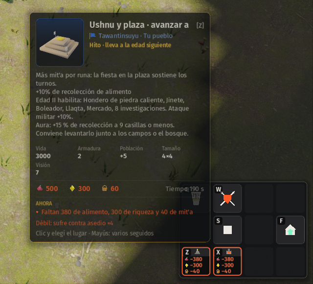
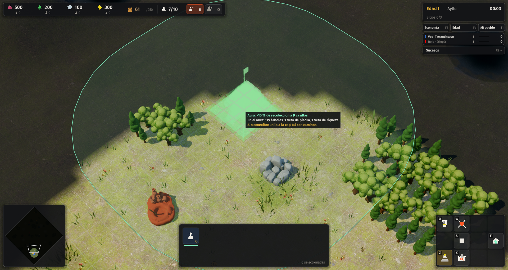
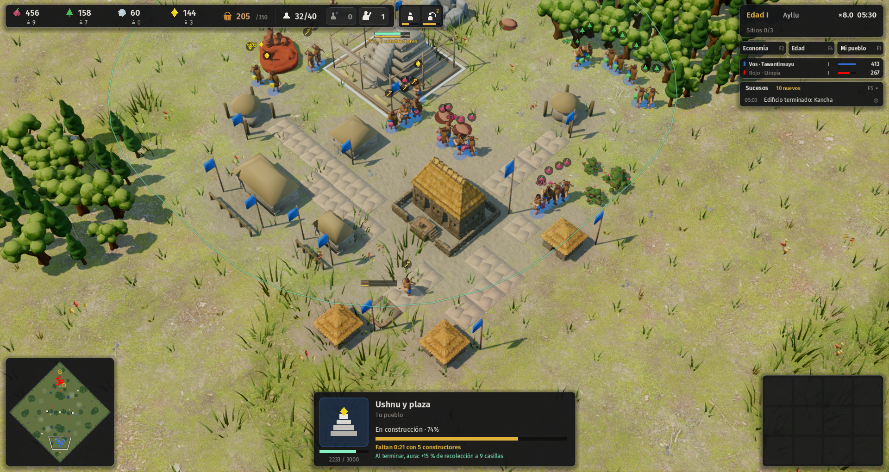
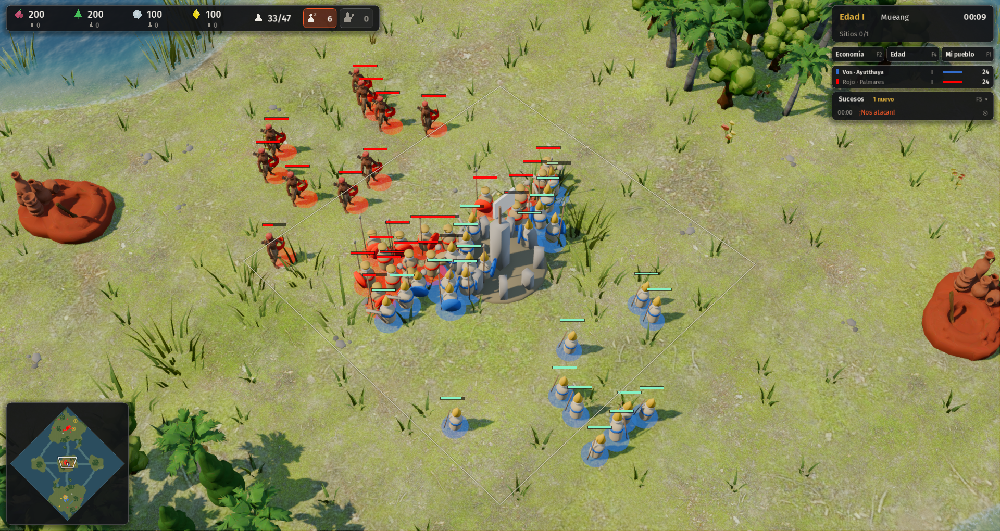

# 4k · Interfaz que pide el veterano (tercera ronda)

## Pedido
Del [informe del veterano de AoE4 en la tercera ronda](../22-testers/ronda-3/01-veterano-aoe4.md), §3.4, §3.5, §5.2 y §7, solo lo que toca la interfaz (`src/game`, `data/interfaz.json`; la simulación no se tocó):

1. **Costo del hito.** Hace tres rondas que la grilla muestra "−300+" en lugar de lo que pide el hito, contando el costo extra de la civ (mit'a, fama).
2. **Aura al colocar el hito.** El radio en el suelo, como el alcance de las torres.
3. **Ficha del hito en obra.** Cuánto falta con los constructores de ahora (rendimiento decreciente) y qué aura va a tener.
4. **Demos por encima del tope de población** (`--demo=batalla` arrancaba 33/10).
5. **Ocho marcadores de cámara** en lugar de tres (F7–F9).
6. **Barras de vida al pelear por defecto,** sin activar la opción.

## Qué se hizo

### 1. Costo real del hito
- **Casilla de la grilla** (`src/game/ui/estado_casilla.gd`): la franja de abajo lista **cada recurso que falta con su glifo y su número**, uno por renglón ("−380 / −300 / −40"). Si falta uno solo, la franja queda igual que antes. Con varios renglones, el glifo del edificio se achica y sube para que no lo tape (`_rect_glifo`). Se terminó el "+".
- **Ficha al pasar el mouse** (`src/game/ui/ficha.gd`): debajo del costo completo (con la mit'a o la fama del hito), en "Ahora", va "Faltan 380 de alimento, 300 de riqueza y 40 de mit'a". Usa el mismo texto que el aviso al hacer clic sin recursos (`Controller.missing_text`). La ficha del hito también dice ahora el aura.
- **Ayuda vieja** (`Hud.Tooltip`, la de la barra de recursos): suma el mismo renglón cuando hay costo.

### 2. Aura al colocar el hito
- **En el suelo** (`src/game/ui/mundo_capa.gd`): al colocar un hito se dibuja el contorno del aura, medido desde el borde del edificio como `Sim.dist_to`, igual que el alcance de las torres. Es verde si da recolección y celeste si cura. También se dibuja al seleccionar un hito, terminado o en obra (más tenue).
- **Junto al cursor** (`src/game/ui/mundo_colocacion.gd`):
  - "Aura: +15 % de recolección a 9 casillas";
  - "En el aura: 119 árboles, 1 veta de piedra, 1 veta de riqueza" (en rojo, "nada que recolectar").

  El aura sale de `aura` del hito o de `reglas.aura_hito` por eje, igual que `Sim.aura_of`. El conteo recorre la naturaleza una vez por casilla y por segundo de juego, no en cada cuadro.

### 3. Ficha del hito en obra
- **Panel de selección** (`Hud.obra_restante`): "Faltan 0:21 con 5 constructores", o "Parada: sin constructores (con uno, 2:22)". La cuenta es la de la simulación: `SimMods.build_step` por constructor, que da tiempo × 3/(n+2) o la obra colectiva guaraní. Debajo va "Al terminar, aura: +15 % de recolección a 9 casillas".
- **Ficha al pasar el mouse sobre la obra:** suma el mismo renglón de lo que falta.

### 4. Demos sin trabarse en el tope
Al terminar de armar cualquier `--demo` (`main.gd`, `_demo`), el exceso sobre el tope pasa a `pob_extra`, como ya hacía `sim_scenario` en las misiones. Además se suma un margen para seguir entrenando: `interfaz.json` → `demos.pob_margen` = 10. Resultado: `--demo=batalla` arranca 33/47 en lugar de 33/10, y `--demo=base` (guaraníes) 12/35.

### 5. Ocho marcadores de cámara
**Elección:** `Alt + 1…8` vuelve a un marcador y `Ctrl + Alt + 1…8` lo guarda.

**Por qué no `Ctrl + número`:** ya es de los grupos de control (`Ctrl` asigna, `Mayús` suma, el número solo selecciona y el doble toque centra), y romperlo le cambia la mano a cualquiera que venga de AoE. Revisé los atajos existentes:
- `Alt` solo, mantenido, muestra barras y alcances, y no choca con un número;
- `Alt + clic` es la bengala y `Alt + clic derecho`, mover suelto (son con mouse, no con teclado);
- en el escritorio, `Ctrl + Alt + F1…F7` cambia de consola en Linux: por eso no usé `Ctrl + Alt` con teclas de función.

**F7–F9 siguen andando** como atajos de los marcadores 1 a 3 (`Ctrl + F` guarda), así no se pierde lo aprendido en la ronda anterior.

**Datos:** `interfaz.json` → `ordenes.marcadores` (cantidad, 8) y `ordenes.marcadores_f`.

**Documentado** en `docs/07` (tabla de controles), en la ayuda (F1) y en "Mi pueblo".

### 6. Barras de vida al pelear
`Overlay` muestra la barra de toda unidad que pegó o recibió un golpe en los últimos 4 s (`interfaz.json` → `mundo.barras_combate_s`), aunque tenga la vida llena. Usa `SimEntity.last_combat`, que ya existía. Fuera de pelea sigue como antes: lo dañado, lo seleccionado y lo que está bajo el mouse. La opción "Barras de vida siempre visibles" sigue igual.

### Para capturas
`main.gd` suma tres argumentos:
- `--colocar=tipo|hito`: modo de colocación en el centro de la pantalla;
- `--banco=recurso:n,…`: fija recursos antes de la captura;
- `--ayuda=N`: abre la ficha de la casilla N de la grilla.

## Pruebas
**Autotest:** `godot --path . -- --autotest --civ=guaranies --terreno=llano` da **AUTOTEST: OK** ([pruebas/4k-autotest.txt](pruebas/4k-autotest.txt)). Tiene 11 chequeos nuevos (`_autotest_veterano`):
- la casilla del hito nombra cada recurso que falta, sin "+"; si falta uno solo, "−40";
- la ficha dice cuánto falta de cada recurso;
- al colocar el hito se ve "Aura: … casillas" y lo que queda adentro;
- "Faltan 1:54 con 4 constructores" coincide con la cuenta a mano (obra colectiva guaraní); sin constructores dice "Parada";
- `Ctrl + Alt + 8` guarda y `Alt + 8` vuelve; `Ctrl + Alt + número` no toca los grupos; F7 es el marcador 1;
- una unidad sana que acaba de pelear muestra la barra sin la opción.

Al salir, Godot sigue tirando el "double free or corruption" de siempre, después de "AUTOTEST: OK". Ya lo anotaron los jugadores de prueba en rondas anteriores y no tiene que ver con este cambio.

**No hizo falta** correr determinismo ni bench: no se tocó `src/sim`.

| | |
|---|---|
|  |  |
| 1. Tawantinsuyu con 120 de alimento, 0 de riqueza y 20 de mit'a: las casillas Z y X dicen −380, −300 y −40. La ficha muestra el costo completo (500, 300 y 60 de mit'a), el aura y "Faltan 380 de alimento, 300 de riqueza y 40 de mit'a". `--banco=alimento:120,riqueza:0,mita:20 --ayuda=8` | 2. Ushnu al colocarlo: el aura de 9 casillas en el suelo y, junto al cursor, el aura y lo que queda adentro. `--civ=tawantinsuyu --seed=7 --colocar=hito --cam=b13,b11,34` |
|  |  |
| 3. El ushnu de la IA al 74 %, la misma escena que la captura 1 del veterano: "Faltan 0:21 con 5 constructores" y el aura que va a tener; en el suelo, el radio. `--aivai --civ=tawantinsuyu --rival=etiopia --seed=7 --speed=8 --shot-at=330 --select=ushnu` | 4. `--demo=batalla` Ayutthaya contra Palmares a los 9 s, sin `--barras`: se ven las barras de los que pelean. Población 33/47 (antes, 33/10) |

## Tropiezos
- **La primera franja, de a dos por renglón, cortaba los números** ("30" en lugar de "300"): en una casilla de 62 px no entran dos pares de glifo y número. Pasó a un recurso por renglón, con el glifo del edificio más chico.
- **"En el aura: nada que recolectar" junto a un bosque.** Los recursos no están en `Sim.actives` (solo unidades y edificios); el conteo recorre `Sim.entities`.
- **La ayuda de la grilla es la ficha** (`ficha.gd`), no `Hud.Tooltip`. El renglón de lo que falta tuvo que ir en las dos.

## Riesgos
- `estado_casilla.gd`, `hud.gd`, `main.gd` (autotest) y `ficha.gd` también los toca el trabajo en paralelo sobre la grilla con nombres, la pantalla de fin y los avisos. Mis cambios están marcados con `# --- costo real ---`, `# --- obra ---`, `# --- aura del hito ---`, `# --- marcadores ---` y `# --- veterano ---`. En la casilla, solo cambió el rectángulo del glifo sin nombres (`_rect_glifo`) y el bloque de "no alcanza".
- Con los nombres en la grilla y varios recursos faltantes, la franja alta puede pisar el nombre (el cálculo de renglones de ese modo no la tiene en cuenta).

## Commits
- Ver el log de la rama: "Interfaz que pide el veterano en la tercera ronda (4k)".
