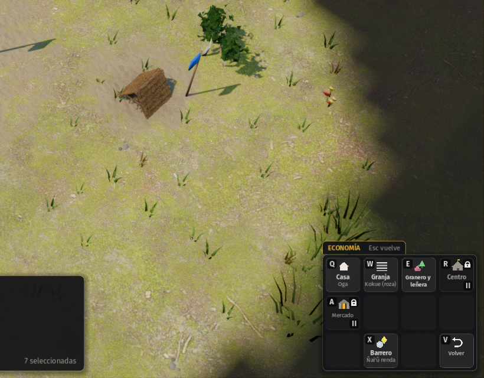
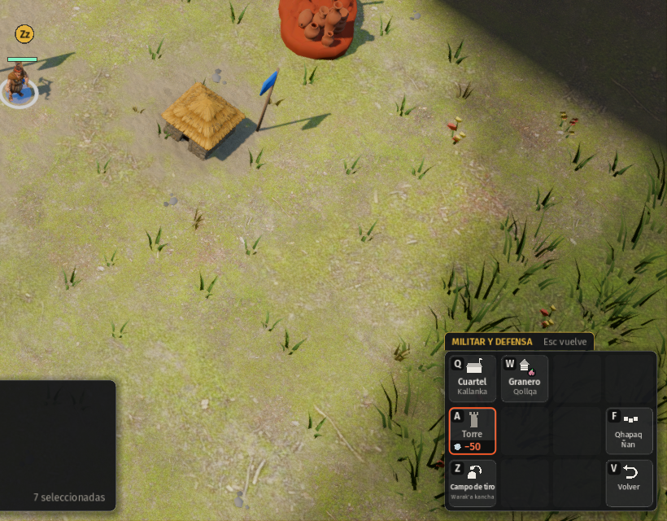
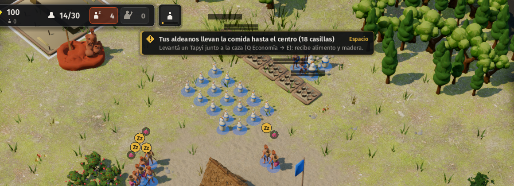
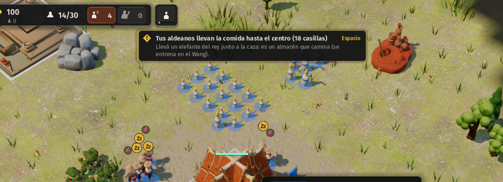

# 4m · Depósitos de comida: que se vea que existen

## Pedido
El autor (2026-11-16): "¿Puede ser que no exista granero? Si necesito ir a buscar comida a otro lado porque no quiero hacer granjas, ¿tengo que dejar que vuelvan hasta la base a traer la comida?"

Los seis pueblos ya pueden dejar comida lejos de la base, pero no se nota:

| Pueblo | Qué recibe alimento lejos | Qué se veía en la grilla |
|---|---|---|
| Guaraníes | **Tapyi** (`almacen_madera`): alimento y madera | "Leñera" con el ícono de la madera. Parecía que no servía para la comida. |
| Tawantinsuyu | **Qollqa**: solo alimento; cuesta piedra y mit'a | Ícono de silo sin nombre común, en el submenú Militar (también hace la leva). |
| Mapuches | **Lof**: recibe todo | Ícono de centro, sin nombre común. |
| Palmares | **Paiol** (`almacen_alimento`) y el **mocambo** | "Granero": se entendía. |
| Etiopía | **Gotära** (`almacen_alimento`) | "Granero": se entendía. |
| Ayutthaya | Ningún edificio: el **elefante del rey** es un almacén que camina | Nada lo decía en la grilla del Wang. |

Además, el **Khlang din** de Ayutthaya (solo arcilla) llevaba el ícono de la piedra.

## Qué se hizo

### 1. Nombres e íconos que dicen qué reciben
- **Nombre común según lo que recibe**, en ese pueblo. Antes se tomaba el nombre del edificio común de los datos, aunque el pueblo lo cambiara.
  - `Grilla.comun` (en `src/game/ui/grilla.gd`) lo usan la grilla con nombres (`Controller.common_name`) y el subtítulo de la ficha (`Ficha._base`).
  - La tabla está en `data/interfaz.json` → `grilla.comunes_deposito`:
    - alimento → Granero
    - madera → Leñera
    - piedra y riqueza → Barrero
    - riqueza → Almacén de arcilla
    - alimento y madera → **Granero y leñera**
    - alimento, madera y piedra → Almacén que camina
  - `grilla.comunes` cubre los edificios propios de un pueblo, que no tienen nombre común en los datos: lof → Centro chico, mocambo → Aldea y depósito y elefante del rey → Almacén que camina.
- **Nombre largo en dos renglones.** Si el nombre común no entra en la casilla con letra de 9 o más, va en dos renglones y el nombre propio queda en la ayuda (`EstadoCasilla.dibujar`). Antes se achicaba hasta ser ilegible: "Almacén de mont…" a 7 px fue la primera prueba.
- **Ícono de lo que recibe** (`Glyphs.resolve` y `Glyphs._recibe`). Un almacén que no recibe los cuatro recursos se dibuja así:
  - Con un recurso, su glifo, igual que antes (granero, leñera).
  - Con dos o tres, los glifos encimados en diagonal y en su color: el tapyi lleva **frutos y árbol**, y el barrero, piedra y arcilla.
  - Si el pueblo le da un ícono propio, ese ícono con los recursos abajo a la derecha: la qollqa lleva el **silo con el alimento**.
  - Los centros, el lof y el mocambo reciben todo y quedan como estaban.
- **Ayuda.** `_building_desc` ya decía "Recibe …" en todos los depósitos. Ahora dice "alimento y madera" en lugar de "alimento, madera".
  - El elefante del rey ya lo decía en su descripción ("Almacén que camina: recibe madera, alimento y piedra").
  - La descripción del tapyi (`data/civs/guaranies.json`) pasa a decir "guarda la comida (caza, frutos y roza) y la madera. Levantalo junto a la caza o el monte, así no vuelven hasta el Oga guasu".

### 2. Aviso que enseña: viajes largos
Va en `src/game/ui/consejos.gd` (`_far`), con los umbrales en `data/interfaz.json` → `consejos.lejos`.
- **Cuándo avisa:** con **3 aldeanos o más** juntando del mapa a **más de 12 casillas** del depósito más cercano que recibe ese recurso, durante **30 s seguidos**. Vale para alimento, madera y piedra.
  - No cuenta a los de granja.
  - Se calla si ya hay un depósito de ese recurso en obra cerca de donde juntan.
  - Se repite cada 150 s como mucho.
- **Qué dice:** el almacén más barato del pueblo que recibe ese recurso y dónde está en la grilla, sin contar centros ni hitos.
  - Guaraníes: "Tus aldeanos llevan la comida hasta el centro (18 casillas). Levantá un Tapyi junto a la caza (Q Economía → E): recibe alimento y madera."
  - Tawantinsuyu: "Levantá una Qollqa junto a la caza (W Militar → W): recibe alimento."
  - Mapuches: "Levantá un Lof…" (Q Economía → R).
  - Palmares y Etiopía: Paiol o Gotära (Q Economía → Z).
  - Ayutthaya, sin edificio para el alimento: "Llevá un elefante del rey junto a la caza: es un almacén que camina (se entrena en el Wang)". Si ya tiene uno, dice "Llevá tu elefante del rey…".
  - El lugar se nombra según el recurso del mapa (la caza, los frutos, el monte, la cantera) y el aviso se puede saltar con `Espacio`.
- **Telemetría:** no se usó `SimTelemetry.viajes`. Solo existe con la telemetría prendida y acumula toda la partida, así que el aviso calcula en la vista con `Sim.nearest_dropoff` y `Sim.dist_to`, que solo leen.

### 3. ¿Los cazadores usan el almacén nuevo? Sí
Lo revisé en `src/sim/sim.gd` sin tocarlo:
- Cada vez que un aldeano se llena (`_do_gather`), pasa a `RETURN` con `aux = -1`.
- `_do_return` busca entonces el depósito más cercano que acepta esa carga, construido, o una unidad con `deposito`, como el elefante (`nearest_dropoff`).
- Un almacén nuevo se usa desde el viaje siguiente. Solo el aldeano que ya iba camino al centro termina ese viaje.

La prueba nueva `tests/depositos_lejos.gd` lo mide en los seis pueblos:
- 3 aldeanos cazan a 26 casillas del centro.
- A los 40 s aparece el almacén del pueblo junto a la caza (el elefante, en Ayutthaya).
- En 4 min y medio, todas las entregas que siguen van a él: de 33 a 54 según el pueblo. Las 3 que van "a otro lado" son las de los aldeanos que ya volvían.

**Matices, sin cambio en la simulación:**
- Se elige el depósito por **distancia en línea recta**, no por camino. Uno del otro lado de un río puede ganarle a uno accesible.
- El aldeano que levanta el almacén se pone a juntar lo más cercano de lo que recibe, como en AoE4. Al tapyi junto a la caza puede ir a talar si el árbol está más cerca que la carne.

## Pruebas
- `godot --path . -- --autotest --civ=guaranies --terreno=llano`: **OK** ([pruebas/4m-autotest-guaranies.txt](pruebas/4m-autotest-guaranies.txt)). Chequeos nuevos:
  - El aviso de viaje largo nombra al Tapyi.
  - Con un Tapyi en obra junto a la caza, el aviso se calla.
  - En la grilla, el almacén de alimento lleva el alimento en el ícono y no se llama "Leñera".
  - Capturas `autotest_lejos.png`, `autotest_grilla_economia.png` y `autotest_grilla_ayuda.png`.
- La misma prueba con `--civ=ayutthaya` y `--civ=tawantinsuyu`: **OK** ([ayutthaya](pruebas/4m-autotest-ayutthaya.txt), [tawantinsuyu](pruebas/4m-autotest-tawantinsuyu.txt)).
  - La primera corrida de Ayutthaya falló en "cuenta grande de sitios del rival (jugador -1)". Es una carrera de la prueba vieja: pone `sitios_ms` a mano y la simulación lo recalcula cada segundo.
  - La copia del commit anterior pasa, y la segunda corrida con este cambio también. No viene de este cambio.
- `tests/depositos_lejos.gd` (nueva): **OK** ([pruebas/4m-depositos_lejos.txt](pruebas/4m-depositos_lejos.txt)). Trae la tabla de cada almacén por pueblo: qué recibe, su ícono y su nombre común.
- `tests/grilla.gd`, `tests/test_paleta.gd` y `tests/test_opciones.gd`: **OK** ([pruebas/4m-grilla.txt](pruebas/4m-grilla.txt)).
- La simulación no cambió, así que no corrí `test_determinism` ni `bench`.
- Los autotest con ventana se caen al cerrar ("corrupted size vs. prev_size" o "double free"), después de imprimir el resultado. En la copia del commit anterior pasa lo mismo.

## Tropiezos
- **"Almacén de monte" no entraba en la casilla** y se achicaba a 7 px. Quedó "Granero y leñera" en dos renglones, que además dice con palabras que el jugador ya conoce qué recibe.
- **La qollqa está en el submenú Militar** (también hace la leva), y el primer chequeo del autotest la buscaba en Economía. No la moví de casilla para no romper la grilla estable que el autor ya conoce: el aviso dice dónde está ("W Militar → W").

## Commits
- `Etapa 24 (4m): almacenes que dicen qué reciben y aviso de viajes largos`
