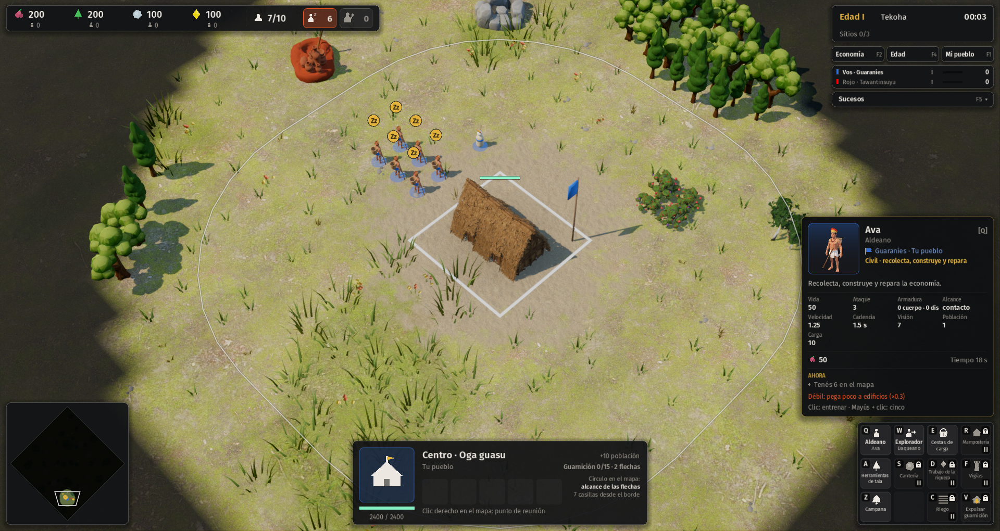
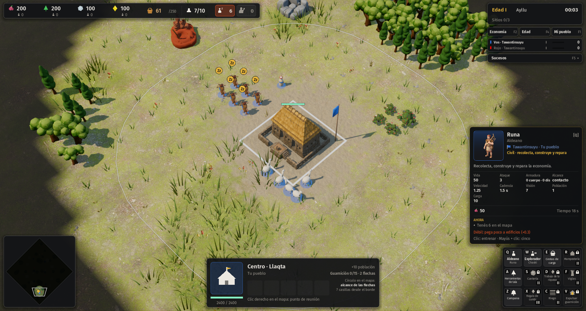
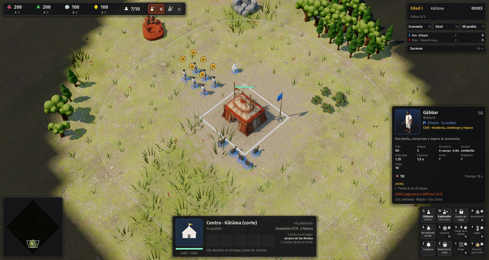
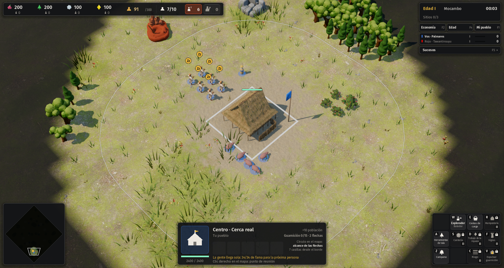
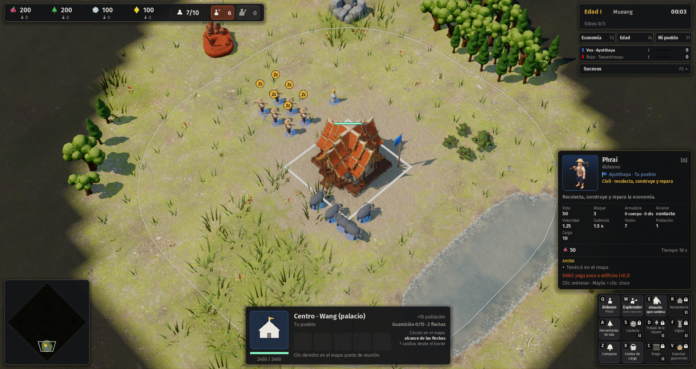
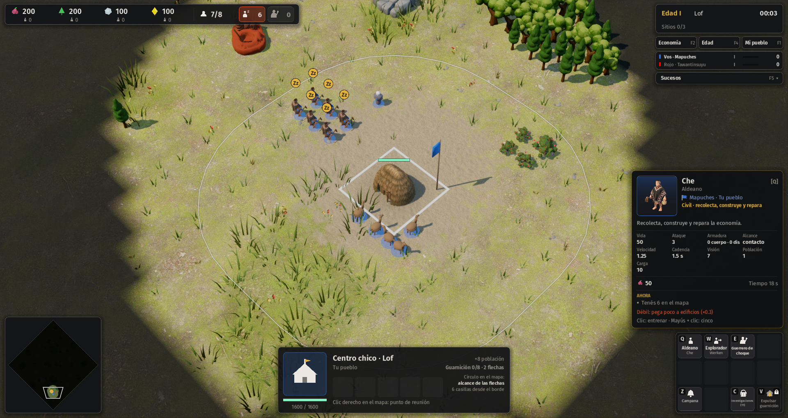
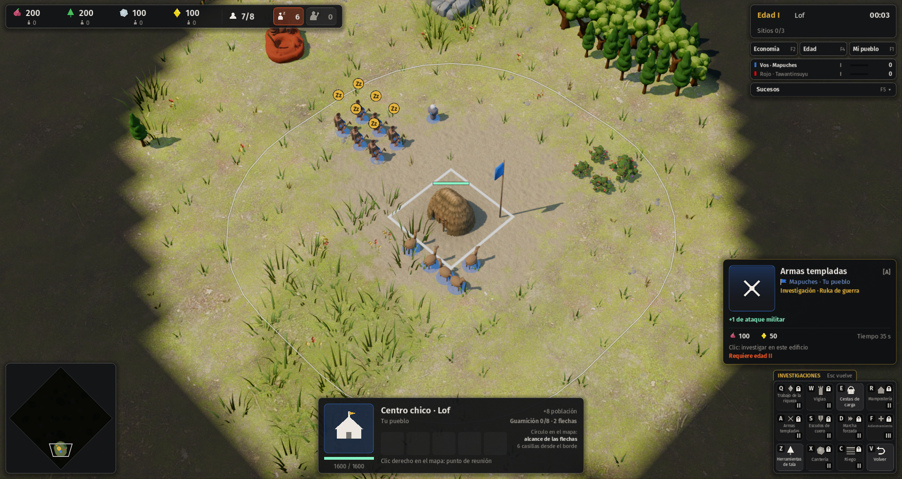
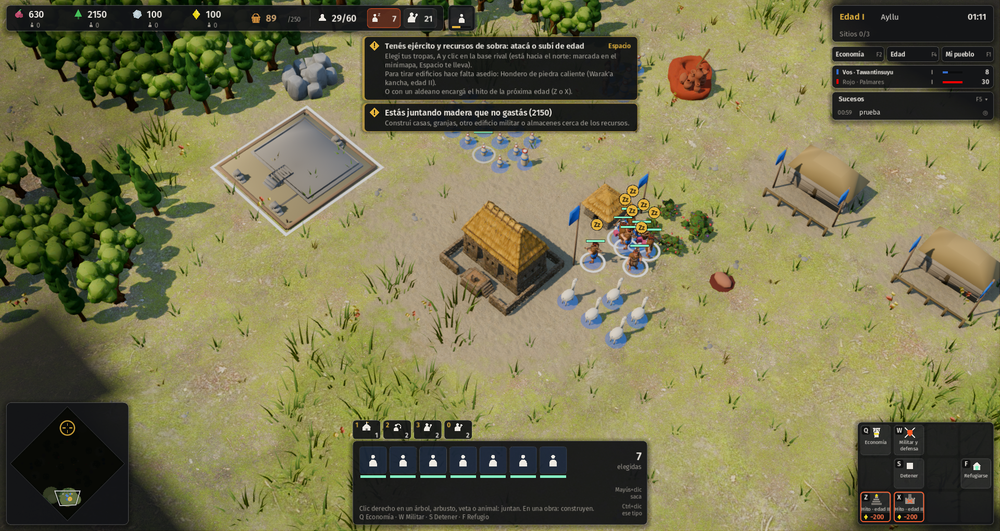

# 4n · Lo que pide el jugador nuevo (cuarta ronda)

## Pedido
Del [informe del jugador nuevo en la cuarta ronda](../22-testers/ronda-4/02-nuevo-en-rts.md), en orden de gravedad:

1. **Grave, todos los pueblos:** en el centro, la casilla Q dice «Herramientas de tala» y no se ven ni el aldeano ni el explorador.
2. La fácil se multiplica cuando la atacan: pasa de 39 a 147 de población.
3. El aviso «A y clic en la base rival» no dice dónde está la base ni que hace falta asedio.
4. El tutorial nunca hace construir una granja, y el principiante se queda sin comida.
5. El cursor sobre un animal propio dice «mover» (el autotest falló así).
6. Media gravedad:
   - nombres de la grilla apagados;
   - panel de aldeanos elegidos vacío;
   - panel de un edificio sin el nombre común;
   - nombres cortados;
   - la ficha tapa el título del submenú;
   - «Barrero» no dice qué guarda.

En paralelo se integró en `main` la ronda 4 del veterano (4o). Esta rama trae `main` y las dos cosas conviven:
- teclas configurables;
- el panel de varias unidades con retratos.

## Qué se hizo

### 1. Una casilla, un comando (grave)

**Causa.** El centro recibe los cuatro recursos, así que `Sim.tech_here` le daba las investigaciones de los almacenes:
- `hachas` en la ranura 0;
- `canteria` en la 1;
- `orfebreria` en la 2.

Esas ranuras son las mismas del aldeano y del explorador. La grilla dibujaba el último comando de cada casilla y la tecla ejecutaba el primero. Además, el centro escondía `cestas` y `riego`, porque se descartaban por ranura y no por cadena. Así, los mapuches no tenían dónde investigarlas.

**Arreglo** (`src/game/controller.gd`, `_ubicar_investigaciones`):
- **Las unidades van primero, en la fila de arriba.** El aldeano está siempre en Q y el explorador en W, en cualquier edificio que los entrene (`data/interfaz.json` → `grilla.unidades_fijas`). Las demás unidades ocupan las casillas libres de Q W E R.
- **Después, los comandos fijos:**
  - campana en Z;
  - cumbi en X (Tawantinsuyu);
  - «Desarmar la corte» en X (antes en F; en Etiopía);
  - kawiñ, gult u oficios en C;
  - guarnición en V.
- **Las investigaciones, al final:**
  - En un almacén usan su `ranura` de `data/tecnologias.json`, como antes.
  - En un edificio que entrena, usan la casilla de `grilla.investigaciones_con_tropa`. En el centro de los seis pueblos quedan así:

    | A | S | D | E | R | F | C |
    |---|---|---|---|---|---|---|
    | tala | cantería | riqueza | cestas | mampostería | vigías | riego |

  - Las mejoras militares se ubican primero y quedan en A S D F, como en el cuartel (también en el mocambo).
  - Si la casilla está ocupada, van a la primera libre. Si no entran todas, van juntas al submenú «Investigaciones», con V o Esc para volver. Pasa en el lof capital mapuche: tres unidades y once investigaciones.
- **Se investiga una por cadena** (`hachas` → `hachas_2`), no una por ranura. El centro ahora también ofrece cestas y riego.
- **Lo que se dibuja es lo que se ejecuta.** `Controller.cmd_at(cmds, casilla)` es el único lugar que resuelve una casilla. Lo usan:
  - el dibujo de la grilla (`hud.gd`);
  - la tecla (`grilla_N` de las teclas configurables);
  - el clic;
  - la ficha;
  - `--ayuda` y `--ficha=cmd:N`.

**Pruebas.**
- **`tests/casillas.gd` (nueva).** Recorre todos los edificios de las seis civilizaciones, en cada edad, con la grilla real (`Controller.commands`): 480 grillas. Falla si:
  - dos comandos caen en la misma casilla o uno queda fuera de la grilla;
  - el aldeano no está en Q o el explorador no está en W;
  - el submenú de investigaciones no tiene Volver o no muestra todas las que anuncia.

  Con `--ver` lista cada grilla. Antes del arreglo fallaba en el centro de cinco pueblos, el lof, el mocambo y el mercado (la venta de alimento y el Oficio maestro compartían A); ahora, en ninguno.
- **El autotest** mira lo que dibujó la grilla del centro (`CommandCard.dibujadas`): «la grilla del centro dibuja «Ava» en Q y «Baqueano» en W», y ninguna casilla repetida.

Los seis centros:

| | |
|---|---|
|  |  |
|  |  |
|  |  |

En Palmares, el centro no entrena aldeanos (la gente llega sola): Q queda libre y el explorador está en W.

### 2. La fácil atacada tiene tope
`reglas.json` → `dificultades.facil.ejercito_max_amenazada: 30`. Es el tope de emergencia cuando le atacan la base; antes no había ninguno (`src/sim/sim_ai.gd`). Con tope, la cuenta incluye lo que está en cola: cada edificio encola hasta dos, y el tope se pasaba por 10. Las otras dificultades no tienen `ejercito_max`, así que no cambian. El hash de `tests/test_determinism.gd` (normal) sigue en 2203695307.

**Herramienta nueva:** `tools/facil_atacada.gd`. Cuatro guerreros quietos en el borde de la base de la fácil (se reponen cuando caen) la dejan «amenazada» sin tirarle nada, como el principiante sin asedio del informe. Resultados en [pruebas/4n-facil_atacada.txt](pruebas/4n-facil_atacada.txt):

| Semilla | Antes: ejército / población máx. | Ahora |
|---|---|---|
| 7 | 54 / 77 (y subiendo) | 35 / 58 |
| 21 | 81 / 104 | 34 / 57 |

Sin amenaza, la fácil se queda ahora en 15 justos (antes llegaba a 18 por la cola).

### 3. El aviso «atacá» dice dónde y con qué

«Elegí tus tropas, A y clic en la base rival (está hacia el norte: marcada en el minimapa, Espacio te lleva). Para tirar edificios hace falta asedio: Ariete (Taller de tacuara, edad II).» (`src/game/ui/consejos.gd`)
- **El rumbo** va hacia la capital rival más cercana. Se mide como se ve en la pantalla y en el minimapa, que giran con la cámara: arriba es el norte. Si ya la vio, dice «la viste».
- **El minimapa** la marca 12 segundos con una mira que late (`Minimap.senalar`), y el aviso guarda el lugar para Espacio.
- **El asedio** se lee de los datos: las unidades de función `asedio` del pueblo, con el edificio que las entrena y la edad, si todavía no se llegó. En Tawantinsuyu es el «Hondero de piedra caliente (Warak'a kancha, edad II)».

El autotest verifica:
- «el aviso dice hacia dónde está la base rival y la marca en el minimapa»;
- «el aviso dice que los edificios caen con asedio».

### 4. Granja en el tutorial
- **Disparador nuevo del motor de escenarios:** `agotado` (`src/sim/sim_scenario.gd`, documentado en `docs/campanas/README.md`). Se dispara cuando quedan `quedan` o menos fuentes de un tipo a `radio` casillas de la capital.
- **El tutorial lo usa con los frutos** (`quedan: 1`, radio 16):
  - objetivo secundario o12: «Se acaban los frutos: construí una granja junto al centro (aldeanos seleccionados: Q abre Economía y W elige la Kokue)…»;
  - un mensaje de la Guía: las tres formas de juntar alimento, y que la granja es la que dura;
  - otro al cumplirlo: una granja por aldeano, y el punto (.) para los ociosos.
- **Es secundario a propósito.** Un objetivo principal oculto que nunca se activa trabaría la victoria.
- **`tests/tutorial_letra.gd`:** el principiante que sigue el texto levanta la granja con un aldeano de los frutos cuando aparece o12. La prueba falla si en modo letra o12 queda sin hacer.

| Modo | Resultado |
|---|---|
| Letra | o12 a las 4:15, hecho a las 4:36; victoria a las 11:01 (antes, 11:10) |
| Indefenso | Victoria a las 14:06 |

### 5. Cursor sobre el animal propio
El cursor usaba `view.hovered` del cuadro anterior, mientras que el clic derecho elegía de nuevo. Además, la unidad más cercana al cursor ganaba, aunque fuera el mismo aldeano elegido que pasaba al lado del animal.

Ahora:
- **El mismo blanco para el cursor y el clic.** Los dos llaman a `pick(punto, para_orden = true)`.
- **Una unidad de la propia selección queda en desventaja:** cuenta como si estuviera media distancia de captura más lejos. Nadie se da una orden a sí mismo.

**Prueba nueva en el autotest:** «con el aldeano pegado al animal (a 32 px), el cursor sigue en juntar». Pone al aldeano a media casilla de la llama y el cursor entre los dos, más cerca del aldeano. Sin el arreglo falla («mover; bajo el cursor: aldeano») y el clic tampoco carnea.

### 6. Media gravedad
- **Nombres en la grilla prendidos la primera vez** (`Opciones.nombres_grilla` y `EstadoCasilla.nombres` en verdadero; también al restablecer). Quien ya guardó sus opciones conserva lo suyo.
- **Panel de varias unidades** (la versión de main, con retratos): abajo, si los retratos dejan lugar, dos renglones de ayuda con las teclas configuradas. Con aldeanos dice «Clic derecho en un árbol, arbusto, veta o animal: juntan…» y «Q Economía · W Militar · S Detener · F Refugio»; con tropas, mover, atacar y grupos ([captura](capturas/4n-aldeanos-elegidos.png)).
- **Panel de un edificio o unidad:** «Centro · Oga guasu», «Centro chico · Lof», «Aldeano · Ava». Usa el mismo `Grilla.comun` que la ficha, y la letra se achica si no entra.
- **Nombres cortados.** Sin nombre común, el nombre se achica hasta entrar entero en sus renglones, sin partir palabras (`EstadoCasilla._fit_lineas`). Si en un solo renglón no entra («Trabajo de la riqueza» con la edad abajo), el glifo se achica y el nombre va en dos renglones arriba de la pastilla.
- **La ficha ya no tapa el título del submenú.** El ancla de la ficha y de la ayuda incluye la pestaña «ECONOMÍA · Esc vuelve» (`Hud.grid_anchor`) ([captura](capturas/4n-submenu-ficha.png)).
- **«Barrero» → «Depósito de piedra y riqueza».** Un almacén se nombra siempre por lo que recibe, aunque coincida con el común (`Grilla.comun`, `interfaz.json` → `comunes_deposito`).

## Pruebas
Todas en `pruebas/4n-*.txt`.

| Prueba | Resultado |
|---|---|
| `tests/casillas.gd` (nueva) | 480 grillas, OK |
| `tests/grilla.gd` | OK |
| Autotest guaraníes | OK (101 chequeos) |
| Autotest Tawantinsuyu | OK |
| `tests/test_determinism.gd` | OK, hash 2203695307, igual que antes |
| `tests/tutorial_letra.gd`, modo letra | Victoria 11:01 |
| `tests/tutorial_letra.gd`, modo indefenso | Victoria 14:06 |
| `tests/campaign_smoke.gd` | Sin errores |
| `tests/civ_smoke.gd` | Sin errores |
| `tests/bench.gd` | 18,9 ms de promedio |
| `tests/test_opciones.gd` | OK |

En el bench, el peor tick fue de 203 ms, con la máquina cargada por el torneo que corría al lado.

## Tropiezos
- **La prueba del animal propio no fallaba al principio.** El aldeano teletransportado seguía dibujado donde estaba, porque el modelo se mueve suave. Hubo que pararlo, esperar 30 cuadros y poner el cursor entre los dos. Recién así fallaba sin el arreglo.
- **El primer sesgo del pick no alcanzaba.** Multiplicar la distancia del elegido por 2 no sirve con el cursor justo encima (0 × 2 = 0). Quedó una suma fija.
- **La primera versión de `tools/facil_atacada.gd` no medía nada.** Mandaba 18 guerreros que arrasaban a la fácil, y daba lo mismo con o sin tope. El caso del informe es un acoso que la deja amenazada sin tirarle nada.
- **En dos corridas falló «cuenta grande de sitios del rival (jugador -1)».** Pasó en corridas del autotest con variantes de prueba (sin el arreglo del cursor). Es de tiempo: la simulación recalcula los sitios cada segundo y pisa el valor de prueba. No tiene que ver con este paso, y las corridas finales pasan.
- **Merge con `main` (4o).** Hubo conflicto en `SelectionPanel._multi`. Quedó la versión de main y la ayuda va encima. El despacho `grilla_N` de las teclas nuevas pasa por `Controller.cmd_at`, y las etiquetas salen de `Controller.etiqueta`.

## Commits
- `ceff3a3`: avance (casillas, tope de la fácil, aviso, granja del tutorial).
- `197c887`: merge de `main` (4o) con el resto del paso: la resolución del conflicto en `_multi`, el despacho de teclas por `cmd_at`, la cola en el tope de la fácil, los nombres compactos, la documentación, las capturas y las pruebas.
- `d272bb3`: merge de `main` (4p, escala; torneo 26), sin conflictos. Después se volvieron a correr `tests/casillas.gd`, los dos autotests y `tests/test_determinism.gd` (mismo hash).
