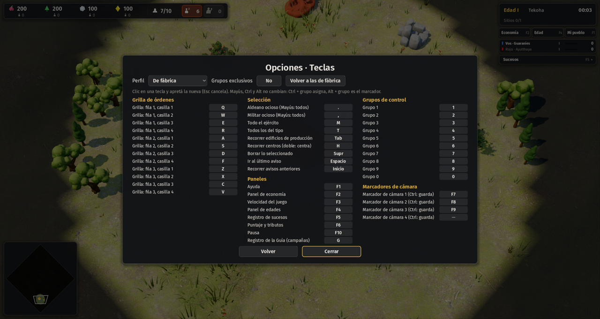
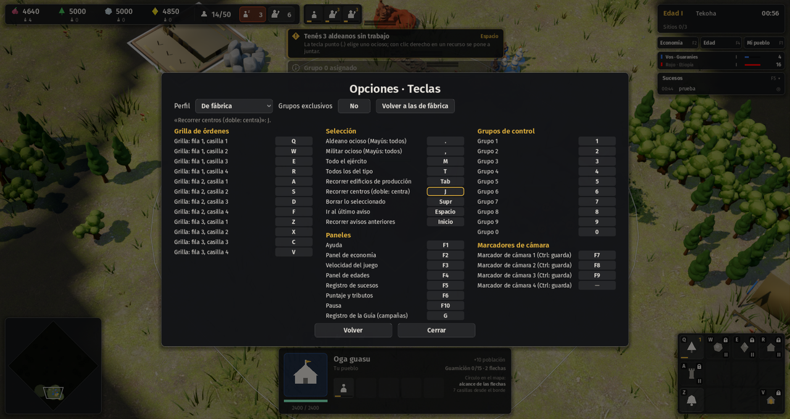
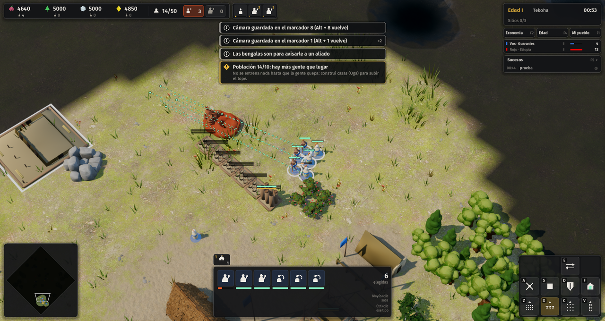
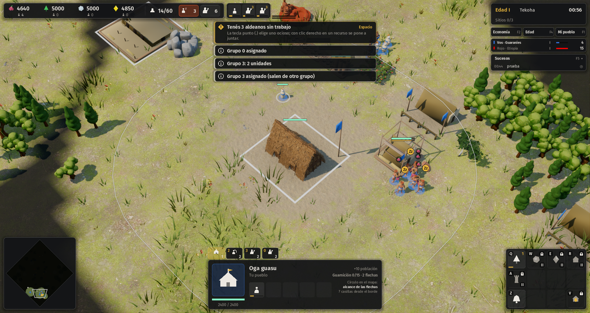
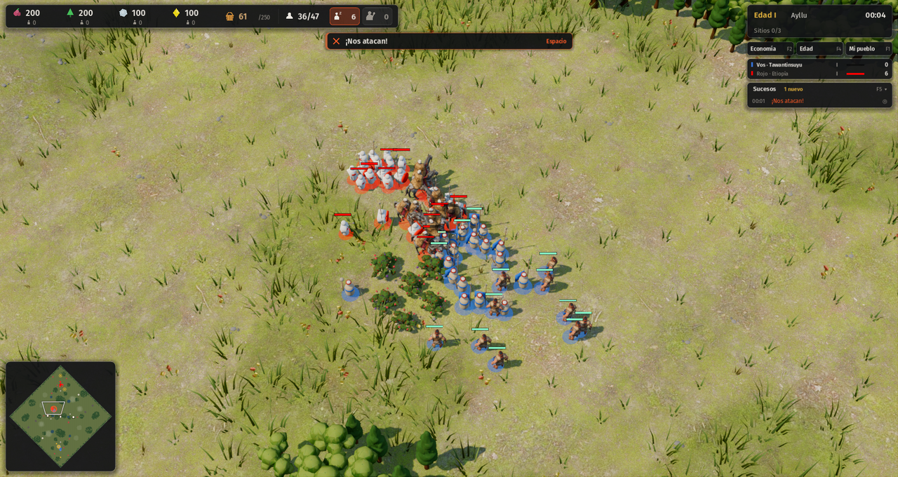

# 4o · Calidad de vida que pide el veterano (cuarta ronda)

## Pedido
Del [informe del veterano de AoE4 en la cuarta ronda](../22-testers/ronda-4/01-veterano-aoe4.md), §2 "Calidad de vida y usabilidad", solo interfaz y controles (`src/game`, `data/interfaz.json`; la simulación no se tocó). En orden de gravedad:

1. Teclas configurables, con perfil AoE4.
2. Producir como AoE4 con varios edificios elegidos.
3. `H` recorre los centros.
4. Panel de varias unidades con vida por unidad, Mayús + clic y Ctrl + clic.
5. `M` y `,` centran la cámara.
6. Grupos de control exclusivos (con opción) y grupo 0.
7. Sin avisos de la IA en `--aivai`.
8. Explicar el círculo del centro.
9. `--demo=batalla` sin `--terreno`, fuera del lago.

En paralelo, otro agente arregla la grilla del centro, el panel de aldeanos vacío, los nombres cortados y la ficha que tapa el submenú. Esas partes no se tocaron. El punto 6 del informe (el cierre con código 134) tampoco: no es de interfaz.

## Qué se hizo

### 1. Teclas configurables

- **Registro de teclas** (`src/game/ui/teclas.gd`, clase `Teclas`). Cada acción tiene una sola tecla. Los modificadores no se reasignan: cambian lo que hace la acción.
  - Mayús en la grilla: entrena 5.
  - Ctrl + grupo: asigna. Mayús + grupo: suma.
  - Alt + grupo: el marcador de ese número; Ctrl + Alt: lo guarda.
  - Ctrl + marcador: guarda la cámara.
- **Los datos** van en `data/interfaz.json` → `teclas`:
  - `acciones`: clave, nombre, sección y tecla de fábrica;
  - `perfiles`: de fábrica y AoE4;
  - `reservadas`: Esc, Mayús, Ctrl, Alt y flechas;
  - `doble_toque_ms`.
  
  Se sacó `ordenes.marcadores_f`: sus valores (F7–F9) son ahora los de fábrica de `marcador_1…3`.
- **Acciones reasignables (43):**
  - las 12 casillas de la grilla;
  - aldeano y militar ocioso, todo el ejército, todos los del tipo, producción (Tab), centros (H), borrar, ir al aviso y recorrer avisos;
  - grupos 1–9 y 0;
  - marcadores 1–4 (el 4 sin tecla de fábrica);
  - ayuda (F1), economía (F2), velocidad (F3), edad (F4), sucesos (F5), puntaje (F6), pausa (F10) y la Guía (G).
- **Quién las lee.** Ya nadie compara con `KEY_…` fijos:
  - `controller.gd` (`_key`) pregunta `Teclas.accion(code)`;
  - `main.gd` (F1, F3, F10), `panel_partida.gd` (F2, F4, F5, F6) y `registro_guia.gd` (G) usan `Teclas.es`;
  - las etiquetas muestran la tecla asignada: grilla, ayuda de la grilla, ficha, "Q Economía → E" de los consejos, cabeceras de los paneles y botones Economía, Edad y Mi pueblo (`Controller.etiqueta(slot)` y `Teclas.texto(accion)`).
- **Opciones → Teclas** (`opciones.gd`, `_panel_teclas`). El botón "Teclas" cambia el contenido de la misma ventana y "Volver" regresa.
  - **Reasignar:** clic en la tecla y apretar la nueva. Esc cancela; las reservadas se rechazan con un aviso.
  - **Choques:** si la tecla nueva ya era de otra acción, **se intercambian** y el renglón de arriba lo dice: "Chocaba con «Todo el ejército», que pasa a H". Si quedara alguna repetida (por un archivo editado a mano), se marca en rojo.
  - **Perfil:** "De fábrica" o "AoE4". AoE4 pone los marcadores en F1–F4 y corre los paneles: economía F5, edad F6, sucesos F7, puntaje F8, ayuda F9 y velocidad F11. También prende los grupos exclusivos.
  - "Volver a las de fábrica" e interruptor "Grupos exclusivos".
- **Guardado:** `user://opciones.cfg`, sección `[teclas]`, por nombre de tecla ("M", "F7", "Period"), más `[controles] grupos_exclusivos`. Como el resto de las opciones, las capturas y el autotest no leen ni escriben el archivo.
- `--abrir=teclas` abre el diálogo en esa vista, para las capturas.

### 2. Producción con varios edificios
`run_command`, caso `train`: cada pulsación entrena **una** unidad en el edificio elegido de **cola más corta**; con Mayús, **5 en total**.

Detalles:
- Lo pedido en el mismo tick se cuenta (`_pendientes`), porque la orden entra recién en el tick siguiente. Así, Mayús + Q con dos cuarteles reparte 3 y 3.
- A igual cola, va al que está más cerca de terminar lo que entrena.
- Se saltean los que tienen la cola llena (`cola_max`).

### 3. H recorre los centros
`atajos.recorrer_centros`:
- cada `H` elige el centro siguiente, con la capital primero;
- un toque solo cambia la selección, para encolar aldeanos sin perder de vista la pelea;
- dos toques seguidos (350 ms, `teclas.doble_toque_ms`) o Mayús + H centran la cámara.

### 4. Panel de varias unidades

`hud.gd`, `SelectionPanel._multi`:
- **Retratos:** hasta 33 unidades, uno por unidad con su barra de vida (verde, o roja por debajo de un tercio). Con 16 o menos, los retratos son más grandes.
- **Con más de 33:** un retrato por tipo, con cantidad y vida sumada, como antes.
- **A la derecha:** cuántas hay y qué hacen los modificadores.
- **Clics** (`_clic_multi`):

| Clic | Sobre una unidad | Sobre un tipo |
|---|---|---|
| Solo | deja esa unidad | deja ese tipo |
| Mayús | la saca | saca el tipo |
| Ctrl | deja ese tipo | deja ese tipo |
| Ctrl + Mayús | saca ese tipo | — |

### 5. M y `,` centran la cámara
- `,` ya centraba.
- `M` ahora también, pero no en el promedio: con el ejército partido en dos, el promedio cae en el medio de la nada. Centra en la unidad elegida más cercana al promedio (`atajos.centrar_en_grueso`).

### 6. Grupos exclusivos y grupo 0
- **Grupos exclusivos** (Opciones → Teclas; de fábrica, apagado; el perfil AoE4 lo prende). Asignar o sumar a un grupo saca a esas unidades de los demás, y el aviso dice "(salen de otro grupo)".
- **Grupo 0:** con su tecla (`0`), su pestaña en la fila de grupos y sin marcador (Alt + 0 no hace nada).

### 7. Sin avisos de la IA en IA contra IA
`hud.gd`: los sucesos `notice` ("Rozas en espera: falta madera…") y `alarm` se filtran con `_local_is_ai()`, como ya se hacía con `notify`.

### 8. El círculo del centro

Es el alcance de las flechas (`mundo_capa._draw_ranges`), medido desde el borde del edificio. Al elegir un centro o una torre, el panel lo dice a la derecha: "Círculo en el mapa: alcance de las flechas · 7 casillas desde el borde". El valor se lee de los datos, con la mejora de alcance. Se puso en el panel de selección y no en la ficha, para no pisar el arreglo paralelo de la ficha.

### 9. `--demo=batalla`, en tierra firme

- **Terreno:** sin `--terreno`, la demo toma el de `interfaz.json` → `demos.terreno.batalla` (llano).
- **Lugar:** el llano también tiene lagunas y bosques. Por eso la pelea va al campo abierto más cercano al centro del mapa: 21 × 13 casillas sin agua y con 6 o menos ocupadas.
- **Cámara:** mira ahí (`demo_cam`).

## Pruebas
- **Autotest** (`godot --path . -- --autotest --civ=guaranies --terreno=llano`): **96 OK, AUTOTEST: OK** ([salida](pruebas/4o-autotest.txt)). Sale con código 134 por la caída al cerrar, que ya existía (punto 6 del informe).

  Chequeos nuevos (`_autotest_veterano4`):

  | Tema | Qué comprueba |
  |---|---|
  | Producción | Dos cuarteles: Q encola uno solo ([1, 0]). Mayús + Q, cinco en total, repartidos ([3, 3]). |
  | Panel de varias | Un retrato por unidad (6 de 6). Mayús + clic saca una. Ctrl + clic deja el tipo. |
  | Cámara | M elige el ejército y centra. `,` centra. |
  | Grupos | Exclusivos: asignar al 3 saca del 2. Sin la opción, una unidad queda en dos. Grupo 0 con Ctrl + 0 y 0. La fila muestra el 0. |
  | Centros | H elige la capital sin mover la cámara; otra H va al centro siguiente; dos seguidas centran; Mayús + H vuelve y centra. |
  | Reasignar | Por el diálogo de verdad (Opciones → Teclas, clic en H, apretar J): J elige el centro y H ya no. |
- **`tests/test_opciones.gd`:** OK ([salida](pruebas/4o-test_opciones.txt)). Comprueba:
  - las de fábrica, sin choques;
  - asignar e intercambiar;
  - volver a las de fábrica;
  - guardar y recuperar las teclas y los grupos exclusivos, por nombre en el archivo;
  - perfil AoE4 (F1–F4, paneles con tecla, sin choques, grupos exclusivos);
  - teclas reservadas.
- **Otras pruebas que pasan:** `tests/grilla.gd`, `tests/grupos.gd`, `tests/ordenes.gd` y `tests/tutorial_letra.gd`.

## Tropiezos
- La Mayús del autotest. La grilla lee `Input.is_key_pressed(KEY_SHIFT)` y no la marca del evento. Hizo falta inyectar la tecla Mayús de verdad (`_key_shift`) para probar Mayús + Q y Mayús + H.
- El primer intento de sacar la demo del lago solo miraba el agua. La pelea quedó en el bosque, sobre el sitio sagrado del centro. Ahora también cuenta las casillas ocupadas.

## Pendiente
- Los textos largos de ayuda (`hud.gd` "Controles" y `panel_pueblo.gd`) siguen nombrando las teclas de fábrica. Avisan que se cambian en Opciones → Teclas, pero no las leen una por una.
- El diálogo de teclas no tiene la elección "grilla / clásico" que mencionó el veterano. Hoy hay solo dos perfiles: de fábrica y AoE4.
