# 4p · Escala: gente más chica, edificios y árboles más altos

## Pedido
El autor: "AoE4 tiene una sensación de realidad muy buena basada en el tamaño de las cosas; creo que estamos muy lejos". Se hace el **paso 1** del [análisis de escala del veterano](../22-testers/ronda-4/03-escala-veterano.md), que es **solo vista**:

- la gente al 60 % y los soldados de maqueta al alto del aldeano;
- un alto mínimo por tipo de edificio. En las maquetas se suben muros y techos, en vez de estirar todo;
- el centro más ancho dentro de su huella;
- árboles ×1,5 y pasto ×0,6, y que el bosque no tape a la gente;
- animales en proporción con la persona nueva;
- zoom por defecto 28.

Se mantienen el margen de 0,3 casillas en la huella y el aspecto por edad (`data/arte_edades.json`).

No se tocó `src/sim`, ni `tam`, ni `velocidad_pct`. El hash de `tests/test_determinism.gd` no cambia: **2203695307**, igual que en [5b](README.md).

## Primero: cómo se mide (y un error del informe)
El script del veterano quedó en el repositorio como **`tools/escala.gd`**, con dos cambios:

- **El alto del cuerpo.** El veterano medía la caja entera del edificio, y la caja incluye los estandartes de las esquinas (de 2 a 2,4 casillas). Por eso le daba "casa = 2 personas" y "cuartel = 2 personas": medía el mástil. Ahora se tiran 9×9 rayos verticales sobre el 64 % central de la planta, y se toma el punto más alto que tocan. Con eso, **la casa medía 0,8 personas y el cuartel 1,2**. El problema era más grande de lo que decía el informe.
- **La tabla en personas.** Al final imprime casa, cuartel, centro (alto y ancho), hitos (mínimo, máximo y mediana) y torre de cada pueblo, más el árbol medio, en alturas de una persona (`godot --headless --path . -s tools/escala.gd`). También mide todas las especies de animales.

Salidas completas: [antes](pruebas/4p-escala-antes.txt) y [después](pruebas/4p-escala-despues.txt).

## Resultado: proporciones en alturas de persona

Promedio de los seis pueblos; entre paréntesis, el rango. Alto del cuerpo, sin estandartes.

| Proporción | Antes | Después | AoE4 (de memoria) [verificar] |
|---|---|---|---|
| Persona, en casillas | 1,02 | **0,75** | — |
| Soldado de maqueta / aldeano | 0,74 (lancero 1,46 con la lanza) | **1,0** (lancero 2,0 con la lanza; tocados hasta 1,3) | 1,0–1,1 |
| Casa | 0,8 (0,4–1,2) | **1,9** (1,3–2,2) | 2,5–3 |
| Cuartel | 1,2 (1,0–1,4) | **2,7** (2,5–3,1) | 3–4 |
| Centro | 2,1 (1,3–3,0) | **3,4** (2,3–4,3) | 5–7 |
| Ancho del centro | 3,1 | **4,2** | 7–9 |
| Hitos (mediana de cada pueblo) | 2,4 (1,3–2,7) | **5,6** (3,3–6,2) | 6–12 |
| Torre (inca y etíope) | 3,9 | **6,0** | 5–7 |
| Árbol medio | 2,0 | **4,0** | 4–6 |
| Llama / búfalo / cabra | 0,99 / 0,64 / 0,59 | **0,88 / 0,85 / 0,50** | — |

Por pueblo, después:

| Pueblo | Casa | Cuartel | Centro | Ancho del centro | Hitos (mín–máx, mediana) | Torre |
|---|---|---|---|---|---|---|
| tawantinsuyu | 2,1 | 3,1 | 4,0 | 4,3 | 2,8–6,4, 5,8 | 6,0 |
| mapuches | 1,3 | 2,5 | 2,3 | 3,0 | 0,6–6,4, 5,0 | - |
| guaraníes | 2,0 | 2,5 | 3,3 | 4,3 | 3,1–6,3, 5,6 | - |
| etiopía | 2,2 | 2,6 | 2,7 | 4,5 | 2,0–6,4, 6,2 | 6,0 |
| palmares | 2,0 | 2,5 | 3,8 | 4,3 | 3,4–7,0, 5,9 | - |
| ayutthaya | 2,0 | 3,1 | 4,3 | 4,6 | 1,2–5,7, 3,3 | 3,6 |

**Lo que falta:**

- **Centro y su ancho.** Con huella de 4×4 y margen de 0,3, el cuerpo no pasa de 3,4 casillas. Los centros son modelos generados, y no conviene estirarlos más de ×1,9. Para llegar a 5–7 personas de alto y 7–9 de ancho hace falta el **paso 3** del informe (huella de 5×5), que toca la simulación.
- **Casa mapuche y lof.** El modelo es un domo bajo y llega al tope de estiramiento: queda en 1,3 personas la ruka y 2,3 el lof.
- **Ayutthaya.** La mediana de sus hitos es baja porque el junco y el puerto están topados a propósito (ver abajo), y el rayo central del puerto cae en el agua del muelle.
- **Mínimo de los hitos mapuches (0,6).** Es el weichan: un anillo de lanzas con el centro vacío. El rayo del centro no toca nada, pero se ve alto.

## Paso a paso

### 1. Gente (`data/reglas.json → escala_visual.unidad_pct`, `WorldView`)
- `unidad_pct` de 82 a **60**: la persona mide 0,75 casillas (1 casilla ≈ 2,3 m).
- **Maquetas al alto del aldeano.** La persona de maqueta (`CivMeshes._person`) tiene la cabeza a 0,92, y la generada mide `FIGURE_H` = 1,25. La maqueta se escala por 1,25 / 0,92 (`WorldView.MAQUETA_H`): el cuerpo mide lo mismo que el aldeano y la lanza sobresale (2 personas). Con los jinetes de maqueta pasa lo mismo, y el caballo queda a la altura de la cadera. El elefante, la corte móvil y los animales no cambian.
- La escala de cada unidad queda en el visual (`v["k"]`), porque `_render_unit` la vuelve a poner en cada cuadro.

### 2. Edificios: subir muros y techos, no estirar todo (`Meshes.levante` y `Meshes.levantar`)
- **Alto mínimo del cuerpo**, sin estandartes (`altura_min_cm`): casa 190, producción 240, capital 380, hito 480 y torre 450. Son más bajos que los que proponía el informe (270/330/480/560/520) porque aquellos se medían con el mástil.
- **En las maquetas** (`CivMeshes.building`, `HitosMeshes`), antes de unir las partes:
  - hasta el **zócalo** (`zocalo_cm` = 40) nada cambia: puertas, cercos, pilas, postes del frente;
  - de ahí a la mitad del cuerpo (los muros) se estira por `kw`;
  - de la mitad para arriba (los techos) se estira por `kr`, que se lleva solo el 55 % del estiramiento extra (`techo_pct`). Así los techos no quedan de aguja;
  - cada parte se estira entera según su tramo, sin quiebres;
  - los **estandartes, la gente y los animales** de los hitos se marcan como fijos (`Meshes.FIJO`): suben con su base y no se estiran;
  - `kw` no pasa de `estirar_max_pct` (230).
- **El estiramiento se calcula con el cuerpo de la edad I** (`CivMeshes.alto_cuerpo`), así lo que crece con la edad (`alto_pct`, `pisos_techo`) se conserva.
- **Los modelos generados** (casas y centros) se siguen estirando parejo, hasta `estirar_modelo_max_pct` (190). El estandarte ya no entra en la medida ni se estira con el modelo. Antes medía 2,4 y era más alto que la casa, así que **la casa generada nunca se estiraba**.
- **Corrección:** la categoría "producción" buscaba la clave `entrena`, que no existe (es `produce`). Los cuarteles, establos y campos de tiro no se estiraban nunca.
- **Hitos chatos o abiertos** con tope propio (`data/arte_hitos.json → levantar_max_pct`):

  | Hito | Tope |
  |---|---|
  | Ushnu | 140, para que no vuelva a ser la pirámide de la ronda 3 ([4i](4i-arte-ronda-3.md)) |
  | Casa del karai | 170 |
  | Junco | 130 |
  | Puerto | 150 |
  | Trinchera | 140 |
  | Remonta | 150 |
  | Cerca en anillos | 150 |
  | Weichan | 150 |
  | Corral de caballos | 150 |

- **Torres bajas** (`torres_bajas`): siguen sin levantarse.
- **Vista previa al colocar:** `building_mesh_for` levanta la maqueta por su cuenta si no le pasan cómo, así que la vista previa de `controller.gd` mide lo mismo que el edificio, sin tocar ese archivo ([captura](capturas/4p-colocar.png)).

### 3. Centro y cuartel más anchos (`CivMeshes._center`, `_barracks`)
- **Centro de maqueta.** La casa principal ocupa casi todo el ancho útil (78 % de la huella, dentro del margen) y va contra el fondo. Las dos casas chicas quedan adelante. Antes ocupaba el 55 %.
- **Galpón del cuartel.** Pasa de 45 a 52 % de hondo, para que al subirlo no quede una lámina.
- **Centros generados.** Ya usaban el cuerpo entero (huella menos el margen de 0,3, por la `escala_pct` de la edad). Se ven más anchos porque la persona es más chica: 4,2 personas contra 3,1.

### 4. Árboles, pasto y el bosque que tapa (`_make_mm`, `_build_clutter`, `shaders/silueta.gdshader`)
- **Árboles:** ×1,5 de alto y ×1,25 de ancho (`arbol_alto_pct`, `arbol_ancho_pct`). Con ×1,5 de ancho las copas de un bosque de un árbol por casilla se volvían una masa. El árbol medio mide 3 casillas, 4 personas.
- **Pasto decorativo:** ×0,6 (`pasto_pct`). Ya no llega a la cintura.
- **Silueta de la gente tapada.** Con árboles de 4 personas, la tropa que pasa detrás de un bosque desaparecía: solo se veían los discos ([captura](capturas/4p-bosque.png), a la izquierda). Se resolvió como en AoE4:
  - cada unidad lleva un `material_overlay` que compara su profundidad con la de la escena;
  - donde algo opaco está más de 0,35 casillas por delante (un árbol, un edificio), pinta la unidad del color del equipo, semitransparente;
  - donde se ve, no pinta nada.

  Con 200 aldeanos (`--demo=multitud`) los cuadros por segundo no cambian (28–37 con y sin silueta, con la máquina cargada por un torneo).

### 5. Animales (`data/arte_animales.json → escala_pct`)
En proporción con la persona, un poco más grandes que lo real para que se lean:

| Animal | Alto en personas |
|---|---|
| Llama | 0,88: una persona baja |
| Chilihueque | 0,80 |
| Guanaco | 0,90 |
| Búfalo | 0,85, y 1,4 de largo |
| Vaca | 0,78, y 1,3 de largo |
| Cabra | 0,50 |
| Cerdo | 0,41 |
| Venado | 0,85 |
| Tapir | 0,65, y 1,0 de largo |

La caza y los animales sueltos se dibujaban sin la escala de la gente. Ahora la toman (`WorldView._res_k`), y si no los venados quedaban más altos que el aldeano.

### 6. Cámara (`RtsCamera.zoom`)
De 32 a **28**. El aldeano de 0,75 casillas queda en unos 33 px a 1080p, cerca de lo que el veterano estima para AoE4. La base se ve más cerca, y los edificios y los árboles ocupan más pantalla.

### 7. Demo nueva: `--demo=bosque`
Ocho aldeanos talan el borde lejano del bosque más cercano a la base, el que mira hacia el lado contrario a la cámara. Nueve soldados pasan por detrás. Sirve para revisar la lectura entre árboles: `godot --path . -- --demo=bosque --civ=guaranies --terreno=llano --seed=21 --nofog --shot=x.png --shot-at=5`.

## Capturas (antes a la izquierda, después a la derecha)

| | |
|---|---|
| 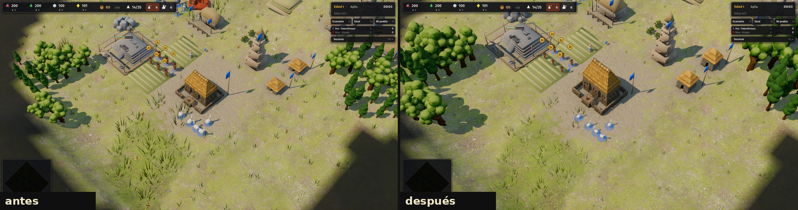 | 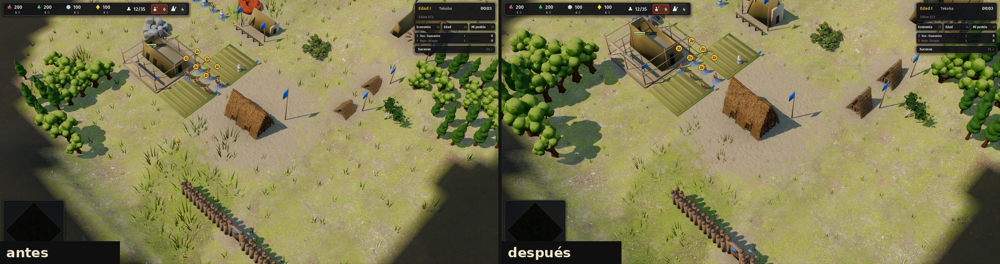 |
| 1. Base inca al zoom por defecto (32 antes, 28 después). La llaqta y la kancha se estiran, el ushnu en obra y la pukara crecen, las llamas quedan a la altura de una persona baja | 2. Base guaraní. La oga guasu (centro) domina. Las casas, estiradas ×1,9, quedan como un A empinado (ver riesgos) |
| 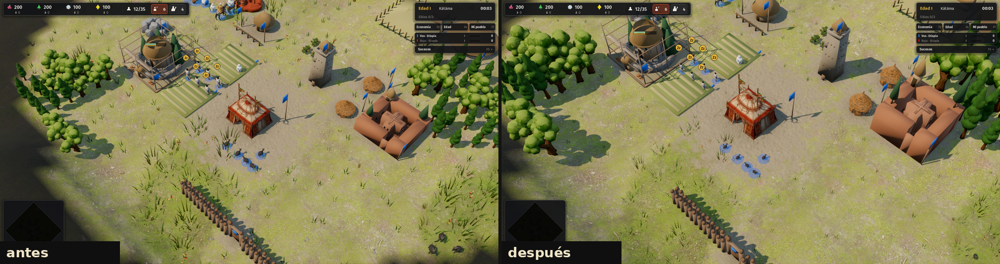 | 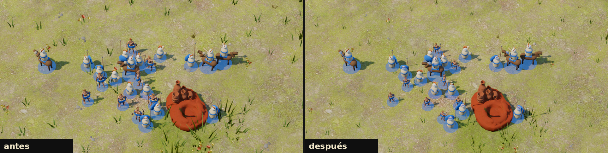 |
| 3. Base etíope. El hito, la torre de la amba y los tukules, más altos; las cabras, más chicas | 4. Tropa de 24 guaraníes (misma cámara). Los guerreros miden lo mismo que el arquero generado y las lanzas sobresalen |
| 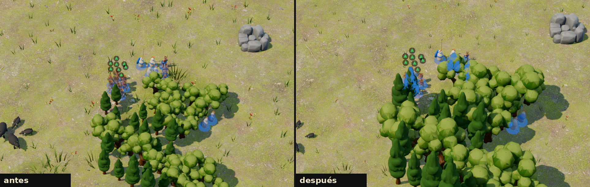 | 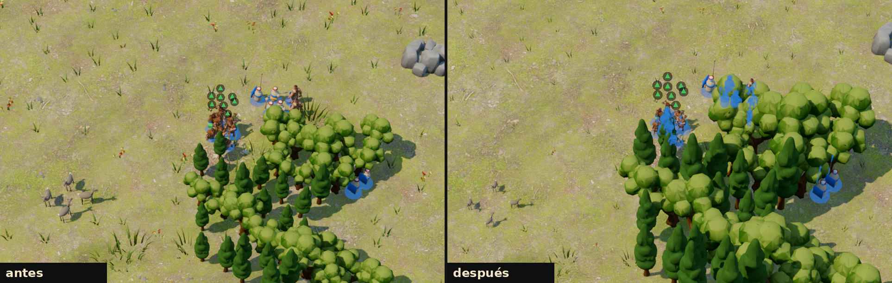 |
| 5. Bosque con aldeanos y una tropa detrás. Antes, la gente se perdía entre árboles bajos; después, los árboles miden 4 personas y lo que queda tapado se ve como silueta azul | 6. Lo mismo con los incas |
| 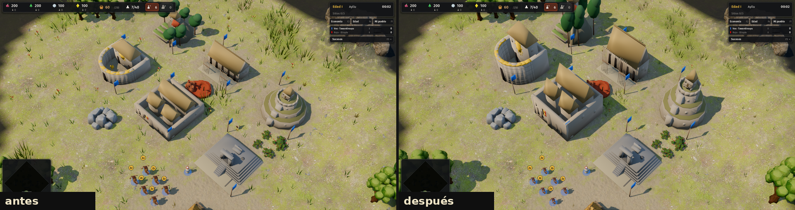 | 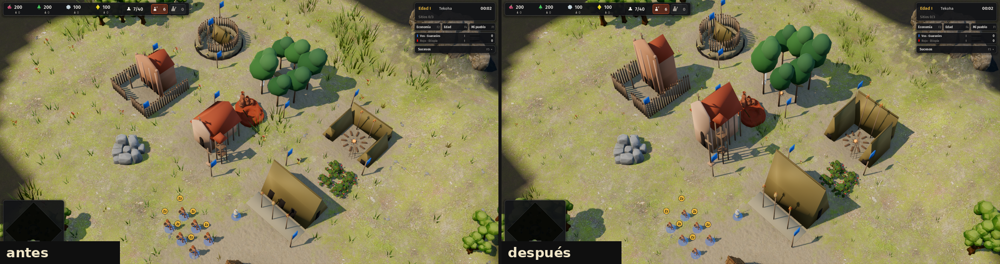 |
| 7. Hitos incas (misma cámara). Suben los muros del aqllawasi, la kallanka y el Qorikancha; el ushnu, topado, sigue siendo una plataforma | 8. Hitos guaraníes. Todos crecen; la casa del karai (abajo), topada a ×1,7, sigue siendo una casa larga de techo hasta el suelo |
| 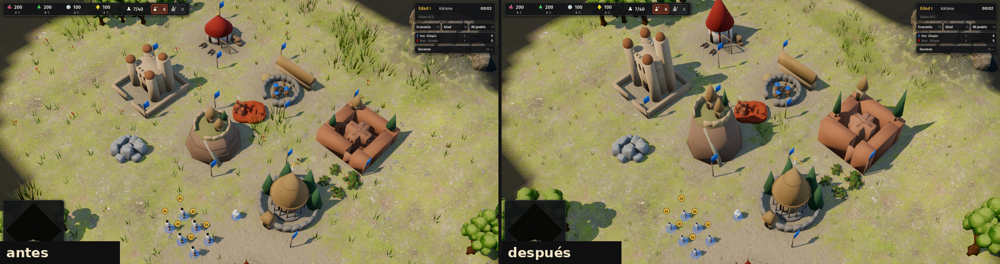 | 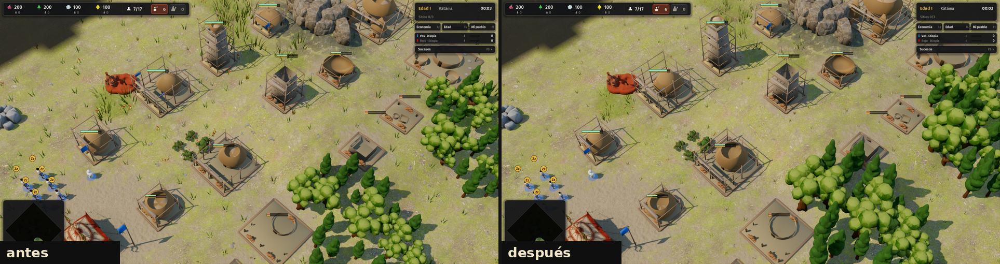 |
| 9. Hitos etíopes. Los seis pasan a ser lo más alto de la base | 10. Obras en tres etapas. La obra se corta sobre la maqueta ya levantada, con el andamio a su altura |
| 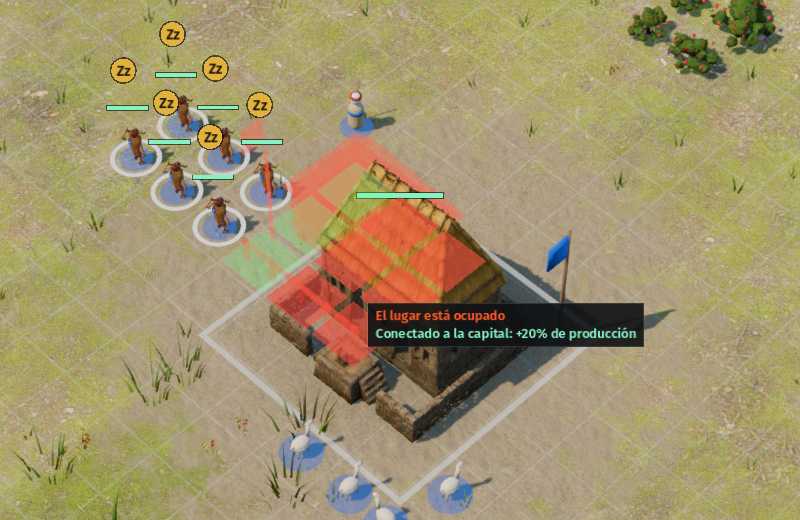 | |
| 11. La vista previa de un cuartel al colocarlo, ya levantada | |

## Pruebas
- `tests/test_determinism.gd`: OK, hash **2203695307**, sin cambios ([salida](pruebas/4p-test_determinism.txt)).
- Autotest (`--autotest --civ=guaranies --terreno=llano`): OK, 78 pasos. Incluye la selección por arrastre, el clic derecho sobre un animal propio y los atajos de selección ([salida](pruebas/4p-autotest.txt)).
- **Clics sobre unidades más chicas:** `Controller.pick` busca la unidad más cercana en pantalla dentro de 26 × 40 / zoom píxeles (37 px con el zoom nuevo), apuntando a 0,45 de alto. La persona mide ahora 0,75, con el medio a 0,37: el punto queda dentro del cuerpo. No hizo falta tocarlo.
- `tools/escala.gd`, antes y después (arriba).

## Riesgos y pendientes
- **Velocidad.** Es el paso 2 del informe, que va solo. El aldeano camina igual en casillas, pero con la persona a 0,75 son **1,5 personas por segundo** (antes 1,1): se va a ver corriendo. Va a la simulación con un torneo: `velocidad_pct` de 90 a 72, o decidirlo con el autor a ×1.
- **Huellas** (paso 3: centro y hitos en 5×5). Sin eso, el centro no llega al alto ni al ancho de AoE4.
- **Casas generadas estiradas ×1,9.** La guaraní y la palmarista se ven como un A empinado. Si molesta, bajar `estirar_modelo_max_pct` a 160–170 (las casas quedan en 1,6–1,8 personas) o regenerar los modelos más altos en Meshy.
- **Siluetas.** También se ven a través de un cerro o de otra unidad, como en AoE4. Si molestan sobre el relieve, se puede subir `margen` en `silueta.gdshader`.
- **Números de AoE4.** Siguen de memoria [verificar]. El método para medirlos está en la sección 6 del informe del veterano. `tools/escala.gd` da la columna nuestra.

## Commits
- Escala (paso 4p): gente al 60 %, edificios levantados, árboles, animales, siluetas y zoom 28.
