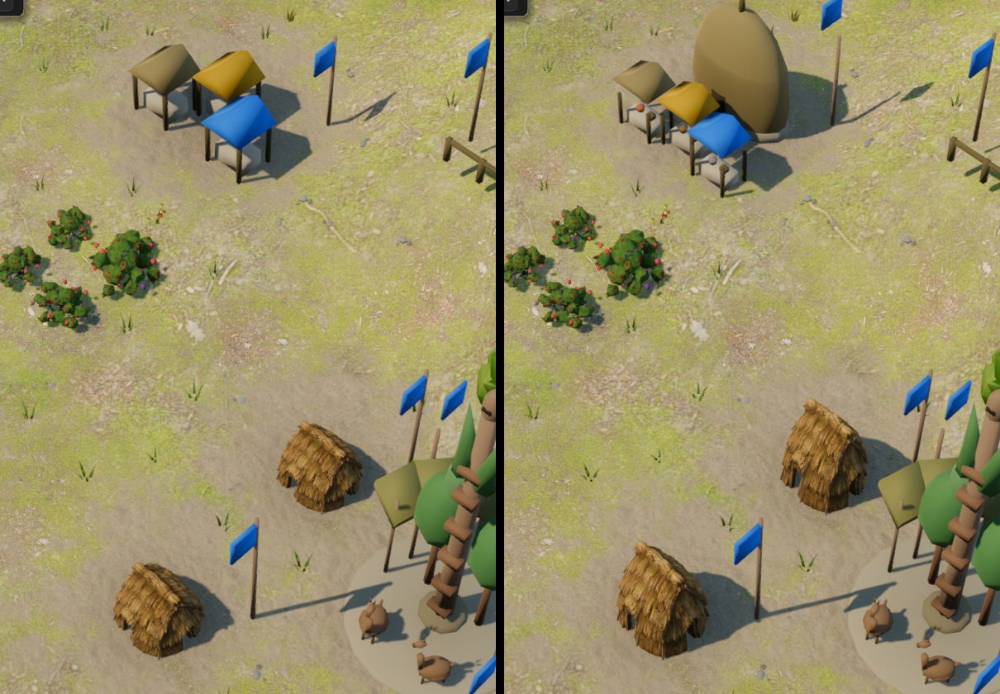
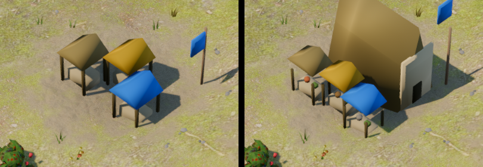
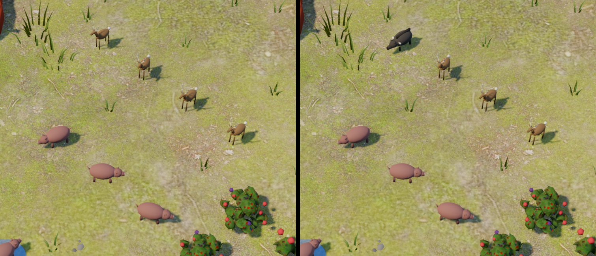
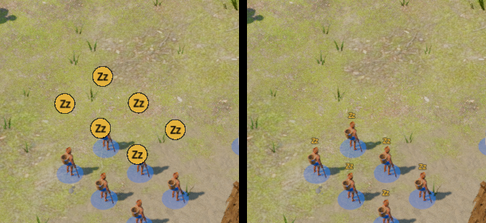
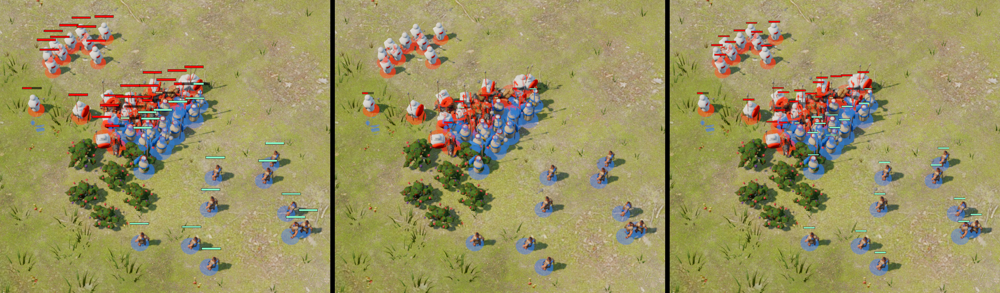
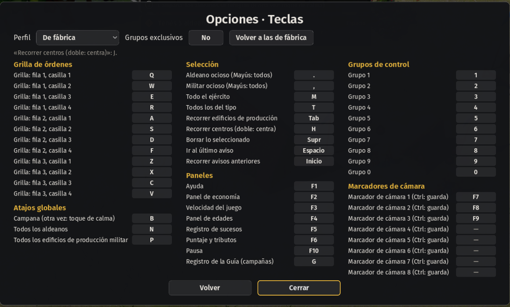

# 4r · Veterano, quinta ronda: lo que es solo vista o interfaz

## Pedido
Del [informe del veterano de la quinta ronda](../22-testers/ronda-5/01-veterano-aoe4.md), las partes que no tocan la simulación:

1. **Escala:**
   - estirar el mercado (1,5 personas) y la ruka mapuche (1,3) a la regla de su tipo;
   - el venado de Palmares de 0,35 a unas 0,8 personas;
   - que ninguna casa quede por debajo de ~1,8 personas ni ningún edificio de producción por debajo de ~2,4.
2. **El «Zz» de ocioso** más chico que la cabeza del aldeano.
3. **Barras de vida** más finas, o solo con daño en batalla, con opción para verlas siempre.
4. **Atajos globales** reasignables: la campana, todos los aldeanos y todos los edificios de producción, con teclas de fábrica que no choquen.
5. **Los 8 marcadores en la lista de teclas.**

Afuera, por pedido: `src/sim`, `tam` y `velocidad_pct` (la velocidad, C-65, y el centro de 5×5, C-66, van a consulta). Las otras partes del informe las hace otro agente en paralelo: el aviso de la pelea en `consejos.gd`, la hoja de atajos, «Hito · edad II» cortado, que el tapyi, el campo de tiro y el cuartel se distingan, y la IA fácil.

El hash de `tests/test_determinism.gd` no cambia: **2203695307**.

## Paso a paso

### 1. Escala
Medido con `tools/escala.gd`: alto del cuerpo, sin estandartes, en alturas de una persona. Salidas completas: [antes](pruebas/4r-escala-antes.txt) y [después](pruebas/4r-escala-despues.txt).

**Mercado** (`CivMeshes._market`):
- Antes eran tres puestos de 1,1 casillas, sin categoría en `altura_min_cm`: no se levantaba nunca.
- Ahora tiene un galpón de feria al fondo, con la forma de casa de cada pueblo (domo mapuche, casa larga guaraní, kancha inca…), y los tres puestos adelante.
- Los puestos, la mercadería y el estandarte van marcados `Meshes.FIJO`: quedan a la escala de la gente. Solo se levanta el galpón.
- Categoría nueva **`mercado`: 240 cm** en `reglas.json → escala_visual.altura_min_cm`, la misma que la producción. `WorldView._want_h_of` la reconoce por `def.mercado`.

**Ruka mapuche:**
- Es un modelo generado (`mapuches_casa`), un domo bajo, y se estiraba parejo hasta el tope general de 190 %.
- Nuevo `escala_visual.estirar_modelo_max_por_modelo`: un tope propio por nombre de modelo. La ruka queda en **290**, y `WorldView._stretch_k` lo lee.
- El domo pasa de 0,95 a 1,49 casillas: de 1,3 a **2,0 personas**. Al subir, el domo se vuelve una bóveda alta y sigue leyéndose como ruka (captura 1).

**Caza de Palmares** (`data/arte_animales.json`):
- El «venado de 0,35 personas» del veterano no era un venado: era el **pecarí**. Palmares caza `["venado", "pecari"]`, y el venado ya medía 0,85.
- Un pecarí de 0,8 personas sería un jabalí del tamaño de una vaca. Se hicieron dos cosas:
  - `caza_por_civ.palmares` pasa a `["venado", "venado", "pecari"]`: dos de cada tres presas son venados (0,85 personas);
  - el pecarí sube de `escala_pct` 88 a **105**: de 0,35 a **0,42 personas**, a la par del cerdo (0,41). Se lee como un chancho de monte y no como un perro.
- La nota de `caza_por_civ` explica que repetir una especie la hace salir más seguido.

**`tools/escala.gd`:**
- Para cada pueblo imprime la caza, especie por especie, con su frecuencia.
- La tabla suma dos columnas: el edificio de producción más bajo (sin el centro, los hitos ni el corral mapuche, que es un cerco transitable) y el mercado.
- Al final, una línea con lo que queda por debajo de la regla.

| Pueblo | Casa | Cuartel | Producción, el más bajo | Mercado (antes → ahora) | Centro | Ancho del centro | Hitos (mín–máx, mediana) | Torre |
|---|---|---|---|---|---|---|---|---|
| tawantinsuyu | 2,1 | 3,1 | 3,1 (campo de tiro) | 1,5 → **3,2** | 4,0 | 4,3 | 2,8–6,4, 5,8 | 6,0 |
| mapuches | 1,3 → **2,0** | 2,5 | 2,5 (cuartel) | 1,5 → **3,1** | 2,3 | 3,0 | 0,6–6,4, 5,0 | - |
| guaraníes | 2,0 | 2,5 | 2,5 (taller) | 1,5 → **2,9** | 3,3 | 4,3 | 3,1–6,3, 5,6 | - |
| etiopía | 2,2 | 2,6 | 2,6 (establo) | 1,5 → **3,2** | 2,7 | 4,5 | 2,0–6,4, 6,2 | 6,0 |
| palmares | 2,0 | 2,5 | 2,5 (cuartel) | 1,5 → **2,6** | 3,8 | 4,3 | 3,4–7,0, 5,9 | - |
| ayutthaya | 2,0 | 3,1 | 3,1 (campo de tiro) | 1,5 → **2,8** | 4,3 | 4,6 | 1,2–5,7, 3,3 | 3,6 |

`Por debajo de la regla (casa 1,8 · producción y mercado 2,4): ninguno`.

Lo que sigue bajo no entra en este pedido:
- el centro (alto y ancho) necesita la huella de 5×5 (C-66);
- el mínimo de los hitos mapuches es el weichan, un anillo abierto;
- en Ayutthaya, el junco y el puerto tienen un tope a propósito ([4p](4p-escala.md)).

### 2. El «Zz» de ocioso (`MundoCapa._draw_icons`, `interfaz.json → mundo.ocioso`)
- **Antes:** un disco dorado de 25 px a zoom 28, 1,75 casillas sobre el suelo. La persona mide 0,75 casillas, así que el disco flotaba lejos y se confundía de dueño.
- **Ahora:** un «Zz» dorado con contorno oscuro, sin disco, de unos 10 px (`letra_px` 7 a zoom 40), apenas sobre la cabeza (`FIGURE_H × unidad_pct + 0,14`). Es del tamaño de la cabeza y queda pegado a su aldeano (captura 4).
- Los íconos de trabajo (recurso, martillo) no cambian.

### 3. Barras de vida (`Overlay`, `interfaz.json → mundo.barra_unidad`, Opciones)
- **Finas:**
  - antes, la barra de una unidad medía 43 × 4 px (más 1 px de borde) a zoom 28;
  - ahora mide **25 × 3 px**, con borde más transparente, y deja de crecer al acercar la cámara (`tope_zoom`);
  - las de los edificios no cambian.
- **Sobre la cabeza:**
  - la barra va justo sobre la cabeza y no a 1,2 casillas. Era el doble del alto de la persona y tapaba a la fila de atrás;
  - los montados y los elefantes la llevan sobre su figura entera. Se mide una vez por unidad (`Overlay._alto_barra`).
- **Solo con daño, como AoE4:**
  - por defecto se ve la barra de lo elegido, lo que está bajo el mouse, lo dañado y las obras;
  - la de las unidades sanas que pelean ([4k](4k-veterano-ronda-3.md), punto 6) pasa a ser opcional: **Opciones → «Barras de las tropas sanas al pelear»** (`Opciones.barras_pelea`, apagada de fábrica);
  - «Barras de vida siempre visibles» y Alt mantenido siguen igual. La regla quedó en `Overlay.barra_visible`.
- Captura 5: la misma batalla (`--seed=7`), antes, ahora y ahora con «siempre visibles».

### 4. Atajos globales (`data/interfaz.json → teclas`, `Atajos`, `Controller._key`)
Sección nueva **«Atajos globales»** en Opciones → Teclas:

| Acción | Tecla de fábrica | Qué hace |
|---|---|---|
| `campana` | **B** | Toca la campana sin elegir el centro; otra vez, toque de calma (`Atajos.campana`). Sin centro, avisa |
| `todos_aldeanos` | **N** | Elige todos los aldeanos propios, trabajen o no (`Atajos.todos_aldeanos`) |
| `produccion_todos` | **P** | Elige todos los edificios terminados que entrenan tropa, sin los centros (`Atajos.todos_produccion`). Con eso, la grilla encola en el de cola más corta y Mayús reparte cinco, como ya hacía con varios cuarteles |

- **B, N y P** no las usa ninguna otra acción ni el perfil AoE4, ni la grilla (QWER/ASDF/ZXCV). La J tampoco se tocó, porque el autotest la usa para reasignar.
- **Archivo de opciones de antes:** si el jugador ya había puesto la B en otra acción, la campana queda sin tecla en vez de robársela (`Teclas.cargar`).

### 5. Los ocho marcadores
- `marcador_5` a `marcador_8` entran en la lista, sin tecla de fábrica. Alt + 1…8 y Ctrl + Alt + 1…8 siguen valiendo siempre.
- Las columnas se reparten de nuevo para que entre todo (captura 6):
  - grilla y atajos globales;
  - selección y paneles;
  - grupos y los ocho marcadores.

### Demo
`--demo=base` coloca también un mercado, para revisar su escala: `godot --path . -- --demo=base --civ=mapuches --terreno=llano --seed=21 --nofog --cam=b0,b10,22 --shot=x.png --shot-at=3`.

## Pruebas
| Prueba | Resultado |
|---|---|
| `godot --path . -- --autotest --civ=guaranies --terreno=llano` | **AUTOTEST: OK**, 108 chequeos ([salida](pruebas/4r-autotest.txt)). Nuevos: N elige los 7 aldeanos, P elige los 2 edificios de producción y no el centro, B toca la campana y la calma sin elegir el centro, Opciones → Teclas muestra los 8 marcadores y la campana en B; una unidad sana que pelea no muestra barra, sí con la opción, y una dañada siempre |
| `tests/test_opciones.gd` | **OK** ([salida](pruebas/4r-test-opciones.txt)). Nuevos: B/N/P de fábrica y sin choques, 8 marcadores, perfil AoE4 sin choques, archivo viejo con B ocupada, ida y vuelta de `barras_pelea` |
| `tests/test_determinism.gd` | **OK**, hash 2203695307 (igual) |
| `tools/escala.gd` | Ninguna casa bajo 1,8 personas, ninguna producción ni mercado bajo 2,4 |

## Tropiezos
- **El «venado» de 0,35 era un pecarí.** La herramienta del veterano mide el primer recurso `venado` que encuentra, y en Palmares le tocó la especie pecarí. Estirarlo a 0,8 lo habría vuelto un monstruo: se cambió la mezcla de la caza.
- **El corral mapuche figuraba como producción de 1,5 personas.** Tiene `produce` (los jinetes), pero es un cerco transitable, y `_want_h_of` ya lo dejaba afuera a propósito. La herramienta ahora también lo deja afuera.
- **La demo de batalla sin `--seed`** arma otro mapa cada vez. Las capturas de antes y después usan `--seed=7`. Las de antes se sacaron con los archivos de vista de la base (`git checkout` de esos archivos sobre un commit de trabajo).
- **Dos avisos de campana:** el HUD ya avisa «¡Campana!» con el suceso de la simulación. El atajo solo avisa el toque de calma.

## Riesgos
- **La ruka a ×2,9:** el domo generado se estira solo en alto. Se ve bien a zoom de juego, pero de cerca es más bóveda que domo.
- **El mercado mapuche:** usa el domo como galpón y sale alto y angosto, parecido a la ruka de guerra.
- **Teclas B, N y P:** si el otro agente suma acciones con esas teclas de fábrica, `test_opciones` («sin choques») lo marca.

## Capturas (antes a la izquierda, después a la derecha)

| | |
|---|---|
|  |  |
| 1. Base mapuche: el mercado suma un galpón (domo) detrás de los puestos y las rukas suben de 1,3 a 2,0 personas | 2. Mercado guaraní: casa larga al fondo, puestos a la escala de la gente |
|  |  |
| 3. Caza de Palmares: dos venados de cada tres; el pecarí (oscuro), a la par del cerdo | 4. El «Zz»: antes un disco de 25 px que flotaba lejos; ahora del tamaño de la cabeza y pegado a su aldeano |
|  |  |
| 5. La misma batalla (`--demo=batalla --seed=7`, a los 10 s): antes, ahora (solo las dañadas, finas) y con «Barras de vida siempre visibles» | 6. Opciones → Teclas: «Atajos globales» (B, N, P) y los ocho marcadores |

## Commits
- `Veterano, quinta ronda: escala del mercado, la ruka y la caza; Zz, barras, atajos globales y 8 marcadores` (este).
