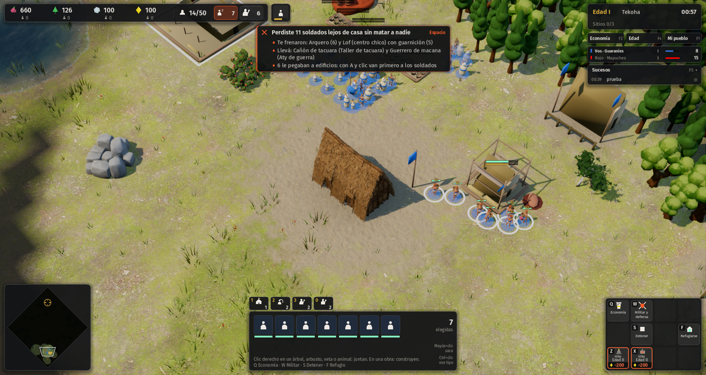
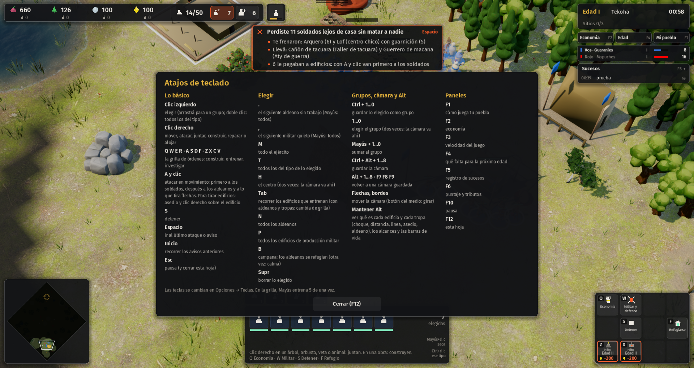
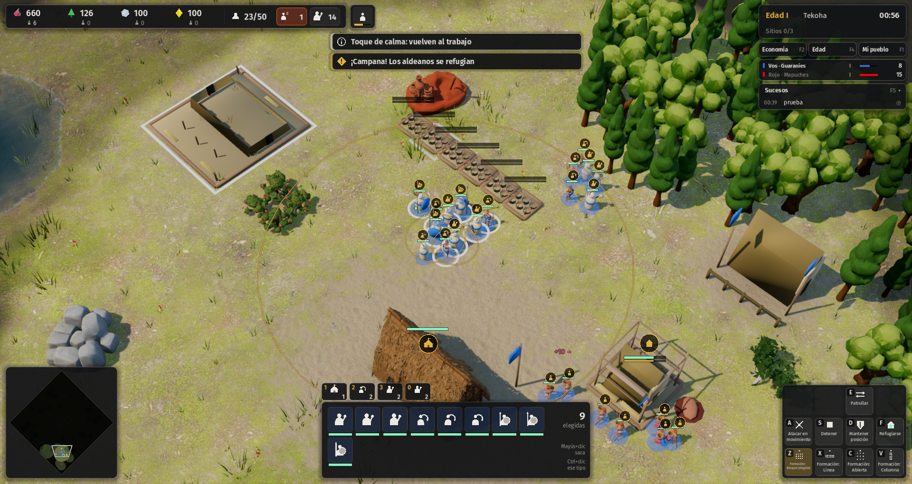
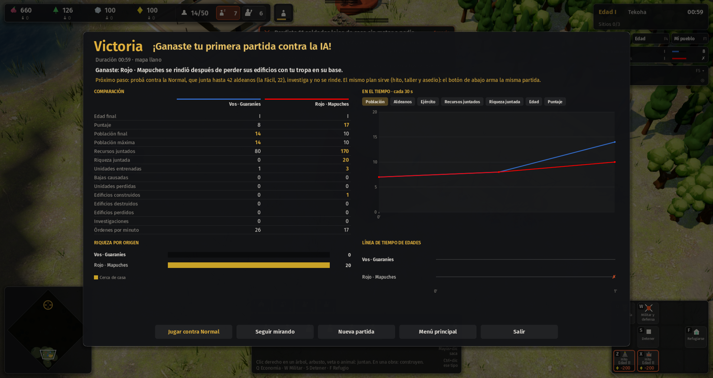
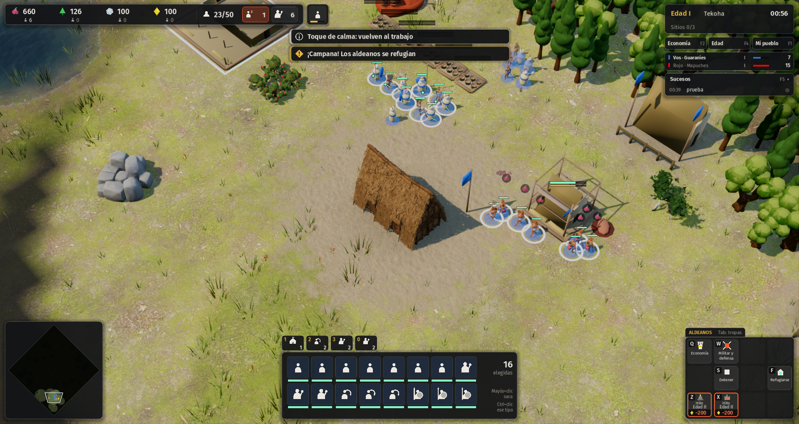

# 6a · Interfaz de la sexta ronda

Pedido: el plan de la [síntesis de la sexta ronda](../22-testers/ronda-6/00-sintesis.md), paso 1. Sale de los informes del [veterano](../22-testers/ronda-6/01-veterano-aoe4.md) y del [jugador nuevo](../22-testers/ronda-6/02-nuevo-en-rts.md). Solo interfaz: `src/sim` no se tocó.

| # | Qué | Gravedad | Quedó |
|---|---|---|---|
| 1 | El consejo de la pelea perdida y la hoja de atajos decían que «A y clic ataca lo primero que ve» | Alta | Reescritos con la elección de blancos ([5d](5d-eleccion-de-blancos.md)) |
| 2 | Resumen de la pelea: seis renglones de letra chica | Media | Título y tres renglones con viñeta, en letra 16 |
| 3 | Alt no figuraba en la hoja; Alt sobre las unidades | Media | En la hoja, y Alt muestra la función de cada unidad |
| 4 | Festejar la primera victoria e invitar a Normal | Media | Festejo, «Jugar contra Normal» y la victoria guardada |
| 5 | Z X C V con aldeanos y tropas elegidos: ¿cuál gana? | Media | El tipo más numeroso; Tab cambia; una pestaña lo dice |
| 6 | «Edad II» en la casilla del hito: se perdió «hito» | Baja | «Hito» y «Edad II» en dos renglones |
| 7 | El chequeo «cuenta grande de sitios del rival» fallaba con la máquina cargada | Baja | En pausa y esperando el estado |

## 1. A y clic, como funciona ahora

Desde [5d](5d-eleccion-de-blancos.md), el ataque en movimiento pega primero a los soldados, después a los aldeanos, después a lo que tira flechas y al final a los demás edificios. El texto viejo enseñaba a no usar la orden que ahora anda bien (veterano).

- **Hoja de atajos (F12):** «atacar en movimiento: primero a los soldados, después a los aldeanos y a lo que tira flechas. Para tirar edificios: asedio y clic derecho sobre el edificio».
- **Resumen de la pelea:** si un 30 % o más le pegaba a un edificio cuando caía (`pelea.ocupados_pct`), el tercer renglón dice «6 le pegaban a edificios: con A y clic van primero a los soldados». Esos soldados tenían una orden directa sobre un edificio, porque el ataque en movimiento ya no se queda en uno. La tecla sale de Opciones → Teclas, no está escrita a mano.

## 2. El resumen en tres renglones



```
Perdiste 11 soldados lejos de casa sin matar a nadie
• Te frenaron: Arquero (6) y Wang (centro) con guarnición (5)
• Llevá: Cañón de tacuara (Taller de tacuara) y Guerrero de macana (Aty de guerra)
• 6 le pegaban a edificios: con A y clic van primero a los soldados
```

- Son los tres puntos que pidió el jugador nuevo: qué te frenó, qué llevar y cómo mandarlos.
- **Cómo mandarlos** depende de la pelea:
  - si muchos le pegaban a edificios, que A y clic va primero a los soldados;
  - si no, y los mataron edificios que tiran flechas, el asedio con clic derecho sobre el edificio;
  - si no, que con A y clic van primero a los soldados y después a los aldeanos.
- `avisos.gd`: un cuerpo escrito en renglones con «• » se dibuja en letra 16 (antes 14), con una viñeta del color del aviso por renglón y un poco de aire entre ellos. Los demás avisos quedan igual.
- El aviso sigue en Espacio e Inicio. El registro F5 no lo guarda todavía: queda para otra etapa (es un pedido del jugador nuevo).

## 3. Alt



La hoja tiene un renglón nuevo en la tercera columna (ahora «Grupos, cámara y Alt»): «Mantener Alt: ver qué es cada edificio y cada tropa (choque, distancia, línea, asedio, aldeano), los alcances y las barras de vida». Lo puse ahí y no en «Lo básico», que con el texto nuevo de A y clic ya era la columna más larga.



Con Alt, cada unidad a la vista lleva sobre la cabeza el glifo de su función (`mundo_capa._draw_unit_icons`): guerrero para choque, hondero para distancia, lancero para línea, ariete para asedio, explorador y aldeano. Es el mismo disco oscuro con borde que el ícono de los edificios: dorado para las propias y el color del equipo para las ajenas. Las unidades rivales solo se marcan si se ven (niebla). Va por encima de la barra de vida. Tamaño y altura están en `interfaz.json → mundo.funcion_alt`.

Con Alt, el «Zz» y el recurso de los aldeanos no se dibujan: el glifo de la función ocupa ese lugar.

## 4. La primera victoria



- **Festejo.** Si ganás una escaramuza contra la IA (ni campaña, ni demo, ni repetición, ni IA contra IA), la pantalla de fin pone al lado de «Victoria», en dorado:
  - «¡Ganaste tu primera partida contra la IA!» si es la primera;
  - «¡Primera victoria contra la Normal!» si es la primera en esa dificultad.
- **Invitación.** Abajo del motivo: «Próximo paso: probá contra la Normal, que junta hasta 42 aldeanos (la Fácil, 22), investiga y no se rinde. El mismo plan sirve (hito, taller y asedio): el botón de abajo arma la misma partida.» Los números salen de `reglas.json → dificultades`.
- **Botón «Jugar contra Normal»**, el primero y resaltado (`main.jugar_revancha`). Arma la misma partida: mismas civilizaciones, semilla, terreno y opciones, con las IA rivales en la dificultad siguiente. Con la experta no aparece.
- **Se guarda** en `user://opciones.cfg`, sección `logros`, clave `victorias` (`{"facil": 1}`): `Opciones.registrar_victoria`. «Restablecer» no lo borra. Cuenta la dificultad más baja entre los rivales. La victoria se anota una sola vez por partida aunque la pantalla se abra de nuevo.
- Para las capturas: `--panel=fin-victoria` termina la partida ganada por rendición (con `--dificultad=facil`, festeja e invita a la Normal).

## 5. Z X C V con aldeanos y tropas elegidos



Antes, con un aldeano en la selección ganaba siempre la grilla del aldeano: Z era el hito y las formaciones no aparecían.

Ahora, como en AoE4:
- la grilla es la del **tipo principal** de la selección: el más numeroso, y si empatan, la militar;
- **Tab** pasa a la otra grilla y vuelve. Es la acción `produccion`: sin selección mixta sigue recorriendo los edificios que entrenan. En Opciones → Teclas y en la hoja dice «(con aldeanos y tropas: cambia de grilla)»;
- una pestaña arriba de la grilla dice de quién es («ALDEANOS · Tab: tropas»);
- una selección nueva vuelve al principal.

Lo decide `Controller.grilla_aldeano()`, dentro de `commands()`. Así, la grilla dibujada, la tecla, el clic y la ficha leen lo mismo (`Controller.cmd_at`). Esc y el título del submenú también lo usan. Con la grilla militar en una selección mixta, las órdenes (formación, detener, mantener) van a toda la selección, como el clic derecho.

Chequeos nuevos en el autotest (`_autotest_ronda6`):
- con 9 tropas y 7 aldeanos, Z es una formación, la grilla la dibuja en Z y la tecla Z la pone;
- Tab pasa a la grilla del aldeano: Z es el hito, la grilla lo dibuja y la tecla Z lo coloca sin tocar la formación;
- Tab otra vez vuelve a la militar;
- con más aldeanos que tropas manda la grilla del aldeano.

## 6. «Hito» y «Edad II»

En la misma captura: si «Hito · edad II» no entra en la casilla, el glifo se achica (18 px) y van dos renglones: «Hito», más tenue, y «Edad II». Si la franja de lo que falta ocupa varios renglones y queda lugar para uno solo, dice «Hito edad II». El comando trae `common_dos` (`controller.gd`) y el autotest lo revisa.

## 7. El chequeo de los sitios

El veterano lo vio fallar con el torneo corriendo: «cuenta grande de sitios del rival (jugador −1)». La prueba ponía `sitios_ms` a mano y miraba dos cuadros después. La simulación lo recalcula cada segundo, y con la máquina cargada en esos dos cuadros entraban varios pasos y lo borraban.

Ahora la simulación queda en pausa mientras dura el chequeo, y la prueba espera a que aparezca la cuenta (`_esperar`, hasta 120 cuadros) en vez de contar cuadros fijos. Los chequeos nuevos de Alt también esperan el estado.

## Pruebas

| Prueba | Resultado |
|---|---|
| `godot --path . -- --autotest --civ=guaranies --terreno=llano`, 3 veces seguidas | **OK las 3, 132 de 132** (había 112). Las tres terminan con el código 134 de siempre al cerrar |
| `tests/test_opciones.gd` | OK, con 5 chequeos nuevos de las victorias guardadas |
| `tests/casillas.gd` | OK, 480 grillas |
| `tests/test_determinism.gd` | OK, `hash=2203695307`, el mismo de [4q](4q-primera-victoria.md) |

Chequeos nuevos o cambiados en el autotest:
- el resumen va en título y tres renglones;
- dice qué llevar (asedio y la tropa que les gana);
- enseña que A y clic va primero a los soldados, y ningún renglón pasa de 90 letras;
- la hoja nombra Alt y la elección de blancos;
- los siete de la grilla mixta y el hito;
- Alt muestra un ícono por unidad, y sin Alt no hay ninguno;
- la cuenta de sitios, ahora firme;
- la primera victoria: el festejo, la victoria anotada, el botón, la partida que arma y que la segunda no festeja.

## Tropiezos

- El primer resumen tenía un tercer renglón de 93 letras («…; a los edificios, el asedio»). El asedio ya está en «Llevá:», así que lo saqué.
- Los íconos de función tapaban la barra de vida: los subí de 0,3 a 0,45 casillas sobre la cabeza.
- Con el texto nuevo, la columna «Lo básico» de la hoja crecía más que la pantalla. Alt pasó a la tercera columna.
- «Edad II» quedaba pegado a la franja de lo que falta: subí los renglones un punto.

## Commits

- Interfaz de la sexta ronda (este paso).
