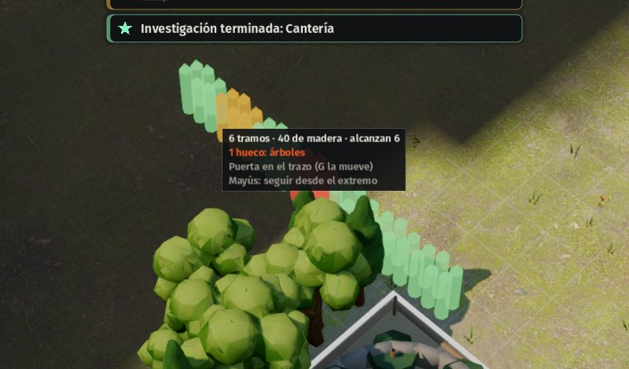

# Frente 2 · Constructor

Pedido: la fila del frente 2 en [README.md](README.md) (V5, V8, V9, V20; C2, C3, C6, C7, C10, C23).

## Qué entró

- **Mayús + colocar, en orden** (`ui/mundo_cola.gd → colocar`). El primer cimiento lo empiezan los aldeanos. Los siguientes se pagan con `ids: []` y quedan en su cola como obra (tipo y casilla). Cuando termina la obra en curso, la cola manda la siguiente, aunque la simulación ya haya mandado al aldeano al cimiento más cercano. No hay tope de distancia. La cola dibuja los puntos de las obras pendientes.
- **Muro arrastrado** (`controller.gd → plan_linea`). Junto al cursor muestra «n tramos · costo · alcanzan k», con el presupuesto de todos los recursos, no solo de la madera. Avisa los huecos y su causa (árboles, recursos, edificios, agua, roca). Al soltar, un aviso con lugar (Espacio lleva al hueco), y los huecos quedan en rojo unos segundos. Con Mayús, el trazo siguiente arranca en el extremo del anterior. Con G durante el arrastre, la casilla bajo el cursor pasa a ser puerta. El tope de 80 casillas está en los datos y se avisa al llegar.
- **Granjas que se pegan** (`mundo_colocacion.gd → pegar_granja`). Se corren hasta 1 casilla para quedar contra el depósito de alimento o contra otra granja. Muestran «x de 8 lugares libres junto a …» y a cuántas casillas caminan los granjeros.
- **El almacén informa** qué recursos que recibe hay a 6 casillas, con su cantidad, y a qué distancia está el depósito más cercano.
- **Reparar en cadena**: quien termina una reparación ordenada sigue con el edificio dañado más cercano, a 10 casillas o menos. **«Reparar (zona)»** (D en la raíz del aldeano) reparte a los elegidos entre lo dañado a 12 casillas. Las dos cosas pasan en el cliente y viajan como comandos comunes. El costo de reparar no se tocó (C-100).
- **Huella fantasma**: un edificio propio que tira el rival deja su huella durante 3 minutos. Con clic derecho de un aldeano sobre la huella, el cimiento vuelve y se paga de nuevo. El cursor sobre la huella es el de construir. No quedan huellas de muros, hitos ni maravillas.
- **Rebusca lejana** (`sim.gd → _rebusca_lejos`, `reglas.rebusca_lejos`). Si a 10 casillas no queda nada, el aldeano va al recurso más cercano del mismo tipo (y si no hay, de su recurso) que esté junto a otro depósito propio, a 40 casillas o menos. La reunión recuerda el tipo de recurso. Si ese recurso se agotó, el aldeano nuevo va al más cercano del mismo tipo y la reunión pasa a ese recurso.

Los números de la interfaz están en `data/constructor.json`; los de la simulación, en `data/reglas.json`. `_cmd_build_line` no cambió: la puerta va como un `build` aparte, y los huecos se calculan en el cliente.

## Pruebas

- `test_determinism`: OK. **El hash cambia** de 2203695307 a 2903543624, solo por la rebusca lejana: con `rebusca_lejos.max = 0` vuelve al anterior.
- `bench`: 9,45 ms de promedio y 92 ms en el peor tick (el presupuesto es de 100 ms).
- `casillas` y `jugabilidad`: OK.
- Autotest con etiopía en llano: OK, con 22 controles nuevos (`src/game/autotest_fluidez2.gd`):
  - tres casas con Mayús terminadas en el orden puesto;
  - muro con un árbol en medio: cifras, hueco avisado y marcado, puerta con G;
  - granja pegada con «7 de 8»;
  - almacén que informa;
  - huella que reconstruye;
  - «Reparar (zona)».
- Pendiente: el torneo conjunto de los frentes 1, 2 y 5.

## Tropiezos

- La simulación manda sola al constructor al cimiento más cercano, así que el aldeano nunca queda ocioso. Por eso la cola no podía esperar al ocio: ahora cuenta como libre a quien terminó su obra.
- El autotest esperaba 6 cuadros, menos que un tick a ×1, y la orden todavía no había entrado. Ahora espera 30.
