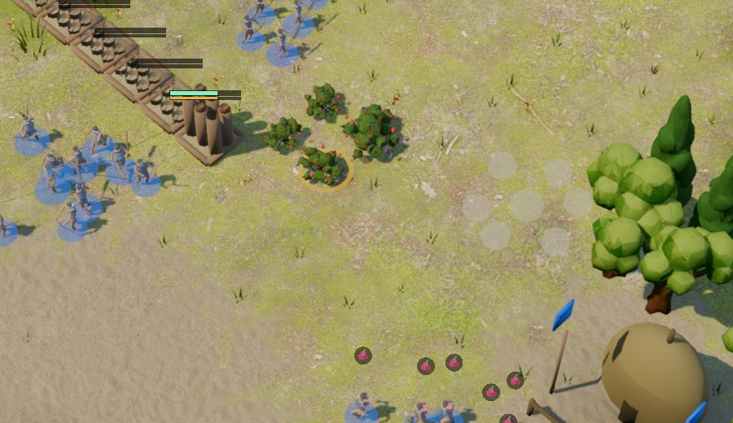

# Frente 3 · Respuesta inmediata

**Pedido.** Lo que pidió el veterano en la [ronda 7](../22-testers/ronda-7/03-veterano-fluidez.md) (3.4, 4.1, 4.2, 6.3, 7.3 y 9): que el oído y la vista confirmen cada clic. Solo en la vista: `src/sim` no se tocó.

## Qué entró

| Pedido | Qué hace | Dónde |
|---|---|---|
| Sonido al elegir (V1) | Un golpe corto según la categoría (aldeano, tropa o edificio), con el instrumento del pueblo. Lo ajeno (rival, recurso) suena con el clic genérico, más bajo. | `Respuesta.al_elegir`, `GameAudio.elegir` |
| Error (V1) | Suena el error si el clic derecho no hace nada (no hay nada propio elegido) o si el cimiento no entra. | `Respuesta.error` |
| Cimiento (V2) | Golpe de tablones sobre la tierra y un anillo de nubecitas de polvo claro alrededor. | `Respuesta.cimiento`, `WorldView.polvo_cimiento` |
| Destello (V10) | Al ordenar atacar o juntar, un aro del tamaño del blanco parpadea dos veces en 0,45 s: rojo si es enemigo, acento si es un recurso. Sigue a la unidad si se mueve. | `WorldView.destello` |
| Pulso (V18) | Al saltar con Espacio, con el doble toque de un grupo o al ir al aldeano inactivo, se abre un aro donde cae la cámara. | `WorldView.pulso` |
| Estela (V19) | Las flechas y las piedras llevan una estela corta pegada detrás: se lee de dónde viene el tiro. | `WorldView._estela` |
| Orden por función (V23) | La orden suena distinta para civiles, montados y asedio; a pie sigue la de 4g. Se elige por la mayoría de lo elegido. | `Respuesta.funcion`, `GameAudio.orden` |

Los volúmenes, los tiempos y un `activo` por cada sonido y cada efecto están en `data/respuesta.json`. En el controlador hay ocho ganchos de una línea, marcados `# --- fluidez 3 ---`.

## Los sonidos

`tools/audio/generar_respuesta.py` sintetiza 40 archivos (227 KB): por pueblo, tres de elegir y tres de orden (civil, montado y asedio), y cuatro genéricos en `assets/audio/ui/` (los tres de elegir y el cimiento, con golpes de madera) para los pueblos sin entrada. Son notas y golpes sueltos, de 0,15 a 0,45 s, con los instrumentos de [4g](../24-tras-la-segunda-ronda/4g-sonido.md):

- **Tawantinsuyu:** siku, quena y wankara.
- **Mapuches:** kakelkultrun, kull-kull y trutruka.
- **Guaraníes:** mimby y angu'apu.
- **Etiopía:** krar y masenqo.
- **Palmares:** kisanji, ngongi, ngoma y marimba.
- **Ayutthaya:** ranat y khong.

Nada sagrado, con el criterio de [4h](../24-tras-la-segunda-ronda/4h-sonido-con-respeto.md): no hay kultrun, mbaraka, takuapu, begena ni berimbau. El kebero y el ching quedan fuera de los clics, como en la orden de 4g. Las medidas están en `tools/audio/medidas_respuesta.json`.

## Pruebas

- `tests/test_determinism.gd`: **DETERMINISMO: OK** (`src/sim` sin cambios).
- `--autotest --civ=mapuches --terreno=llano`: **AUTOTEST: OK**, con 12 controles nuevos (`src/game/autotest_fluidez3.gd`):
  - el clic que elige suena, y las categorías y la función salen bien;
  - el error suena;
  - el arbusto destella y el destello se va solo (en unos 250 ms);
  - el polvo del cimiento aparece;
  - el pulso aparece y la flecha lleva su estela;
  - el destello se apaga desde los datos.

## Tropiezos

- El polvo de los golpes no se leía sobre la tierra a los pocos cuadros. El del cimiento sale ya abierto y más claro.
- Los sonidos de menos de 0,4 s no los mide ebur128: `export` los ajusta por pico, como la orden de 4g.

## Queda

- La voz de la orden es un instrumento, no una voz hablada: grabar voces por pueblo pide hablantes y permisos.
- Falta escucharlos en partida, con el autor.
