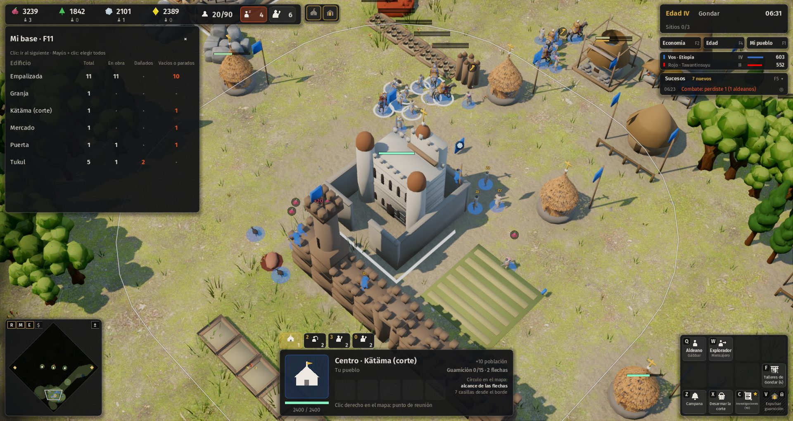
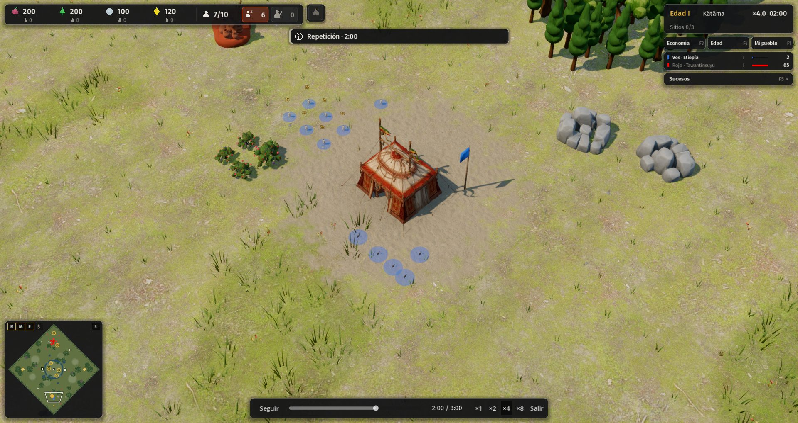
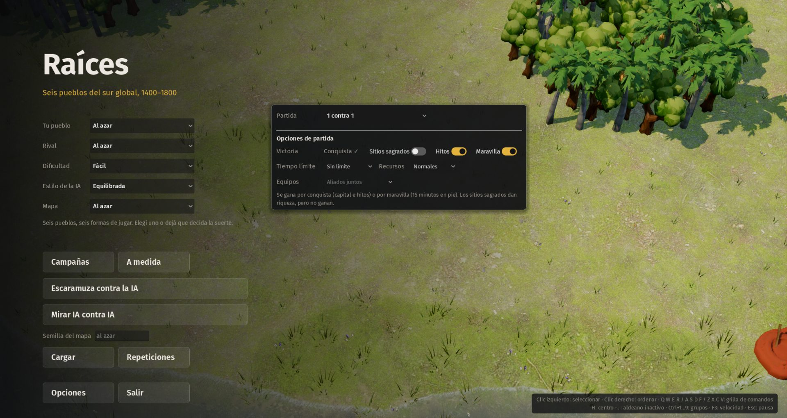

# Frente 6 · Guardar, repeticiones y «Mi base»

Pedido: C8 (guardar, cargar y autoguardado) y C17 (panel «Mi base») de la ronda 7
([04-constructor-fluidez.md](../22-testers/ronda-7/04-constructor-fluidez.md), §4.1 y §4.5),
más repeticiones con línea de tiempo.

## Qué entró

- **Guardar = cómo se armó la partida + comandos hasta el tick.** `src/game/guardado.gd` (clase
  `Guardado`) escribe la semilla, las opciones, las IA (o la campaña y la misión), los argumentos
  de la partida, los comandos de `sim.recording`, el tick y el hash del estado. **Cargar** arma la
  simulación igual y la re-simula sin dibujo, 40 ms por cuadro, con una barra de avance. Al
  terminar compara el hash con el guardado. Si no coincide, avisa («¿otra versión del juego?»).
  No toca `src/sim/`.
- **Dónde:** en la pausa están «Guardar partida» y «Cargar partida». En el menú, «Cargar»
  (`user://partidas/`). Por línea de comandos, `--cargar=ruta`.
- **Autoguardado:** cada `guardado.autoguardado_min` minutos de juego (5, en
  `data/interfaz.json`). Se conservan los últimos 3. También se guarda al salir (`salida.json`):
  por la ventana, por «Salir», al ir al menú, con «Nueva partida» y con `--salir-a`. No se guarda
  en el menú, las demos, las capturas ni las repeticiones. Funciona con la partida a medida y con
  las campañas.
- **Repeticiones:** se guardan solas al terminar o al salir, una por partida, en
  `user://repeticiones/` (las últimas 20). También se guardan las partidas sin órdenes y las de
  campaña. Sigue existiendo `ultima_partida.json`. En el menú, «Repeticiones» abre la lista.
  `src/game/repeticion.gd` (`BarraRepeticion`) tiene la línea de tiempo, pausa, ×1, ×2, ×4 y ×8
  (`guardado.velocidades`) y «Salir». Arrastrar la línea salta a ese minuto: se arma de nuevo y
  se re-simula hasta ahí (`--replay=ruta --desde=tick`). La cámara queda libre y sin niebla.
- **«Mi base» (F11, acción `mi_base`; en el perfil AoE4 queda sin tecla):**
  `src/game/panel_base.gd` tiene una fila por tipo de edificio propio, con estas columnas:
  - total;
  - en obra;
  - dañados;
  - vacíos o parados: granja sin granjero, producción con la cola vacía, repetición frenada por
    población o recursos, obra sin constructores.

  El clic va al siguiente de esa celda, lo elige y centra la cámara. Mayús + clic los elige a todos.

## Pruebas

Detalle en [pruebas/07-guardado.txt](pruebas/07-guardado.txt) y
[pruebas/07-autotest-etiopia.txt](pruebas/07-autotest-etiopia.txt).

- `tests/guardado.gd` (nueva): guarda en el tick T y pasa los datos por JSON. Después arma la
  partida, la re-simula y compara el hash en T. Las dos siguen con la misma orden hasta T2, donde
  vuelve a comparar. Se probó con 1v1, 2v2 con opciones y la misión 1 de Etiopía: **OK**.
- En el juego, una escaramuza guardada en 2:00 da el mismo hash al cargarla. Cargada y seguida
  hasta 2:30, da el mismo hash que sin cargar (2669539229). La campaña también da el mismo hash.
- `test_determinism`: OK, con el hash de siempre (3059812827). `test_replay`: OK.
- Autotest con Etiopía: **OK** (6 comprobaciones nuevas, `src/game/autotest_fluidez6.gd`). El
  guardado del autotest se hace antes de que el autotest toque la partida a mano (crea unidades,
  da recursos): esas trampas no son comandos y no se pueden re-simular.

## Tropiezos y pendientes

- **La carga tarda lo que tarda la simulación.** Con la máquina cargada, salen unos 400 ticks
  por segundo en 1v1 y unos 145 en 2v2. Así, el minuto 60 de un 4v4 tardaría minutos en
  cargar. Hacen falta la caché de caminos (C21) o fotos del estado cada N minutos, y eso sí
  toca la simulación.
- Saltar hacia adelante en una repetición también re-simula desde el principio. Es seguro, pero
  lento en partidas largas.
- Al cargar, la vista arranca de cero: los gráficos de F2 y el registro de sucesos empiezan vacíos.
- Lo que el juego cambia fuera de los comandos (las trampas de las pruebas, `--demo`) no queda
  en el guardado.
