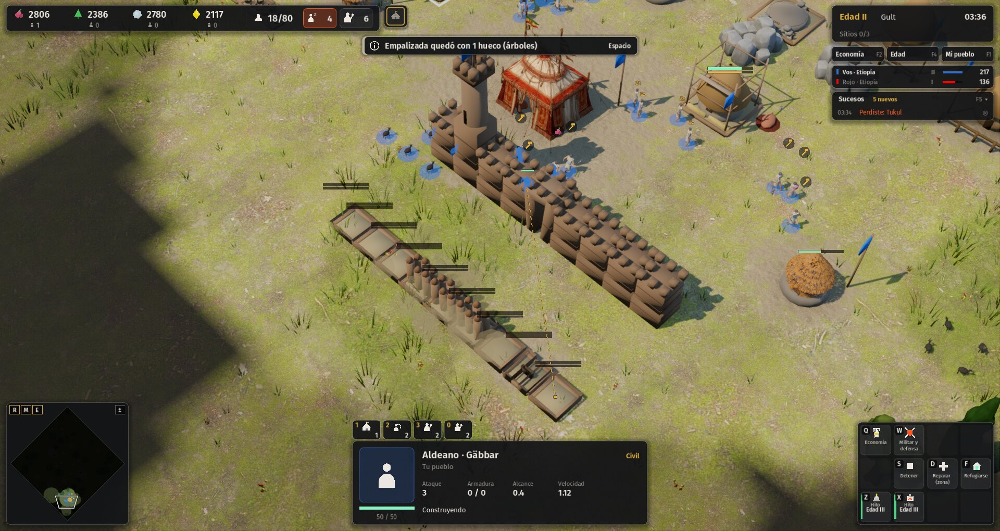

# 06 · Muralla de piedra en la edad II

**Pedido.** C-101 respondida: muralla de piedra sí, en la edad II, como en AoE4. Tramos, puerta y torre encima. Se arrastra igual que la empalizada (costo, huecos, G para la puerta, Mayús para encadenar). La empalizada se refuerza a piedra. Cada pueblo tiene su muro, con nombre, maqueta y glifo propios. La difícil y la experta lo usan con criterio. Tiene que seguir siendo una inversión cara, no la opción de todos en el 1v1 (el miedo del veterano).

## Qué entró

- **Tres piezas comunes** en `data/edificios.json`:
  - `muralla`: el tramo, que se arrastra como la empalizada.
  - `puerta_piedra`: la puerta.
  - `torre_muralla`: la torre, de 1×1, que solo va encima de un tramo propio (`solo_sobre`).
- **Encima de otra pieza** (`sobre`).
  - La muralla arrastrada sobre la empalizada propia la reemplaza: así se refuerza.
  - La puerta de piedra va sobre la de madera o sobre un tramo.
  - La torre va sobre un tramo.
  - Lo resuelven `Sim._own_piece_under` y `_replace_wall`, que ahora corre también en `_cmd_build_line`.
  - `_cmd_build_line` controla la edad mínima, cosa que antes no hacía.
- **Cada muro trae su puerta** (`su_puerta`). G pone la puerta del muro que se está trazando (`MundoColocacion.tipo_puerta`).
- **El trazo** muestra «n tramos · costo · alcanzan k», y además «Refuerza n tramos» cuando pasa por encima de la empalizada.
- **El asedio contra la muralla** (`recibe`, ahora por tipo antes que por función):
  - el ariete y la catapulta pegan al 400 %;
  - los incendiarios se quedan con su 150 % y, con su `bono_material`, le hacen 4 por golpe a la piedra contra 54 a la empalizada.
- **IA** (`reglas.ia_muralla`; las dificultades difícil y experta tienen `muralla: true`).
  - Un lienzo recto de 13 casillas del lado del rival, con la puerta en el medio.
  - Prueba los radios 13, 16, 10 y 19 casillas, y se queda con el que tiene más casillas libres.
  - **En la II** solo si el rival ya vino con tropa a la base. **Si no, en la III**, aunque esté ahorrando, salvo que ahorre para la maravilla.
  - Desde la III pone 2 torres encima. Levanta un solo lienzo por partida.

## Números (AoE4 aproximado)

| | Empalizada | Muralla | Puerta de piedra | Torre de muralla |
|---|---|---|---|---|
| Vida | 300 | 1800 | 2400 | 1500 |
| Armadura | 0 | 6 | 6 | 6 |
| Costo | 4 madera | 20 piedra | 60 piedra | 100 piedra |
| Obra | 3 s | 12 s | 25 s | 30 s |

- **Golpes** (`tests/asedio.gd`). Contra la muralla, la tropa de choque y la de distancia sacan 1 por golpe, el daño mínimo. El ariete saca 190: rompe un tramo en unos 30 s.
- **El costo.** Un lienzo de 13 tramos con su puerta cuesta 320 de piedra, más de dos torres comunes. La empalizada sigue siendo el cerco barato: 13 tramos, 52 de madera.

## Por pueblo

| Pueblo | Muro | Puerta | Torre | Arte y diferencia |
|---|---|---|---|---|
| Etiopía | Muro de la amba | Puerta de la amba | Torre del muro | piedra parda en talud; refuerza su empalizada |
| Tawantinsuyu | Pirca | Punku | Torreón de pirca | piedras de campo sin argamasa; 2100 de vida; no tiene empalizada |
| Ayutthaya | Kamphaeng | Pratu | Atalaya de la muralla | ladrillo con almenas en hoja; 12 de piedra y 10 de madera; 1700 de vida |
| Adal (IA) | Jugol | Puerta del Jugol | Torre del Jugol | encalado, almenas redondas |
| Birmanos (IA) | Muralla de ladrillo | — | — | ladrillo |
| Cañaris, caranquis y chankas (IA) | Pirca | Portada de pirca | — | pirca |
| Mapuches, guaraníes, Palmares, tupíes | — | — | — | sin muralla, como pide su diseño: «sin piedra ni torres» |

- **Glifos nuevos** (`src/game/ui/iconos.gd`): `muralla`, `muro_amba`, `pirca`, `kamphaeng`, `puerta_piedra`, `punku` y `torre_muralla`. Cada dato puede pedir su glifo con `glifo`.
- **Maquetas** (`CivMeshes.muro`, estilos en `data/arte_edades.json` → `muros`). El tramo llena su casilla y lleva almenas en las esquinas y en el medio de cada lado, así que se lee como un lienzo continuo en cualquier dirección.
- **Grilla** (submenú Militar). Etiopía: R, E y W. Tawantinsuyu: R, E y X. Ayutthaya: S, F y X.

## Pruebas

- `tests/test_determinism.gd`: OK. El hash no cambió (718068252): la IA normal no amuralla.
- `tests/bench.gd`: 9,49 ms de promedio.
- `tests/asedio.gd`: OK, con 15 controles nuevos de la muralla.
- `tests/casillas.gd`: OK (576 grillas).
- `tests/grilla.gd`: OK.
- `tests/iconos.gd`: OK (142 íconos).
- `tests/civ_smoke.gd`: sin errores.
- `tools/primera_victoria.gd` (semillas 7, 21 y 3): ganó 2 de 3.
- `tools/micro_matriz.gd`: corre. El cambio de `recibe` no toca a la tropa contra la tropa.
- **Autotest** con Etiopía en llano: OK, con 9 controles nuevos (`src/game/autotest_muralla.gd`).
  - En la II arrastra la muralla sobre 3 tramos de empalizada: «9 tramos · 220 de piedra · alcanzan 9 / Refuerza 3 tramos».
  - G pone la puerta de piedra.
  - Quedan 8 tramos y la puerta, y se cobran 220 de piedra.
  - La torre va encima de un tramo y no en el suelo.
- **IA** (`tools/muralla_ia.gd`, 25 min, 2 semillas, 8 partidas): ver [muralla-ia.txt](muralla-ia.txt).
  - Amurallaron 6 de los 16 jugadores, y ninguno de los que no tienen muralla.
  - Casi siempre fue en la II, después de que el rival viniera con tropa. Etiopía, sin alerta, amuralló en la III, y el Tawantinsuyu puso sus 2 torres en la III.
  - Los demás se quedaron con la piedra para la economía y los hitos: no hay «todos amurallan».

**Captura revisada.**
- El lienzo de sillares se ve continuo, con las almenas, la puerta en el medio y la torre encima.
- Adelante, en obra, está el tramo que reemplazó a la empalizada.

## Tropiezos

- La primera IA no amurallaba nunca, por dos motivos:
  - la experta ahorra siempre, así que la regla de no amurallar mientras ahorra la dejaba afuera;
  - en la III, la base está llena y a 13 casillas quedaban 2 libres.
- Se corrigió con la regla de la III y la lista de radios.
- El autotest de la muralla dejaba la edad y los recursos cambiados, y la veta de la prueba siguiente («fluidez 4») no avisaba. Ahora restaura todo y saca lo que puso.
- Con `recibe.asedio: 400` solo, los incendiarios le pegaban más a la muralla que a una torre. Por eso `recibe` acepta el tipo de la unidad.

## Queda

- Soldados que caminan por arriba, y mejoras de la muralla (aceite, almenas).
- Que la IA repare o rehaga el lienzo.
- Planos (C-101, segunda parte): después.
