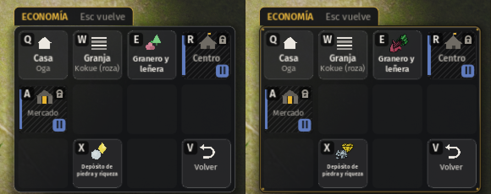
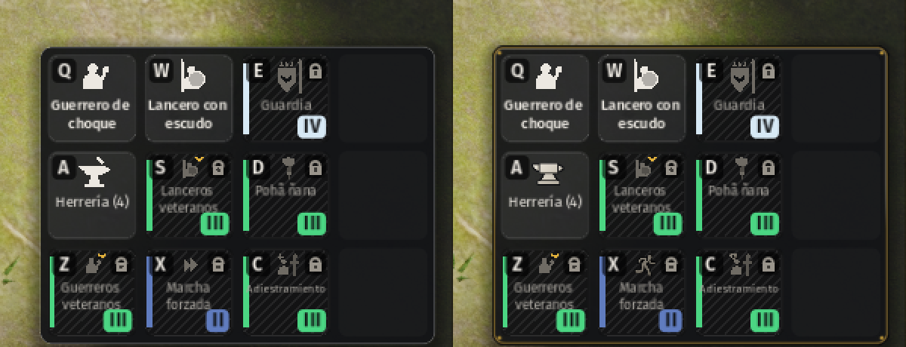
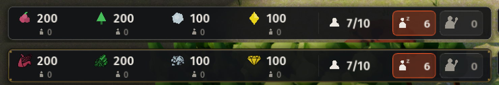
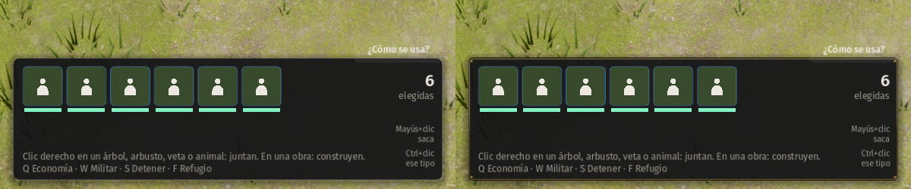
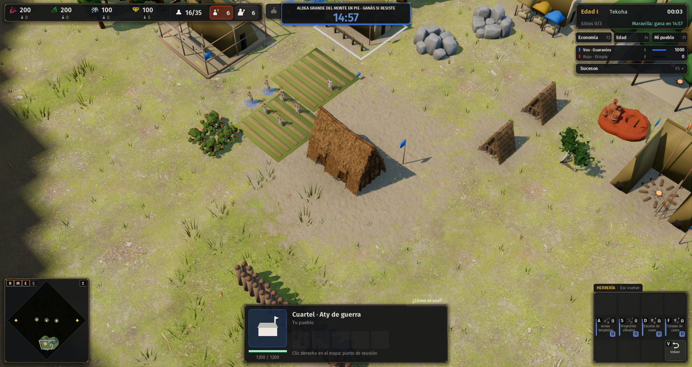
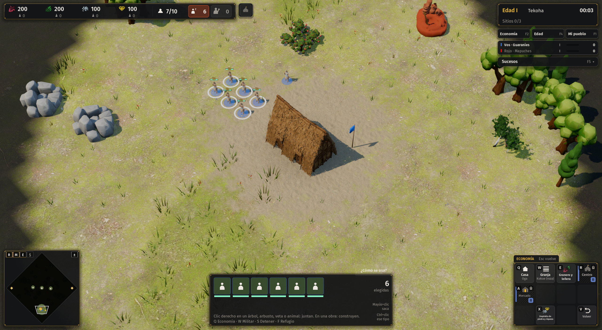

# 39 · Arte de interfaz, primera pasada (2026-11-19)

> **Pedido:** primera pasada de arte de interfaz con bibliotecas libres y sin cuentas: íconos genéricos (recursos, mejoras comunes, órdenes y estados), cursores y marcos del HUD, y capturas de antes y después. Es el punto 1 del plan de [`../38-alternativas-a-meshy/2D.md`](../38-alternativas-a-meshy/2D.md).

## Qué se hizo

1. **21 íconos genéricos** de [game-icons.net](https://game-icons.net) (**CC BY 3.0**; autores: Lorc, Delapouite, Zeromancer y Sbed):
   - recursos: `alimento` (maíz), `madera`, `piedra` y `riqueza`;
   - órdenes: `atacar`, `patrullar`, `campana` e `investigar`;
   - estados: `vida`, `velocidad`, `escudo` y `carga`;
   - mejoras: `hacha`, `pico`, `canasta`, `martillo`, `yunque`, `engranaje`, `riego`, `arco` y `vigia`.
   - Entran por `data/iconos.json → imagenes`, **sin código nuevo**. `Glyphs.draw` mira primero la imagen, también en las partes de los nombres compuestos. Por eso la herrería (`atacar~guerrero~2`), las tandas (`hacha#2`) y los costos de la ayuda usan el PNG.
   - **No se tocaron las unidades ni los edificios de los pueblos**, que siguen como glifos. Tampoco `volver`: la flecha de game-icons se leía peor que el glifo. Ni `espada`: las de game-icons son europeas.
2. **`tools/iconos_render.py`**: lee `assets/ui/iconos/catalogo.json`, baja las siluetas que faltan (`--bajar`) a `assets/ui/iconos/fuentes/` y las prepara:
   - **marco fijo**: la silueta va centrada en una caja de 52/64, y así todas pesan lo mismo en la casilla;
   - **material neutro**: pergamino claro; los recursos llevan su color natural (`Palette.RES`);
   - **luz** desde arriba a la izquierda, con un filo oscuro abajo a la derecha;
   - **contorno oscuro** de 2 px a 64 px;
   - **salida**: PNG de 32 y 64 px.

   Los íconos genéricos no llevan color de equipo, así que no hay máscara. El catálogo acepta `"equipo": true`, que saca `<nombre>_equipo.png`, para cuando haga falta.

   No se dibujó un borde dentro del ícono porque la casilla ya lo tiene, y un segundo borde achicaba la silueta a 20 px.
3. **Cursores** (`--cursores`, `assets/ui/cursores/`, 12 PNG de 64 px):
   - flecha propia con degradé, contorno y sombra blanda, más una insignia con la silueta de la acción;
   - la de atacar es roja entera, para que se distinga de un vistazo en la pelea;
   - `cursores.gd` carga los PNG de `data/interfaz.json → cursores.carpeta`, con el punto activo en `cursores.punta`, y los achica a `px × escala` como antes. El tipo que no tenga PNG sigue dibujado con código.
4. **Marco del HUD** (`--marcos`, `assets/ui/marcos/marco.png`, 9 cortes):
   - canto oscuro, filete de bronce, brillo arriba y un rombo dorado en cada esquina;
   - centro transparente, encima de `Hud.panel_box`: no cambian ni el color ni la transparencia de los paneles;
   - se dibuja en la barra de recursos, el reloj, la grilla, la selección y el minimapa (`Hud.dibujar_marco`, `data/interfaz.json → marco`).
5. **Créditos**: tabla nueva en `assets/CREDITOS.md`, con el autor y la URL de cada ícono. La CC BY pide atribuir y decir qué se cambió.

## Capturas (1920×1080, guaraníes, llano)

| | |
|---|---|
| Grilla del aldeano (antes · después) |  |
| Grilla del cuartel (antes · después) |  |
| Barra de recursos (antes arriba) |  |
| Panel de selección (antes · después) |  |
| Submenú de la herrería (después) |  |
| HUD a 2560×1440 |  |
| Cursores (antes · después) |   |

Revisión:

- a 26 px, los recursos se leen mejor que los glifos: el maíz, los troncos, las piedras y el diamante;
- en las casillas bloqueadas, la imagen se atenúa igual que el glifo;
- el marco es sutil: separa el panel del pasto sin pesar;
- a 1440 los PNG de 64 se ven nítidos. A 1080 se achican con filtro lineal y no se nota serrucho.

## Tropiezos

- **No se pudo bajar nada de Kenney** (UI Pack y Cursor Pack): la descarga pide un enlace firmado y el entorno la bloqueó. Los cursores y el marco se hicieron con el script, como **obra propia** y en la misma línea que los íconos. Si el autor baja los packs de Kenney (CC0) a mano, el script los puede usar de base.
- `riqueza` empezó con `gold-nuggets`, que a 26 px eran puntitos sueltos. Se cambió por `cut-diamond`, que es parecido al glifo de antes.

## Pruebas

- `tests/iconos.gd`: 752 grillas, 145 íconos distintos, OK.
- `tests/casillas.gd`: 600 grillas, OK.
- `tests/test_determinism.gd`: OK, `ticks=3000 hash=3059812827`, el mismo de las etapas anteriores (`src/sim` no se tocó).
- Autotest con guaraníes en llano: `AUTOTEST: OK`, con «se dibujaron los cursores (12)»; la hoja de cursores sale de esa corrida.

## Commits

- `a6b33e7`: 21 íconos genéricos y `tools/iconos_render.py`.
- `e52c27c`: cursores, marco del HUD y créditos.
- Este documento, con las capturas.
