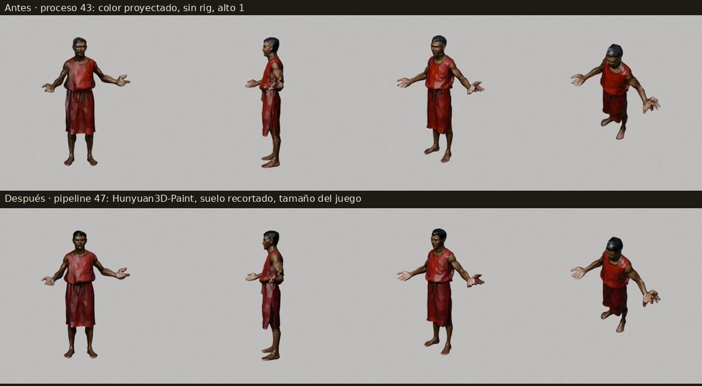
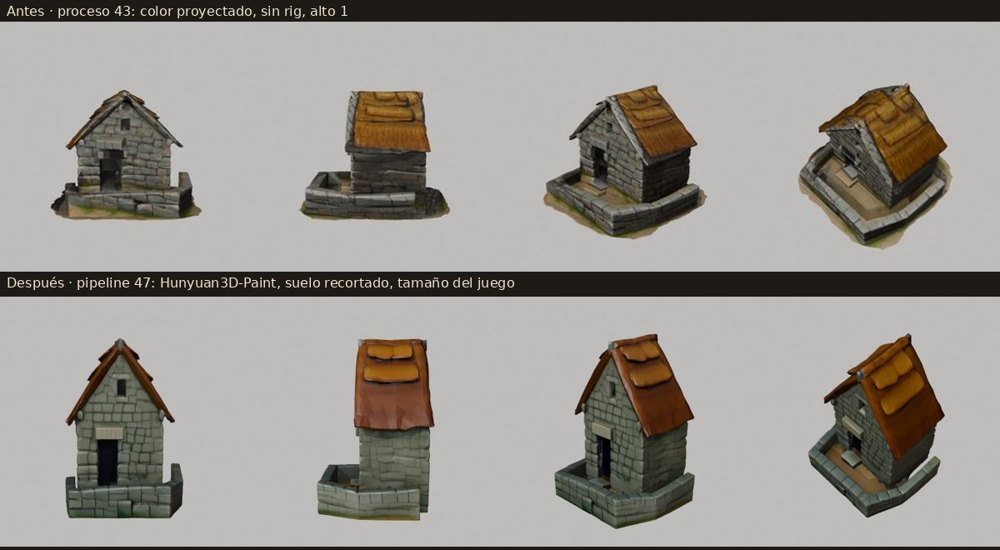
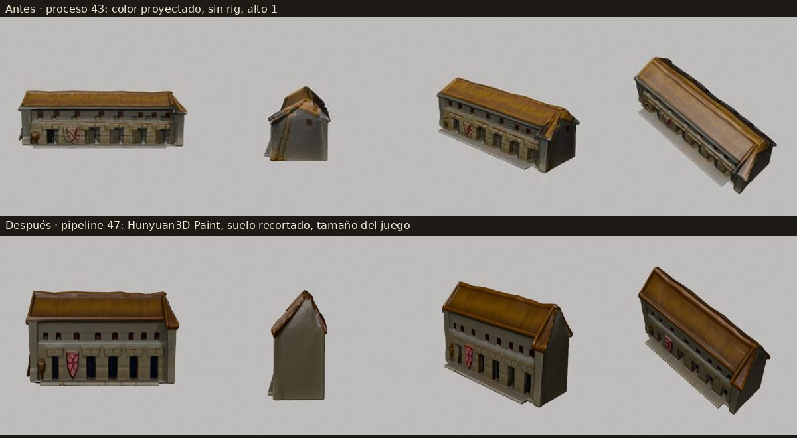
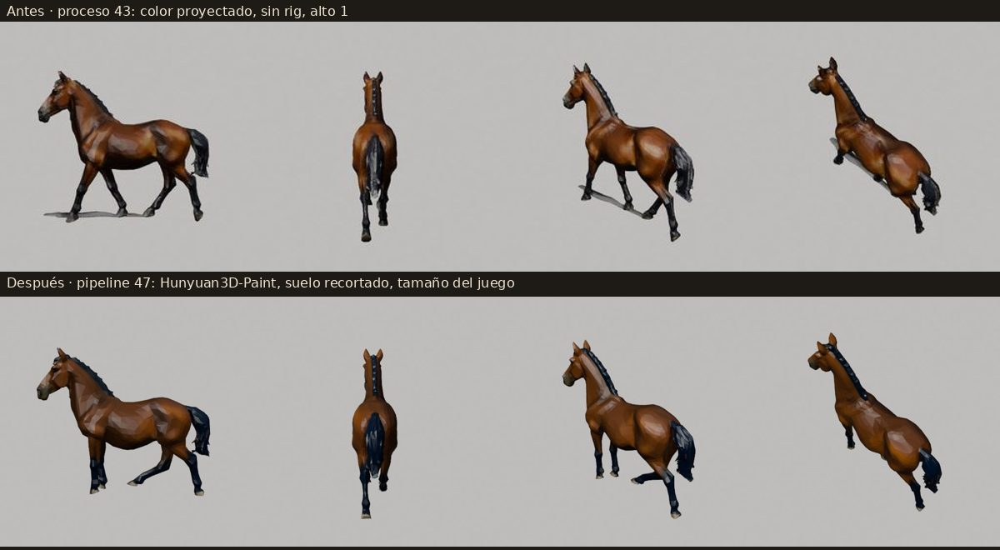
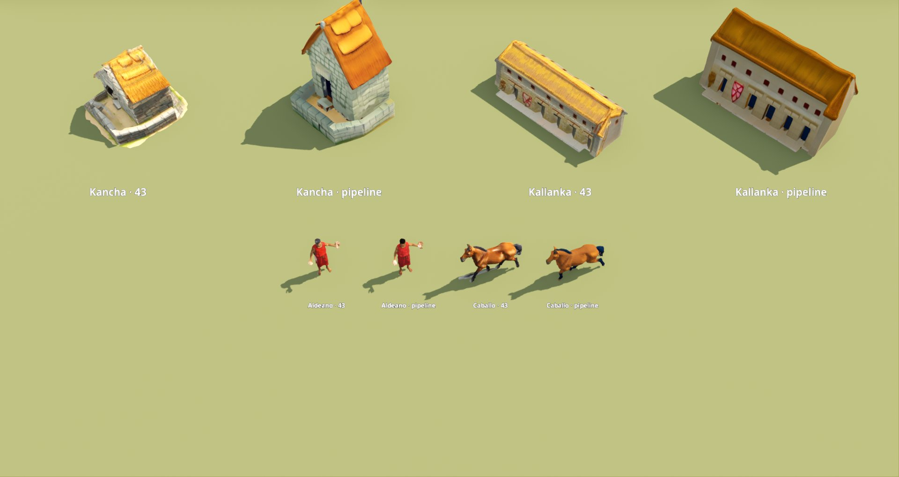
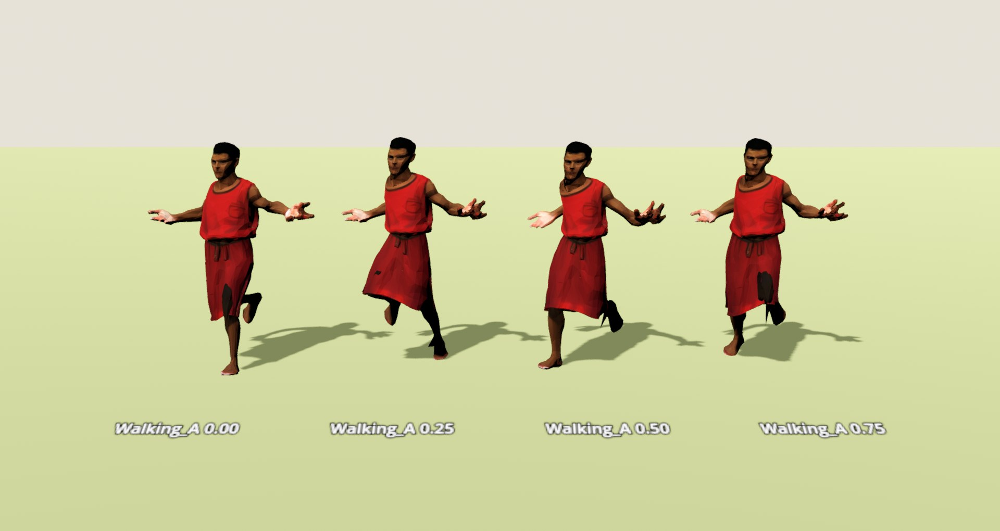
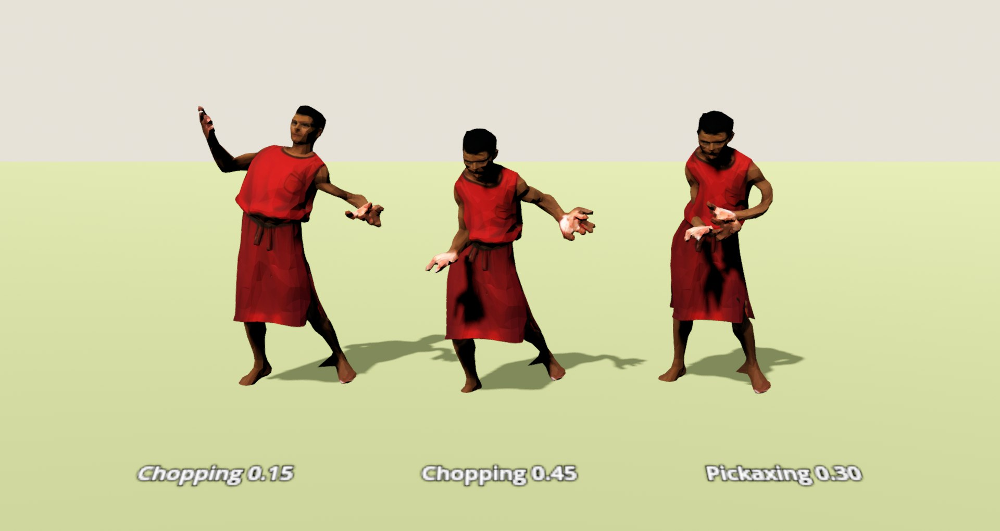
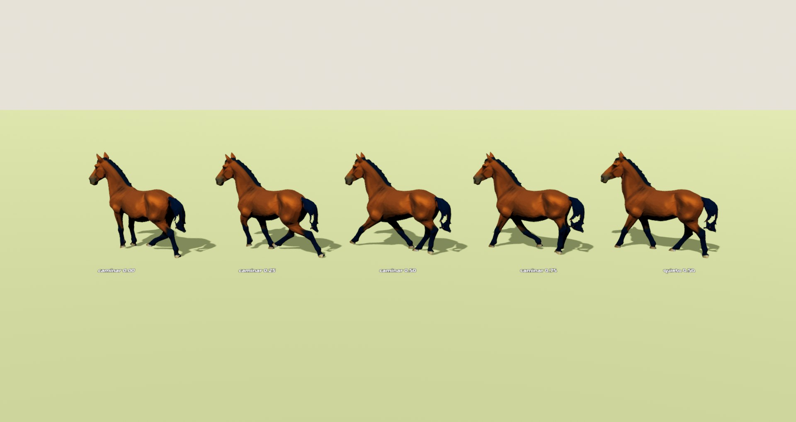
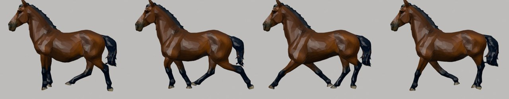
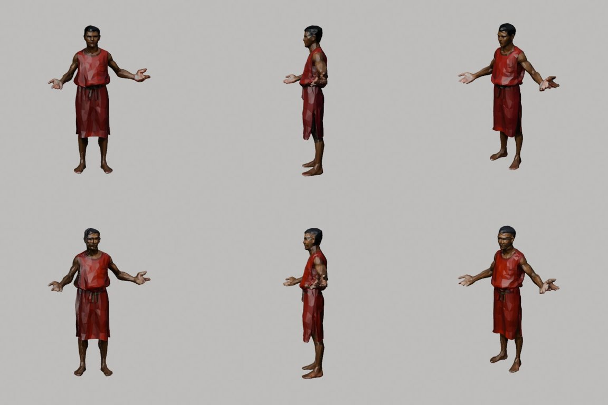

# 47 · Pipeline 3D local repetible (2026-11-20)

> **Pedido del autor:** un pipeline repetible, para regenerar y mejorar arte y modelos más
> adelante: no la perfección ahora, sino todo armado de punta a punta.

Página: [`index.html`](index.html) (la misma información, con las imágenes en grilla). En
GitHub, todo está acá abajo.

## En una línea

```
tools/gen3d_pipeline.py <pieza>      # o --todas; --lista muestra las piezas
```

Las piezas están en [`data/gen3d_piezas.json`](../../data/gen3d_piezas.json) (el juego no lo
lee). Cada paso deja su salida en `gen3d/pipeline/<pieza>/` con una **firma** (los parámetros
del paso, el contenido de sus entradas y de sus scripts): si no cambió, se saltea. Cambiar la
imagen de una pieza rehace solo esa pieza; cambiar `gen3d_final.py` rehace solo el último paso
de todas. Opciones: `--desde PASO`, `--hasta PASO`, `--forzar PASO`, `--textura
paint|proyector`, `--regenerar-imagen`.

| Paso | Qué hace | Herramienta | Tiempo (aldeano) |
|---|---|---|---|
| 1 referencia | la imagen que está o FLUX en ComfyUI con la receta gouache de proceso/42; vistas con alfa | `gen3d_entradas.py`, `generar_local.py` | 1 s (52 s con FLUX) |
| 2 forma | Hunyuan3D-2mini turbo (2mv turbo con frente y espalda) | `gen3d.py` | 88 s (6,5 s de forma) |
| 3 limpieza | Blender: suelda, corta la losa del suelo, borra sueltos, diezma (4–5 mil caras), alto 1 | `gen3d_blender.py` | 7 s |
| 4 textura | Hunyuan3D-Paint turbo si está compilado; si no, el proyector | `gen3d_paint.py` / `gen3d_color.py` | 56 s (11 s de pintura) |
| 5 rig | humano: 19 huesos KayKit · cuadrúpedo: 20 huesos y ciclos caminar y quieto | `gen3d_rig.py` / `gen3d_rig_cuadrupedo.py` | 2–5 s |
| 6 final | tamaño del juego, GLB con JPEG en `assets/generados/modelos/local/`, renders | `gen3d_final.py` | 2 s |

Tamaño del juego (las mismas reglas que `WorldView._model_for` y `_stretch_k`, leídas de
`data/`): persona = `FIGURE_H` (1,25) × `escala_visual.unidad_pct` = 0,75 casillas; caballo =
1,05 × persona; edificio = lado mayor de la planta igual a `tam − 2 × margen_cm` y, si queda
bajo, estirado en alto hasta `altura_min_cm` de su categoría con el tope
`estirar_modelo_max_pct` (casa 1,9; la kallanka, categoría producción, queda en 1,41 por el
tope de 190 %). Los GLB pesan 500–750 KB.

Cada paso pesado corre en `systemd-run --user --scope -p MemoryMax=12G -p MemoryHigh=10G
-p MemorySwapMax=1G`, de a uno, y espera a tener 14 GB disponibles. ComfyUI se arranca solo si
hace falta, en un scope igual, y al terminar se libera (`POST /free`), se apaga y se verifica
con `pgrep` anclado que no quede.

**Para usarlos en el juego** (no se cambió todavía): en `data/civs/tawantinsuyu.json →
estilo.modelos`, poner por ejemplo `"casa": "local/tawantinsuyu_casa"` (consulta C-106).

## Antes y después

Arriba, proceso 43 (color proyectado desde la imagen, alto 1, sin rig); abajo, el pipeline
(Hunyuan3D-Paint, suelo recortado, tamaño del juego). Vistas: frente, costado, tres cuartos y
cámara del RTS.






En Godot, con la cámara del RTS (`tools/visor_3d_local.gd -- --antes-despues`): atrás, kancha
y kallanka de la 43 y del pipeline (el visor no estira los edificios de la 43; el pipeline ya
los trae al alto de la categoría); adelante, aldeano y caballo de la 43 y del pipeline.



## Rig en Godot

El aldeano del pipeline con las animaciones de KayKit (`assets/animaciones/kaykit/
personas_kaykit.glb`), retargeteadas al vuelo por `tools/visor_rig.gd`: los huesos tienen los
mismos nombres, así que por cada hueso se toma el giro de la animación respecto del reposo de
KayKit (en el espacio del esqueleto) y se aplica sobre el reposo del aldeano, corregido para que
cada hueso apunte como en la pose T de KayKit (lo que hace «Fix Silhouette» del BoneMap).

Caminar (`Walking_A` en 4 momentos):



Trabajo (`Chopping` y `Pickaxing`):



Caballo con su rig de cuadrúpedo: `caminar` en 4 momentos (paso de cuatro tiempos) y `quieto`:



En Blender, el ciclo de caminar del caballo:



## Paint contra el proyector



Hunyuan3D-Paint deja la cara limpia, cubre el costado y la espalda sin manchas y pinta lo que
ninguna vista muestra (el techo de atrás, la cara oculta del caballo) con coherencia; el
proyector copia la imagen tal cual (más fiel al gouache en el frente) pero mancha donde no ve.
Paint gana en las cuatro piezas; el proyector queda como respaldo (`--textura proyector`) y para
máquinas sin el toolkit.

## Paso a paso

1. **Hunyuan3D-Paint compilado.** El entorno `gen3d/cuda128` (a medio armar desde el cuelgue)
   se completó sin red desde el caché de micromamba (`gen3d/mamba`): nvcc 12.8.93, encabezados
   (cuBLAS, cuSPARSE, cuSOLVER…) y gcc 14.4 de conda-forge. Después se borró `gen3d/mamba`
   (5,3 GB). `tools/gen3d_compilar_paint.sh` compila `custom_rasterizer` (CUDA, sm_75) y
   `mesh_processor` (C++) en `venv_hy`, con MAX_JOBS=2 y dentro del scope de 12 GB.
2. **Paint con poca memoria** (`tools/gen3d_paint.py`): un modelo por vez (primero el que quita
   luces, se libera, después el multivista), la unet con descarga a CPU y el VAE de a una vista.
   Aldeano: 12,8 s de textura, 18 s de carga, VRAM 4,3 GB. Comparación con el proyector:
   [img/aldeano_paint_vs_proyector.jpg](img/aldeano_paint_vs_proyector.jpg) (arriba Paint,
   abajo el proyector): Paint deja la cara limpia y cubre el costado; el proyector mancha la cara
   con la espalda.
3. **Pipeline** (`tools/gen3d_pipeline.py` y `data/gen3d_piezas.json`): los seis pasos de
   arriba, con firma por paso. `gen3d_blender.py` suma el corte del suelo (`suelo_pct`: corta
   bajo ese porcentaje del alto, cierra el corte y borra láminas chatas sueltas); nuevo
   `gen3d_final.py` (tamaño del juego, GLB final y renders).
4. **Caballo cuadrúpedo** (`tools/gen3d_rig_cuadrupedo.py`): halla la cabeza (el extremo más
   alto), las cuatro patas (grupos de vértices cerca del suelo), 20 huesos (columna, cuello,
   cabeza, dos de cola y tres por pata), pesos automáticos sin vértices sueltos y dos acciones
   en pistas NLA: `caminar` (1 s, paso de cuatro tiempos con la rodilla que se dobla al
   levantar, cabeceo y vaivén) y `quieto` (2 s, respiración, cabeza y cola).
5. **Las 4 piezas por el pipeline** (`--todas`): 4 min la primera vez (aldeano, kancha y
   kallanka; el caballo ya estaba hecho y se salteó entero). Rehacer el último paso de las
   cuatro: 10 s.
6. **Godot**: `tools/visor_rig.gd` (retarget de KayKit al aldeano y el caballo con sus ciclos) y
   `tools/visor_3d_local.gd -- --antes-despues`.
7. **FLUX desde el pipeline**: una pieza de prueba sin imagen generó su referencia con la
   receta (52 s con el arranque de ComfyUI), lo liberó, lo apagó y el `pgrep` anclado quedó
   vacío.

## Tropiezos

- `gen3d/cuda128` tenía solo 15 MB: el conda-meta listaba los paquetes pero faltaban los
  archivos (la instalación se cortó con el cuelgue). Todo estaba bajado en `gen3d/mamba`.
- torch 2.11 pide gcc < 14 para CUDA 12.8 (su tabla), aunque nvcc 12.8 acepta 14:
  `TORCH_DONT_CHECK_COMPILER_ABI=1`.
- Con el gcc-14 de pacman (14.3.1), los encabezados de CUDA 12.8 chocan con la glibc del
  sistema en `mathcalls.h` (sinpi, cospi, rsqrt sin `noexcept`). El gcc 14 de conda trae su
  sysroot (glibc 2.39) y compila limpio: se usa ese.
- conda deja los encabezados en `targets/x86_64-linux/include`: hace falta `CPATH`.
- `venv_hy` es de uv, sin pip: `uv pip install --python venv_hy/bin/python`.
- La unet del multivista se cargaba del `.bin` en fp32 (7,3 GB) y armaba el modelo en fp32:
  el proceso llegaba al tope de 12 GB y se trababa en swap (se cortó dos veces a mano). Parche
  ([hunyuan_paint_poca_ram.patch](hunyuan_paint_poca_ram.patch)): modelo en el dispositivo
  «meta», `.bin` con mmap y cada peso a fp16 de a uno. Ojo: diffusers no usa el `modules.py`
  del repo sino el de la carpeta de pesos (`unet/modules.py`), que se reemplazó por una copia
  parchada. El `.safetensors` de esa carpeta es otra variante (con IP-Adapter) y no calza.
- Con todo en la GPU, el VAE se quedó sin VRAM al decodificar las 6 vistas: descarga a CPU y
  VAE de a una vista.

- `gen3d_blender.py` dejaba una lámina de sombra bajo los cascos del caballo con el corte al
  2,5 %: sube a 4 % y se borran las láminas chatas sueltas cerca del suelo.
- El importador de glTF de Blender crea una «Icosphere» como forma de los huesos: entraba en
  la medida y en el GLB final. Se borra antes de medir.
- Con la escala en el nodo del esqueleto, Godot medía la caja del modelo escalada pero lo
  dibujaba sin escala (salían 1,35 veces más grandes): `gen3d_final.py` aplica la escala a la
  malla y al esqueleto, y escala las claves de posición de los huesos.
- Las poses del visor no se aplicaban: dentro de `_initialize` el árbol todavía no corre,
  `get_bone_global_pose` no se actualiza y `seek` no surte efecto. La pose global de KayKit se
  arma a mano y las animaciones se fijan después del primer cuadro.
- `systemctl --user stop comfyui-<n>` no apaga el scope: hace falta el sufijo `.scope`.
- Al cortar con `--hasta`, la firma de los pasos de después quería leer salidas que todavía
  no existían.
- KayKit `Walking_A` lleva los brazos apenas 25° bajo la horizontal y patea la pierna atrás
  (es un muñeco cabezón): en el aldeano se ve igual. Las faldas de la túnica siguen a las
  piernas (pesos automáticos) y se estiran un poco en el trabajo.

## Qué falta

- Pasar las piezas al juego (C-106) y llevar el retarget de `visor_rig.gd` a
  `AldeanoAnimado` para modelos riggeados.
- Las otras civilizaciones y las edades: agregar piezas a `data/gen3d_piezas.json`.
- El caballo no tiene trote ni galope, y el jinete no está.

## Commits

- `a21dad6` Hunyuan3D-Paint compilado y con poca memoria
- `6dcdb6f` pipeline, recorte del suelo, rig de cuadrúpedo
- `97709e2` las 4 piezas, rig del aldeano y caballo en Godot
- (este) FLUX probado, documentación, índice, estado y C-106

