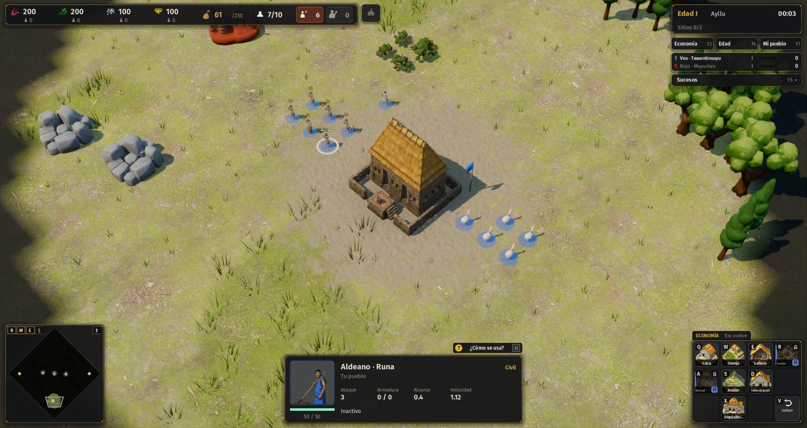
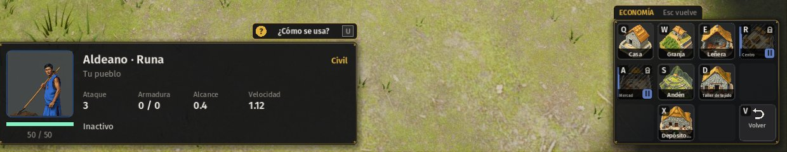
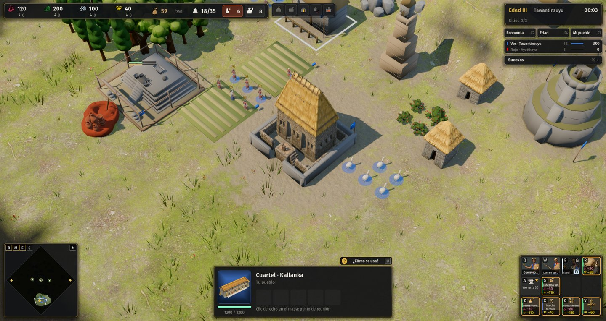
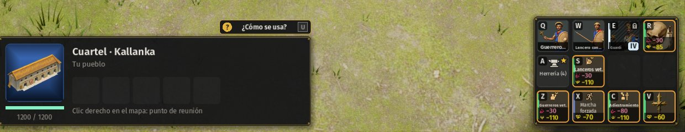
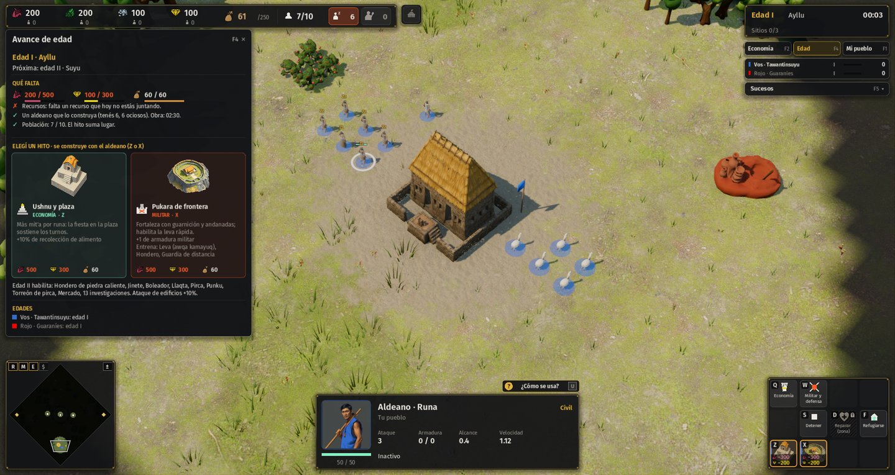
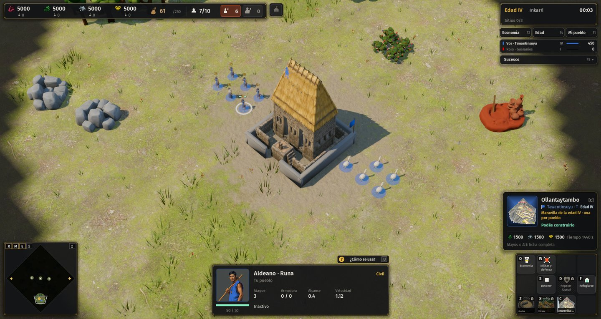
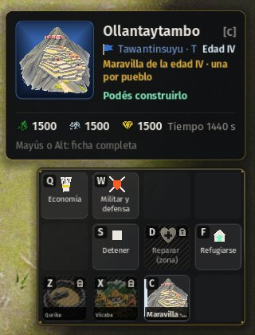
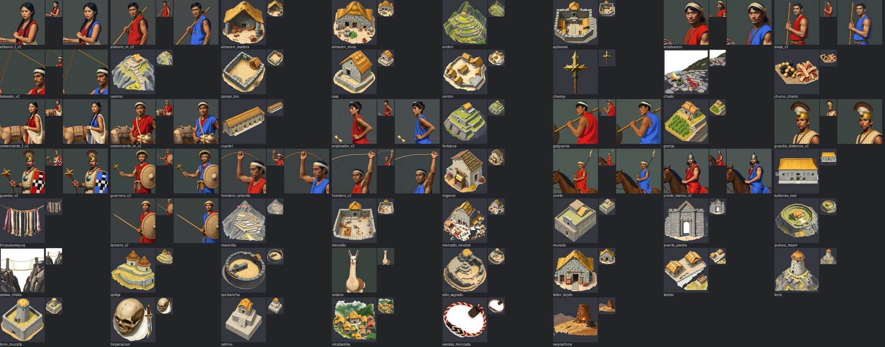

# 48 · El arte en gouache en la interfaz (2026-11-20)

> **Pedido:** llevar al juego el arte en gouache de los incas (etapa 42): retrato de la selección, casillas de entrenar, menú de construir, mejoras, hitos al subir de edad y maravilla. Por datos, para que los otros cinco pueblos se sumen solo con su entrada cuando tengan su tanda. Reglas del autor: un arte por unidad (el mismo en todas las edades), un ícono por edificio, el arte recoloreable con el color del equipo y las edades legibles por equipo y silueta. Si una pieza no se lee a 48 px, queda el glifo.

## Cómo se ve

Aldeano elegido, con el menú de economía. El retrato es la cabeza y el torso, con la túnica en el color del jugador (azul); cada edificio tiene su pintura y el nombre abajo:

Cuartel en la edad III: guerrero, lancero y guardia (bloqueada hasta la IV), y las mejoras propias (cirugía de cráneo, champi). El guerrero y el lancero llevan el mismo escudo; para que se distingan, el recorte deja entrar la porra y la lanza:

Avance de edad: cada tarjeta de hito lleva su pintura arriba (Ushnu y plaza, Pukara de frontera). Las casillas Z y X del aldeano también:

La maravilla (Ollantaytambo) en la casilla C de la IV y en la ficha:

Las 54 piezas procesadas: ícono de 128 px, el mismo a 48 px y, en las unidades, teñido de azul con la capa del equipo:

## Paso a paso

1. **Datos** — `data/arte_pueblos.json`: por pueblo, la carpeta de destino, la de los PNG originales (fuera del repo) y el mapeo id del juego → pieza: 17 unidades (aldeano y comerciante con pieza por sexo; catapulta y ariete comparten el hondero de piedra caliente), 28 edificios con los 6 hitos y la maravilla, y las 8 mejoras propias. Se usan las v2 (adultos) de la etapa 42.
2. **Proceso** — `tools/arte_pueblo.py --pueblo=tawantinsuyu` (Pillow y numpy, sin GPU, 80 s): retrato de 320 px y ícono de 128 px en WebP (2,4 MB los 54). Las unidades conservan su fondo pintado; el ícono es cabeza y torso, centrado en la figura, con recorte a mano para 5 piezas (`icono_unidad.cajas`). Edificios y mejoras se recortan del fondo claro (relleno desde el borde) y se ajustan al cuadrado.
3. **Color del equipo** — con la máscara de `tools/recolorear.py` (la de la etapa 41) se arma una capa aparte: el valor de la tela en gris y la máscara como alfa (`*_equipo.webp`). El juego la dibuja encima de la pintura multiplicada por el color del jugador: no recalcula píxeles y vale en cualquier tamaño. Se usa en la selección (color del dueño), en la ficha y en la grilla (color propio).
4. **Código** — `src/game/ui/arte_pueblo.gd` (nuevo) busca la pieza y dibuja. `Retratos.de` y `de_tipo` dan prioridad al arte del pueblo (gana sobre los retratos por edad de `data/retratos.json`, por la regla «un arte por unidad»); el panel de la selección usa el busto. `Controller` marca las casillas de construir, entrenar e investigar con arte; `EstadoCasilla` la dibuja ocupando la casilla, con el nombre en una franja oscura abajo, y deja encima los estados de siempre (rayado y edad si está bloqueada, franja de lo que falta, tilde). `panel_edad.gd` pone el hito pintado arriba de cada tarjeta.
5. **Sin arte** — los pueblos sin entrada (o un id sin pieza) siguen con glifos y retratos de antes. Para sumar uno: su entrada en `data/arte_pueblos.json` y correr el script.

## Reglas del autor

- Un arte por unidad, el mismo en todas las edades: sí; el aldeano inca ya no cambia de retrato por edad.
- Un ícono por edificio: sí, también hitos y maravilla.
- Recoloreable por equipo: sí, en la selección, la ficha y la grilla.
- Edades legibles por equipo y silueta: en la interfaz, la edad sigue en la franja de color de la casilla y en la pastilla «IV»; el cambio de equipo por edad queda para los modelos 3D (hojas por edad de la etapa 42).

## Legibilidad a tamaño chico

- **Chaski en relevo** (mejora): un camino con objetos chicos; a 48 px no se lee. Queda el glifo en la casilla (`sin_casilla`); en la ficha, el arte.
- Leñera, depósito de piedra y taller de tejido son casas de piedra con techo de paja parecidas; se distinguen por el nombre de abajo. Conviene repetirlas con el objeto de cada una más grande.
- Guerrero y lancero se confundían con el recorte automático (mismo escudo y gorro): recorte a mano con el arma adentro.
- Los accesorios (armas, herramientas) y las hojas 3D no van a la interfaz: son para los modelos.
- No se tocó la cola de producción ni los íconos del mapa (siguen con glifo).

## Pruebas

- `tests/iconos.gd` (752 grillas, OK), `tests/grilla.gd` (OK), `tests/casillas.gd` (600 grillas, OK), `tests/test_paleta.gd` (OK), `tests/test_determinism.gd` (OK).
- Autotest con ventana, `--autotest --civ=tawantinsuyu --terreno=llano`: AUTOTEST OK, 255 comprobaciones, sin SCRIPT ERROR.
- `tests/galeria_grilla.gd` pide ventana; con `--headless` se cuelga (ya lo decía su encabezado).

## Tropiezos

- `ImageDraw.floodfill` de Pillow 13 no rellenaba imágenes en escala de grises: el recorte del fondo salía vacío. Se cambió por una reconstrucción con numpy.
- Tras reprocesar las piezas, Godot seguía mostrando las viejas hasta reimportar (`--import`).

## Commits

- Proceso 48: arte en gouache de los incas en la interfaz (datos, script, retrato, grilla, hitos y maravilla).
