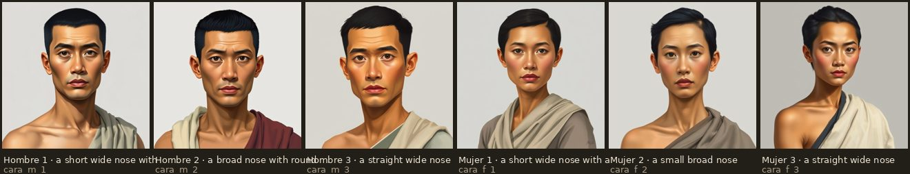
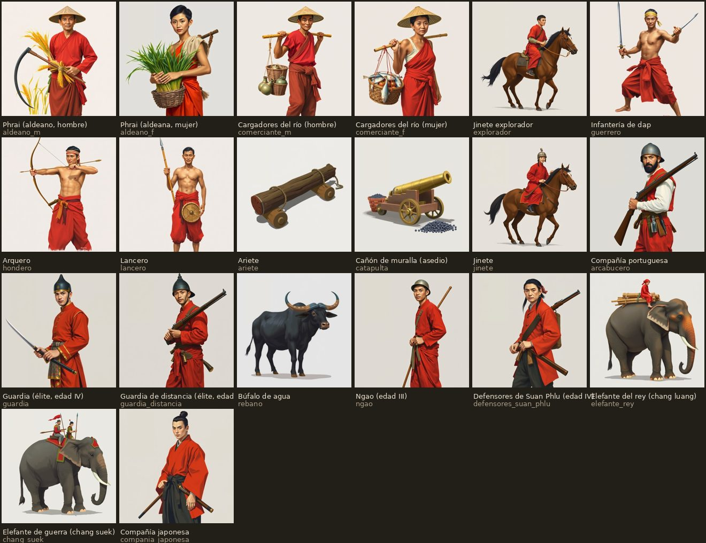
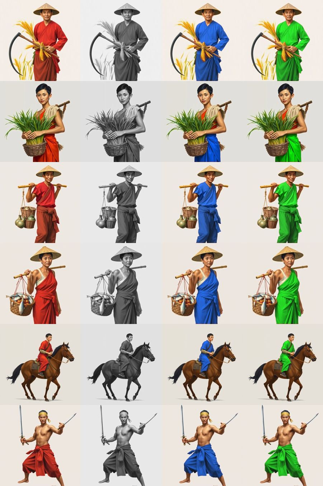
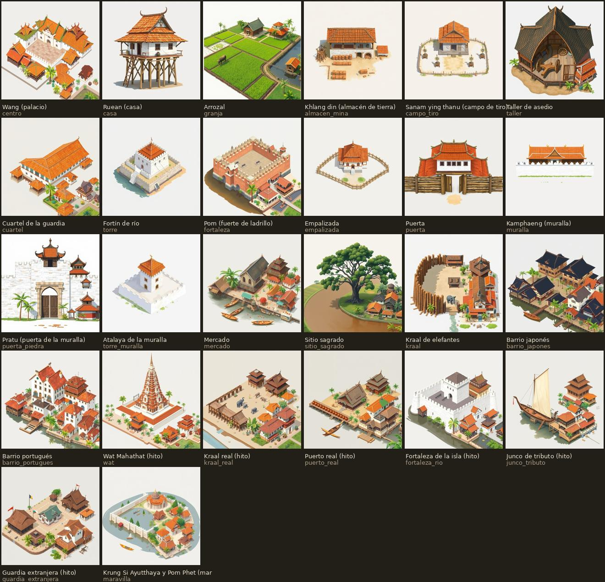
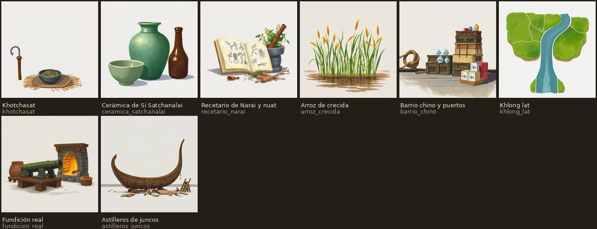
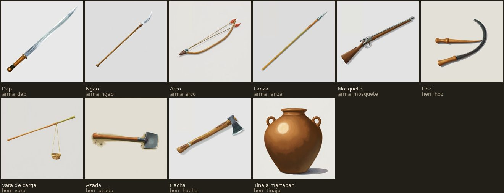
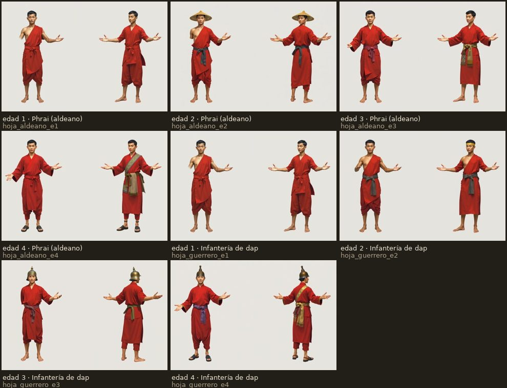
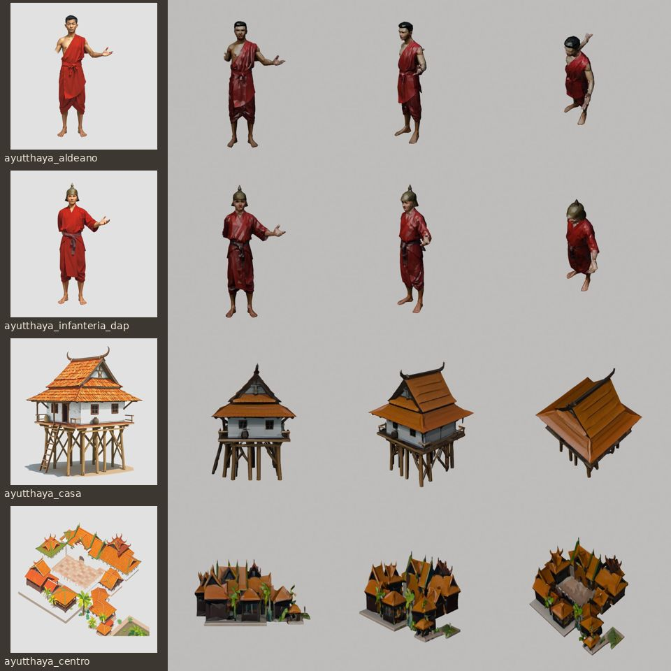
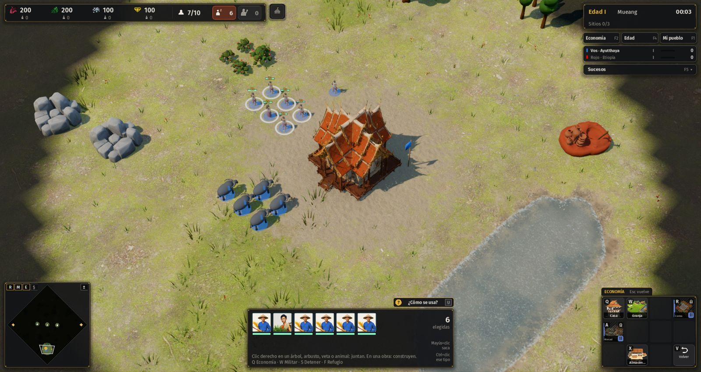

# 49 · Arte de Ayutthaya en gouache (2026-11-21)

> **Pedido:** el juego de arte de los incas (proceso/42, estilo C, gouache) llevado a
> Ayutthaya, el último de los cinco pueblos. Mismas reglas que en
> [los mapuches](../49-arte-mapuches/README.md): un arte por unidad, un ícono por edificio, la
> edad por el equipo y la silueta, la ropa del equipo en rojo plano, hojas 3D por edad, adultos de
> 25 a 35 años, caras siamesas (tailandesas); 3D del phrai, la infantería de dap, la ruean y el
> wang (sin usar, C-106); y el arte en la interfaz.

Página con los prompts: [`index.html`](index.html). Piezas en [`armar_piezas.py`](armar_piezas.py)
y [`piezas_ayutthaya.py`](piezas_ayutthaya.py), generadas con `tools/arte_gouache.py`. PNG fuera
del repo, en `comfyui/output/ayutthaya_gouache/`.

## Caras

Ronda de 6: «Siamese Thai man/woman from the kingdom of Ayutthaya in central Thailand», cara
ancha, pómulos altos, piel castaño claro; los dos con el pelo muy corto, como lo describe La
Loubère (1691). Elegidos: **hombre 1** (nariz corta y ancha) y **mujer 2** (nariz chica y ancha).
Todos adultos; la cara fija lleva la frase de edad desde el principio.

## Unidades (20)

Las compañías extranjeras llevan su propia cara, no la siamesa: la portuguesa con un mestizo
luso-asiático, los defensores de Suan Phlu (la comunidad china de 1767) y la compañía japonesa.
Mujeres phrai en el campo y en el mercado (Reid, 1988). El chong kraben rojo es la zona del
equipo; en las mujeres, el pha nung.

## Edificios, hitos y maravilla (26)

Todos seculares salvo el Wat Mahathat (hito), que se pinta solo por su arquitectura.

## Mejoras propias (8), accesorios (10) y hojas por edad (8)

Phrai e infantería de dap en Mueang, Krung Si, Ekkarat y Mueang Tha: el chong kraben rojo no
cambia; suben la faja, el sombrero de palma, la chaqueta, la faja de seda y, en la tropa, la
chaqueta roja con el casco de punta y después el casco lacado de la guardia.

## Modelos 3D

`ayutthaya_aldeano` 744 KB, `ayutthaya_infanteria_dap` (hoja de la edad III, con chaqueta roja y
casco de punta) 745 KB, `ayutthaya_casa` (la ruean del reintento, aislada) 524 KB,
`ayutthaya_centro` (el wang) 661 KB, en `assets/generados/modelos/local/`. No se usan todavía
(C-106).

Problemas: la hoja del phrai de la edad I tiene un brazo cruzado bajo la tela del hombro y el rig
lo deja torcido en la vista del RTS; la ruean sale bien (pilotes, techo de puntas curvas); el
wang es un conjunto complejo y queda como maqueta con muchos techos y algo de pasto suelto.

## En el juego

`data/arte_pueblos.json → pueblos.ayutthaya` y `tools/arte_pueblo.py --pueblo=ayutthaya` (el
ariete queda con glifo en la casilla). tests/iconos.gd y tests/grilla.gd en OK. Aldeanos elegidos
y la grilla de economía:

## Historiadores (proceso/25) aplicados

- Sin imágenes del Buda en ninguna pieza (ni de decoración, ni en el piso, ni cortadas) y sin
  monjes. El Wat Mahathat solo con el prang de tradición jemer, los prangs chicos y el viharn;
  sigue pendiente la consulta theravada (03, §4).
- La maravilla es la ciudad isla con Pom Phet, sin el wat del palacio (C-79 a).
- El palacio y los barrios sin templos; el barrio portugués sin iglesia ni cruz.
- El elefante sin la parte ritual (augurios, elefantes blancos): carga y guerra.
- La ngao como hoja curva sobre un asta, no una alabarda.
- La tropa es sobre todo leva de phrai a pie; el elefante, élite.

## Revisión y reintentos

Se miraron las 78 imágenes. Reintentos (la anterior como `img/<id>_v1.jpg`):

| Pieza | Problema | Resultado |
|---|---|---|
| aldeano_m, comerciante_m, guerrero, hondero, lancero | se leían de unos 20 años | v2 con la frase de edad: adultos |
| comerciante_f | sombrero cónico | v2 igual (ver abajo) |
| casa, almacen_mina, campo_tiro, torre, empalizada, puerta, muralla, torre_muralla | venían con un barrio de casas alrededor | v2 con «only this one structure, alone» y sin el río en la descripción: aislados (la empalizada se lee poco) |
| arma_dap | espada europea con gavilanes | v2 con guarda de disco y mango largo |
| herr_hoz, herr_azada | salían picos | v3 se leen como hoz y pala |

Problema que queda: FLUX dibuja el sombrero de palma como el *nón lá* cónico vietnamita aunque se
le pida «wide flat-topped woven palm-leaf hat (ngop)». En Siam también había sombreros cónicos,
pero conviene revisarlo con alguien que conozca la ropa de época.

## Commits

- (este) arte de Ayutthaya, 3D, interfaz y documentación
