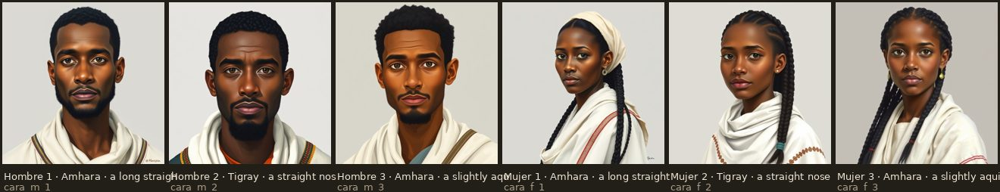
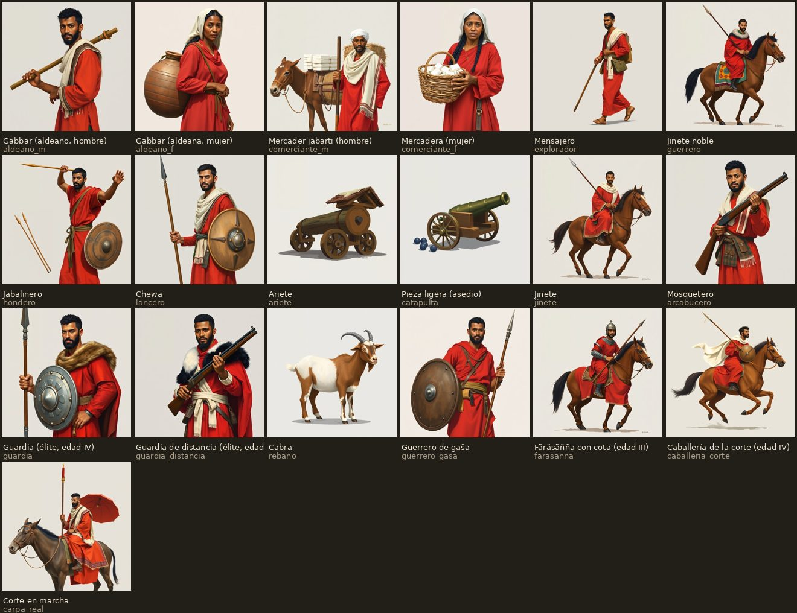
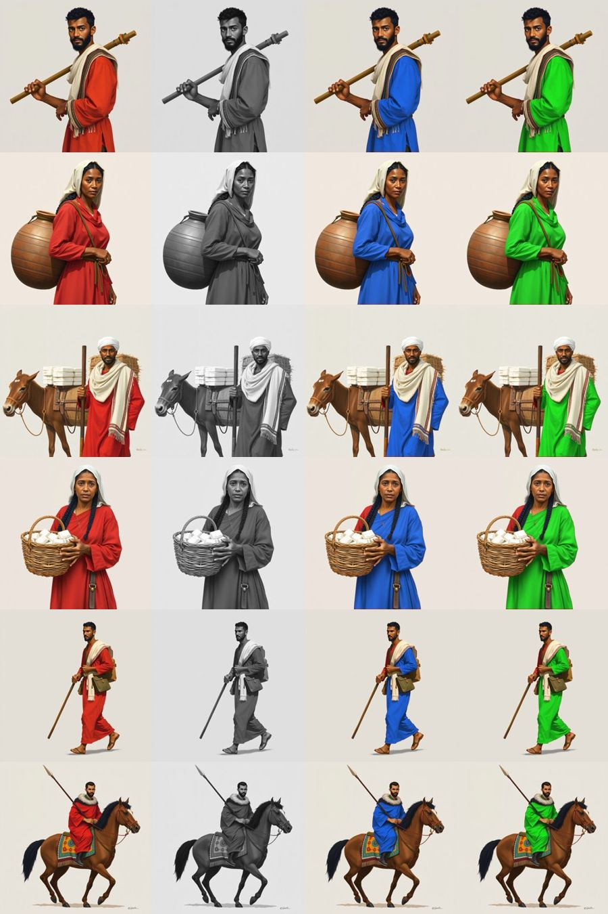
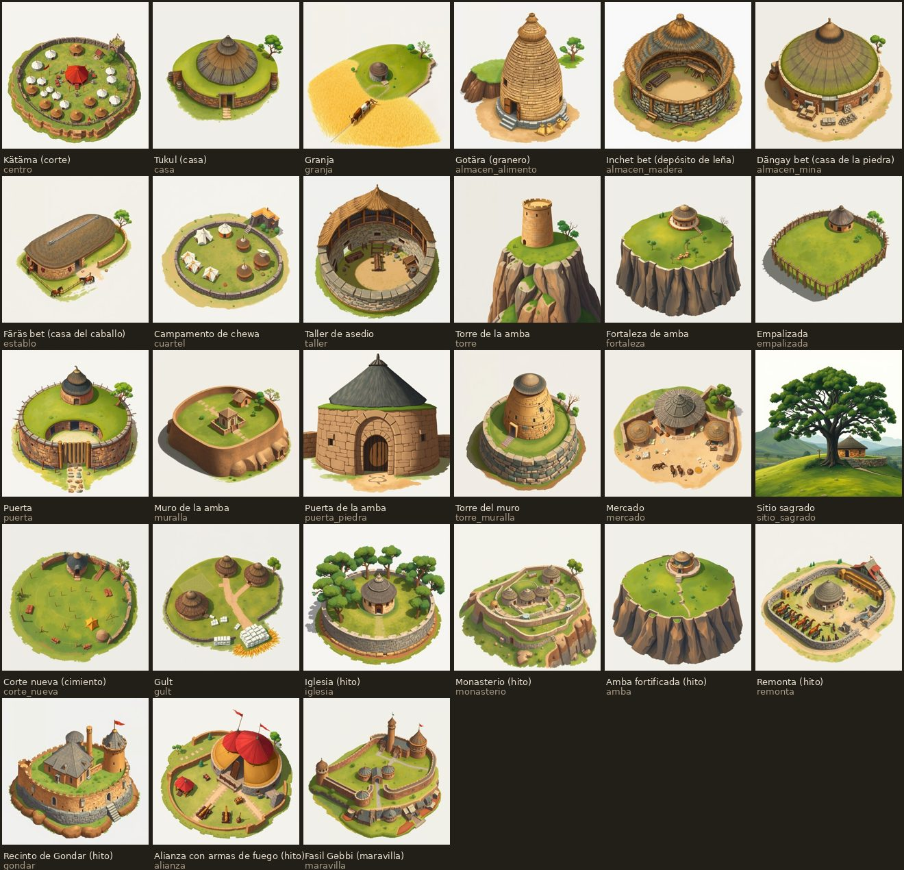
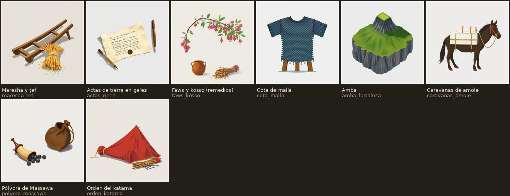
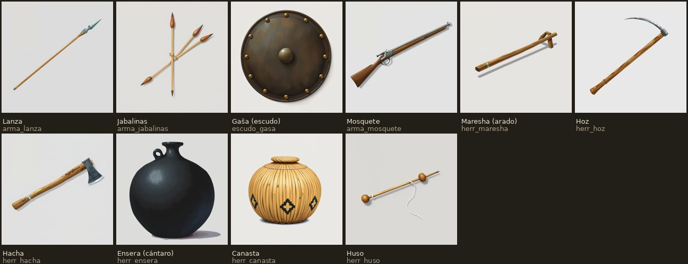
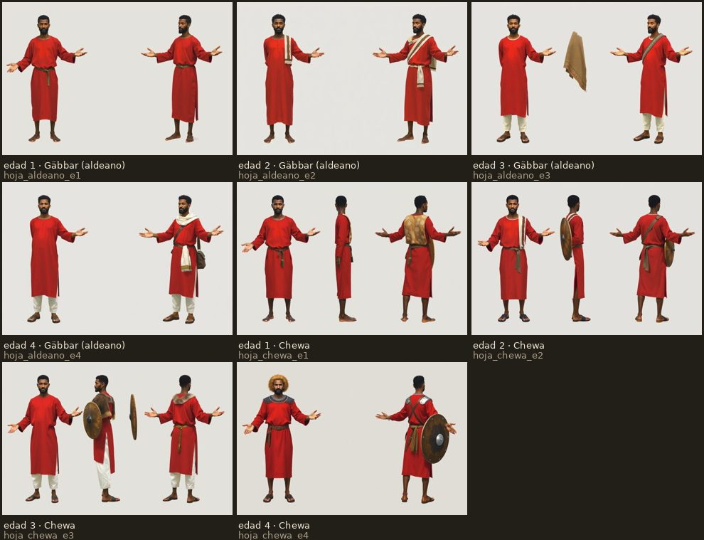
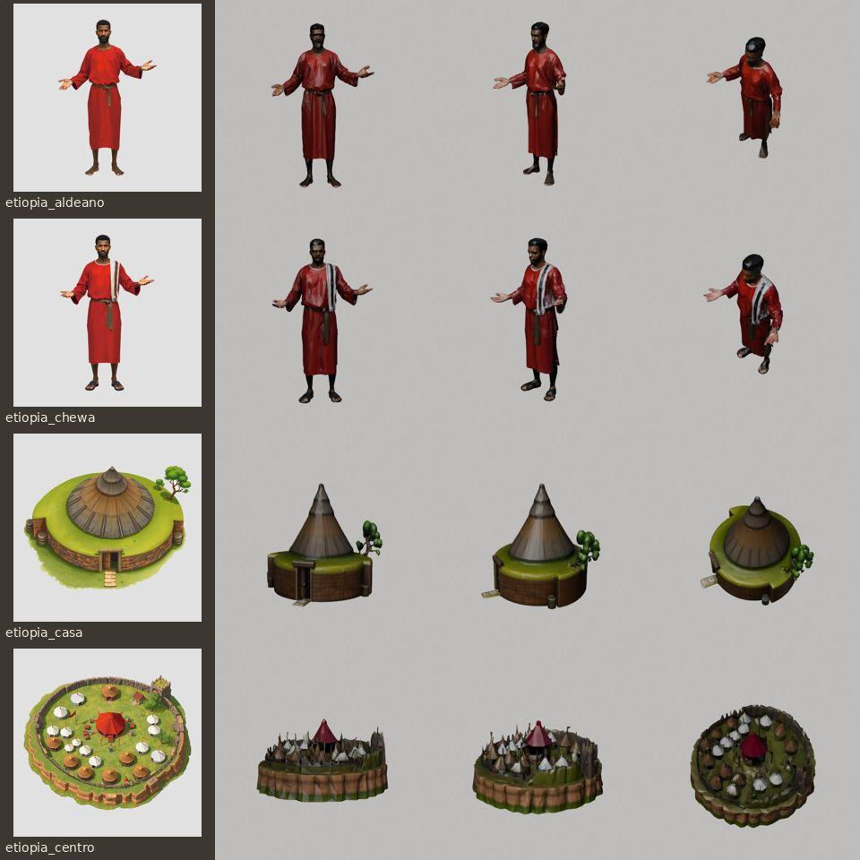
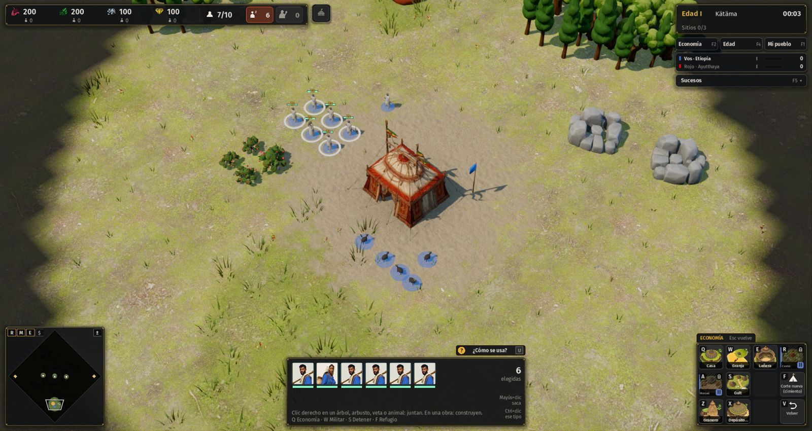

# 49 · Arte etíope en gouache (2026-11-20)

> **Pedido:** el juego de arte de los incas (proceso/42, estilo C, gouache) llevado a Etiopía,
> tercero de los cinco pueblos. Mismas reglas que en [los mapuches](../49-arte-mapuches/README.md):
> un arte por unidad, un ícono por edificio, la edad por el equipo y la silueta, la ropa del
> equipo en rojo plano, hojas 3D por edad, adultos de 25 a 35 años, caras de las tierras altas
> (amhara y tigray); 3D del aldeano, el chewa, el tukul y el kätäma (sin usar, C-106); y el arte
> en la interfaz.

Página con los prompts: [`index.html`](index.html). Piezas en [`armar_piezas.py`](armar_piezas.py)
y [`piezas_etiopia.py`](piezas_etiopia.py), generadas con `tools/arte_gouache.py`. PNG fuera del
repo, en `comfyui/output/etiopia_gouache/`.

## Caras

Ronda de 6: «Ethiopian Amhara/Tigray man/woman from the northern Ethiopian highlands», cara
oval, nariz larga y recta o apenas aguileña, piel castaña; el hombre con barba corta, la mujer
con las trenzas finas pegadas a la cabeza (*shuruba*). Elegidos: **hombre 3** (amhara, nariz
apenas aguileña) y **mujer 1** (amhara, con la *netela*). FLUX oscureció la piel respecto de
«warm medium-brown». A la cara fija se le sumó «a mature man/woman of about thirty-five… smile
lines», la lección de los guaraníes.

## Unidades (19)

El jinete noble (la unidad de choque desde la edad I), el chewa, el guerrero de gaša, el
färäsäñña con cota y la caballería de la corte, más la corte en marcha (el kätäma se mudaba).
La túnica roja es la zona del equipo; el *shamma* blanco con su borde queda encima.

## Edificios, hitos y maravilla (27)

## Mejoras propias (8), accesorios (10) y hojas por edad (8)

Gäbbar y chewa en Kätäma, Gult, Ras y Gondar: la túnica roja no cambia; suben el *shamma* con
borde angosto y después ancho, los calzones, las sandalias, la capa de león y, en la IV, la cota
de malla y el tocado de melena.

## Modelos 3D

`etiopia_aldeano` 730 KB, `etiopia_chewa` (hoja de la edad II; la hoja tiene tres vistas, así
que el recorte de frente y espalda se ajustó a mano: 0–38 % y 64–100 %) 745 KB, `etiopia_casa`
493 KB, `etiopia_centro` (kätäma) 608 KB. No se usan todavía (C-106).

Problemas: el tukul se lleva el disco de pasto del ícono como un zócalo alto (el corte del suelo
al 3 % no alcanza); el kätäma queda como una maqueta sobre un disco.

## En el juego

`data/arte_pueblos.json → pueblos.etiopia` y `tools/arte_pueblo.py --pueblo=etiopia`.
tests/iconos.gd y tests/grilla.gd en OK. Aldeanos elegidos y la grilla de economía (la corte
nueva queda con glifo: su ícono no se lee a 62 px):

## Historiadores (proceso/25) aplicados

- Nada sagrado como bono ni como arma, sin cruces. La iglesia (hito) es el recinto redondo con
  su bosque, sin cruz; el monasterio, una comunidad de celdas y libros, **sin Lalibela ni Debre
  Damo** (lugares vivos de peregrinación). Los dos siguen pendientes de C-69.
- Fasil Gəbbi y el recinto de Gondar sin las iglesias del recinto (H-49).
- El *šotäl* queda solo en la ficha (sus imágenes son posteriores); el guerrero de gaša lleva
  lanza, jabalinas y escudo.
- La caballería de la corte con su nombre de reserva, sin rasgos oromo hasta la consulta.
- Las actas de tierra como hoja suelta con sello, no un evangeliario abierto; los remedios sin
  oraciones ni rollos protectores.
- Los mercaderes jabarti como mercaderes musulmanes (turbante), con el *amole*.

## Revisión y reintentos

Se miraron las 78 imágenes. Reintentos (la anterior como `img/<id>_v1.jpg`):

| Pieza | Problema | Resultado |
|---|---|---|
| aldeano_f, comerciante_f | se leían de 22–24 años | v2 con «clearly in her mid thirties…»: adultas |
| guerrero_gasa | dos escudos | v2 con uno |
| herr_hoz | parecía un pico | v2 se lee como hoz |

Quedan como están: la escritura de las actas parece latina (FLUX no escribe ge'ez); la mejora
«Amba» tiene forma de volcán.

## Commits

- (este) arte etíope, 3D, interfaz y documentación
