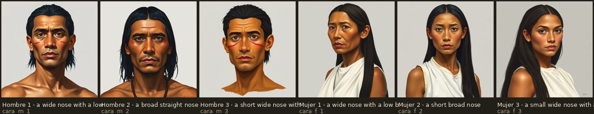
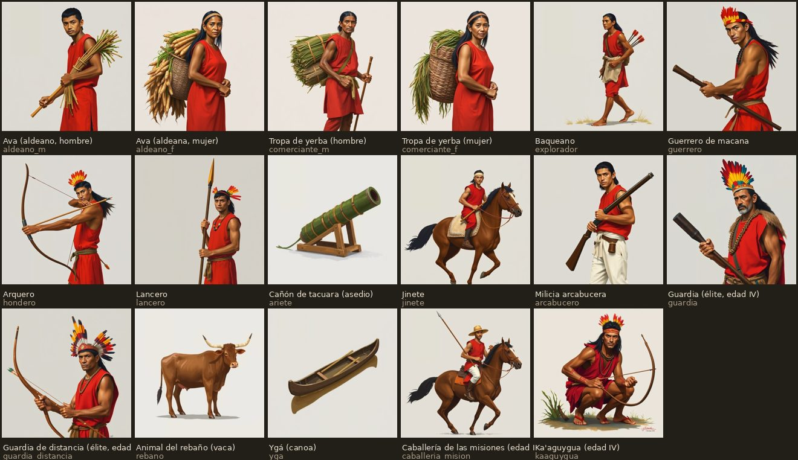
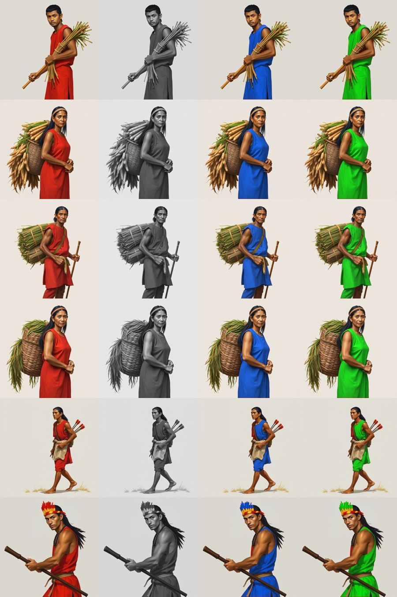
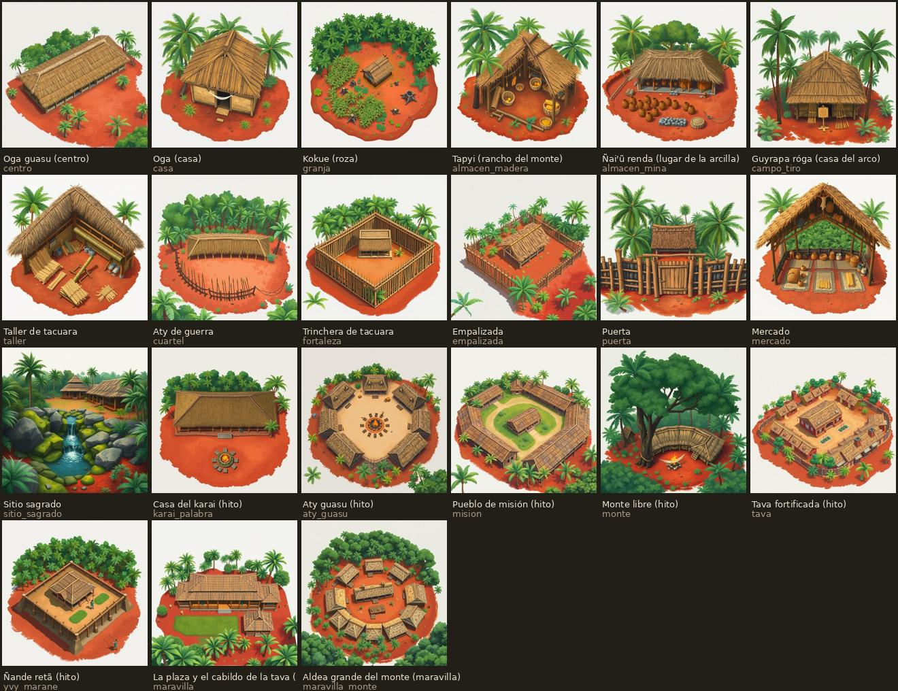
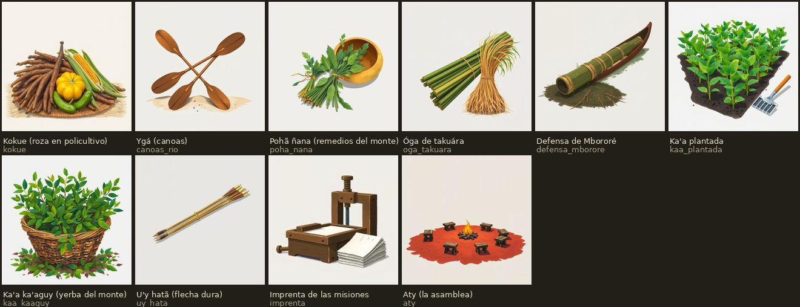
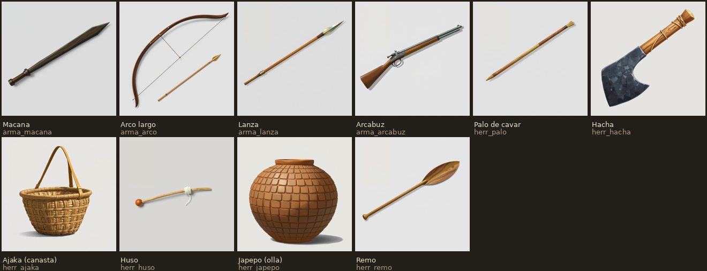
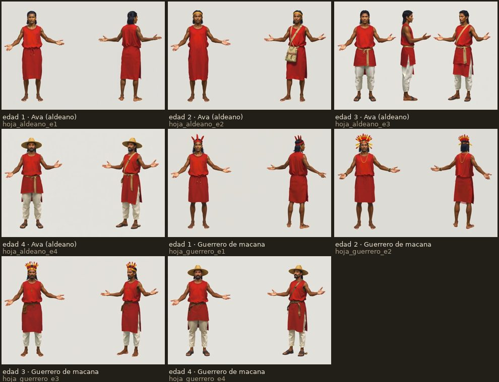
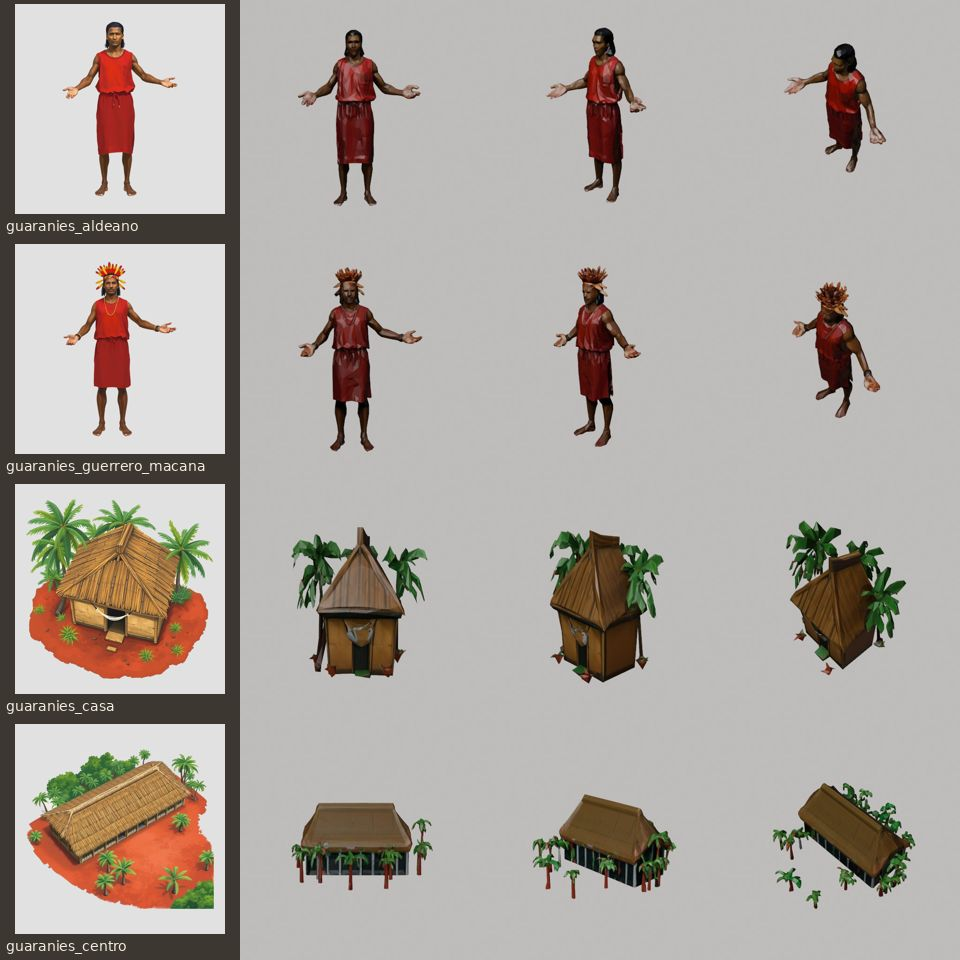
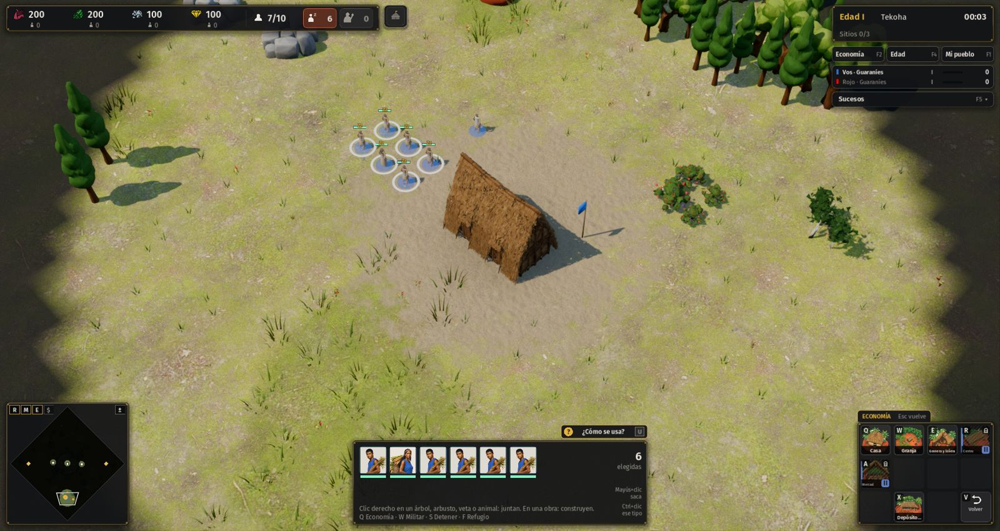

# 49 · Arte guaraní en gouache (2026-11-20)

> **Pedido:** el juego de arte de los incas (proceso/42, estilo C, gouache) llevado a los
> guaraníes, segundo de los cinco pueblos. Mismas reglas que en
> [los mapuches](../49-arte-mapuches/README.md): un arte por unidad, un ícono por edificio, la
> edad por el equipo y la silueta, la ropa del equipo en rojo plano, hojas 3D por edad, adultos
> de 25 a 35 años; 3D del aldeano, el guerrero de macana, la oga y la oga guasu (sin usar,
> C-106); y el arte en la interfaz del juego.

Página con los prompts: [`index.html`](index.html). Piezas en [`armar_piezas.py`](armar_piezas.py)
(caras) y [`piezas_guaranies.py`](piezas_guaranies.py), generadas con `tools/arte_gouache.py`.
PNG fuera del repo, en `comfyui/output/guaranies_gouache/`.

## Caras

Ronda de 6: «Guaraní man/woman from the subtropical forests of the Paraná river in Paraguay»,
cara ancha, pómulos altos y redondeados, piel dorada; el hombre con flequillo recto y una línea
de urucú en los pómulos, la mujer con el pelo largo y suelto. Elegidos: **hombre 2** (nariz
recta y ancha, cara más ancha) y **mujer 2** (nariz corta y ancha). Los seis salieron adultos.

## Unidades (17)

El cañón de tacuara ocupa la ranura del ariete y la de la catapulta (un solo arte, como el
hondero de piedra caliente inca). La túnica (tipoy) roja es la zona del equipo.

## Edificios, hitos y maravillas (21)

Las dos vías de la IV tienen su maravilla: la plaza y el cabildo (misión) y la aldea grande del
monte.

## Mejoras propias (10), accesorios (10) y hojas por edad (8)

Ava y guerrero de macana en Tekoha, Amundá, Mbororé y Tava: el tipoy rojo no cambia; suben la
vincha, el bolso, los calzones de algodón de las misiones, las plumas y el sombrero de paja de la
milicia.

## Modelos 3D

`guaranies_aldeano` 737 KB, `guaranies_guerrero_macana` (hoja de la edad II, con corona de
plumas) 759 KB, `guaranies_casa` 520 KB, `guaranies_centro` (oga guasu) 613 KB, en
`assets/generados/modelos/local/`. No se usan todavía (C-106).

Problemas: las palmeras del ícono entran en el modelo como geometría (la oga y la oga guasu
quedan con palmeras pegadas); la oga sale más cuadrada que en la imagen.

## En el juego

`data/arte_pueblos.json → pueblos.guaranies` y `tools/arte_pueblo.py --pueblo=guaranies`.
tests/iconos.gd y tests/grilla.gd en OK. Aldeanos elegidos y la grilla de economía:

## Historiadores (proceso/25) aplicados

- Casa del karai sin yvyra'i ni mbaraka (H-23): la casa grande y la plaza con los asientos.
- Misión, tava y maravilla sin la fachada de la iglesia ni la cruz (H-37): casas con galerías,
  talleres, el cabildo de dos plantas.
- La yerba con su nota: también fue tributo y trabajo forzado.
- Los nombres de las edades siguen los del juego (Tekoha, Amundá, Mbororé, Tava); la propuesta
  del historiador (*Tekoha → Guára → Mbororé → Ñande retã*, 01 R1) sigue pendiente.
- «Baqueano» queda con su nota: nombre en castellano, a revisar.

## Revisión y reintentos

Se miraron las 72 imágenes. Reintentos (la anterior como `img/<id>_v1.jpg`):

| Pieza | Problema | Resultado |
|---|---|---|
| aldeano_f, comerciante_f | se leían de 18–20 años | v2 con «a mature woman of about thirty-five… smile lines»: adultas |
| comerciante_m | se leía de unos 20 años | v2 adulto |
| kaaguygua | escena entre hojas grandes, no aislado | v2 agachado sobre fondo liso |
| kokue (mejora) | salieron bananas | v2 mandioca, maíz, porotos y zapallo |
| arma_arco | una lanza, sin arco | v2 arco y flecha |
| herr_hacha | hacha de acero | v2 de piedra |

## Tropiezos

- En el cuerpo entero las mujeres salen más jóvenes que en la ronda de caras, con la misma
  descripción: hizo falta la frase de edad en la pieza.
- Un cuadro de Godot con ventana mientras FLUX generaba subió una imagen de 20 s a 80 s (la GPU
  compartida).

## Commits

- (este) arte guaraní, 3D, interfaz y documentación
