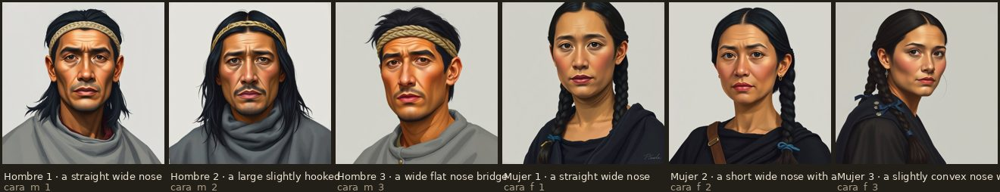
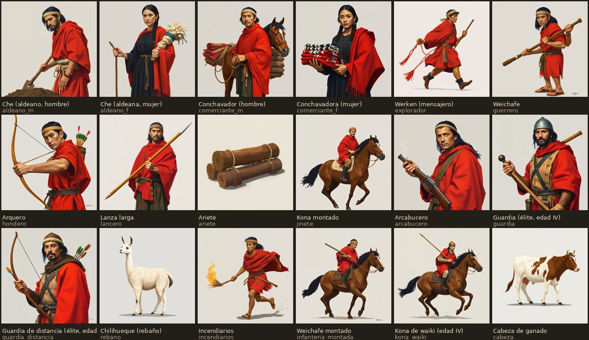
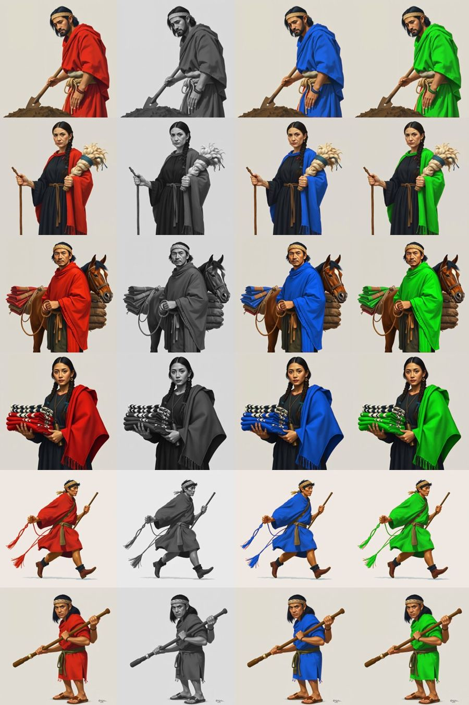
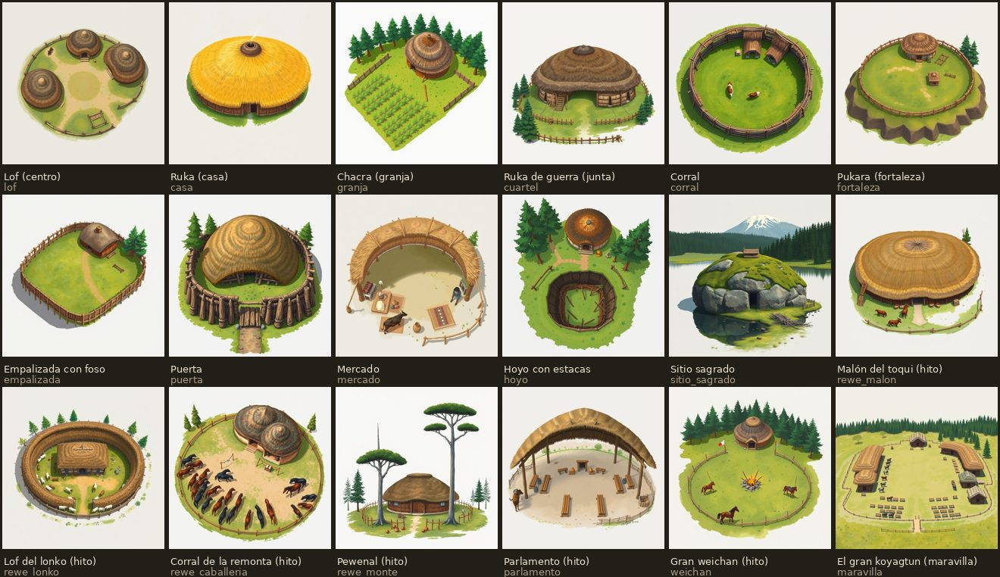
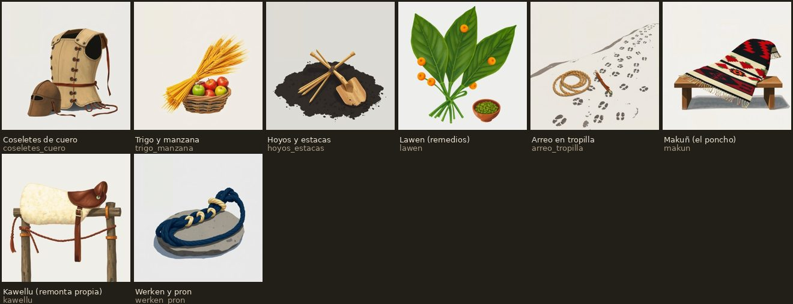
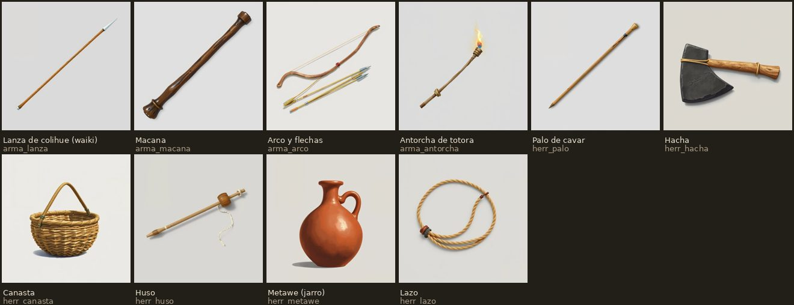
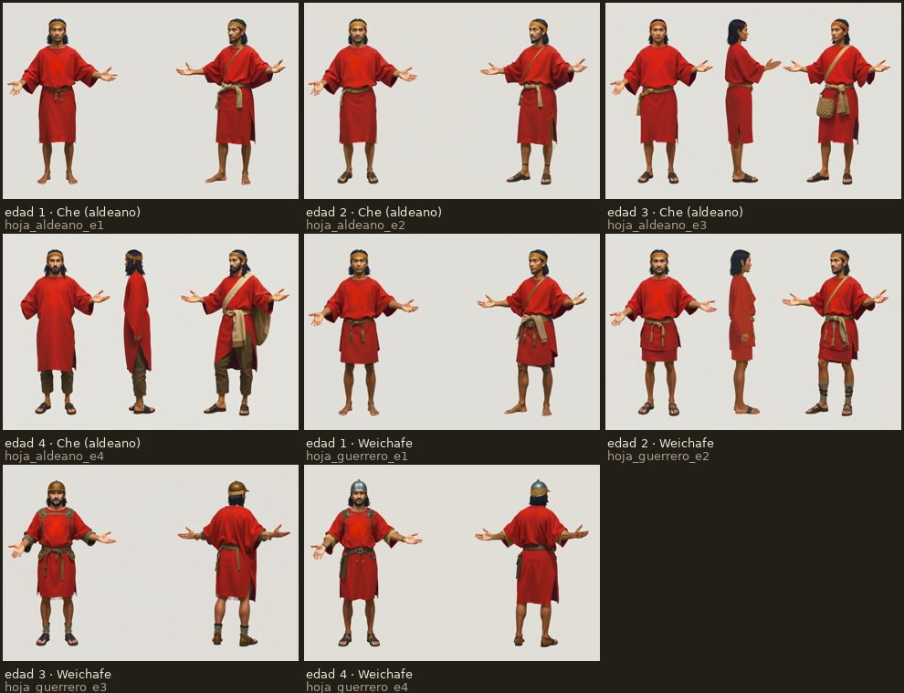
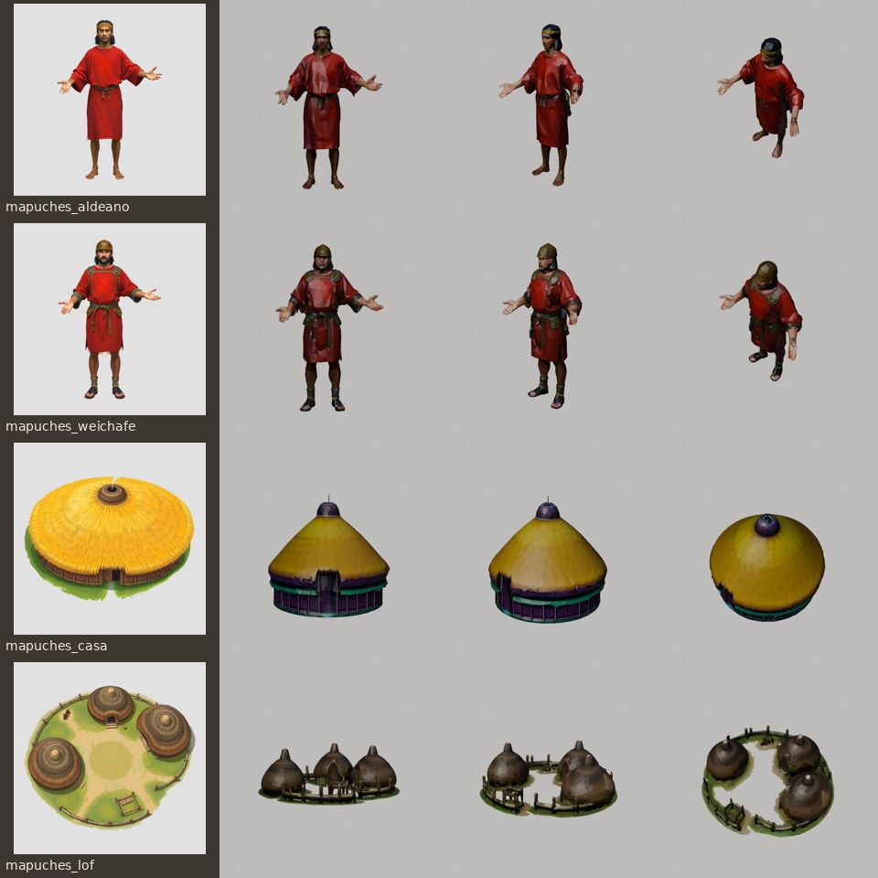
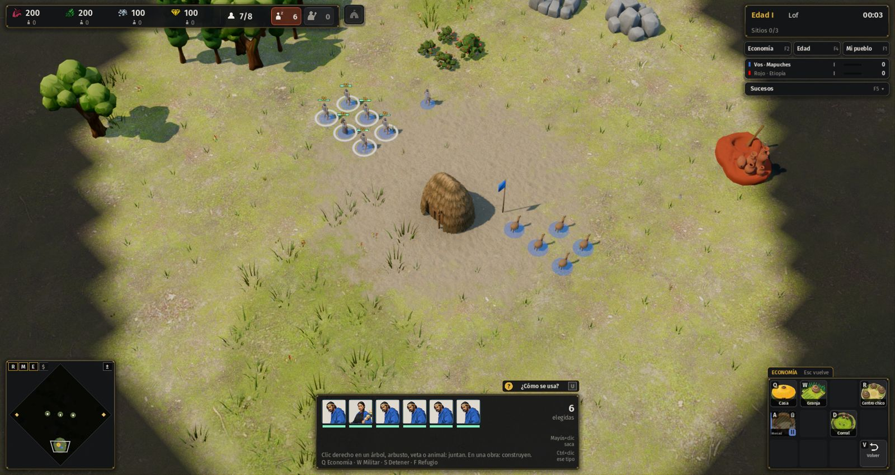

# 49 · Arte mapuche en gouache (2026-11-20)

> **Pedido:** llevar el juego de arte de los incas (proceso/42, estilo C, gouache) a los otros
> cinco pueblos, de a uno. Este es el primero: los mapuches. Un arte por unidad (el mismo en
> todas las edades), un ícono por edificio, la edad por el equipo y la silueta (no por el
> color), la ropa del equipo en rojo plano para recolorear, hojas 3D por edad, caras de adultos
> de 25 a 35 años; los modelos 3D del aldeano, la ruka, el lof y una unidad propia (el
> weichafe), sin pasarlos al juego (C-106). Después, el arte en la interfaz del juego.

Página con todo (prompts incluidos): [`index.html`](index.html). Piezas en
[`armar_piezas.py`](armar_piezas.py) (caras) y [`piezas_mapuches.py`](piezas_mapuches.py) (la
lista), generadas con `tools/arte_gouache.py` (nuevo, común a los cinco pueblos). PNG fuera del
repo, en `comfyui/output/mapuches_gouache/`; acá, JPG de 512 px y las hojas de contacto.

## Caras

Una ronda de 6 (3 hombres, 3 mujeres; cambia la nariz y la semilla). «Mapuche man from Araucanía
in southern Chile» primero, adulto «in his early thirties», pelo largo con trarilonko; la mujer
con dos trenzas atadas con lana azul. Elegidos: **hombre 1** (nariz recta y ancha: el más
mapuche, sin rasgos mestizos) y **mujer 2** (cara ancha y redonda). La mujer 3 salía europea.

## Unidades (18)

Las 12 comunes con su nombre mapuche, las 3 propias (incendiarios, weichafe montado, kona de
waiki), el chilihueque y la cabeza de ganado del malón. El poncho rojo plano es la zona del
equipo.

Comprobación del recoloreo (original | gris | azul | verde):

## Edificios, hitos y maravilla (18)

## Mejoras propias (8), accesorios (10) y hojas 3D por edad (8)

Hojas del che y del weichafe en las cuatro edades (Lof, Rewe, Ayllarewe, Butalmapu): el poncho
rojo queda igual y suben el trarilonko, las ojotas, la faja, el coselete de cuero y, en la IV,
el morrión tomado al enemigo.

## Modelos 3D

Con `tools/gen3d_pipeline.py` (piezas `mapuches_*` en `data/gen3d_piezas.json`), textura con
Hunyuan3D-Paint, rig KayKit en las personas. Frente, tres cuartos y cámara del RTS:

GLB en `assets/generados/modelos/local/`: `mapuches_aldeano` 744 KB, `mapuches_weichafe` (hoja de
la edad III, con coselete y casco) 739 KB, `mapuches_casa` 533 KB, `mapuches_lof` 630 KB. Unos
4,5 minutos por pieza. No se usan en el juego todavía (C-106).

Problemas: la ruka sale con techo cónico (Hunyuan no copia el domo bajo) y Paint le pinta la pared
de violeta y verde agua en los lados que la imagen no muestra; el lof copia bien las tres rukas y
el cerco.

## En el juego

`data/arte_pueblos.json → pueblos.mapuches` y `tools/arte_pueblo.py --pueblo=mapuches` (118
WebP, 1,5 MB). tests/iconos.gd y tests/grilla.gd en OK. Aldeanos elegidos (retrato teñido de
azul) y la grilla de economía con la ruka, la chacra, el lof, el mercado y el corral:

## Historiadores (proceso/25) aplicados

- Nada de lo sagrado: ni machi, ni rewe, ni kultrun, ni canelo, ni toki kura. El «Lof del
  lonko» (`rewe_lonko`) muestra la ruka grande del lonko con su ganado, no el nguillatuwe
  (vida religiosa actual, C-74). El sitio sagrado es solo paisaje (piedra, lago, volcán).
- Hitos con los nombres que proponen (01 R4): «Malón del toqui», «Corral de la remonta»,
  «Pewenal» (el pewen como alimento).
- La «Ruka de guerra» no tiene registro (01 R5): se pinta el lugar de junta, un galpón abierto
  con las lanzas, no una casa de guerra.
- Pukara de madera y tierra, sin cantería (Dillehay, 2007).
- El caballo solo en las unidades de la edad II en adelante.

## Revisión y reintentos

Se miraron las 68 imágenes. Reintentos (la anterior queda como `img/<id>_v1.jpg`; el PNG como
`<id>_v1_<semilla>.png`, que `arte_pueblo.py` ignora):

| Pieza | Problema | Resultado |
|---|---|---|
| explorador | escena con bosque, no aislado | v2 bien |
| lancero | lanza corta, cara poco clara | v2 bien |
| ariete | el marco solo, sin el tronco | v2 igual; v3 (tronco sobre rodillos) se lee poco: **queda con glifo en la casilla** |
| cuartel | óvalo ilegible | v2 se lee como galpón |
| rewe_monte | sin araucarias | v2 con copas en paraguas |
| arma_macana | parecía una trompeta | v2 bien |
| arma_arco | solo una flecha | v2 bien |
| herr_hacha | hacha de acero | v3 de piedra |

## Tropiezos

- FLUX no dibuja un ariete colgado de su marco: tres intentos. Es el único que no cumple.
- `tools/arte_pueblo.py` toma el PNG de semilla más baja: los reintentos renombran el viejo a
  `<id>_v<n>_<semilla>.png` para que tome el nuevo.
- Con `--cache-none` y el scope a 12 GB, FLUX tarda 19–20 s por imagen (no 85 como en la 42).
- La primera espera (`until ! pgrep -f arte_gouache.py`) se encontraba a sí misma en la línea de
  comandos y no terminaba nunca.
- `gen3d_pipeline.py` no conocía los edificios propios de un pueblo (el lof): ahora los busca en
  `data/civs/<civ>.json → edificios_nuevos` con el campo `civ` de la pieza.

## Commits

- (este) arte mapuche, 3D, interfaz y documentación
