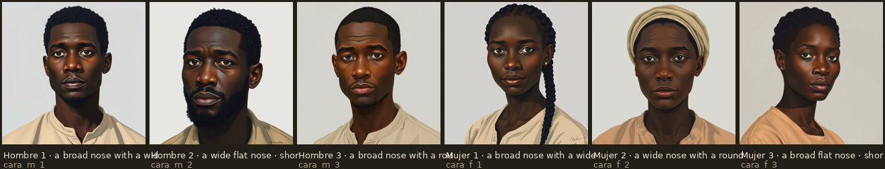
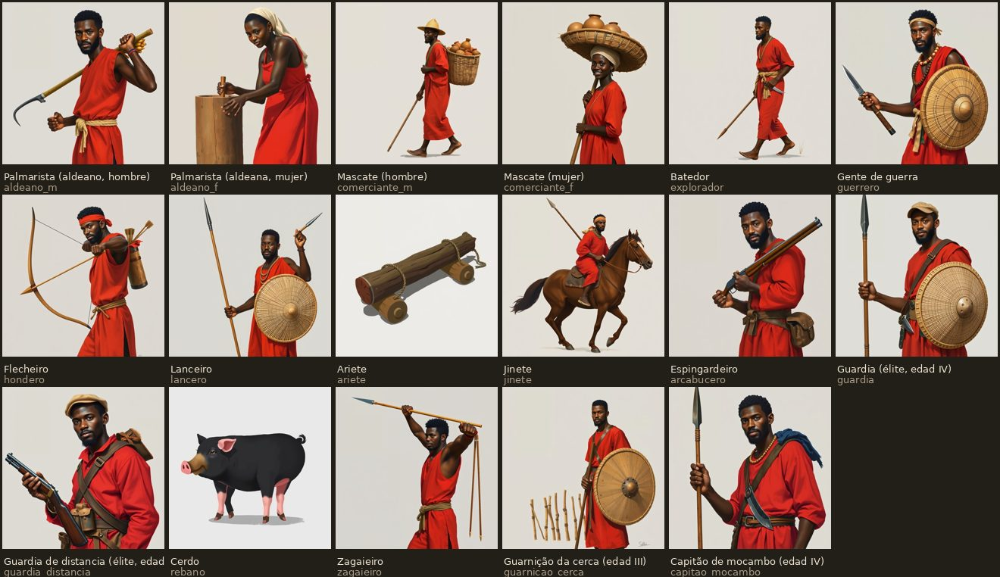
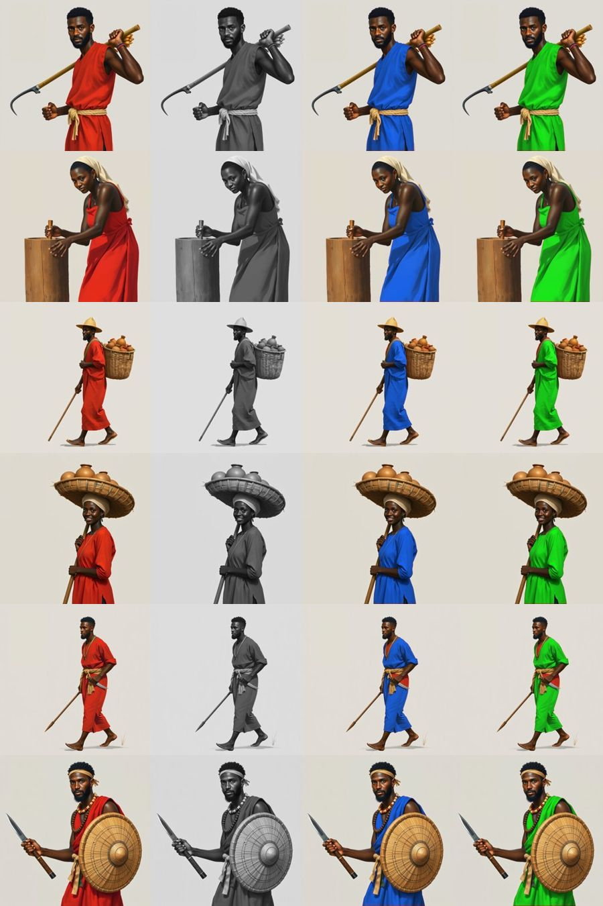
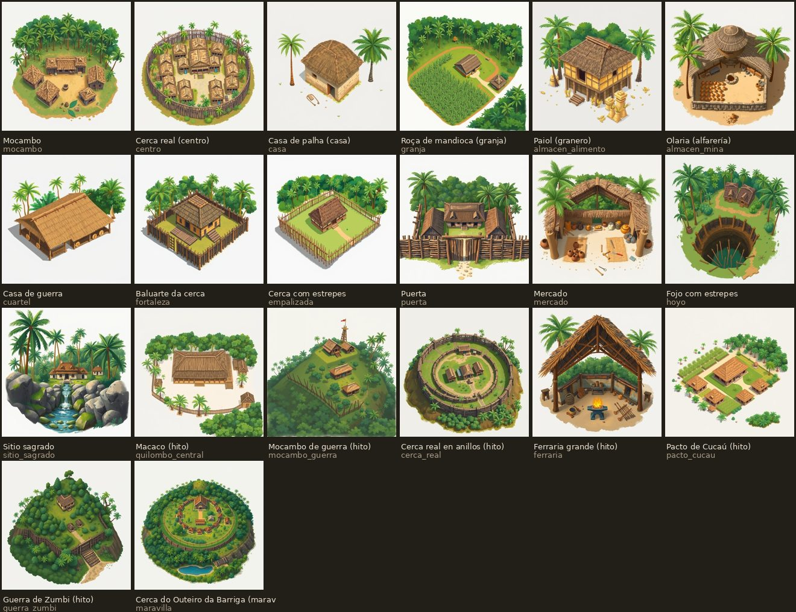
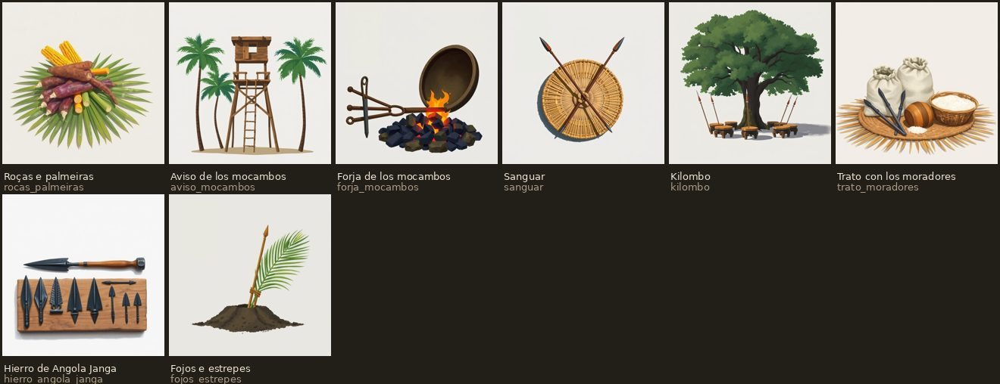
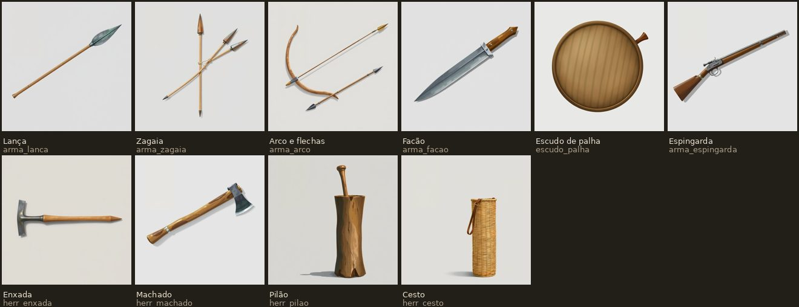
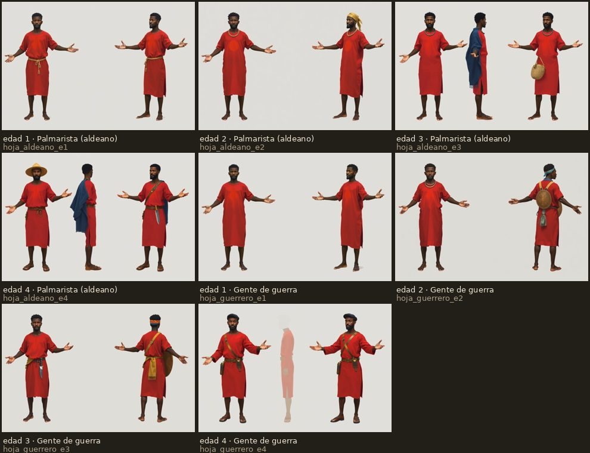
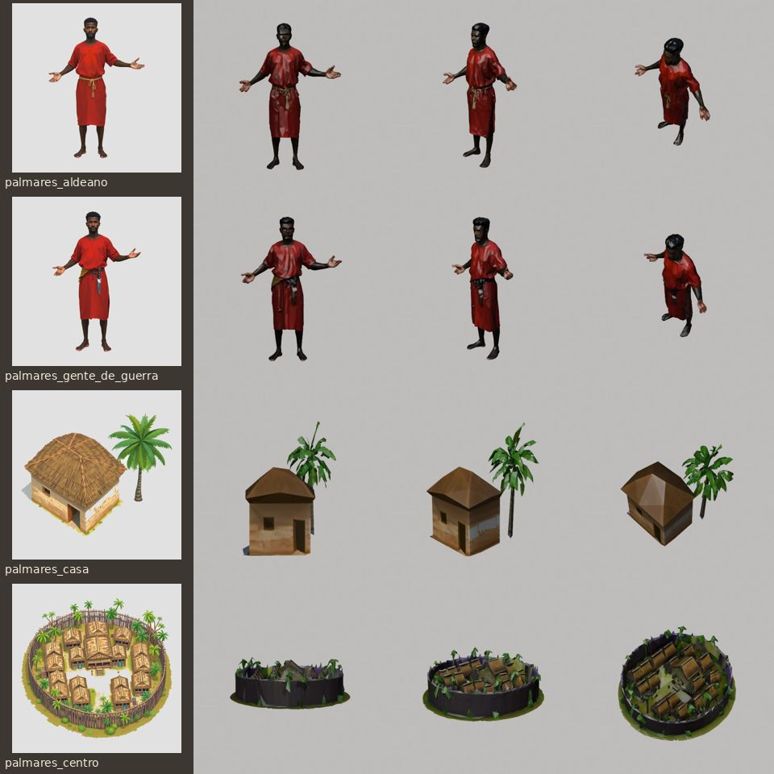
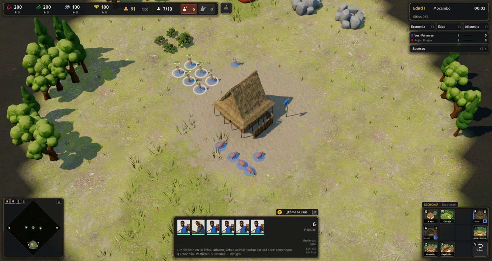

# 49 · Arte de Palmares en gouache (2026-11-20)

> **Pedido:** el juego de arte de los incas (proceso/42, estilo C, gouache) llevado a Palmares,
> cuarto de los cinco pueblos. Mismas reglas que en [los mapuches](../49-arte-mapuches/README.md):
> un arte por unidad, un ícono por edificio, la edad por el equipo y la silueta, la ropa del
> equipo en rojo plano, hojas 3D por edad, adultos de 25 a 35 años, caras afrobrasileñas de
> ascendencia centroafricana (Kongo, Ndongo); 3D del palmarista, la gente de guerra, la casa de
> palha y la cerca real (sin usar, C-106); y el arte en la interfaz.

Página con los prompts: [`index.html`](index.html). Piezas en [`armar_piezas.py`](armar_piezas.py)
y [`piezas_palmares.py`](piezas_palmares.py), generadas con `tools/arte_gouache.py`. PNG fuera del
repo, en `comfyui/output/palmares_gouache/`.

## Caras

Ronda de 6: «Afro-Brazilian man/woman of Central African Kongo and Mbundu descent, from the
quilombo of Palmares in northeastern Brazil», cara ancha, nariz ancha, piel castaño oscuro; tres
peinados por sexo. Elegidos: **hombre 2** (nariz ancha y chata, barba corta) y **mujer 2**
(pañuelo en la cabeza, la más madura). Todos salieron adultos. La cara fija lleva la frase de
edad («about thirty-five… smile lines») desde el principio.

## Unidades (17)

Las propias: zagaieiro, guarnição da cerca y capitão de mocambo (un jefe de edad madura, sin
corona ni insignia: no se glorifica a una persona). La túnica roja es la zona del equipo.

## Edificios, hitos y maravilla (20)

## Mejoras propias (8), accesorios (10) y hojas por edad (8)

Palmarista y gente de guerra en Mocambo, Palmares, Angola Janga y Cucaú o Quilombo: la túnica
roja no cambia; suben las cuentas, el pañuelo, la tela índigo, el escudo de palma, el facão y, en
la IV, la bandolera con el cuerno de pólvora y el gorro.

## Modelos 3D

`palmares_aldeano` 489 KB, `palmares_gente_de_guerra` (hoja de la edad III, con faja ocre y
facão) 492 KB, `palmares_casa` 467 KB, `palmares_centro` (la cerca real) 638 KB, en
`assets/generados/modelos/local/`. No se usan todavía (C-106).

Problemas: Hunyuan3D-Paint pierde los rasgos en la piel oscura y la cara queda casi negra y sin
facciones (en la imagen se ven bien): hay que revisarlo antes de usar estos modelos, por ejemplo
con el proyector en la cabeza o con más luz en la hoja. La palmera del ícono de la casa entra en el
modelo; la cerca real sale con la empalizada negra y las casas chatas adentro.

## En el juego

`data/arte_pueblos.json → pueblos.palmares` y `tools/arte_pueblo.py --pueblo=palmares`.
tests/iconos.gd y tests/grilla.gd en OK. Aldeanos elegidos y la grilla de economía:

## Historiadores (proceso/25) aplicados

- Sin capoeira, berimbau ni candomblé; el sanguar (esquivar en orden abierto) se muestra con
  lanzas y escudo, no como antecedente de la capoeira (H-28).
- Sin Aqualtune. Sin la bandera blanca en el Pacto de Cucaú (imagen europea sin fuente): la aldea
  en hileras con sus roças.
- Sin estandarte de Zumbi en la Guerra de Zumbi (no hay fuente de época): el cerro con la cerca y
  un tambor.
- El Macaco sin la capilla; la forja sin el rito ni la realeza del herrero; las roças con las
  palmeras nativas, no el dendê.
- Las tres cercas de la Barriga (H-17) en el hito y en la maravilla.
- Gente que trabaja, comercia y se defiende: ninguna pieza la muestra escondida ni encadenada.

## Revisión y reintentos

Se miraron las 69 imágenes. Reintentos (la anterior como `img/<id>_v1.jpg`):

| Pieza | Problema | Resultado |
|---|---|---|
| rocas_palmeiras | la mandioca parecía zanahoria | v2 con raíces de cáscara marrón y batata morada |
| trato_moradores | letras inventadas en la bolsa y el barril | v2 sin letras |
| hierro_angola_janga | una espada europea | v2 puntas de lanza y flecha forjadas |
| herr_enxada | un martillo; después un pico | v3 se lee como azada |

El escudo de palma sale de madera en el accesorio; el aldeano lleva una hoz larga en lugar de la
azada. Se dejan.

## Commits

- (este) arte de Palmares, 3D, interfaz y documentación
