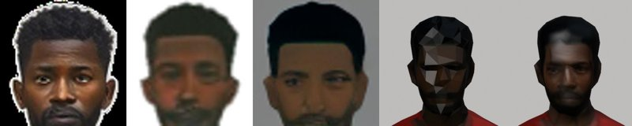
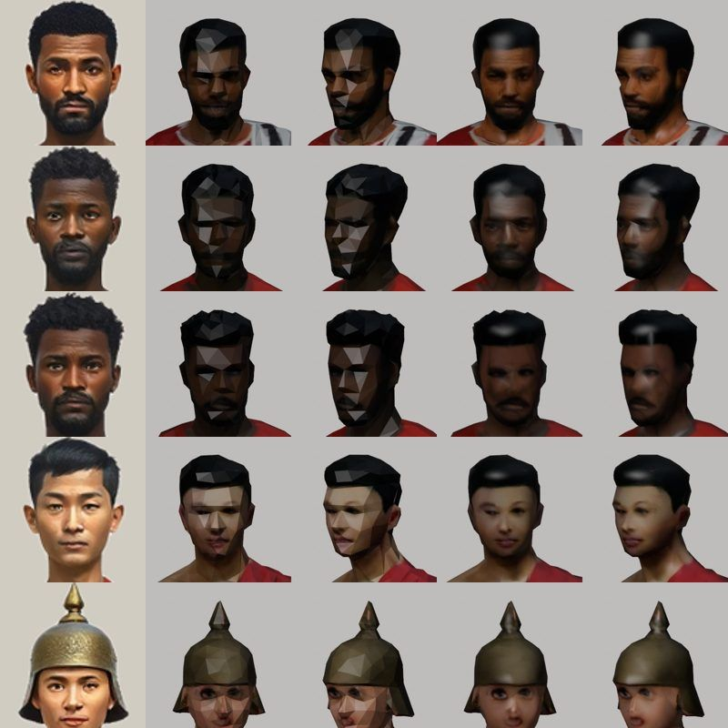

# 50 · Arreglos de arte (2026-11-21)

> **Pedido:** una pasada de arreglos sobre lo que quedó mal en las etapas 47 y 49, en este
> orden: (1) las caras de piel oscura en 3D, (2) el sombrero siamés, (3) el paisaje del ícono
> pegado en los edificios 3D, (4) íconos chicos que no se leen. Los modelos 3D siguen sin
> usarse en el juego (C-106).

## 1 · Caras de piel oscura en 3D

### Diagnóstico

Sobre el palmarista (`palmares_aldeano`): la hoja 2D, lo que entra al multivista después del
paso que quita luces, la vista de frente del multivista, y el modelo antes y después de esta
etapa:

Hay tres causas que se suman:

1. **Paint oscurece la piel.** El paso que quita luces y sombras (delight) y el multivista
   bajan la luminancia de la piel, y la bajan más cuanto más oscura es: en la mediana (L de
   Lab) el palmarista pasa de 28 a 20, el aldeano etíope de 37 a 24 y la gente de guerra de
   25 a 17; en los incas y en Ayutthaya baja apenas 5. La piel oscura además vira a un oliva
   grisáceo. Los rasgos siguen en el multivista, pero con poco contraste.
2. **El modelo final tenía sombreado plano.** Paint guarda la malla sin normales: el
   importador de Blender la dejaba como triángulos sueltos y el GLB salía con 12 mil vértices
   (3 por cara) y sombreado plano. Cada faceta refleja la luz por su cuenta y en la cara eso
   tapa ojos, nariz y boca. Le pasaba a los 24 modelos del pipeline.
3. **La cabeza es chica en la entrada.** En la hoja de cuerpo entero la cara ocupa unos 40 px
   del recorte de 512 que usa Paint: los rasgos llegan borrosos.

### Lo que se probó, en orden

- **(a) Más luz en la hoja antes de Paint**: la piel de la hoja (máscara por tono) con las
  sombras levantadas (curva 1 − (1 − v)^1,45). Mejora poco: Paint vuelve a bajarla y la cara
  sigue oscura. Descartado.
- **(b) El color de la hoja en la cara**, proyectado de frente y mezclado con Paint: da rasgos
  de verdad, pero solo si la cara de la hoja calza con la de la malla. Con un calce por la caja
  del cuerpo salían caras fantasma (bigote doble, ojos corridos 20 px). Queda con calce local
  (plantilla de la cara con corrimiento y escala) y solo donde Paint perdió los rasgos.
- **(c) Corrección del tono de la piel en el atlas** que conserva los rasgos: es la que más
  aporta, junto con el sombreado suave.

### Lo que quedó en el pipeline

- **`tools/gen3d_final.py`**: suelda los vértices y suaviza por ángulo (70° en personas y
  animales, 40° en edificios) antes de exportar. Las costuras de UV quedan (en Blender van por
  esquina). Los GLB pasan de 12 mil a unos 4 mil vértices y pesan menos (220–410 KB).
- **Paso nuevo `piel`** (`tools/gen3d_piel.py`, entre textura y rig, solo personas):
  1. ubica cada texel del atlas en 3D y lo proyecta de frente sobre la hoja, con prueba de
     profundidad;
  2. etiqueta la piel: de frente, con la máscara por tono de la hoja; atrás y a los costados,
     por vecinos en Lab contra esos ejemplos (así el casco de bronce o la soga no pasan por
     piel);
  3. si Paint bajó la mediana de la piel más de 6 puntos, la lleva al percentil 70 de la piel
     de la cara en la hoja (la hoja ya está iluminada y el juego vuelve a sombrear), estirando
     el contraste ×1,1–1,6 (las sombras suben más, los rasgos quedan), con el tono (a, b) de la
     hoja; lo muy oscuro (pelo, barba, cejas) casi no se mueve;
  4. con la misma condición y si la cara de la hoja calza (correlación > 0,4), mezcla el color
     de la hoja en la cara vista de frente, con peso 0,5 como máximo (`comun.piel_cabeza`);
  5. rellena el margen de cada isla del atlas con el texel más cercano.
- **`tools/gen3d_cara.py`**: primer plano de la cabeza (frente y tres cuartos) para comparar.
- `tools/gen3d_pipeline.py` acepta varias piezas separadas por coma (`a,b,c`).

### Los 11 modelos de personas, antes y después

Los 24 modelos del pipeline incluyen 11 personas (aldeano inca y, por pueblo, aldeano y unidad
propia); los otros son edificios y el caballo. En cada fila: la hoja, antes (frente y tres
cuartos) y después.

Incas, mapuches (aldeano y weichafe), guaraníes (aldeano y guerrero de macana) y aldeano etíope:

Chewa, Palmares (palmarista y gente de guerra) y Ayutthaya (phrai e infantería de dap):

| Pieza | L hoja | L Paint | L después | Cara de la hoja |
|---|---|---|---|---|
| aldeano (inca) | 41,8 | 36,7 | sin cambio de tono | no |
| mapuches_aldeano | 42,5 | 35,3 | 48,1 | sí |
| mapuches_weichafe | 38,0 | 30,3 | 42,5 | sí |
| guaranies_aldeano | 42,3 | 36,2 | 48,6 | sí |
| guaranies_guerrero_macana | 37,4 | 32,4 | sin cambio de tono | no |
| etiopia_aldeano | 37,1 | 23,9 | 41,5 | sí |
| etiopia_chewa | 36,4 | 29,1 | 41,4 | sí |
| palmares_aldeano | 28,1 | 20,1 | 34,0 | sí |
| palmares_gente_de_guerra | 25,2 | 17,1 | 30,3 | no (no calza: corrimiento de 22 px) |
| ayutthaya_aldeano | 55,3 | 50,0 | sin cambio de tono | no |
| ayutthaya_infanteria_dap | 47,1 | 49,6 | sin cambio de tono | no |

(L de Lab, mediana de la piel vista de frente; «después» es la mediana sobre esos mismos
texels; la meta es el percentil 70 de la cara de la hoja.) Los que quedan «sin cambio de
tono» mejoran igual por el sombreado suave.

Queda: la cabeza sigue con pocas caras (la malla entera tiene 4–5 mil) y los rasgos son los
de una figura de 0,75 casillas; la corona de plumas del guerrero de macana sale marrón (Paint
pierde el rojo y el amarillo), no es de la piel.
