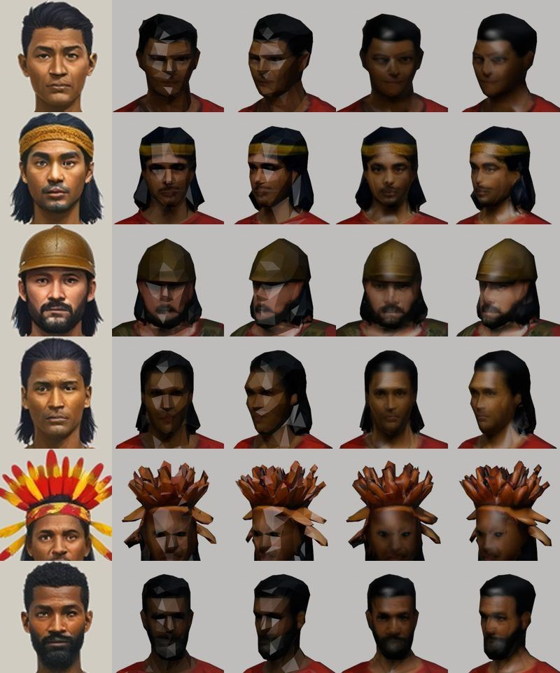
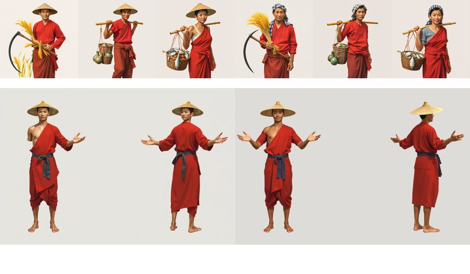
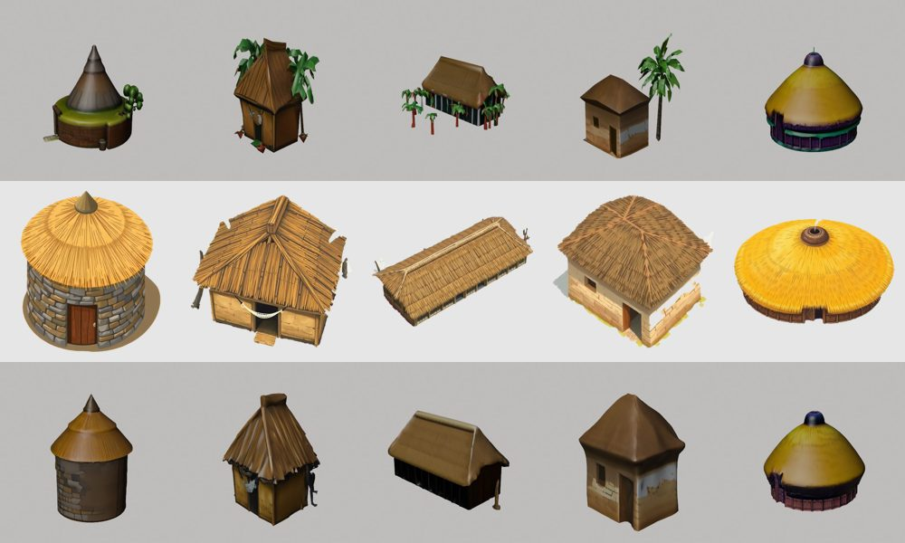
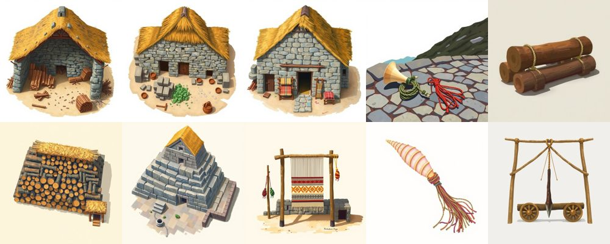
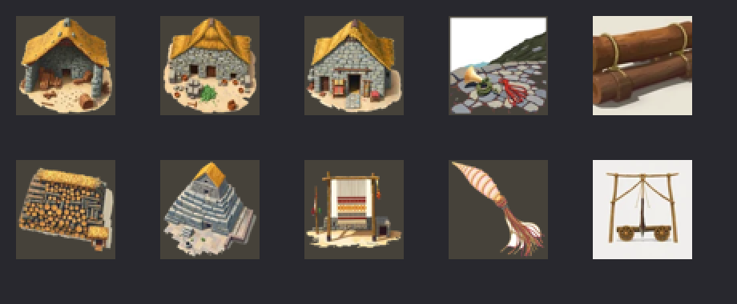

# 50 · Arreglos de arte (2026-11-21)

> **Pedido:** una pasada de arreglos sobre lo que quedó mal en las etapas 47 y 49, en este
> orden: (1) las caras de piel oscura en 3D, (2) el sombrero siamés, (3) el paisaje del ícono
> pegado en los edificios 3D, (4) íconos chicos que no se leen. Los modelos 3D siguen sin
> usarse en el juego (C-106).

## 1 · Caras de piel oscura en 3D

### Diagnóstico

Sobre el palmarista (`palmares_aldeano`): la hoja 2D, lo que entra al multivista después del
paso que quita luces, la vista de frente del multivista, y el modelo antes y después de esta
etapa:

Hay tres causas que se suman:

1. **Paint oscurece la piel.** El paso que quita luces y sombras (delight) y el multivista
   bajan la luminancia de la piel, y la bajan más cuanto más oscura es: en la mediana (L de
   Lab) el palmarista pasa de 28 a 20, el aldeano etíope de 37 a 24 y la gente de guerra de
   25 a 17; en los incas y en Ayutthaya baja apenas 5. La piel oscura además vira a un oliva
   grisáceo. Los rasgos siguen en el multivista, pero con poco contraste.
2. **El modelo final tenía sombreado plano.** Paint guarda la malla sin normales: el
   importador de Blender la dejaba como triángulos sueltos y el GLB salía con 12 mil vértices
   (3 por cara) y sombreado plano. Cada faceta refleja la luz por su cuenta y en la cara eso
   tapa ojos, nariz y boca. Le pasaba a los 24 modelos del pipeline.
3. **La cabeza es chica en la entrada.** En la hoja de cuerpo entero la cara ocupa unos 40 px
   del recorte de 512 que usa Paint: los rasgos llegan borrosos.

### Lo que se probó, en orden

- **(a) Más luz en la hoja antes de Paint**: la piel de la hoja (máscara por tono) con las
  sombras levantadas (curva 1 − (1 − v)^1,45). Mejora poco: Paint vuelve a bajarla y la cara
  sigue oscura. Descartado.
- **(b) El color de la hoja en la cara**, proyectado de frente y mezclado con Paint: da rasgos
  de verdad, pero solo si la cara de la hoja calza con la de la malla. Con un calce por la caja
  del cuerpo salían caras fantasma (bigote doble, ojos corridos 20 px). Queda con calce local
  (plantilla de la cara con corrimiento y escala) y solo donde Paint perdió los rasgos.
- **(c) Corrección del tono de la piel en el atlas** que conserva los rasgos: es la que más
  aporta, junto con el sombreado suave.

### Lo que quedó en el pipeline

- **`tools/gen3d_final.py`**: suelda los vértices y suaviza por ángulo (70° en personas y
  animales, 40° en edificios) antes de exportar. Las costuras de UV quedan (en Blender van por
  esquina). Los GLB pasan de 12 mil a unos 4 mil vértices y pesan menos (220–410 KB).
- **Paso nuevo `piel`** (`tools/gen3d_piel.py`, entre textura y rig, solo personas):
  1. ubica cada texel del atlas en 3D y lo proyecta de frente sobre la hoja, con prueba de
     profundidad;
  2. etiqueta la piel: de frente, con la máscara por tono de la hoja; atrás y a los costados,
     por vecinos en Lab contra esos ejemplos (así el casco de bronce o la soga no pasan por
     piel);
  3. si Paint bajó la mediana de la piel más de 6 puntos, la lleva al percentil 70 de la piel
     de la cara en la hoja (la hoja ya está iluminada y el juego vuelve a sombrear), estirando
     el contraste ×1,1–1,6 (las sombras suben más, los rasgos quedan), con el tono (a, b) de la
     hoja; lo muy oscuro (pelo, barba, cejas) casi no se mueve;
  4. con la misma condición y si la cara de la hoja calza (correlación > 0,4), mezcla el color
     de la hoja en la cara vista de frente, con peso 0,5 como máximo (`comun.piel_cabeza`);
  5. rellena el margen de cada isla del atlas con el texel más cercano.
- **`tools/gen3d_cara.py`**: primer plano de la cabeza (frente y tres cuartos) para comparar.
- `tools/gen3d_pipeline.py` acepta varias piezas separadas por coma (`a,b,c`).

### Los 11 modelos de personas, antes y después

Los 24 modelos del pipeline incluyen 11 personas (aldeano inca y, por pueblo, aldeano y unidad
propia); los otros son edificios y el caballo. En cada fila: la hoja, antes (frente y tres
cuartos) y después.

Incas, mapuches (aldeano y weichafe), guaraníes (aldeano y guerrero de macana) y aldeano etíope:

Chewa, Palmares (palmarista y gente de guerra) y Ayutthaya (phrai e infantería de dap):

| Pieza | L hoja | L Paint | L después | Cara de la hoja |
|---|---|---|---|---|
| aldeano (inca) | 41,8 | 36,7 | sin cambio de tono | no |
| mapuches_aldeano | 42,5 | 35,3 | 48,1 | sí |
| mapuches_weichafe | 38,0 | 30,3 | 42,5 | sí |
| guaranies_aldeano | 42,3 | 36,2 | 48,6 | sí |
| guaranies_guerrero_macana | 37,4 | 32,4 | sin cambio de tono | no |
| etiopia_aldeano | 37,1 | 23,9 | 41,5 | sí |
| etiopia_chewa | 36,4 | 29,1 | 41,4 | sí |
| palmares_aldeano | 28,1 | 20,1 | 34,0 | sí |
| palmares_gente_de_guerra | 25,2 | 17,1 | 30,3 | no (no calza: corrimiento de 22 px) |
| ayutthaya_aldeano | 55,3 | 50,0 | sin cambio de tono | no |
| ayutthaya_infanteria_dap | 47,1 | 49,6 | sin cambio de tono | no |

(L de Lab, mediana de la piel vista de frente; «después» es la mediana sobre esos mismos
texels; la meta es el percentil 70 de la cara de la hoja.) Los que quedan «sin cambio de
tono» mejoran igual por el sombreado suave.

Queda: la cabeza sigue con pocas caras (la malla entera tiene 4–5 mil) y los rasgos son los
de una figura de 0,75 casillas; la corona de plumas del guerrero de macana sale marrón (Paint
pierde el rojo y el amarillo), no es de la piel.

## 2 · El sombrero de Ayutthaya

FLUX dibujaba el *nón lá* vietnamita (un cono de punta) en el phrai, los dos cargadores del
río y la hoja 3D de la edad II (que además lo pedía «conical»).

**Qué llevaba la gente común de Siam.** El sombrero de trabajo es el *ngob* (งอบ): hojas de
palma sobre un armazón de tiras de bambú, con un aro interior que lo apoya sobre la cabeza y
deja pasar el aire, de copa corta y **plana** sobre un ala ancha que cae suave; es más
complejo que el cono del resto del sudeste asiático y hoy su centro de producción es Bang
Pahan, en la provincia de Ayutthaya ([Wikipedia](https://en.wikipedia.org/wiki/Thai_farmer%27s_hat),
[Google Arts & Culture: «flat top hat (ngob)»](https://artsandculture.google.com/asset/flat-top-hat-ngob-made-of-leaves-from-talipot-palm/qAFlWOJliVe2WQ)).
La otra prenda de cabeza común es el *pha khao ma*, el paño de algodón a cuadros que sirve de
faja, de toalla o de turbante. La Loubère (1691) describe a la gente común con la cabeza
descubierta y el pelo muy corto; el sombrero es del trabajo al sol.

Intentos (se guardan todos; el de la etapa 49 queda como `img/<id>_v2.jpg` en
`proceso/49-arte-ayutthaya`):

| Intento | Descripción | Resultado |
|---|---|---|
| 3 | ngob: copa «como una maceta dada vuelta», arriba plana, escalón con el ala, «not a conical Vietnamese hat» | cono otra vez en las tres unidades |
| 4 | copa de tambor bajo, arriba plana, ala casi horizontal, «like a flat-crowned planter's hat» | conos de ala ancha en las unidades; **la hoja de la edad II sí sale con copa chata y ala ancha**: queda |
| 5 (unidades) | el *pha khao ma* atado en la cabeza, sin sombrero | se lee bien, sin cono: queda |

FLUX asocia «palm-leaf hat» con una cara del sudeste asiático y dibuja el cono aunque se le
describa la forma. En la hoja de cuerpo entero, con la cara más chica, la descripción gana.

Arriba, antes (49) y después en el phrai y los cargadores; abajo, la hoja de la edad II:

`tools/arte_gouache.py` acepta `intentos={edad: n}` en `hojas()` para reintentar una hoja
sola. La interfaz se rearmó con `tools/arte_pueblo.py --pueblo=ayutthaya`.

## 3 · El paisaje del ícono pegado en los edificios 3D

Hunyuan hace la forma de todo lo que tiene alfa: las palmeras, el pasto y el disco de tierra
del ícono entraban como geometría (palmeras pegadas a la oga, la oga guasu y la casa de palha;
el tukul sobre un montículo de pasto; la ruka sobre un disco verde). El corte del suelo al
3 % (`suelo_pct`) no alcanza, porque la palmera o el montículo se levantan del suelo.

**Arreglo en la imagen de entrada** (`tools/gen3d_entradas.py`, opción `quitar` de la vista en
`data/gen3d_piezas.json`): antes de cuadrar la vista se saca del alfa el paisaje:

- `verde`: tono 60–180° con saturación (hojas, pasto, árboles);
- `tierra_roja`: el disco de tierra roja de los guaraníes (tono < 25°, muy saturado);
- después, la pieza más grande y los huecos chicos rellenos.

El tukul no tenía arreglo así: en el ícono del juego (`casa_7`) la casa es un techo sobre un
montículo de pasto con un muro de piedra, y sin el verde quedaba solo el techo. Para el 3D tiene
una referencia propia hecha por el pipeline con FLUX: muro cilíndrico de piedra, techo cónico,
«no ground, no grass, no platform, no trees» (el ícono del juego no cambia).

Además, el pipeline arranca ComfyUI solo con `arrancar_aislado.sh` (antes envolvía
`arrancar.sh` en su propio scope) y lo baja a 12 GB.

Arriba, antes; en el medio, la vista limpia que entra a Hunyuan; abajo, después (tukul, oga,
oga guasu, casa de palha y ruka):

Quedan como están los conjuntos (kätäma, lof, cerca real, wang): el suelo y las plantas están
adentro del cerco y sacar el verde los parte en pedazos. La ruka sigue con el techo cónico.

## 4 · Íconos chicos que no se leían

Máximo tres intentos por pieza. La anterior queda como `img/<id>_v<n>.jpg` en su carpeta
(`proceso/42-incas-gouache`, `proceso/49-arte-mapuches`) y su PNG como `<id>_v<n>_<semilla>.png`.

| Pieza | Antes | Ahora | Intentos |
|---|---|---|---|
| Leñera inca (`almacen_madera`) | casa de piedra con leña adentro | una pila grande de leña cortada con un alerito de paja | 1 |
| Depósito de piedra inca (`almacen_mina`) | casa de piedra con bloques al frente | una pila escalonada de bloques de piedra labrada | 2 (el segundo, un patio con bloques sueltos, se leía peor: queda el primero) |
| Taller de tejido inca | casa de piedra con telares | un telar grande de pie con la tela a medio tejer | 1 |
| Chaski en relevo (mejora) | caracola y khipu chicos sobre un camino | un pututu (caracola) grande con el khipu colgando | 1 |
| Ariete mapuche | tronco sobre rodillos (glifo en la casilla) | el tronco colgado de un armazón sobre cuatro ruedas, de costado | 1 (el cuarto en total) |

Las tres casas incas ya no se parecen: leña, piedra y telar tienen cada una su silueta. El
chaski y el ariete mapuche salen de `sin_casilla` y muestran su arte en la casilla. El ariete es
un objeto entero y el recorte de «cabeza y torso» de las unidades le cortaba las ruedas:
`tools/arte_pueblo.py` acepta ahora cajas `pueblo:pieza` en `data/arte_pueblos.json →
icono_unidad.cajas` y el ariete mapuche usa la imagen entera (el de Ayutthaya sigue con glifo).

Arriba, antes; abajo, ahora (leñera, depósito de piedra, taller de tejido, chaski, ariete):

Las mismas casillas a 62 px, como en el juego (ampliadas ×2):

## 5 · Pruebas

Con `systemd-run --user --scope -p MemoryMax=4G timeout 400 godot --headless …`, después de
reimportar (`godot --headless --path . --import`):

- `tests/iconos.gd`: 752 grillas, 145 íconos distintos, OK ([salida](pruebas/iconos.txt));
- `tests/grilla.gd`: OK ([salida](pruebas/grilla.txt));
- `tests/test_determinism.gd`: OK ([salida](pruebas/test_determinism.txt)).

No se tocó la simulación ni el juego: los modelos 3D siguen sin usarse (C-106).

## Tropiezos

- La primera corrección de la piel la volvía gris: al subir la luminancia con el mismo a, b
  baja la saturación aparente; hubo que llevar el tono al de la hoja.
- La máscara por tono no reconoce la piel que pinta Paint (oliva oscuro): la piel de Paint se
  etiqueta por la hoja, de frente, y por vecinos en Lab atrás.
- Con el calce por la caja del cuerpo, la cara de la hoja quedaba corrida (caras fantasma);
  el registro ECC global no convergía o daba corrimientos absurdos. Quedó el calce local de
  la cara por plantilla, y solo donde Paint perdió los rasgos.
- La cavidad de Workbench marca las aristas con líneas claras que el juego no dibuja: el
  primer plano de las caras va sin cavidad.
- OpenCV 5 ya no trae los clasificadores de Haar: la caja de la cara sale de la mancha de piel
  más alta de la hoja.
- Cambiar `gen3d_paint.py` (aunque fuera para depurar) cambiaba la firma de la textura y habría
  rehecho Paint en las 24 piezas: la salida de depuración se usó y se sacó.
- FLUX dibuja el sombrero cónico aunque se le describa otra forma (tres intentos).

## Commits

- `2b59b70` caras de piel oscura en 3D
- `86dbe1d` el sombrero de Ayutthaya
- `43d9231` sin el paisaje del ícono en los edificios 3D
- (este) íconos chicos, pruebas, estado e índice
