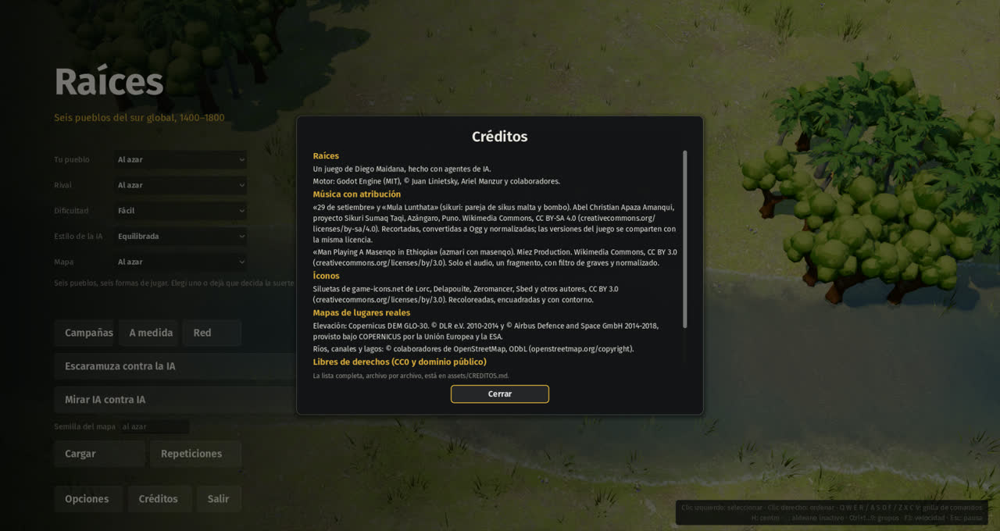
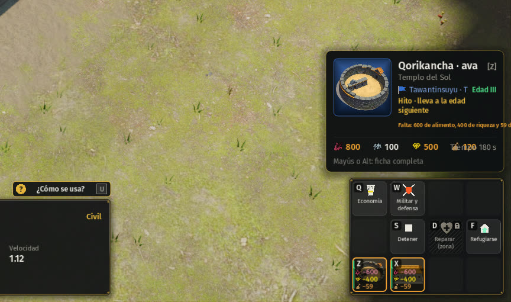
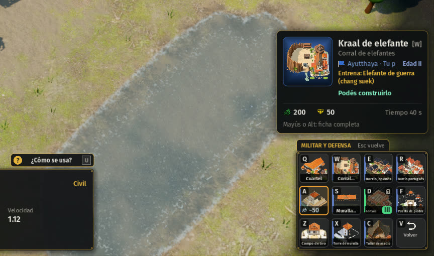
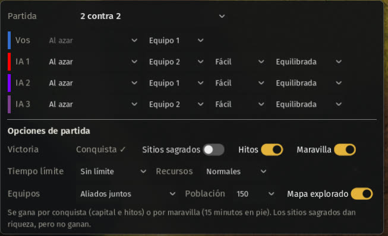

# 51 · Respuestas del autor (C-07 a C-61)

## Pedido
El autor contestó C-07 a C-61 en la página de consultas (2026-11-21). Este paso aplica las de contenido, historia, sonido, nombres e IA. Las de teclas, tutorial y «Arte de la guerra» (C-35, C-37, C-38) las lleva otro agente. Las que confirmaban la opción por defecto se revisaron una por una contra el código y los datos: si ya estaba, se anota así; si no, se hizo.

## Tabla de respuestas

| Consulta | Respuesta | Qué se hizo |
|---|---|---|
| C-07 | a) CC BY-SA con crédito | **Hecho.** Dos sikuris de Azángaro, Puno (pareja de sikus malta y bombo, «29 de setiembre» y «Mula Lunthata»; Abel Christian Apaza Amanqui, CC BY-SA 4.0) en la paz del Tawantinsuyu |
| C-08 | a) pifilka solo en la paz | **Hecho.** Estaba en el combate; pasó a la paz (`data/audio.json`) |
| C-13 | a) arreglos sin arrepentimiento | Ya estaba (proceso/14) |
| C-14 | a) umbrales absolutos | Criterio adoptado. `tests/economia.gd` imprime las órdenes por minuto, pero no separa las del motor: la verificación queda para el torneo del hito |
| C-15 a C-19 | a) | Ya estaba (500 + 300 para la II; sin veta en el flanco; corte que se funda; Ayutthaya sin depósitos comunes; lof en 110 de madera) |
| C-20 | a) frases nuevas | **Hecho** en Ayutthaya: «La ciudad isla del rey, sus elefantes y sus huéspedes». La de Palmares ya no decía «se esconde» |
| C-21, C-23 | a) | Ya estaba |
| C-22 | a) explicarlo | **Hecho.** Lautaro lo dice al empezar la misión 2 («esto es un malón… no hace falta entrenar a nadie»). Antes solo lo decía el consejo de aprendizaje |
| C-24 | c) CC BY-SA | **Hecho.** Un azmari con masenqo (Miez Production, CC BY 3.0) en la paz etíope. De krar no hay grabaciones libres (ver tropiezos) |
| C-25 a C-29 | a) | Ya estaba (khlang din; lof como único almacén; línea, choque, distancia y asedio; bloque a 16 casillas; velocidad del más lento) |
| C-30 | a) + «nombres en castellano y los originales» | **Hecho.** `nombre_comun` en 30 edificios y unidades propios con nombre en su lengua. La grilla, la ficha (también la compacta), el tooltip del mundo y los hitos muestran los dos |
| C-36 | a) | Ya estaba (con los ajustes de 4l) |
| C-40 | b) Qorikancha a la III | **Hecho.** Qorikancha a la III y aqllawasi a la IV, con los números ajustados (ver paso 3) |
| C-41 | a) *Tekoha → Tovaja → Mbororé → Ñande retã* | **Hecho.** *Tovaja* queda [verificar] con un hablante (`docs/civs/guaranies.md`) |
| C-42 | b) *1678* | **Hecho** |
| C-43 | a) «la mata» → «el monte» | **Hecho**: 8 lugares en la campaña de Palmares y uno en `docs/campanas` |
| C-44 a C-46 | a) | Ya estaba |
| C-48 | a) + modo nómade | **Hecho.** La regla de conquista no depende de bases fijas: con `opts.sin_base_inicial`, nadie pierde hasta fundar. Nota: [`docs/diseno/28-modo-nomade.md`](../../docs/diseno/28-modo-nomade.md) |
| C-49 | b) solo mejorar la IA | El menú no sugería tiempo límite: ya estaba. Medición de la IA abajo (paso 6): 2 de 4 terminan |
| C-50 | a) población y revelar mapa | **Hecho.** «Población» (100 a 300) y «Mapa explorado» en las opciones de partida (`--pob`, `--explorado`) |
| C-51, C-52 | a) | Anotadas: van al torneo del hito (etapa 35, torneo de expertos) |
| C-53 | a) kultrun | **Hecho.** Vuelve el sonido de 4g (`456a59b`). Hay que consultarlo con una organización mapuche antes de publicar |
| C-54 a C-59 | | Ya estaba (4h y etapa 25) |
| C-60 | a) mbaraka | Ya estaba. Choca con C-74, que propone sacarla y sigue sin contestar |
| C-61 | a) oleadas chicas | **Hecho.** Oleadas de 10, 12 y 14 soldados, y después siempre el tope de 15 |

Commit: `c9ab5d0` («Proceso 51: respuestas del autor C-07 a C-61», rama `worktree-agent-a87f3f08ed0821db4`).

## Paso a paso
1. **Música con atribución (C-07, C-24).** Busqué con la API de Commons y en Internet Archive. La licencia de cada archivo la verifiqué en su página.
   - Sikuri: el proyecto Sikuri Sumaq Taqi subió grabaciones de estudio de dos temas populares. Hay una pista por cada tamaño de siku y una «maqueta» con la pareja malta y el bombo. Usé las dos maquetas (2:00 y 1:28). Pasaron a Ogg a −16 LUFS y pesan 1,2 y 0,9 MB.
   - Masenqo: del video «Man Playing A Masenqo in Ethiopia», que es un azmari en la calle, usé el audio de 2:50 a 4:48. Lleva un filtro de graves a 140 Hz para el viento y fundidos, y pesa 1,6 MB.
   - Los créditos están en `assets/CREDITOS.md`, en `assets/audio/musica/README.md` y en una pantalla nueva del menú, **Créditos** (`src/game/ui/creditos.gd`, con el texto en `data/creditos.json`). Esa pantalla junta también lo que ya pedía atribución: los íconos CC BY, OpenStreetMap y Copernicus.

   
2. **Nombres (C-30).** `Grilla.comun` toma primero `nombre_comun`. Por esa función pasan la grilla, la ficha, el tooltip del mundo y los consejos. La ficha compacta ya no borra el segundo nombre.

    
3. **Qorikancha (C-40).** El Qorikancha es económico, así que lo cambié por el otro económico, el aqllawasi. Las dos edades siguen con un hito de economía y uno militar.
   - Qorikancha en la III: +10 % de recolección (antes +15) y la mit'a de la III (120).
   - Aqllawasi en la IV: +1 taller de tejido, +20 % de riqueza («cumbi fino») y la mit'a de la IV (200).
   - Medí con un torneo dirigido: `tests/torneo.gd` ganó `--civ=clave`, que juega solo los cruces de esa civilización. Fueron 30 minutos y 2 semillas, con los datos de antes y con los de ahora ([antes](pruebas/torneo_tawantinsuyu_antes.txt), [ahora](pruebas/torneo_tawantinsuyu.txt)). Salieron **los mismos diez resultados**: 7 de 10 para el Tawantinsuyu, 5 de ellos por puntos.
   - El cambio no mueve el balance a 30 minutos. El 70 % viene de antes: el desempate por puntos favorece la edad, así que hay que mirarlo en el torneo del hito.
   - El torneo completo no se corrió, porque el autor prefiere un torneo por hito.
4. **Edades (C-41, C-42).** Los cambios de nombre están en los datos y en las fichas. En `docs/diseno/26` se marcaron H-13, H-37 y H-38. El hito militar guaraní de la IV también se llama *Ñande retã*: queda anotado.
5. **Kultrun y pifilka (C-53, C-08).** Volvieron el modelo `kultrun` y las partituras mapuches de 4g, y se regeneraron los cuatro Ogg, que salen **bit a bit iguales** a los de `456a59b`. Los sonidos de selección (fluidez 3) siguen con kakelkultrun: nacieron después de 4h y nunca tuvieron kultrun.
6. **IA sin hitos (C-49).** Corrí `tools/sin_hitos_ia.gd` (ganó `--hitos=` y el detalle de lo que queda) a 45 minutos, sin hitos ni sitios, con 2 semillas ([salida](pruebas/sin_hitos_45min_antes.txt)).
   - Etiopía conquista a Palmares a los 39 minutos en las dos semillas.
   - Los mapuches dejan al inca con 2 y 12 edificios a los 45: un almacén de mina en el borde del mapa y un tambo lejano.
   - Probé poner la cacería antes que los sitios y las oleadas, y fue peor: el ejército se reparte antes de tiempo y quedan 60 edificios en pie ([salida](pruebas/sin_hitos_45min_caza_primero.txt)). **Se revirtió.** Antes de este paso no terminaba ninguna; hacer que la IA vaya a buscar el último edificio lejano queda para un paso de IA.
7. **Opciones (C-50).** `Sim.pob_max()` reemplaza a `reglas.pob_max` en la simulación, la IA y el HUD. «Mapa explorado» marca todo el mapa como explorado al empezar. La partida a medida todavía no las muestra (solo por argumento).

   
8. **Fácil (C-61).** `ataque_base` pasó a 10 y `ataque_paso` a 2. Además, la oleada nunca pide más que `ejercito_max`. `tools/primera_victoria.gd` con la fácil da lo mismo que antes: el principiante gana 2 de 3 ([salida](pruebas/primera_victoria_facil.txt)).

## Pruebas
| Prueba | Resultado |
|---|---|
| [test_determinism](pruebas/test_determinism.txt) | OK, hash **3059812827**, sin cambios: lo nuevo es opcional (nómade, población, mapa explorado) o es de la IA fácil |
| [bench](pruebas/bench.txt) | Promedio 9,1 ms; peor tick 66 ms |
| [civ_smoke](pruebas/civ_smoke.txt) | Las seis, sin errores |
| [campaign_smoke](pruebas/campaign_smoke.txt) | 25 misiones, sin errores |
| [iconos](pruebas/iconos.txt), [grilla](pruebas/grilla.txt) | OK |
| [opciones_partida](pruebas/opciones_partida.txt) | OK |
| [autotest con ventana](pruebas/autotest.txt), Tawantinsuyu, llano | AUTOTEST: OK |
| [sonido_civ](pruebas/sonido_civ.txt) | 6 fallas, todas iguales: la alarma no suena con el suceso de ataque en ningún pueblo. No toca lo que cambié. Supongo que viene de las alertas por zona (fluidez 4), que tapan la alarma general; en 4h pasaba. Queda para revisar |

## Tropiezos
- **No hay krar con licencia libre.** En Commons, «Krar» tiene solo fotos. En Internet Archive aparecen discos comerciales subidos como CC0, que no sirven. Los videos «Ethiopian Ambassel/Tizita scale» (CC BY) son una clase con guitarra eléctrica: lo vi en un cuadro del video. El de Mestawet Shumye (VOA) es con violín. Queda el masenqo.
- **Sin escuchar.** No pude oír las pistas. Las juzgué por los espectrogramas y por cuadros del video. Falta escuchar si en el fragmento del masenqo habla el camarógrafo, y de qué habla la letra del azmari [verificar].
- **El nombre largo del hito no entraba.** Primero puse «Qorikancha (Templo del Sol) · avanzar…» en el título de la ficha, y se cortaba. Ahora el castellano va en el renglón de abajo, como en el resto de las fichas.
- **El sandbox del worktree** rechaza los comandos con variables en algunas posiciones. Los arreglos de varios archivos se hicieron con scripts en el scratchpad.
- **Un `pkill -f` se mató a sí mismo** porque el patrón estaba en su propia línea de comandos (la memoria ya lo advertía). Se relanzó la medición.

## Pendiente
- Que el autor escuche el sikuri, el masenqo y el kultrun.
- Antes de publicar: consultar el kultrun y la pifilka con una organización mapuche (C-53), y la mbaraka con una mbyá (C-60 frente a C-74).
- Verificar *tovaja* con un hablante.
- C-39 y C-70 (el nombre de la IV inca).
- Que la IA termine la conquista sin hitos contra bases desparramadas.
- La alarma de `sonido_civ`.
- El torneo del hito con la experta contra la difícil (C-51, C-52).
