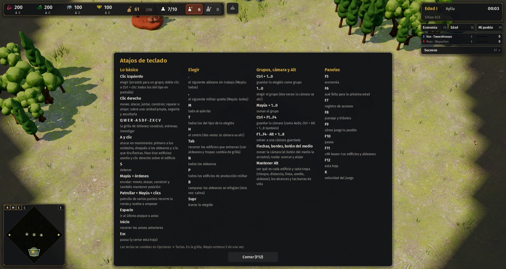
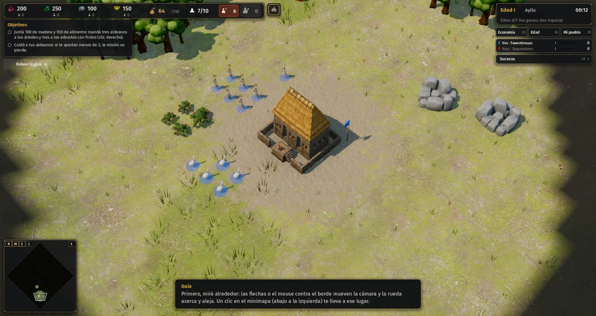
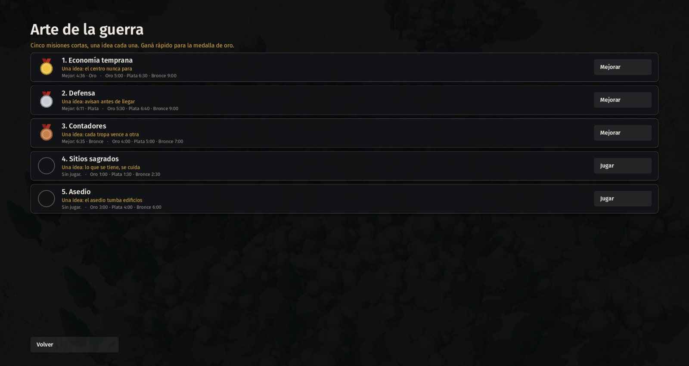
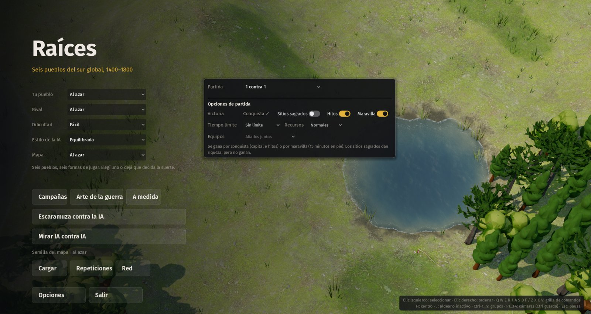

# 52 · Atajos como AoE4, tutorial con el Tawantinsuyu y Arte de la guerra (2026-11-24)

> **Pedido:** aplicar tres respuestas del autor en `CONSULTAS.md`, en este orden:
> **C-35 b** (marcadores de cámara en F1–F4 como AoE4, los paneles a otras teclas),
> **C-37 b** (el tutorial pasa de los guaraníes al Tawantinsuyu) y **C-38 a** (el «Arte de la
> guerra»: cinco misiones cortas de una idea, con medallas de bronce, plata y oro por tiempo).
> Las respuestas de contenido e historia las aplica otro agente en paralelo.

## 1 · Marcadores de cámara como AoE4 (C-35 b)

**Qué hace AoE4.** Las notas de la temporada 1 de AoE4 dicen: «Ctrl + [F1-F8] to save a
location. Shift + [F1-F8] to go to a location» ([ageofempires.com](https://www.ageofempires.com/news/age-of-empires-iv-season-one-update-release-notes/)).
F1–F4 solos, en AoE4, eligen edificios (militares, económicos, de investigación, hitos;
[pcgamesn](https://www.pcgamesn.com/age-of-empires-4/hotkeys-keyboard-shortcuts)). El autor
pidió F1–F4 para volver y Ctrl + F1–F4 para guardar: así queda, y Mayús + F también vuelve
(el controlador no distingue Mayús en los marcadores), que es la tecla de AoE4.

**Teclas nuevas de fábrica** (`data/interfaz.json → teclas.acciones`):

| Acción | Antes | Ahora |
|---|---|---|
| Marcadores 1–4 | F7, F8, F9, — | **F1, F2, F3, F4** (Ctrl guarda) |
| Economía | F2 | F5 |
| Edad | F4 | F6 |
| Sucesos | F5 | F7 |
| Puntaje y tributos | F6 | F8 |
| Ayuda (cómo juega mi pueblo) | F1 | F9 |
| Velocidad | F3 | **K** (libre; la J queda libre para las pruebas de reasignar) |
| Pausa, «Mi base», hoja de atajos | F10, F11, F12 | sin cambio |

Por qué así: los paneles quedan juntos y en el orden en que se usan (F5–F9), la pausa sigue
en F10 donde la buscan los que ya juegan, y el perfil «AoE4» de Opciones, que ya corría los
paneles a F5–F9, pasa a ser casi la tecla de fábrica (ahora solo prende los grupos
exclusivos y apaga los números de daño). Ninguna tecla choca (`test_opciones`).

**Archivos de antes.** `opciones.cfg` guardaba todas las teclas, también las de fábrica: sin
más, quien ya había abierto Opciones se quedaba con F7. `teclas.rev` (2) y
`teclas.migracion` (las de fábrica viejas) hacen que, al cargar un archivo sin la revisión
nueva, cada tecla que sigue en la de fábrica vieja pase a la nueva; la que el jugador cambió
se queda, y si la nueva choca con una suya, queda sin tecla (`src/game/ui/teclas.gd → _migrar`).

**Textos.** La hoja de atajos (en el orden de las teclas, con «Mi base»), la ayuda del HUD, la
ficha del pueblo, el registro de sucesos, los botones de los paneles, el pie del menú, los
avisos del marcador («Cámara guardada en el marcador 1 (F1 vuelve)»), la pantalla de fin y
`docs/07-arte-y-ui.md`. Donde se podía, la tecla sale de `Teclas.texto(...)` y sigue a lo que
el jugador reasigne; el tutorial ya no nombra teclas de paneles: dice «el botón Edad, arriba
a la derecha».

**Autotest.** Los chequeos de paneles y marcadores usan la tecla de la acción. Nuevos: «de
fábrica, los marcadores 1 y 4 están en F1 y F4», «Ctrl + F4 y F4: el cuarto marcador» y
«los paneles dejaron F1–F4 a la cámara».

## 2 · El tutorial con el Tawantinsuyu (C-37 b)

`data/campanas/tutorial.json` pasa a `"civ": "tawantinsuyu"`. Los textos nombran el edificio
propio con el común al lado (la casa, Kancha; el cuartel, Kallanka; la granja, Chacra; el
centro, Llaqta) y los hitos incas (Ushnu y plaza en Z, Pukara de frontera en X).

- **Paso nuevo (o15):** con los guaraníes no había almacenes; ahora, después de la casa, la
  Guía explica el viaje al depósito y pide un almacén de madera junto al bosque (Q, E).
- **Ataque 15 s más tarde.** Con el guerrero de porra, cinco contra cuatro saqueadores ganan,
  pero cuatro pierden: al pie de la letra llegaban 4 guerreros. La cuenta sigue siendo de 60 s.
- **Derrota con motivo.** Sin defenderse, con los guaraníes caían todos los aldeanos; con los
  incas sobreviven 2 y la misión quedaba abierta. `proteger` admite ahora `min`: el tutorial
  se pierde si quedan menos de 3 aldeanos, con el motivo y qué hacer la próxima vez.
- `tests/tutorial_letra.gd` construye el almacén (o15); en modo indefenso, «pasa el ataque»
  también a los dos minutos de llegar (los dos últimos saqueadores se quedan golpeando un
  edificio fuera del alcance del centro).

Resultado: al pie de la letra, **victoria a las 10:10**; indefenso, **derrota a las 8:37**
con motivo ([pruebas/tutorial_letra.txt](pruebas/tutorial_letra.txt),
[pruebas/tutorial_indefenso.txt](pruebas/tutorial_indefenso.txt)).

## 3 · Arte de la guerra (C-38 a)

Cinco misiones en `data/campanas/arte_guerra.json`, con el Tawantinsuyu y el motor de
escenarios de siempre. Una idea cada una, textos cortos:

| Misión | Idea | Qué pide | Oro · Plata · Bronce |
|---|---|---|---|
| 1 · Economía temprana | el centro nunca para | 8 aldeanos, 500 alimento, 400 madera, 150 riqueza y un almacén de madera | 5:00 · 6:30 · 9:00 |
| 2 · Defensa | avisan antes de llegar | tres oleadas anunciadas con cuenta (4, 6 y 7); se pierde con menos de 5 aldeanos | 5:30 · 6:40 · 9:00 |
| 3 · Contadores | cada tropa vence a otra | honderos, lanceros y guerreros de a uno, con la tropa que vence a cada uno | 4:00 · 5:00 · 7:00 |
| 4 · Sitios sagrados | lo que se tiene, se cuida | los 3 sitios y guardia en cada uno | 1:00 · 1:30 · 2:30 |
| 5 · Asedio | el asedio tumba edificios | la torre y el cuartel de una plaza fija | 3:00 · 4:00 · 6:00 |

**Medallas.** Por tiempo de juego hasta ganar (`medallas` de cada misión, en segundos). Ganar
después del bronce cuenta como completada, sin medalla. La mejor marca de cada misión
(tiempo y medalla) se guarda en `user://arte_guerra.json`, que es del jugador de esa
instalación (el juego no tiene perfiles con nombre). Todas abiertas desde el principio.

**Menú.** «Arte de la guerra» va junto a «Campañas»; «Red» bajó al renglón de Cargar para que
el menú no crezca (con un renglón más, Opciones y Salir quedaban fuera de la pantalla). La
pantalla muestra cada misión con su medalla dibujada, la mejor marca y los tres tiempos; la
introducción suma los tiempos de las medallas y el final dice la medalla y si mejoró la marca.

**Lo que se sumó al motor de escenarios** (opcional; detalle en `docs/campanas/README.md`):
`jugador.edificios` (cuartel, campo de tiro y torre ya hechos), `rivales[i].quieta` (un rival
sin IA: la plaza fija del asedio; con IA, una pasiva con +300 por edad juntaba 11 soldados al
minuto y ninguna escolta llegaba), `min` en `proteger`, y sitios de la misión que buscan el
hueco de 2×2 más cercano (los tres de la misión 4 no aparecían porque caían sobre árboles).

**Prueba.** `tests/arte_guerra.gd` juega cada misión con un jugador simple que hace lo que dice
la Guía (economía repartida, campana si los superan, la tropa que vence a cada oleada, parejas
a cada sitio, escolta adelante y asedio atrás). Las cinco se ganan, todas con oro: 4:36,
5:18, 3:38, 0:47 y 2:11 ([pruebas/arte_guerra.txt](pruebas/arte_guerra.txt)). Los umbrales se
fijaron a partir de esos tiempos. `campaign_smoke` corre todo `data/campanas`, también estas.

## Tropiezos

- La primera búsqueda de las teclas de AoE4 no las traía; están en las notas de la temporada 1.
- `ArteGuerraUI` no existía para el juego hasta reimportar (la caché de `class_name`): la
  primera corrida del autotest quedó colgada en un error de carga.
- Defensa: la torre común es de la edad II y la misión es de la I; se la da hecha.
- Primer autotest: 1 falla, «el escolta va con la patrulla (a 10267)», ajena a estos cambios;
  en la segunda corrida, 251 OK y ninguna falla ([pruebas/autotest-guaranies.txt](pruebas/autotest-guaranies.txt),
  la primera en [pruebas/autotest-guaranies-1.txt](pruebas/autotest-guaranies-1.txt)).

## Pruebas

| Prueba | Resultado |
|---|---|
| `test_determinism` | OK ([pruebas/determinismo.txt](pruebas/determinismo.txt)) |
| `bench` | 8,7 ms de promedio, peor 63 ms (presupuesto 100) |
| `campaign_smoke` | 30 misiones sin errores ([pruebas/campaign_smoke.txt](pruebas/campaign_smoke.txt)) |
| `tutorial_letra` (letra e indefenso) | OK los dos |
| `arte_guerra` | OK, las cinco con oro |
| `test_opciones` | OK, con la migración de un `opciones.cfg` de antes ([pruebas/test_opciones.txt](pruebas/test_opciones.txt)) |
| `iconos`, `grilla` | OK |
| `--autotest --civ=guaranies --terreno=llano` | OK en la segunda corrida (251) |

## Commits

- `c86e1bb` Proceso 52: marcadores en F1–F4 como AoE4, tutorial con el Tawantinsuyu y Arte de la guerra con medallas.
