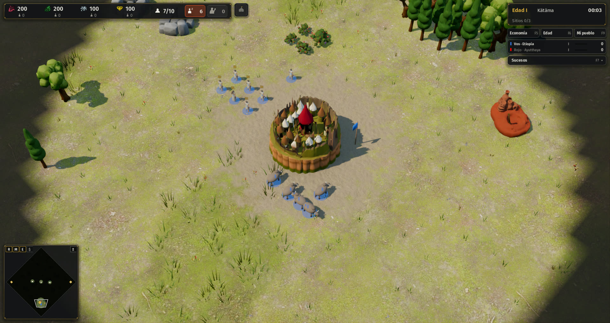

# 53 · Respuestas del autor: mecánicas y balance (2026-11-26)

> **Pedido:** aplicar las respuestas del 2026-11-26 de mecánica y balance (C-47, C-49, C-51, C-52, C-62 a C-69, C-75 a C-97 y C-100). En paralelo, otro agente hizo las de nombres, sonido, representación y 3D (proceso/54); de acá solo se tocó lo mínimo de los mismos JSON. Por cada respuesta: revisar el estado y anotar «ya estaba» o hacerlo. Al final, **un solo torneo** para todos los cambios de balance juntos.

## Resumen

| Consulta | Qué se hizo | Estado |
|---|---|---|
| **C-47 b** | Desempate al tiempo límite. La regla está en los datos: `reglas.opciones_partida.desempate = ["sitios", "edificios"]`. Primero cuentan los puntos. Si empatan, gana quien tenga más sitios sagrados; si siguen iguales, quien tenga más edificios terminados en pie (sin muros, puertas, caminos ni trampas). Si todo empata, es empate (`Sim.end_by_time`, `_tiebreak`) | Hecho |
| **C-49 b** | La IA sin hitos no terminaba la conquista. Causa: la amenaza en casa (un hondero suelto) traía de vuelta a **todo** el ejército que cazaba. Sin victoria por hitos, la IA ahora defiende con lo que hace falta (`ia_caza.defensa_proporcional`, como la experta). Agrandar los grupos de caza no cambiaba nada y se volvió atrás | Hecho |
| **C-51 a / C-52 a** | Experta contra difícil, 12 partidas: **9 de 12** para la experta (antes, 1 de 6). Palmares, 0 de 2: abajo por diseño (crece por la fama), sin quedar inútil. No hizo falta otro ajuste | Medido |
| **C-62 a** | Sin nadie junto al sitio, la captura a medias baja `reglas.sitios.vaciado_ms` (500 ms por segundo, la mitad de lo que sube). Si está disputado, queda como está | Hecho |
| **C-63 a** | «Mirar IA contra IA» arranca con los sitios prendidos (`Menu.watch_args`), salvo que el jugador los haya apagado a mano | Hecho |
| **C-64 a** | El guerrero común ya andaba a 1350 y la línea ya tenía +6 contra el choque (esport 1a) | Ya estaba |
| **C-66 a** | Esperar al paso 1 (solo vista). No se tocó nada | Anotado |
| **C-67 a** | Yerba silvestre: `yerbal_silvestre` («Ka'a del monte»), 3 en el borde del monte junto a la base guaraní (`recursos_semilla` con `junto_monte`) y más en cada edad (`vetas_por_edad` del pueblo). La roza que se deja crecer queda en capuera; solo con la vía misión deja un yerbal plantado (`granja.deja_requiere_hito`). La misión cría ganado vacuno (`mision.ganado`: el motor de los corrales, sin kawiñ). Sin la misión, la IA quema las rozas | Hecho |
| **C-68 a** | Con el Pacto de Cucaú, la acogida va a la mitad (cada persona cuesta el doble de fama) y los ingenios liberan la mitad de la gente. La liberación de casas y centros vale solo contra los invasores (`liberacion.solo_invasores`, el campo `invasor` de las potencias de proceso/54) | Hecho |
| **C-69 a** | Lalibela pasa a sitio sagrado neutral (`sitio_lalibela`, el del centro cuando juega Etiopía; `reglas.sitios.centro_por_civ`; no se construye). El monasterio se ve como **Debre Damo**: una amba sin camino, la cuerda de cuero y la iglesia aksumita arriba (`hitos_meshes._debre_damo`). La iglesia cambia el +5 % de vida de la tropa por población: aloja 10 en lugar de 5 | Hecho |
| **C-75 a, C-76 a, C-77 a, C-78 a** | La regla del ×2 en valor en comunes, el aura del hito militar en la III y la IV, el paso 1 (herrería y niveles) y la maravilla, todo de la etapa 26 | Ya estaba |
| **C-81, C-83 a C-86, C-88 a C-90, C-92, C-94 a C-97 a** | Los saberes del diseño revisado: trepanación, «debatido», *ka'aguygua*, Aldea grande del monte, *ampive* y *makuñ*, *wayrachina*, *Oficinas do Macaco*, guerrero de *gaša*, hierro +1 de ataque, ṭef, kosso, jabarti, juncos, Phra Khlang, Si Satchanalai, *khlong lat*, *nuat* y la Cerca sitiada | Ya estaba |
| **C-87 a, C-93 a (erveira)** | Son unidades compartidas del paso 5 (la pieza pesada de la IV y el sanador). Esperan la C-80, que sigue sin respuesta | Espera C-80 |
| **C-91 a** | Jinetes oromo aliados: no se entrenan. Llegan de a 5 por el **Tratado con los oromo** (establo, IV, 250 de riqueza), y cada uno pide 2 de riqueza por minuto de agasajo. Si no alcanza, el tratado se rompe y se van; si caen todos, se puede firmar otro (`Sim._sign_treaty`, `treaty_second`). La IA lo firma con 12 de tropa | Hecho |
| **C-100 a** | Reparar cuesta el 50 % del costo del edificio, en proporción a la vida reparada (`reglas.reparacion_costo_pct`). Los hitos pagan el costo de su edad, y el asedio que se repara en el campo sigue gratis. Si no alcanza, la reparación se frena. Nueva decisión **D-032**, que reemplaza a D-024 | Hecho |

Pedidos del coordinador, después de juntar con main (proceso/54):
- la liberación mira `invasor` y no la clave `invasores`;
- el barrio chino entra en la renta de «Barrio chino y puertos», y la IA de Ayutthaya lo levanta cuando tiene la mejora (`ia_edificios` respeta `requiere_tec`);
- `tests/saberes.gd` vuelve a pasar: las pruebas de amole y Massawa estaban viejas (desde el paso 5 del comercio, el amole da `comercio_pct` y Massawa pide una ruta abierta).

## Paso a paso

1. **Desempate (C-47).** `end_by_time` arma una clave por equipo (puntos, sitios, edificios) y la compara en orden. El criterio sale de la lista de datos, así que se puede cambiar sin tocar el código.
2. **Sitios (C-62, C-69).** En `_sacred`, cuando no hay nadie junto al sitio, la captura baja. El sitio del centro toma el tipo de `centro_por_civ` en los dos generadores (1 contra 1 y N bases).
3. **Guaraníes (C-67).** Primera prueba: la yerba silvestre no aparecía, porque los bosques se generan después de los recursos semilla. El reparto `junto_monte` pasó a después de los bosques. Los mapas de 3 o más jugadores no tenían semilla antes y siguen sin ella; las vetas por edad sí llegan.
4. **Palmares y Etiopía (C-68, C-69, C-91).** Todo por datos con campos nuevos (`pacto_hito`, `pacto_costo_pct`, `pacto_pct`, `solo_invasores`, efecto `tratado`).
5. **Reparar (C-100).** `_pay_repair` acumula milésimas por jugador y recurso (`rep_m`, entra solo en las instantáneas) y cobra unidades enteras.
6. **IA sin hitos (C-49).** `tools/sin_hitos_ia.gd` ganó `--par=a,b` y `--detalle`, que da la línea de tiempo cada 3 minutos y las órdenes de la tropa. Con eso se vio que los que cazaban marchaban de vuelta a casa (`am … hacia 89,89`).
7. **Prueba nueva** `tests/respuestas_mecanicas.gd`: 17 controles (desempate, vaciado, capuera, yerbal con misión, ganado, liberación, pacto, Lalibela, iglesia, tratado que llega y se rompe, costo de reparar).

## Tropiezos

- La yerba silvestre salía en 0: el reparto corría antes que los bosques.
- Agrandar los grupos de caza de 8 a 24 dio los mismos números hasta el minuto 30. El problema no era el tamaño: era la defensa que se llevaba a todos.
- Con la defensa proporcional, incas contra mapuches cambia de partida: la IA ya no regala el ejército, la partida queda pareja y sigue abierta a los 45 minutos.

## Mediciones

- IA sin hitos ni sitios, 45 minutos ([salida](pruebas/sin_hitos_45min_defensa_proporcional.txt)): Etiopía conquista a Palmares a los **17:56 y 22:57** (en proceso/51, a los 39). Incas contra mapuches sigue abierta (63/53 y 53/48 edificios que cuentan).
- Experta contra difícil ([salida](pruebas/experta_vs_dificil_antes.txt)): 9 de 12.
- Torneo del hito: ver abajo.

## Torneo del hito

`tests/torneo.gd -- --minutes=30 --seeds=2`, con todo lo de esta etapa y de proceso/54 juntos: 30 partidas ([salida](pruebas/torneo_53.txt)). El torneo 42 eran 150 partidas (5 semillas). Con 10 partidas por pueblo, cada partida mueve 10 puntos.

| Pueblo | Torneo 42 | Torneo 53 | Después del ajuste (solo ese pueblo, `--civ`) |
|---|---|---|---|
| Tawantinsuyu | 42 % | **20 %** | **40 %**: la mit'a de los hitos de la IV, de 200 a 150 ([salida](pruebas/torneo_tawantinsuyu_mita150.txt)) |
| Mapuches | 64 % | **80 %** | **70 %** con la mit'a nueva; probé la cría del rewe de 35 a 42 s y no cambió nada (7 de 10, [salida](pruebas/torneo_mapuches_cria42.txt)), así que se volvió atrás |
| Guaraníes | 52 % | 60 % | |
| Etiopía | 50 % | 40 % | |
| Palmares | 46 % | 40 % | |
| Ayutthaya | 46 % | 60 % | |

- La edad IV llegó en 25 de 30 partidas. Hubo 9 victorias por destrucción de hitos, 4 de ellas de los mapuches.
- **El Tawantinsuyu perdía por puntos con una edad menos.** En proceso/51, con las mismas semillas, ganaba 7 de 10. Las partidas que cambiaron son contra los guaraníes (que ahora llegan a la IV con la yerba silvestre), contra Ayutthaya en montaña y contra Etiopía. Con la mit'a de la IV en 150 vuelve al 40 %.
- **Los mapuches quedan en 70 %, fuera de la banda.** Ganan 4 de 10 por destrucción de hitos (2 contra Palmares). La cría no es la causa. Queda para la próxima ronda de balance, con más semillas: 10 partidas no alcanzan para ajustar con precisión.

## Pruebas

| Prueba | Resultado |
|---|---|
| `tests/test_determinism.gd` | OK, **hash 3059812827, igual que antes**: la partida de prueba usa la capa común sin pueblo y dura 5 minutos, y ningún cambio la toca (no hay sitios a medio tomar, reparaciones, yerba ni tratados) |
| `tests/bench.gd` | 8,49 ms por tick de promedio, el peor 60,86 (el presupuesto es 100) |
| `tests/respuestas_mecanicas.gd` (nueva) | 17 de 17 |
| `tests/saberes.gd` | OK (arregladas las dos pruebas viejas de amole y Massawa) |
| `tests/civ_smoke.gd` | Sin errores |
| `tests/campaign_smoke.gd` | 30 escenarios, sin errores |
| `tests/arte_guerra.gd` | Las cinco misiones, ganadas |
| `tests/tutorial_letra.gd` | Se gana; en modo indefenso, derrota con motivo a las 8:37 |
| `tests/salud_ia.gd` | Como en proceso/45; los guaraníes llegan a la II a las 8:09 (eran 7:26) con 11 de ejército (eran 3) |
| Autotest con ventana, `--civ=etiopia --terreno=llano` | AUTOTEST: OK ([salida](pruebas/autotest_etiopia.txt)) |

## Commits

- `f653b23`: las mecánicas (C-47, C-49, C-62, C-63, C-67, C-68, C-69, C-91, C-100) y la prueba nueva.
- `233683c`: merge de main (proceso/54).
- `6d6a506`: `invasor`, el barrio chino, Debre Damo, saberes al día y la medición de la experta.
- `933594e`: el torneo del hito, la mit'a de la IV inca, la documentación y las consultas.
- El commit de este README.
