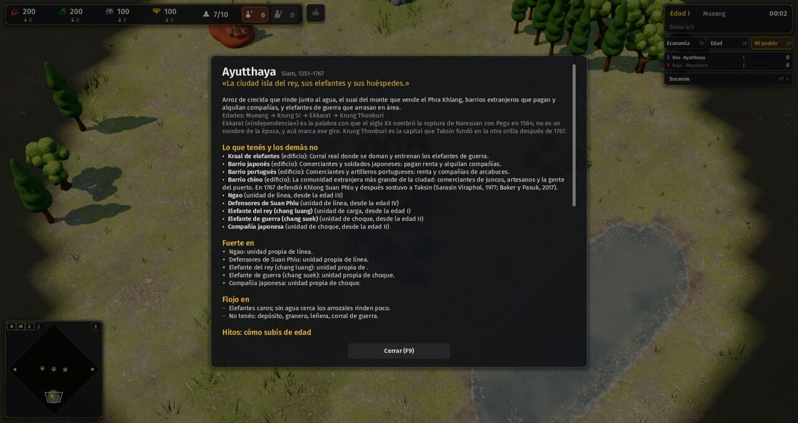
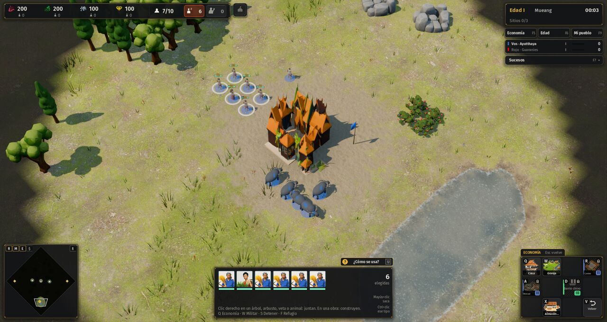
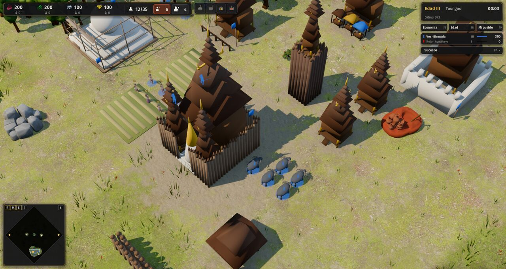
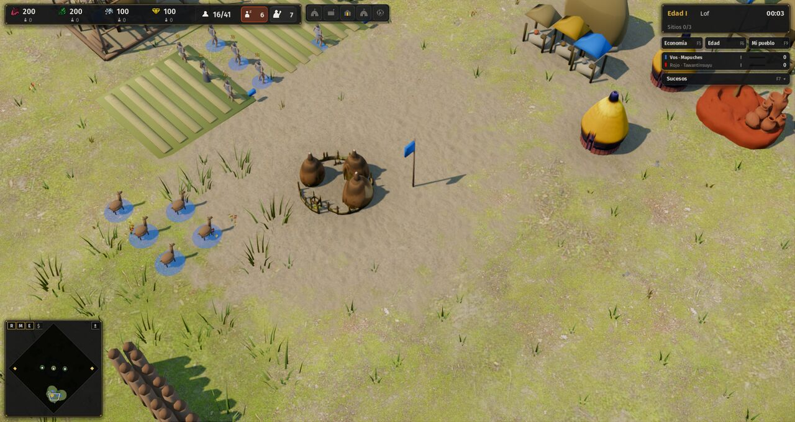
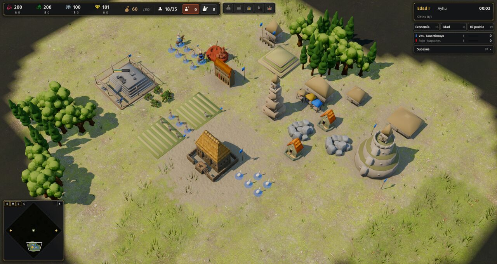
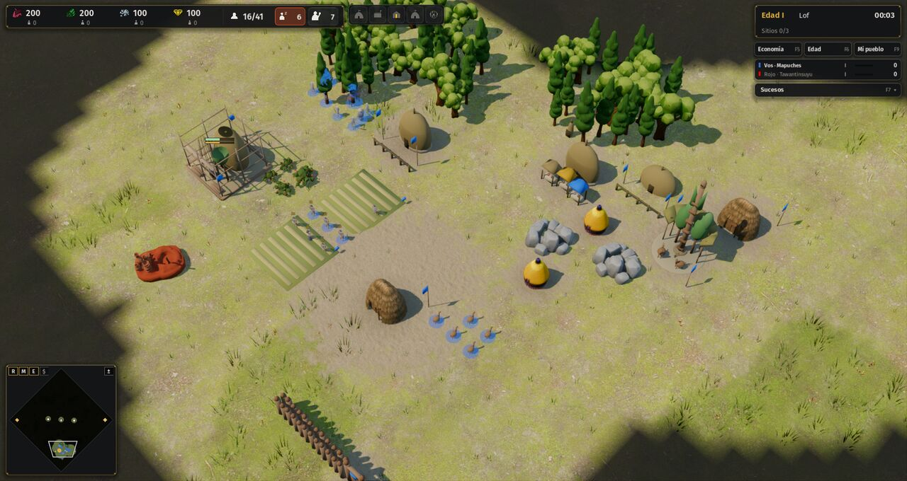
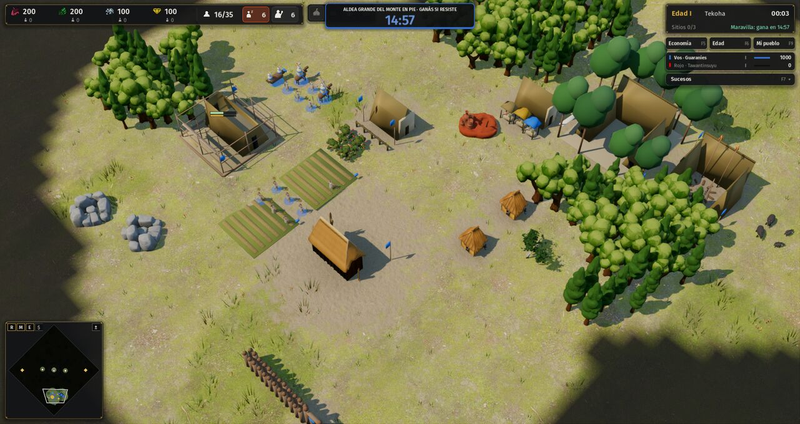
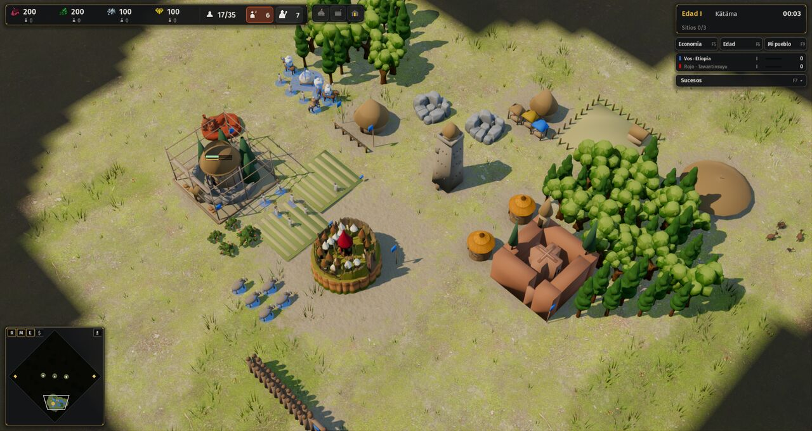
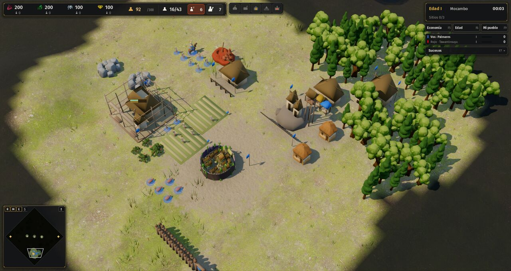
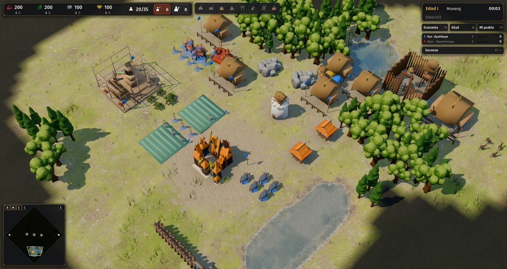

# 54 · Respuestas del autor: nombres, historia, sonido, representación y 3D (2026-11-26)

> **Pedido:** aplicar las respuestas del 2026-11-26 de nombres, historia, sonido, representación y 3D: C-70 a C-74, C-79, C-82, C-102 a C-104 y C-106. Otro agente hace en paralelo las de mecánica y balance (C-47, C-62 a C-69, C-75 a C-100), así que acá no se tocó ningún número de balance. Por cada respuesta, revisar el estado y anotar «ya estaba» o hacerlo.

> **Para confirmar (importante): la mbaraka.** En la C-60 a (2026-11-21) dijiste «dejarlo: es la casa del karai, donde corresponde». En la C-74 a (2026-11-26) aceptaste «la mbaraka sale del modelo hasta la consulta mbyá». Apliqué la C-74, que es la respuesta más nueva y la prudente: **la mbaraka ya no está en el hito guaraní**. Si preferís la C-60, es un dato: `data/arte_hitos.json → guaranies.karai_palabra.mbaraka: true`.

## Resumen

| Consulta | Qué se hizo | Estado |
|---|---|---|
| **C-70 a** | Incas: edad IV *Inkarri* → ***Willkapampa***, y el hito militar *Vilcabamba* → ***Espíritu Pampa*** (la clave `vilcabamba` no cambia). Cierra la C-39 | Hecho |
| | Birmania: III *Hanthawaddy* → ***Toungoo*** | Hecho |
| | Ayutthaya: IV *Mueang Tha* → ***Krung Thonburi***, y *Ekkarat* explicado en el panel del pueblo (campo nuevo `edades_nota`, también en los incas) | Hecho |
| | Guaraníes *Tovaja* (C-41 a), Palmares *1678* (C-42 b) y el Qorikancha en la III (C-40 b) | Ya estaba |
| **C-71 a** | «Tiradores portugueses a sueldo» y «Jinete shan» hasta la III; *Bayingyi* y *Jinete kathe* en la IV. Hace falta un mecanismo nuevo: **nombres por edad** (`nombre_edad` en la unidad o el edificio; solo la interfaz lo lee: `Textos.nombre_de`, en el panel de selección y en la ficha) | Hecho |
| | **Barrio chino** como tercer barrio de Ayutthaya (`barrio_chinos`): con los mismos números que el portugués, lo habilita la mejora «Barrio chino y puertos» de la III (`requiere_tec`) y en la IV entrena a los defensores de Suan Phlu (que siguen también en el cuartel). Grilla de economía, D; ícono del junco | Hecho; **la IA no lo construye todavía** y la mejora no le suma renta: queda para la pasada de balance |
| | **Birmania con piezas propias** (maqueta): *kyaung* (pabellón de teca sobre plataforma alta y escalera) desde la I, *zedi* (estupa en campana, blanca y dorada) en el patio del centro desde la II y remate *pyatthat* (aguja de techos cuadrados con el hti) desde la III | Hecho, en la lista del pipeline de arte |
| **C-72 a** | Hitos mapuches: ***Malón del toqui***, ***Nguillatuwe del rewe*** (común: «Campo ceremonial del lof»), ***Kawellu*** (común: «Corral de la remonta») y ***Pewenal*** (común: «Bosque de pewen»); sin «toqui de caballería» en la campaña | Hecho |
| | «Ruka de guerra» → **Junta de guerra**; «Kamayuq wasi» → ***Qhuya wasi***; «Tukul» → ***Gojjo bet*** | Hecho |
| | Ayutthaya: la riqueza se llama **«Suai (pago al rey)»** | Hecho |
| | Rebaños: **buey cebú** en Etiopía (especie nueva, con giba y papada) | Hecho |
| | Rebaños: cerdo en Palmares | Ya estaba |
| | **Rivales por potencia**: `castilla`, `portugal`, `holanda` (Países Bajos), `francia` y `paulistas` (Velho y las bandeiras), cada uno con su nombre, frase y edades. Heredan tropa y números de `invasores` (`"hereda"`, nuevo en `SimData`); las 19 facciones de las campañas pasan a su potencia; los saqueadores del tutorial y del Arte de la guerra siguen como `invasores` | Hecho |
| | Nombres dobles (original y castellano, C-30): los hitos mapuches con su `nombre_comun`; los edificios de la capa común toman el común solo | Revisado |
| **C-73 a** | **Nagarit** en la fanfarria y la alarma etíopes (el entrenado y la música de paz siguen con un kebero suave) | Hecho |
| | ***Tra Nimit*** fuera del juego, de los créditos y de `assets/` | Hecho |
| | Alarma de Ayutthaya con **sang, klong chana y pi chawa** | Hecho |
| | **Música de paz sintetizada** para Palmares (ngongi, ngoma y marimba, 27 s) y Ayutthaya (khong wong, ranat ek y ching, 32 s) | Hecho |
| **C-74 a** | Wat: sin imagen del Buda reconocible (ni en la maqueta, ni en el gouache; no tiene modelo 3D) | Ya estaba |
| | Wat destructible: se queda como todo hito; la pregunta va a la consulta Q-14 (ver abajo) | Documentado |
| | **Mbaraka fuera del hito guaraní** (ver el recuadro de arriba) | Hecho; **da vuelta la C-60 a** |
| | A futuro: los oromo como facción de IA con el *gadaa*, misiones de Adal, rivales Lan Na, Lan Xang y Camboya → `docs/diseno/26`, §1.9 | Hecho |
| | Lista completa de consultas a comunidades → `docs/diseno/29-consultas-a-comunidades.md` (28 consultas; las tablas de `26` y `27` ahora enlazan ahí) | Hecho |
| **C-79 a** | La maravilla de Ayutthaya es «Krung Si Ayutthaya y Pom Phet», sin el wat del palacio | Ya estaba |
| **C-82 a** | El saber etíope es el «Orden del kätäma»; el *Bahrä Hasab* no figura en los datos. Tu respuesta pide además consultar a la Tewahedo: queda en Q-01 | Ya estaba |
| **C-102 c** | Lista corta del VPS (Hetzner CX22: crear, ssh, relevo con la unidad de systemd, puerto 47900, probar, `RELEVO=`) en `44-version-para-amigos/guia-relevo-y-versiones.md` | Hecho; falta que lo crees |
| **C-103 a** | Pasos de las claves de descarga por amigo en la misma guía | Hecho; falta que crees la página |
| **C-104 a** | Versión con fecha y commit | Ya estaba |
| **C-106 a** | Modelos del pipeline en el juego (ver abajo) | Hecho, salvo el lof mapuche |

## Paso a paso

### Nombres de edad y hitos (C-70)

Solo cambian textos de `data/civs/*.json`: la lista `edades` y el `nombre` del hito, no las claves. El panel «Mi pueblo» muestra ahora, debajo de las edades, el texto de `edades_nota` cuando un pueblo lo tiene:

### Nombres por edad (C-71)

La revisión histórica (H-15, regla 5 de `docs/diseno/26`) ya pedía «nombres y arte por edad cuando la historia cambia dentro de la partida». Se hizo del lado de la interfaz, sin tocar la simulación: `Textos.nombre_de(sim, dueño, def, …)` devuelve el nombre de la edad más alta que el dueño ya alcanzó en `nombre_edad`, y `desc_de` hace lo mismo con la descripción. La simulación ni lo lee, así que no cambia el hash. Sirve también para el Jugol de Adal (H-16) y la cerca de Palmares (H-17), si se quieren.

### Barrio chino (C-71)

`barrio_chinos` (la clave `barrio_chino` ya era la de la mejora). Para no inventar números, copia los del barrio portugués (150 de madera, 900 de vida, 3×3, 30 s). Queda en la grilla de economía (D), con candado hasta tener la mejora:

Lo que **no** se hizo, porque cambia el balance y lo hace la pasada con torneo: que la IA lo construya (`ia_edificios`), que la mejora le sume renta (`tipos` de la renta) y el +20 % de los barrios que propone `docs/diseno/27`, §3.6.

### Birmania (C-71)

Siguen la forma `ayutthaya` y la paleta de teca, con tres claves nuevas de `data/arte_edades.json → civs.birmanos` que lee `CivMeshes`: `kyaung`, `zedi` y el remate `pyatthat`. Base birmana en la edad III (`--demo=base --civ=birmanos --edad=3`):

### Rivales por potencia (C-72)

`SimData` acepta ahora `"hereda": "<otra civ>"` en un archivo de `data/civs/`: parte del otro archivo y pisa lo que el nuevo dice (en `unidades` y `edificios`, clave por clave). Las cinco potencias heredan de `invasores` y cambian nombre, frase, descripción, edades y algunos nombres de tropa (*Soldado de terço*, *Mameluco*…); los números son los mismos. Las edades nuevas de Portugal, Países Bajos, Francia y los paulistas llevan `[verificar]` y están en la consulta Q-28.

**Aviso para la C-68 (la liberación de Palmares vale «contra los ingenios y los invasores»):** las campañas ya no usan `invasores` para los europeos. Todas las potencias y `invasores` tienen `"invasor": true`: la regla tiene que mirar esa marca, no la clave.

### Sonido (C-73)

Instrumentos nuevos en `tools/audio/instrumentos.py`: `nagarit` (timbal de cuenco grande, más grave y largo que el kebero), `klong_chana` (tambor de barril con palillos), `pi_chawa` (oboe de lengüeta cuádruple, nasal, con deslizamientos) y `sang` (caracola). La música de paz nueva sale de `tools/audio/generar_sonidos.py` (`MUSICA`), como la de Etiopía. Se regeneraron solo Etiopía, Palmares y Ayutthaya; cambiaron únicamente la fanfarria y la alarma etíopes y la alarma siamesa (los demás salieron iguales byte a byte). Sonoridad en `tools/audio/medidas.json`.

### Modelos del pipeline (C-106)

Cada cambio es **un renglón** de `data/civs/<pueblo>.json → estilo.modelos`, y se vuelve atrás sacando `local/`:

| Pueblo | Casa | Capital | Otro |
|---|---|---|---|
| Tawantinsuyu | `local/tawantinsuyu_casa` (kancha) | (Meshy, sin cambio) | `cuartel`: `local/tawantinsuyu_kallanka` |
| Mapuches | `local/mapuches_casa` (ruka) | **Meshy**: el `local/mapuches_lof` se ve más chico que una casa (abajo) | — |
| Guaraníes | `local/guaranies_casa` | `local/guaranies_centro` (oga guasu) | — |
| Etiopía | `local/etiopia_casa` (gojjo bet) | `local/etiopia_centro` (kätäma) | — |
| Palmares | `local/palmares_casa` | `local/palmares_centro` (cerca real) | — |
| Ayutthaya | `local/ayutthaya_casa` (ruean) | `local/ayutthaya_centro` (wang) | — |

Revisado en cada uno:

- **Escala.** El pipeline ya los deja al alto mínimo de la categoría (`escala_visual.altura_min_cm`) y el juego los estira hasta ahí con el tope de siempre. El tope propio de la ruka (`estirar_modelo_max_por_modelo.mapuches_casa`) ahora vale también para `local/mapuches_casa` (`world_view.gd` busca por el nombre del archivo).
- **El lof mapuche no pasa**: es un anillo de tres rukitas con cerco, y al escalarlo por la huella queda más chico que una casa. Volvió al de Meshy; para el pipeline: rehacerlo con las rukas llenando la huella o con una ruka grande al centro.

  

- **Orientación.** Las puertas dan a la cámara con el giro de siempre (`GLB_FRENTE_YAW`).
- **Color de equipo.** Igual que los modelos de Meshy: el estandarte del equipo junto a la capital y a la producción (las casas no lo llevan en el modo «importantes»).
- **Aldeanos.** Siguen como estaban, hasta que `AldeanoAnimado` acepte modelos riggeados.
- Observación para el pipeline: la kancha inca tiene techo anaranjado, como de teja; en la época era de paja.

Las seis bases (`--demo=base --cam=b2,b6,40`):

| | |
|---|---|
|  |  |
| Tawantinsuyu: kancha y kallanka | Mapuches: rukas (el lof, de Meshy) |
|  |  |
| Guaraníes: oga y oga guasu | Etiopía: gojjo bet y kätäma |
|  |  |
| Palmares: casa y cerca real | Ayutthaya: ruean y wang |

### Lo nuevo que pide arte (lista para el pipeline)

Todo lo nuevo entró con la maqueta procedural, como se aprobó para las unidades nuevas en la decisión del comercio:

1. Barrio chino de Ayutthaya (edificio; hoy, el barracón siamés de maqueta y el glifo del junco).
2. Birmania: kyaung, zedi y pyatthat (hoy, piezas de maqueta).
3. Buey cebú (hoy, el bovino de maqueta con giba).
4. Potencias europeas y paulistas: sin arte propio (usan la forma `fuerte` de los invasores).
5. Lof mapuche del pipeline: rehacerlo (ver arriba).
6. Kancha inca: techo de paja.

### Wat destructible (C-74)

Hoy el Wat Mahathat es el hito económico de la edad I→II y se destruye como cualquier hito (la victoria por hitos cuenta con eso). No se cambió: cambiarlo es mecánica. La opción que queda para la consulta theravada (Q-14) es la de Palmares (`sitiada`, C-97 a): que no caiga, que quede tomado. Ninguna fuente pide que el Wat Mahathat no pueda destruirse; lo que la revisión pidió es no repetir el saqueo de 1767 con el Wat Phra Si Sanphet, y eso ya está (C-79 a).

## Pruebas

En `pruebas/`:

| Prueba | Resultado |
|---|---|
| `tests/test_determinism.gd` | **OK, hash 3059812827** (el mismo de antes: los nombres no entran al hash, y la herencia de civs no cambia a los pueblos de la prueba) |
| `tests/bench.gd` | 8,23 ms de promedio, 57 ms el peor (presupuesto 100) |
| `tests/civ_smoke.gd` | OK |
| `tests/campaign_smoke.gd` | OK: las 24 misiones, el tutorial y las 5 del Arte de la guerra se arman y corren con las potencias nuevas |
| `tests/sonido_civ.gd` | OK |
| `tests/iconos.gd` | OK (756 grillas, 145 íconos) |
| `tests/grilla.gd` | OK |
| `tests/casillas.gd` | OK |
| `tests/verificar.gd` | OK |
| `tests/saberes.gd` | 2 fallas (*amole* y *massawa*) **que ya estaban** en `3ef568f`: se probó con los datos y el código de ese commit y fallan igual |
| `--autotest --civ=ayutthaya --terreno=llano` (con ventana) | **AUTOTEST: OK** a la primera |

## Tropiezos

- La C-60 a y la C-74 a dicen lo contrario sobre la mbaraka; se aplicó la más nueva y queda para que la confirmes.
- La C-82 a dice «Consultar a la Tewahedo y, si no, Cartógrafos de la corte», pero la revisión de la etapa 26 ya había cambiado la opción por defecto al orden del *kätäma*, que es lo que está en los datos. No se tocó; la consulta queda en Q-01.
- `barrio_chino` ya era la clave de la mejora; el edificio se llama `barrio_chinos`.
- Al separar las potencias, la regla de la C-68 que mira «invasores» tiene que mirar la marca `invasor` (aviso arriba).
- El lof del pipeline quedó chico y se volvió atrás (un renglón).
- El autotest no pudo guardar sus capturas porque la copia de trabajo no tenía la carpeta `screenshots/`; las capturas de esta etapa se sacaron aparte.

## Commits

- `f4f9d89` Proceso 54: respuestas de nombres, historia, sonido, representación y 3D
