# 56 · Rig y color de equipo para los aldeanos de Meshy

**Pedido (2026-11-26):** el autor vio el aldeano inca riggeado por Meshy (`proceso/55`): la cabeza se ve muy mal y muchas formas se rompen. Antes de gastar créditos en 12 aldeanos, responder con pruebas:

1. por qué se rompe y si se arregla sin créditos (repesar en Blender, rig propio con las animaciones de KayKit u otra cosa barata), y qué pipeline usar;
2. cómo poner el color del equipo en un aldeano con textura de Meshy, con un prototipo en Godot (3–4 colores, de cerca y a la distancia del juego, sin teñir piel, pelo ni herramientas);
3. dejarlo como herramienta para la tanda de producción.

**Regla: cero créditos de Meshy.** Todo se hizo con lo que ya estaba: el GLB riggeado de `proceso/55` (`.cache/meshy_rig/tawantinsuyu/`), el Meshy quieto del juego y el pipeline local. No se tocó el juego.

Página para mirar todo junto: [`index.html`](index.html).

## Respuesta corta

- **Por qué se rompe:** no es el esqueleto de Meshy, son los pesos y la malla de entrada.
  - El modelo viene con la herramienta pegada y con el brazo izquierdo doblado sobre el pecho, sosteniéndola junto a la cabeza.
  - El autorrig le dio peso de la mano izquierda a la nuca, al pelo y al gorro, y peso de cabeza al mango.
  - Cuando la mano se mueve, la cabeza se estira en punta hacia ella (la «barba» y el «gorro de mago» de las capturas).
- **Se arregla gratis la cabeza:** con la herramienta borrada y la cabeza rígida (100 % al hueso `Head`), la cara queda entera en todos los clips. El mejor resultado es la variante (c): pesos nuevos de Blender sobre el mismo esqueleto de Meshy.
- **Lo que no se arregla con pesos:**
  - el brazo pegado al pecho;
  - la capa atada al brazo, que se levanta con él al picar;
  - los restos del mango en el puño.

  Para eso hace falta otra malla, en pose A y con las manos vacías.
- **Recomendación:** Meshy solo para la malla (30 créditos), generada desde una hoja en gouache con pose A, las manos vacías y la ropa del equipo en rojo plano. Después, nuestro rig y las animaciones de KayKit, como el pipeline local (0 créditos).
  - Si el rig propio falla en alguna silueta (poncho, falda ancha), queda de respaldo el rig de Meshy (5 créditos) con `tools/meshy_repesar.py` en modo `c`.
  - **Créditos esperados por aldeano: 30** (36 si la hoja la pinta Meshy en lugar de FLUX local; 35–41 en el peor caso, con el rig de Meshy). Los 12: **360**, como máximo 492.

## 1. Diagnóstico

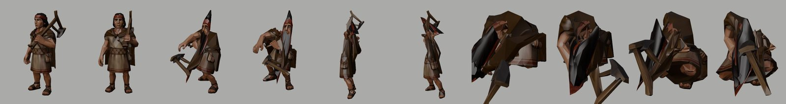

En reposo, el aldeano no está en pose A: sostiene la herramienta con la mano izquierda sobre el hombro. Al talar y al picar, la cabeza se estira en punta, y al agacharse, la herramienta atraviesa el cuerpo.

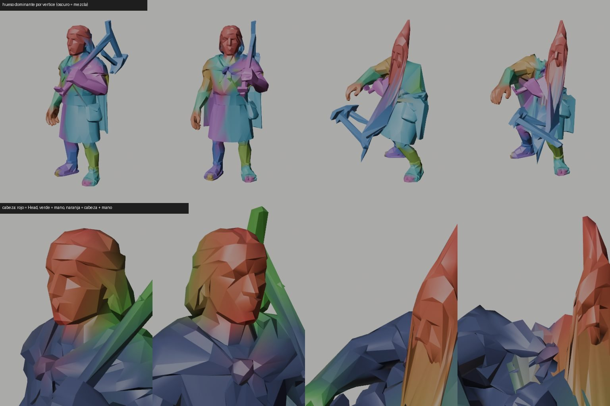

- **Arriba:** el hueso dominante de cada vértice (oscuro es mezcla de varios huesos). El mango y la hoja de la herramienta llevan el mismo color que la mano izquierda.
- **Abajo:** el peso de la cabeza en rojo y el de las manos en verde.
  - En reposo, el pelo de la nuca y el costado izquierdo de la cara ya están verdes: tienen peso de la mano.
  - En el golpe, la cabeza mezclada (naranja) se estira hasta donde llega la mano.

Medido en el GLB:
- 5248 vértices (1213 soldados por posición) y 24 huesos;
- la mano izquierda domina 375 vértices por encima del 80 % del alto, que son la herramienta y la nuca;
- la malla es **una sola pieza**: la herramienta no está separada del cuerpo.

## 2. Arreglos probados

### Detección de la herramienta y de la cabeza

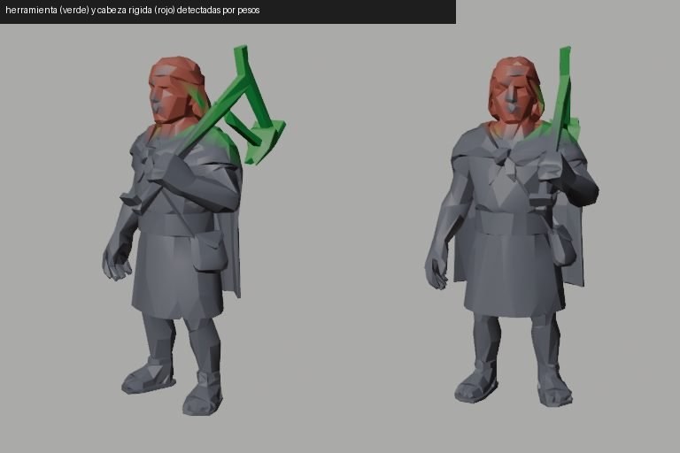

Como la herramienta está soldada al cuerpo, se la separa por pesos:
1. Semillas: vértices que domina una mano y que están a más de 25 cm de ella.
2. Crecimiento por vecindad entre los vértices de esa mano, frenando en una cápsula que va del antebrazo a la punta de los dedos (22 cm, para que la mano vacía no entre).

La cabeza es lo que queda por encima del cuello, dentro de un cilindro de 16 cm. Resultado: 448 vértices de herramienta, 736 de cabeza y 29 de cuello en degradé.

### (a) Repesar sobre los pesos de Meshy

Cabeza, gorro y pelo 100 % a `Head`, el cuello en degradé `neck`→`Head`, sin pesos de mano lejos de la mano, la herramienta y las astillas sueltas borradas, y el torso y la túnica suavizados (×4, tope de 4 huesos por vértice).

### (c) Pesos de Blender sobre el esqueleto de Meshy

La herramienta borrada, los pesos de Meshy tirados y pesos automáticos de Blender (calor de huesos) sobre el mismo esqueleto, con las colas de los huesos enderezadas hacia el hijo; después, la cabeza rígida como en (a). Conserva los 10 clips de Meshy.

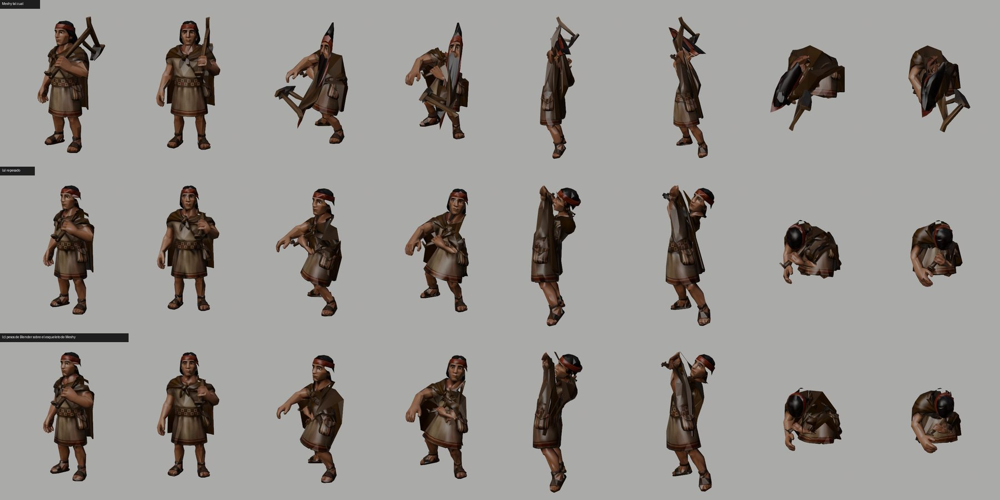

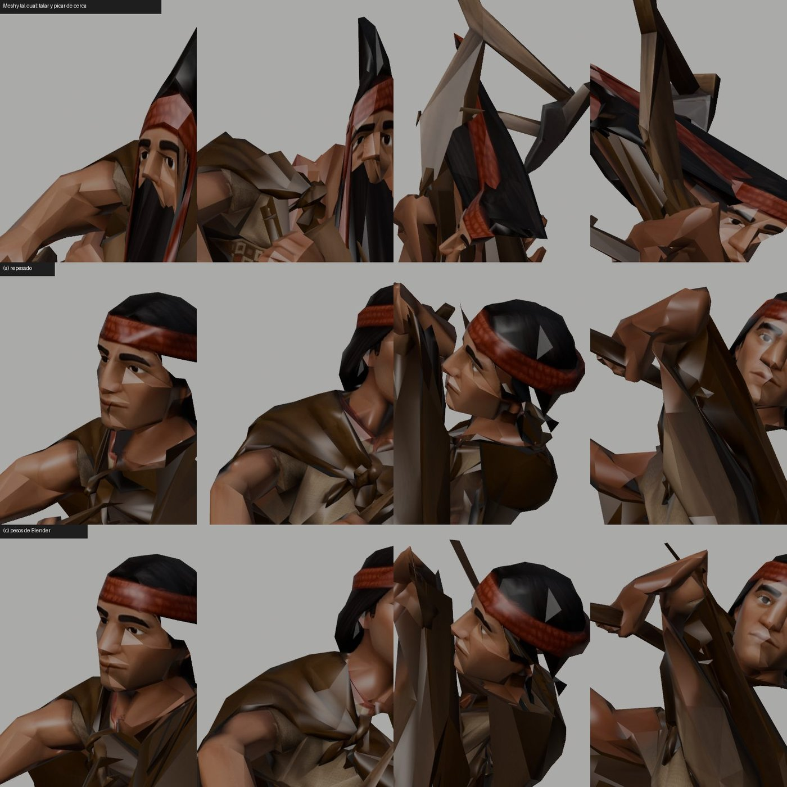

- **(a)** arregla la cabeza. El primer intento, sin soldar las costuras del atlas, deshizo la túnica en astillas: el suavizado no cruza de una isla UV a otra. Con las costuras soldadas queda bien.
- **(c)** queda más limpio que (a) en los hombros y en la cintura.
- En las dos queda lo que no depende de los pesos:
  - el puño cerrado sobre el pecho y un resto de mango;
  - la capa, que en «picar» sube con el brazo porque en el modelo la sostiene el brazo.

### (b) Rig propio (`tools/gen3d_rig.py`) y animaciones de KayKit

La malla de Meshy, sin su esqueleto y sin la herramienta, al rig del pipeline local (19 huesos con nombres de KayKit), y los clips de KayKit por el retarget de `tools/visor_rig.gd`.

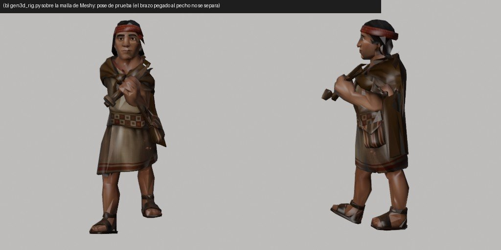

- `gen3d_rig.py` ubica las manos en los vértices más alejados a cada lado, así que da por hecho que el modelo está en pose A.
- Con el brazo doblado sobre el pecho, la mano izquierda queda donde no está y el brazo derecho se mete en el cuerpo en la pose de prueba.
- Con KayKit camina y trabaja sin romper la cara, pero los brazos no se abren (fila de abajo).
- Con una malla en pose A, este camino es el del pipeline local, que ya anda (`proceso/47`).

### Las cuatro en Godot, misma luz y mismo tamaño

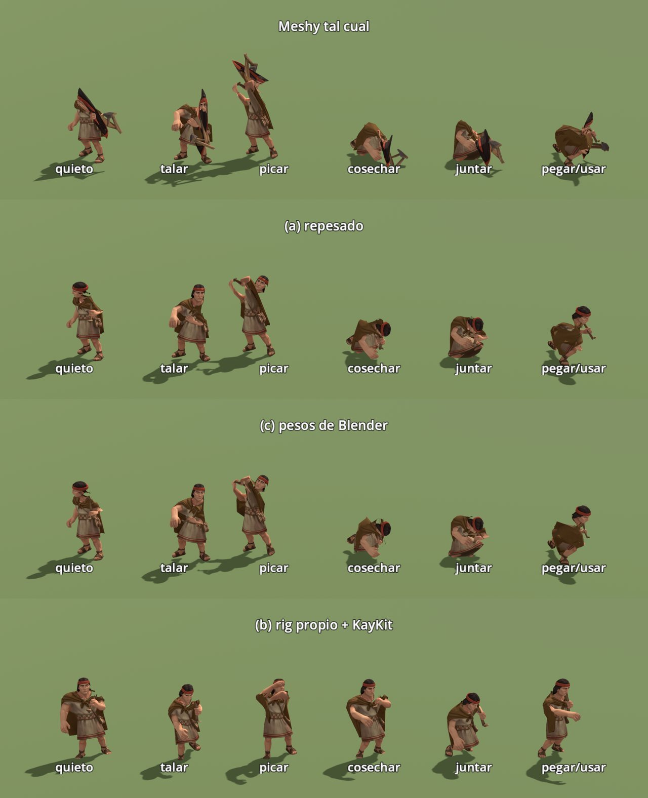

En las filas (a) y (c) la cara ya no se rompe en ningún clip; en (b) los gestos de KayKit se leen bien de lejos. Las tres sin la herramienta pegada.

### (c) de la consigna: otras cosas baratas

- **Voxel Heat Diffuse:** no está instalado (es un complemento pago). No hizo falta: el calor de huesos de Blender, con la malla soldada, alcanzó (0 vértices sin peso).
- **Rigify:** está (el único complemento de rig disponible), pero arma un esqueleto de control con otros nombres. Para este caso no suma nada sobre el retarget de KayKit, así que no se probó.

## 3. Color del equipo

La faja de `proceso/55` era una solución de compromiso: con una sola textura no se puede teñir una parte. Ahora va una **máscara en el mismo atlas UV** y un **shader** que tiñe lo enmascarado con `equipo × (luz de la textura / luz_ref)`. Así se conservan los pliegues, las guardas y las sombras pintadas.

- `tools/mascara_equipo_3d.py` (en Blender, sin scipy ni Pillow). Arma la máscara en el espacio UV de la textura del modelo. Tiene dos métodos:
  - `--metodo=rojo`: tono rojo saturado, como `tools/recolorear.py`. Es para modelos generados desde una hoja con la ropa en rojo plano; es el que **va para la producción**.
  - `--metodo=ropa` (por defecto): para los Meshy de hoy, que no traen ropa roja.
    - Toma las caras de la banda del torso y la túnica (30 %–80 % del alto).
    - Saca los brazos y las manos por los huesos.
    - Saca la piel por parecido en CIELAB al color de las manos: la tela marrón de Meshy cae en el mismo tono que la piel, así que no alcanza un corte por tono.
    - Saca el pelo por oscuridad y el metal por gris.

  En los dos métodos, las manos no se tiñen nunca. La máscara se expande 4 píxeles solo hacia el margen vacío del atlas, para que los mipmaps no dejen bordes, e imprime `luz_ref` para el shader.
- `src/game/shaders/equipo_3d.gdshader`: textura, máscara, color del equipo, `luz_ref`, el tinte mate de `WorldView._matte` y `ver_mascara` para revisar. Todavía no lo usa el juego.
- `tools/rig_y_color.gd --modo=color`: el mismo aldeano en cuatro colores (azul y rojo de `Palette.TEAM`, amarillo y verde), la máscara en magenta y el original, de cerca y con la cámara del juego.

### Meshy de hoy (método `ropa`, el inca de la variante c)

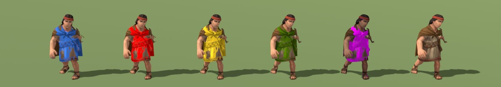

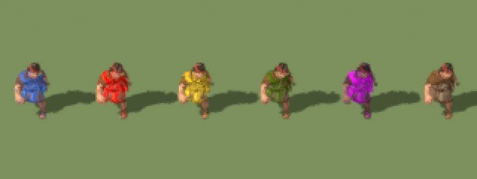

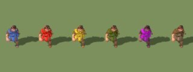

- Piel, cara, pelo, vincha, sandalias y manos quedan sin teñir.
- La túnica y la capa toman el color y se leen de lejos.
- Quedan manchas marrones en la falda: texeles de la tela que se parecen a la piel. Por eso este método sirve de puente y no para producción.
- Cubre el 28 % de la superficie.

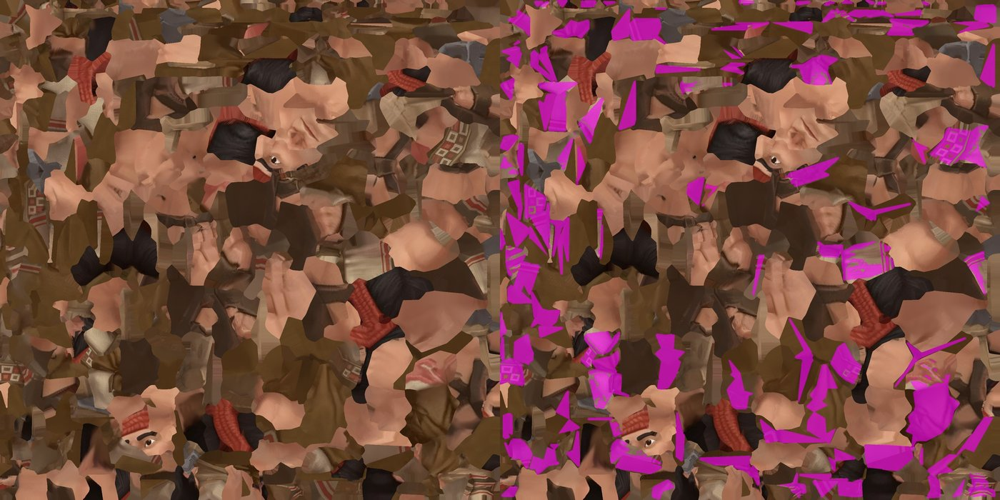

### Ropa en rojo plano (método `rojo`, aldeano del pipeline local)

El aldeano local heredó la túnica roja de las unidades 2D, así que sirve para probar lo que pasaría con un Meshy generado con la ropa en rojo.

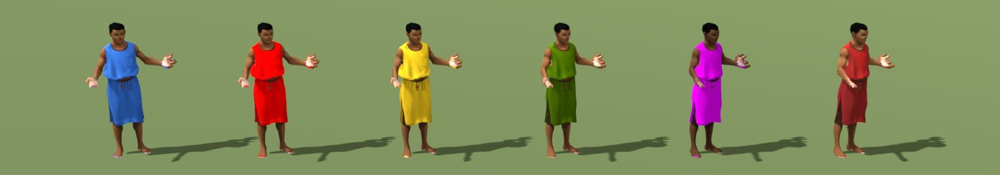

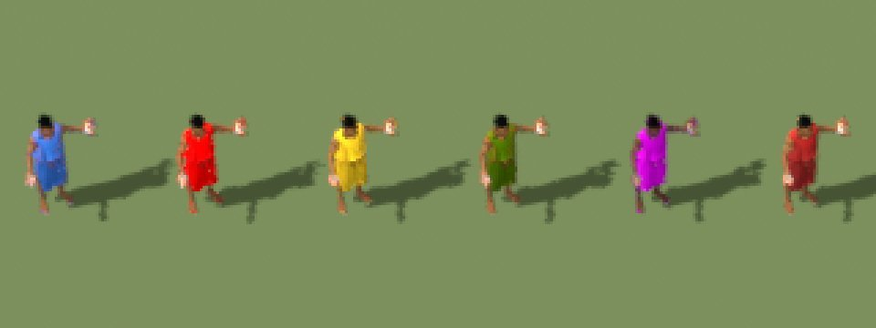

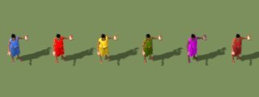

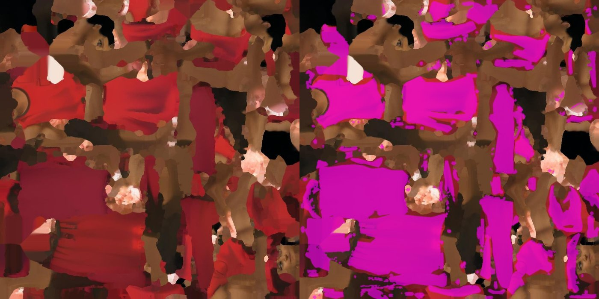

La túnica entera cambia de color, sin manchas; piel, pelo y pies quedan intactos.

## Recomendación para los 12 aldeanos

| Paso | Cómo | Créditos |
|---|---|---|
| Hoja de referencia | Gouache (`tools/arte_gouache.py`/FLUX local) en **pose A, manos vacías, ropa del equipo en rojo plano** (el resto con los colores del pueblo) | 0 (6 si la pinta Meshy) |
| Malla y textura | Meshy multi-image-to-3d, como en `proceso/19` | 30 |
| Rig | `tools/gen3d_rig.py` (KayKit) + cabeza rígida como en `meshy_repesar.py` | 0 |
| Animación | KayKit por el retarget (`AldeanoAnimado`); las herramientas, como accesorios del juego | 0 |
| Color del equipo | `tools/mascara_equipo_3d.py --metodo=rojo` + `equipo_3d.gdshader` | 0 |
| Respaldo, si el rig propio no aguanta una silueta | rig de Meshy (`tools/meshy_rig.py`, trae caminar y correr) + `tools/meshy_repesar.py ... c` | +5 |

**Por aldeano: 30 créditos (de 30 a 41). Los 12: 360 (máximo 492).**

No conviene comprar los clips de Meshy (3 por clip, 30 por aldeano):
- los de KayKit ya están en el juego, son los mismos para los seis pueblos y para los soldados;
- los de Meshy había que recortarlos y dejarlos en el lugar (`proceso/55`).

Antes de la tanda, conviene probar con **un** aldeano (30 créditos) que Meshy respete la pose A y el rojo plano de la hoja: es la única suposición que no se pudo comprobar sin gastar.

## Aldeano de prueba (2026-11-27)

**Pedido:** el autor aprobó un aldeano de prueba (30 créditos, ya generado con la receta de arriba): Meshy multi-image-to-3d con el frente y la espalda de la hoja en gouache `comfyui/output/incas_gouache/hoja_aldeano_e1_31.png`, pose A, 15.000 triángulos, con textura. Había que validarlo, pasarlo por nuestro pipeline y decir si se hacen los otros 11. **Cero créditos más:** no se llamó a Meshy.

### Veredicto: **sí, seguir con los otros 11** (con la receta de abajo; la consulta es C-107)

Las tres suposiciones que no se podían probar sin gastar se cumplieron:
- **Pose A y manos vacías:** sí. Los brazos están a 45°, simétricos (las manos al 44,6 % del alto, a ±0,28 del centro), las manos abiertas y nada pegado al cuerpo.
- **Túnica en rojo plano:** sí. La túnica sale roja en toda la textura, con pliegues y el bolsillo de la hoja. El cordón de la cintura queda marrón verdoso y no se tiñe.
- **Cara:** se lee como un hombre andino adulto: piel cobriza, pelo negro corto, rasgos de adulto, sin deformaciones. No trae vincha ni *llawtu*, porque la hoja tampoco la tenía.

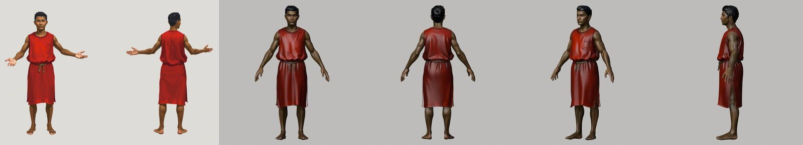

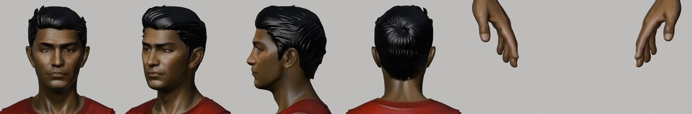

### Rig propio y animaciones de KayKit

`tools/gen3d_rig.py` con dos opciones nuevas:
- `--normalizar`: el GLB de Meshy viene en metros, centrado en el origen;
- `--cabeza-rigida`: el paso de `meshy_repesar.py` con los nombres de KayKit: 1553 vértices de la cabeza al 100 % en `head` y 149 del cuello en degradé `chest`→`head`.

El esqueleto también trae ahora `handslot.l` y `handslot.r` sin peso (ver herramientas). Resultado: 21 huesos y 0 vértices sin peso de 8025. Anduvo a la primera, así que no hizo falta el respaldo de calor de huesos.

Las mismas poses malas de arriba, comparadas con el rig de Meshy roto y con el repesado (c):

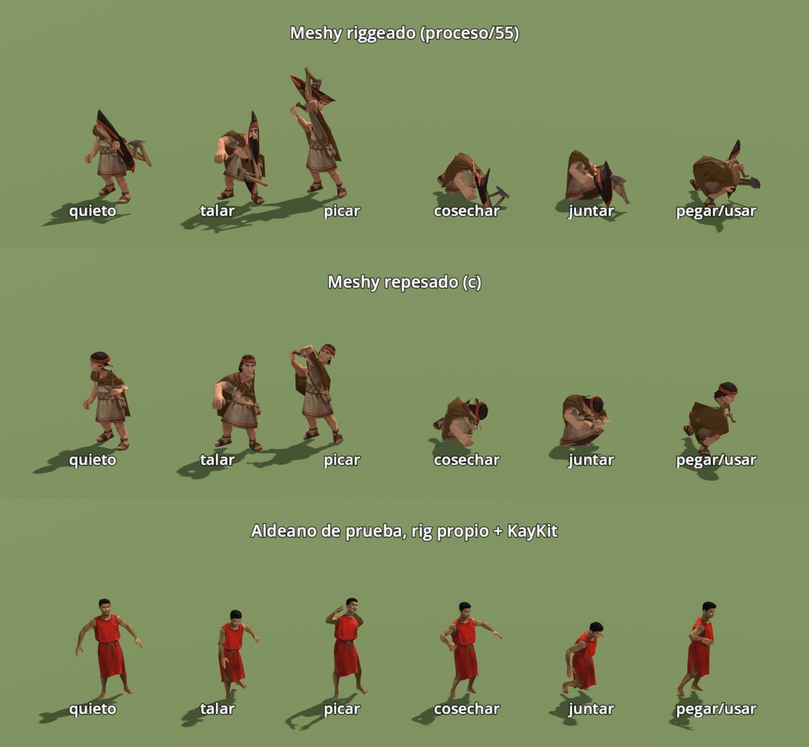

- La cara queda entera en todas las poses, y la mano levantada ya no estira la cabeza.
- Los brazos se abren desde los hombros sin romper la túnica.

Los ocho estados del aldeano, al lado del aldeano de hoy, con la misma biblioteca del juego (`--fuente=juego`: proporciones de `PROP` y brazos y piernas cerrados por `AldeanoAnimado._cerrar`). Los estados son quieto, caminar, talar, picar, construir, llevar, pegar y morir:

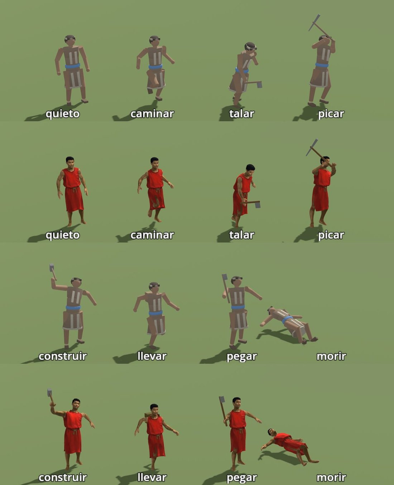

**Herramientas:** son las del juego (`AldeanoAnimado._herramienta`), colgadas de `handslot.r`.
- **Tropiezo:** colgada de `wrist.r`, el hacha de talar salía bien, pero el pico, el martillo y el hacha de pegar quedaban girados. KayKit anima `handslot.r` aparte de la muñeca.
- **Arreglo:**
  - `gen3d_rig.py` arma `handslot.l/r` (en la palma, sin peso);
  - el retarget no usa `handslot` para orientar la muñeca;
  - la pieza va en el marco «corrección × reposo» del hueso.

  Así quedan iguales a las del aldeano de hoy en los ocho estados.
- El atado de «llevar» va en `chest`, como en el juego.

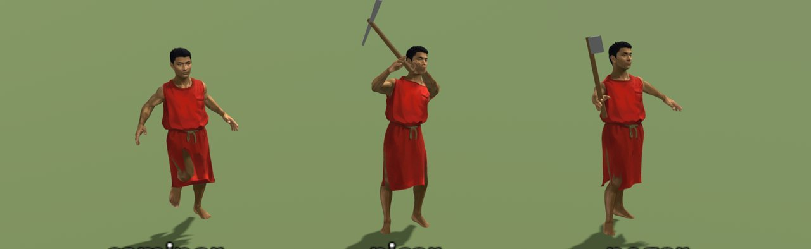

**Lo que queda:**
- **Al caminar, la rodilla asoma por la túnica:** la falda se parte entre los dos muslos.
  - Probé llevar la tela roja por debajo de la cintura hacia `hips`, con los muslos promediados. La rodilla asomaba igual, o un poco más, así que lo saqué.
  - A la distancia del juego no se ve (capturas de color, abajo).
  - Si molesta de cerca, hay que bajar el paso en el clip (`CERRAR_PIERNAS`), no tocar los pesos.
- **La mano derecha queda abierta alrededor del mango:** viene abierta de la pose A, y el rig no tiene dedos para cerrar el puño. De lejos no se nota.

### Color del equipo

`tools/mascara_equipo_3d.py --metodo=rojo`: la máscara cubre el 67 % del atlas, con `luz_ref` = 0,076. Tiñe con `equipo_3d.gdshader` en azul, rojo, amarillo y verde (con la máscara en magenta y el original). A la derecha, el aldeano de hoy (KayKit) para comparar el tamaño:

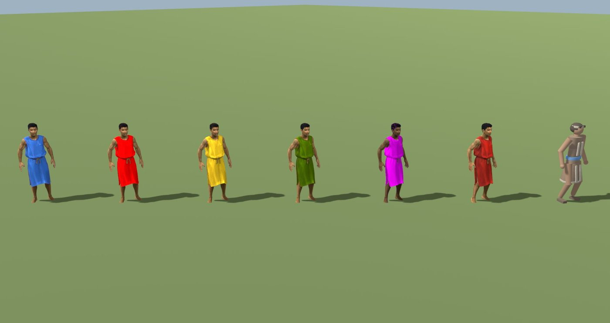

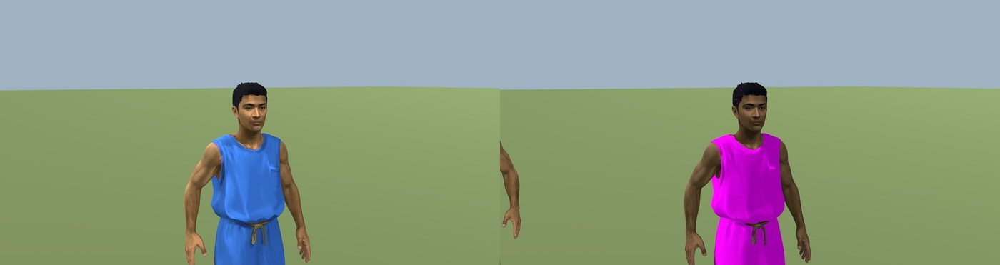

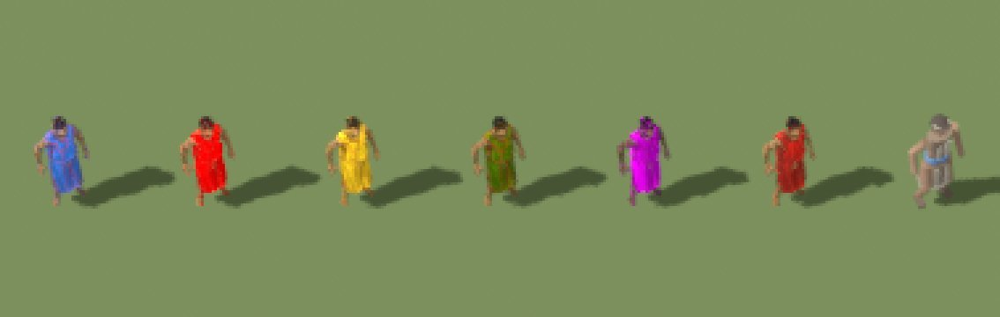

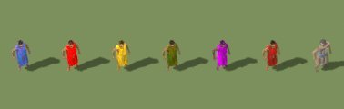

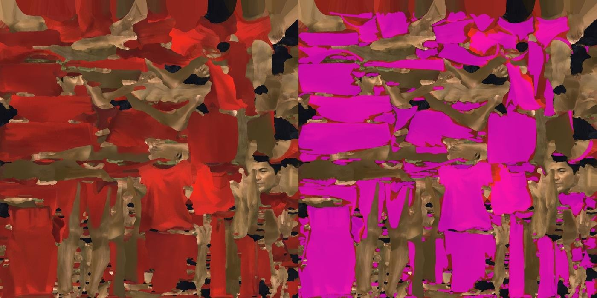

- La piel, la cara, el pelo, las manos, los pies y el cordón quedan sin teñir. No hay vincha (el modelo no la trae).
- La túnica entera cambia de color, sin las manchas del método «ropa», y de lejos el color se lee bien.
- Detalles menores:
  - unos pocos texeles del pelo, rojizos en la textura, entran en la máscara (se ven en magenta arriba de la cabeza; con el color del equipo, casi nada);
  - queda un borde rojo fino en la sisa, en las costuras de las islas del atlas.

### Problemas concretos

1. **Meshy no respetó los 15.000 triángulos:** entregó 515.842 (17,6 MB). `tools/meshy_api.py` ignora `--poli` sin `--remesh` (proceso/16). Se diezmó en local con `optimizar_glb.py` a 16.109 triángulos y textura de 2048, sin pérdida visible. Para los otros 11: pedir con `--remesh --poli=15000` o diezmar igual (es gratis).
2. **La rodilla asoma por la túnica al caminar** (ver arriba). Es aceptable para el juego.
3. **No trae tocado:** la hoja no lo tenía. Si el *llawtu* o la vincha tienen que estar, van en la hoja, en un color que no sea rojo.
4. **Borde rojo en las costuras de la máscara:** son unos pocos píxeles. Se puede crecer la máscara 1–2 px dentro de las islas en `mascara_equipo_3d.py`.

### Receta para cada aldeano que falta

```sh
# 0) hoja en gouache (FLUX local): pose A, manos vacías, la ropa del equipo en rojo plano, sin rojo
#    en piel, pelo ni tocado; recortar frente y espalda.
# 1) malla (30 créditos)
python3 tools/meshy_api.py modelo .cache/meshy_aldeanos/<pueblo>_<sexo>.glb frente.png espalda.png \
    --pose=a-pose --poli=15000 --remesh
# 2) diezmar y achicar la textura (si Meshy no respetó --poli)
blender --background --python tools/optimizar_glb.py -- .cache/meshy_aldeanos/<x>.glb <x>_opt.glb 15000 2048 solo_color
# 3) rig propio (KayKit), cabeza rígida y handslot
blender --background --python tools/gen3d_rig.py -- <x>_opt.glb <x>_rig.glb <x>_mixamo.fbx <x>_prueba \
    --normalizar --cabeza-rigida
# 4) máscara del equipo (anotar luz_ref)
blender --background --python tools/mascara_equipo_3d.py -- <x>_rig.glb <x>_mascara.png --metodo=rojo --hoja=<x>_hoja.jpg
# 5) revisar en Godot: poses malas, los ocho estados con herramientas y los cuatro colores
godot --path . --resolution 1800x620 -s tools/rig_y_color.gd -- --dir=<carpeta> --modo=rig --fuente=juego \
    "--clips=Idle_A@0.5@quieto@,Walking_A@0.25@caminar@,Chopping@0.45@talar@hacha,Pickaxing@0.5@picar@pico" \
    "--filas=Hoy|-|juego;Nuevo|<x>_rig.glb|kaykit"
godot --path . --resolution 1800x620 -s tools/rig_y_color.gd -- --dir=<carpeta> --modo=rig --fuente=juego \
    "--clips=Hammering@0.5@construir@martillo,Walking_A@0.6@llevar@carga,Melee_1H_Attack_Chop@0.45@pegar@hacha,Death_A@0.95@morir@" \
    "--filas=Hoy|-|juego;Nuevo|<x>_rig.glb|kaykit"
godot --path . --resolution 1600x900 -s tools/rig_y_color.gd -- --dir=<carpeta> --modo=color --fuente=juego \
    --glb=<x>_rig.glb --mascara=<x>_mascara.png --luz=<luz_ref> --nombre=<x> --kaykit_civ=<pueblo>
# 6) copiar a assets/generados/modelos/meshy_aldeanos/<pueblo>_<sexo>.glb (+ _mascara.png); ≤ 3 MB
```

Blender y Godot van dentro de `systemd-run --user --scope -p MemoryMax=4G -p MemorySwapMax=1G`, de a uno. Cada aldeano tarda unos 5 minutos de máquina.

**Qué mirar en cada uno antes de seguir:**
- en la vista de frente: pose A y manos vacías;
- en la máscara: que la ropa entre entera y que la piel no entre;
- en «picar» y «pegar»: que la cara no se estire.

Si un pueblo tiene poncho o falda ancha y el rig propio la rompe, el respaldo sigue siendo `meshy_rig.py` (5 créditos) más `meshy_repesar.py ... c`.

**Entregado:** `assets/generados/modelos/meshy_aldeanos/inca_m.glb` (2,8 MB, 21 huesos, sin clips; los toma de KayKit) y `inca_m_mascara.png` (`luz_ref` = 0,076). Todavía no están conectados al juego. Para conectarlos:
- `AldeanoAnimado` tiene que retargetear su biblioteca al esqueleto del GLB (como `rig_y_color.gd`, sin usar `handslot` para la muñeca);
- la herramienta va en `handslot.r`;
- el material es `equipo_3d.gdshader`.

## Cómo repetirlo

```sh
# arreglar un rig de Meshy (marcar | a | c)
blender --background --python tools/meshy_repesar.py -- riggeado.glb salida.glb c
# máscara del equipo
blender --background --python tools/mascara_equipo_3d.py -- modelo.glb mascara.png --metodo=rojo --hoja=hoja.jpg
# comparación de rigs y prueba de color en Godot (GLB fuera de res:// se cargan con GLTFDocument)
godot --path . --resolution 1800x620 -s tools/rig_y_color.gd -- --dir=<carpeta> --modo=rig \
  "--filas=Meshy|a.glb|meshy;Propio|b.glb|kaykit"
godot --path . --resolution 1600x900 -s tools/rig_y_color.gd -- --dir=<carpeta> --modo=color \
  --glb=modelo.glb --mascara=mascara.png --luz=<luz_ref>
```

Los renders de Blender de las poses salieron de un script de prueba fuera del repositorio: tira de vistas 3/4 y de frente por pose, con Workbench y color de textura, de hueso dominante o de peso de cabeza.

## Tropiezos

- `.cache/meshy_rig/` no estaba en el repositorio principal sino en el worktree del agente de `proceso/55`; se copió a la `.cache/` de este.
- Los huesos del GLB de Meshy se importan en Blender con colas absurdas (metros de largo). Para el calor de huesos hubo que enderezarlas hacia el hijo.
- El primer corte de la herramienta se llevaba la mano derecha vacía (los dedos quedan a 21 cm del hueso de la mano). Se arregló con la cápsula del antebrazo y semillas a más de 25 cm.
- El suavizado de pesos sobre la malla sin soldar rompió la túnica en astillas. Hay que soldar las costuras del atlas antes.
- La máscara por tono de piel fija se llevaba el 69 % de la ropa: el marrón de Meshy y la piel tienen el mismo tono. Se pasó a distancia CIELAB al color de las manos y a sacar los brazos por los huesos.
- Godot no importa carpetas que empiezan con punto: los GLB de `.cache/` se cargan con `GLTFDocument` en tiempo de ejecución.
- Aldeano de prueba:
  - el worktree no tenía `.godot/`, así que sin importar, `AldeanoAnimado` no resolvía; se copió el del repositorio principal y se importó;
  - la RAM disponible no llegaba al umbral de 10 GB (ComfyUI de otro proyecto ocupa 8 GB); se bajó el tope a 4 GB con un umbral de 7;
  - la herramienta salía girada colgada de la muñeca (ver arriba);
  - el intento `--falda` se descartó.

## Commits

- Proceso 56: rig de Meshy y color de equipo en 3D (diagnóstico, arreglos, máscara y shader)
- Proceso 56: aldeano de prueba (Meshy en pose A, rig propio, herramientas en handslot y color del equipo)
