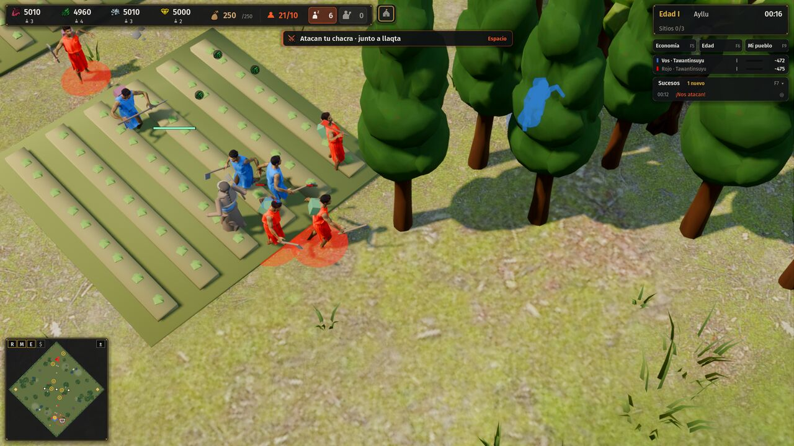

# 57 · Aldeanos de Meshy

## Hojas de las aldeanas

**Pedido:** una hoja de referencia por pueblo de la aldeana de la edad I, igual que la del aldeano (`hoja_aldeano_e1_31.png`): 1152×768, vista de frente a la izquierda y de espaldas a la derecha, pose A con las manos vacías, descalza, ropa en rojo plano (la máscara del equipo) y fondo gris claro. Son la entrada de Meshy (imagen a 3D), y después van el rig propio y el color del equipo.


**Salida:** `comfyui/output/<civ>_gouache/hoja_aldeana_e1_31.png` (`incas_gouache` para el Tawantinsuyu), con su `_mascara.png` y su `_meta.json`. Las descartadas quedan como `_v1` a `_v4`.

**Receta:** FLUX schnell, con la instancia de ComfyUI del autor (un `POST /free` antes y otro después), y la semilla 31 de los aldeanos. La cara es la `CARA_F` aprobada de cada pueblo (`caras_aldeanas.py` la saca de los `armar_piezas.py` de proceso/42 y proceso/49), con la edad dicha en el prompt: «about thirty-five, a mature adult, not a girl». Cada pueblo lleva su ropa de mujer de la época: aksu con chumpi, küpam con trarilonko, tipoy, qemis (sin la shamma: un chal suelto queda colgando entre los brazos), una tela envuelta en Palmares, y pha nung con sabai. El generador está en `hojas_aldeanas.py`.

**Cambios en la cara, para el rig:** a la guaraní se le ata el pelo en una trenza, porque la `CARA_F` lo pide suelto hasta la espalda. A la siamesa se le pide «sin rodete».

**Tropiezos:**
- FLUX schnell corta el prompt a unos 256 tokens. Con la receta larga de las hojas (unas 256 palabras), la edad y el «sin joyas» del final no llegaban. Se compactó a unas 180 palabras.
- Con la semilla 31, la composición casi no cambia entre intentos. La semilla 37 rompe el formato: salen tres o cuatro figuras, sin pose A (`_v4`).
- Igual salen más jóvenes que los hombres: de 25 a 30 años, no adolescentes.

**Elegidas:** Tawantinsuyu y Mapuches del tercer intento (prompt compacto). Guaraníes, Etiopía, Palmares y Ayutthaya del primero.

**Dudas abiertas:**
- **Mapuches:** el trarilonko se ve solo de espaldas.
- **Palmares:** de frente, sin pañuelo y con un hombro al aire; de espaldas, con pañuelo y sin breteles.
- **Ayutthaya:** el sabai cruza un hombro de frente, pero de espaldas tiene mangas cortas. Los intentos 2 y 3 dieron una bata parecida a un kimono, con rodete: se descartaron por estereotipo.

En Palmares y Ayutthaya la ropa no coincide entre las dos vistas, así que hay que retocar una vista a mano o pasar la buena por img2img antes de Meshy.

## En el juego (2026-11-27)

### Pedido

El autor aprobó la receta de `proceso/56` («Aldeano de prueba»): malla de Meshy, **nuestro** rig (`tools/gen3d_rig.py --normalizar --cabeza-rigida`), animaciones de KayKit por retarget y color del equipo con la máscara roja y `equipo_3d.gdshader`. Pedido:

1. Conectar los aldeanos al juego: `AldeanoAnimado` acepta un GLB riggeado por pueblo, con el retarget de los clips de KayKit, las herramientas en `handslot.r` (la carga en el pecho) y el shader del equipo. Un interruptor por pueblo en los datos, para volver atrás en una línea. Biblioteca retargeteada compartida por modelo; medir los FPS con ~200 aldeanos antes y después.
2. Inca primero, con capturas en partida: la base con aldeanos trabajando en dos colores de equipo.
3. Los otros cinco hombres (mapuches, guaraníes, Etiopía, Palmares, Ayutthaya) por la receta, a medida que llegan de la sesión principal.
4. Mujeres: siguen con la figura de KayKit hasta que haya modelos; el interruptor admite «hombre: nuevo, mujer: el de hoy». (Después llegaron también las mujeres: ver abajo.)

**Cero créditos de Meshy**: acá no se llamó a Meshy.

### Paso a paso

#### 1. El interruptor (`data/arte_animaciones.json` → `modelos`)

```json
"modelos": {
  "activo": true,
  "lista": { "inca_m": { "glb": "res://assets/generados/modelos/meshy_aldeanos/inca_m.glb", "mascara": "...inca_m_mascara.png", "luz_ref": 0.076 } },
  "por_civ": { "tawantinsuyu": { "m": "inca_m" } }
}
```

- `por_civ[pueblo][sexo]` elige el modelo; sin la línea, ese aldeano vuelve a la figura de KayKit. `activo: false` los apaga a todos.
- Hombre y mujer son independientes («m» nuevo, «f» el de hoy, o los dos).

#### 2. `AldeanoAnimado` (`src/game/aldeano_animado.gd`, sección «Aldeanos de Meshy»)

- `modelo_de(civ, sexo)` arma el modelo **una vez** y lo guarda: copia del esqueleto del GLB (nombres de KayKit), la malla con su piel (por nombre de hueso), y la **biblioteca retargeteada una sola vez** desde la plantilla del juego (proporciones de `PROP` y brazos y piernas cerrados), con el mismo retarget de `tools/rig_y_color.gd` (la muñeca no se orienta por `handslot`).
- `vestir()` le pone el modelo al aldeano: la malla, la piel y el material `equipo_3d.gdshader` (uno por color de equipo y modelo, compartido) con la máscara y `luz_ref`.
- La herramienta y la carga van en una segunda malla con piel (`extra`), del mismo esqueleto: las piezas de siempre (`_herramienta`, el atado) llevadas al hueso del modelo en el marco «corrección × reposo». Se guardan en caché por herramienta y carga. Así funciona también con los esqueletos compartidos (coros), sin `BoneAttachment3D`.
- Los coros llevan el id del modelo en la clave: los aldeanos de un mismo modelo que hacen lo mismo comparten esqueleto, igual que antes.
- `equipo_3d.gdshader` suma `instance uniform float tono` (la variación de tono de una figura a otra, como en la figura de KayKit).
- `tools/aldeanos_animados.gd --modo=base`: la base con aldeanos de los dos equipos talando, picando, cosechando, construyendo y llevando carga; una captura por trabajo y una general.

#### 3. Inca (hombre): en partida

`tools/aldeanos_animados.gd --modo=base --civ=tawantinsuyu --rival=tawantinsuyu`: aldeanos azules y rojos, el hombre con el modelo de Meshy y la mujer con la figura de KayKit de hoy (50 % y 50 %).




- Las herramientas caen en la mano (hacha, pico, martillo, chakitaqlla) y el atado de la carga en la espalda.
- La túnica toma el color del equipo; piel, pelo y cordón quedan sin teñir.

### Rendimiento (200 aldeanos en pantalla, `--modo=fps`, Tawantinsuyu, llano)

| | FPS (mediana de 5 rondas) | vista (ms/cuadro) | GPU (ms) |
|---|---|---|---|
| Antes (KayKit, 50 % mujeres) | 54,6 | 5,53 | 5,7 |
| Con el inca de Meshy (50 % hombres) | 51,7 | 6,02 | 6,5 |
| Con el inca de Meshy (100 % hombres) | 53,2 | 5,64 | 7,4 |

- El costo está en la GPU (16.000 triángulos con piel por figura, contra unos 1.500 de la maqueta): +1,7 ms con 200 hombres. El CPU casi no cambia, porque los coros siguen compartiendo esqueleto.
- Armar un modelo (retarget de las 31 animaciones incluido) tarda 249 ms, una vez por partida y por modelo, cuando aparece el primer aldeano de ese pueblo.


### Pruebas

- `test_determinism`: OK, hash 3059812827 (igual que antes: es solo imagen).
- `iconos`: OK. `grilla`: OK.

### Tropiezos

- Al empezar, la sesión principal ya había abierto `proceso/57` con las hojas de las aldeanas; pisé su README sin querer y lo recuperé de git, con esta parte agregada abajo.
- La RAM disponible no pasó de 5–6 GB en toda la tarea (ComfyUI ocupaba 13 GB). Después de 30 minutos esperando los 7 GB, se corrió igual, de a un proceso y con el tope de 4 GB.
- La primera captura en partida pedía importar el proyecto: el GLB del inca no tenía su `.scn` en `.godot/`.
