# 57 · Aldeanos de Meshy

## Hojas de las aldeanas

**Pedido:** una hoja de referencia por pueblo de la aldeana de la edad I, igual que la del aldeano (`hoja_aldeano_e1_31.png`): 1152×768, vista de frente a la izquierda y de espaldas a la derecha, pose A con las manos vacías, descalza, ropa en rojo plano (la máscara del equipo) y fondo gris claro. Son la entrada de Meshy (imagen a 3D), y después van el rig propio y el color del equipo.

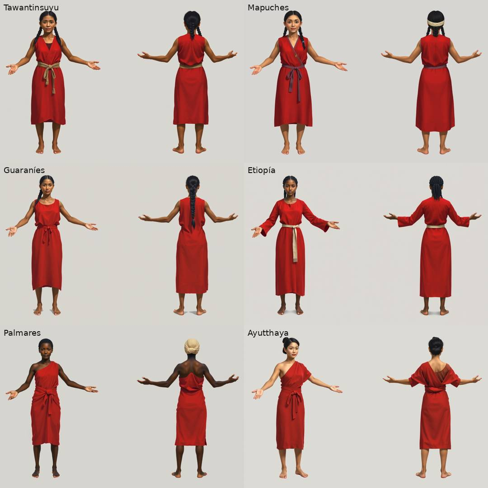

**Salida:** `comfyui/output/<civ>_gouache/hoja_aldeana_e1_31.png` (`incas_gouache` para el Tawantinsuyu), con su `_mascara.png` y su `_meta.json`. Las descartadas quedan como `_v1` a `_v4`.

**Receta:** FLUX schnell, con la instancia de ComfyUI del autor (un `POST /free` antes y otro después), y la semilla 31 de los aldeanos. La cara es la `CARA_F` aprobada de cada pueblo (`caras_aldeanas.py` la saca de los `armar_piezas.py` de proceso/42 y proceso/49), con la edad dicha en el prompt: «about thirty-five, a mature adult, not a girl». Cada pueblo lleva su ropa de mujer de la época: aksu con chumpi, küpam con trarilonko, tipoy, qemis (sin la shamma: un chal suelto queda colgando entre los brazos), una tela envuelta en Palmares, y pha nung con sabai. El generador está en `hojas_aldeanas.py`.

**Cambios en la cara, para el rig:** a la guaraní se le ata el pelo en una trenza, porque la `CARA_F` lo pide suelto hasta la espalda. A la siamesa se le pide «sin rodete».

**Tropiezos:**
- FLUX schnell corta el prompt a unos 256 tokens. Con la receta larga de las hojas (unas 256 palabras), la edad y el «sin joyas» del final no llegaban. Se compactó a unas 180 palabras.
- Con la semilla 31, la composición casi no cambia entre intentos. La semilla 37 rompe el formato: salen tres o cuatro figuras, sin pose A (`_v4`).
- Igual salen más jóvenes que los hombres: de 25 a 30 años, no adolescentes.

**Elegidas:** Tawantinsuyu y Mapuches del tercer intento (prompt compacto). Guaraníes, Etiopía, Palmares y Ayutthaya del primero.

**Dudas abiertas:**
- **Mapuches:** el trarilonko se ve solo de espaldas.
- **Palmares:** de frente, sin pañuelo y con un hombro al aire; de espaldas, con pañuelo y sin breteles.
- **Ayutthaya:** el sabai cruza un hombro de frente, pero de espaldas tiene mangas cortas. Los intentos 2 y 3 dieron una bata parecida a un kimono, con rodete: se descartaron por estereotipo.

En Palmares y Ayutthaya la ropa no coincide entre las dos vistas, así que hay que retocar una vista a mano o pasar la buena por img2img antes de Meshy.

## En el juego (2026-11-27)

### Pedido

El autor aprobó la receta de `proceso/56` («Aldeano de prueba»): malla de Meshy, **nuestro** rig (`tools/gen3d_rig.py --normalizar --cabeza-rigida`), animaciones de KayKit por retarget y color del equipo con la máscara roja y `equipo_3d.gdshader`. Pedido:

1. Conectar los aldeanos al juego: `AldeanoAnimado` acepta un GLB riggeado por pueblo, con el retarget de los clips de KayKit, las herramientas en `handslot.r` (la carga en el pecho) y el shader del equipo. Un interruptor por pueblo en los datos, para volver atrás en una línea. Biblioteca retargeteada compartida por modelo; medir los FPS con ~200 aldeanos antes y después.
2. Inca primero, con capturas en partida: la base con aldeanos trabajando en dos colores de equipo.
3. Los otros cinco hombres (mapuches, guaraníes, Etiopía, Palmares, Ayutthaya) por la receta, a medida que llegan de la sesión principal.
4. Mujeres: siguen con la figura de KayKit hasta que haya modelos; el interruptor admite «hombre: nuevo, mujer: el de hoy». (Después llegaron también las mujeres: ver abajo.)

**Cero créditos de Meshy**: acá no se llamó a Meshy.

### Paso a paso

#### 1. El interruptor (`data/arte_animaciones.json` → `modelos`)

```json
"modelos": {
  "activo": true,
  "lista": { "inca_m": { "glb": "res://assets/generados/modelos/meshy_aldeanos/inca_m.glb", "mascara": "...inca_m_mascara.png", "luz_ref": 0.076 } },
  "por_civ": { "tawantinsuyu": { "m": "inca_m" } }
}
```

- `por_civ[pueblo][sexo]` elige el modelo; sin la línea, ese aldeano vuelve a la figura de KayKit. `activo: false` los apaga a todos.
- Hombre y mujer son independientes («m» nuevo, «f» el de hoy, o los dos).

#### 2. `AldeanoAnimado` (`src/game/aldeano_animado.gd`, sección «Aldeanos de Meshy»)

- `modelo_de(civ, sexo)` arma el modelo **una vez** y lo guarda: copia del esqueleto del GLB (nombres de KayKit), la malla con su piel (por nombre de hueso), y la **biblioteca retargeteada una sola vez** desde la plantilla del juego (proporciones de `PROP` y brazos y piernas cerrados), con el mismo retarget de `tools/rig_y_color.gd` (la muñeca no se orienta por `handslot`).
- `vestir()` le pone el modelo al aldeano: la malla, la piel y el material `equipo_3d.gdshader` (uno por color de equipo y modelo, compartido) con la máscara y `luz_ref`.
- La herramienta y la carga van en una segunda malla con piel (`extra`), del mismo esqueleto: las piezas de siempre (`_herramienta`, el atado) llevadas al hueso del modelo en el marco «corrección × reposo». Se guardan en caché por herramienta y carga. Así funciona también con los esqueletos compartidos (coros), sin `BoneAttachment3D`.
- Los coros llevan el id del modelo en la clave: los aldeanos de un mismo modelo que hacen lo mismo comparten esqueleto, igual que antes.
- `equipo_3d.gdshader` suma `instance uniform float tono` (la variación de tono de una figura a otra, como en la figura de KayKit).
- `tools/aldeanos_animados.gd --modo=base`: la base con aldeanos de los dos equipos talando, picando, cosechando, construyendo y llevando carga; una captura por trabajo y una general.

#### 3. Inca (hombre): en partida

`tools/aldeanos_animados.gd --modo=base --civ=tawantinsuyu --rival=tawantinsuyu`: aldeanos azules y rojos, el hombre con el modelo de Meshy y la mujer con la figura de KayKit de hoy (50 % y 50 %).


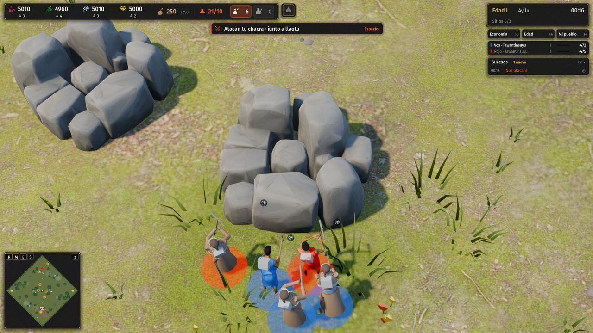

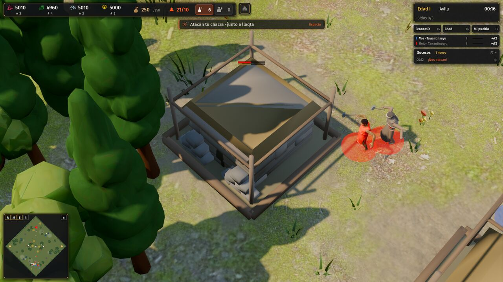

- Las herramientas caen en la mano (hacha, pico, martillo, chakitaqlla) y el atado de la carga en la espalda.
- La túnica toma el color del equipo; piel, pelo y cordón quedan sin teñir.

#### 4. Los otros cinco hombres

Llegaron crudos de la sesión principal a `.cache/meshy_aldeanos/` (de 16 a 98 MB, de 460.000 a 3 millones de triángulos). Los cinco cumplen la entrada: pose A, manos vacías, ropa en rojo plano y cara adulta del pueblo (render de frente y de espalda de los crudos):

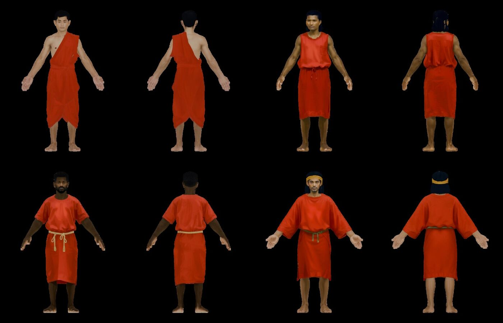

Receta de `proceso/56`, de a un proceso (`optimizar_glb` a 15.000 triángulos y 2048, `gen3d_rig --normalizar --cabeza-rigida`, `mascara_equipo_3d --metodo=rojo`):

| Pueblo | Triángulos | Vértices sin peso | Máscara | `luz_ref` | GLB |
|---|---|---|---|---|---|
| Guaraníes | 14.999 | 0 | 65 % | 0,084 | 2,7 MB |
| Etiopía | 15.821 | 5025 → 0 (con `--calor-escala=10`) | 85 % | 0,073 | 2,8 MB |
| Palmares | 14.999 | 5910 → 0 (con `--calor-escala=10`) | 80 % | 0,092 | 3,0 MB |
| Ayutthaya | 17.310 | 0 | 77 % | 0,090 | 2,7 MB |
| Mapuches | — | — | — | — | **no entra** |

- **Calor de huesos que falla:** en Etiopía y Palmares, Blender no encontró solución a alto 1 y dejó dos tercios de los vértices sin peso (el cuerpo no se movía). `gen3d_rig.py --calor-escala=K` calcula los pesos con todo K veces más grande y después lo vuelve a achicar: con K = 10, 0 vértices sin peso en los dos. Si igual quedan, un respaldo les da los dos huesos más cercanos.
- **Mapuche, salteado:** el crudo pesa 98 MB (3 millones de triángulos, seis veces más denso que los otros). `optimizar_glb` lo deja en astillas: el diezmado se traba en unos 60.000 triángulos y, al soldar más fuerte para seguir, rompe la malla. Probé rehacerlo con vóxeles y hornear el color (o pasar las UV de la original): la forma queda bien, pero el pecho, las mangas y las piernas salen con manchas oscuras, como si la malla de Meshy tuviera una segunda capa por dentro. Esos intentos no quedaron en la herramienta. Hace falta pedirlo de nuevo con `--remesh --poli=15000` (30 créditos) o revisarlo a mano en Blender. El mapuche sigue con la figura de KayKit.

En partida, cada pueblo con su rival del mismo pueblo (azul y rojo): talar, picar, cosechar en la chacra y llevar la carga (abajo a la derecha, la obra o la segunda vuelta de la piedra):

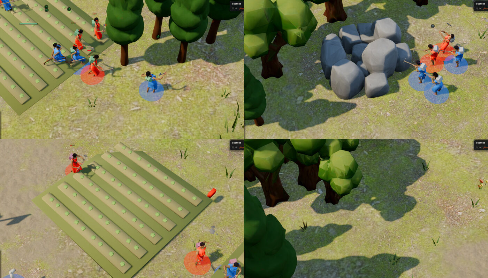

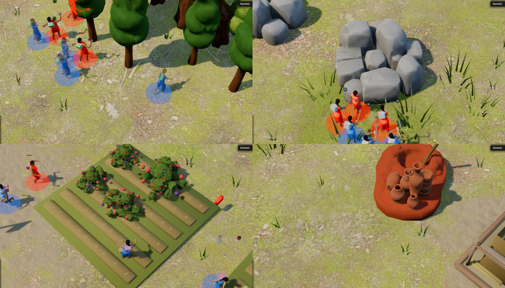

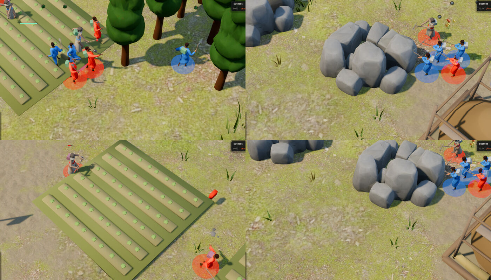

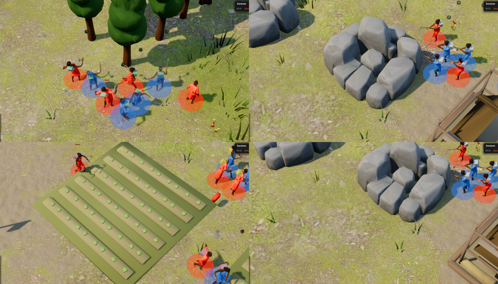

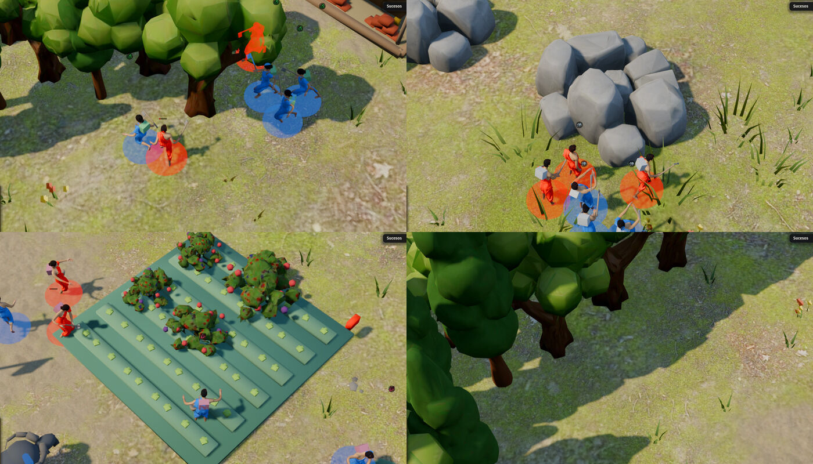

#### 5. Las mujeres

Llegaron después, también crudas (Mapuches, Palmares y Ayutthaya hechas solo con la vista de frente). Con la misma receta y `--calor-escala=10` salieron las seis sin problemas de malla: entre 15.000 y 16.000 triángulos, 0 vértices sin peso, máscara del 63 al 84 %. Las espaldas de Mapuches, Palmares y Ayutthaya están bien (lisas y del mismo vestido):

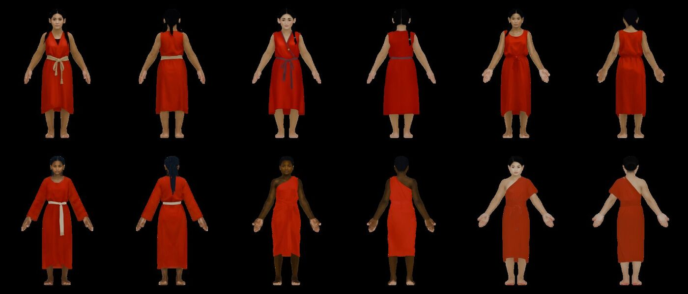

La entrada pide «una cara adulta del pueblo»:

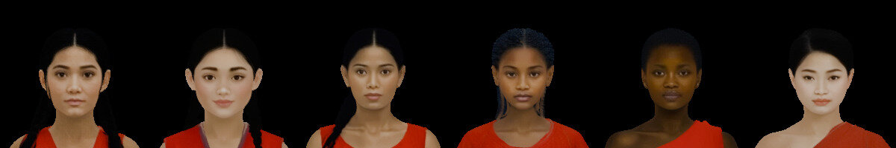

- **Conectadas:** inca, guaraní, de Palmares y siamesa (`por_civ[pueblo].f`). Las cuatro se ven de 25 a 30 años, como avisaba la parte de las hojas.
- **Salteadas (siguen con la figura de KayKit):**
  - **etíope:** la cara se lee como de una nena de 12 a 14 años;
  - **mapuche:** la cara sale blanca y de muñeca, sin los rasgos de la `CARA_F` aprobada.

  Las dos están riggeadas en `.cache/meshy_aldeanos/proc/` por si el autor las acepta igual: copiar el GLB y la máscara y agregar la línea en `por_civ`.

#### 6. Los tres que faltaban (C-108)

El autor eligió regenerar los tres (C-108 a). Llegaron rehechos por la sesión principal con el remesh de Meshy, ya livianos: 3,4–3,9 MB y unos 20.000 triángulos con textura de 2048. Acá **no** se llamó a Meshy.

- **Mapuche (hombre):** la malla nueva está entera (el crudo viejo, de 98 MB, se rompía al diezmar). Cara adulta, trarilonko, manos vacías.
- **Etíope (mujer):** hoja nueva con cara adulta, de frente y de espalda. Ahora se lee como de 25 a 30 años, igual que las otras.
- **Mapuche (mujer):** hoja nueva, hecha solo con la vista de frente. La espalda está bien: lisa, del mismo vestido, con las dos trenzas. La cara es adulta y morena; el trarilonko sale de lana clara, no de plata.

Ninguno tiene nada pegado a las manos. Frente, espalda, costado y cara de los tres crudos:

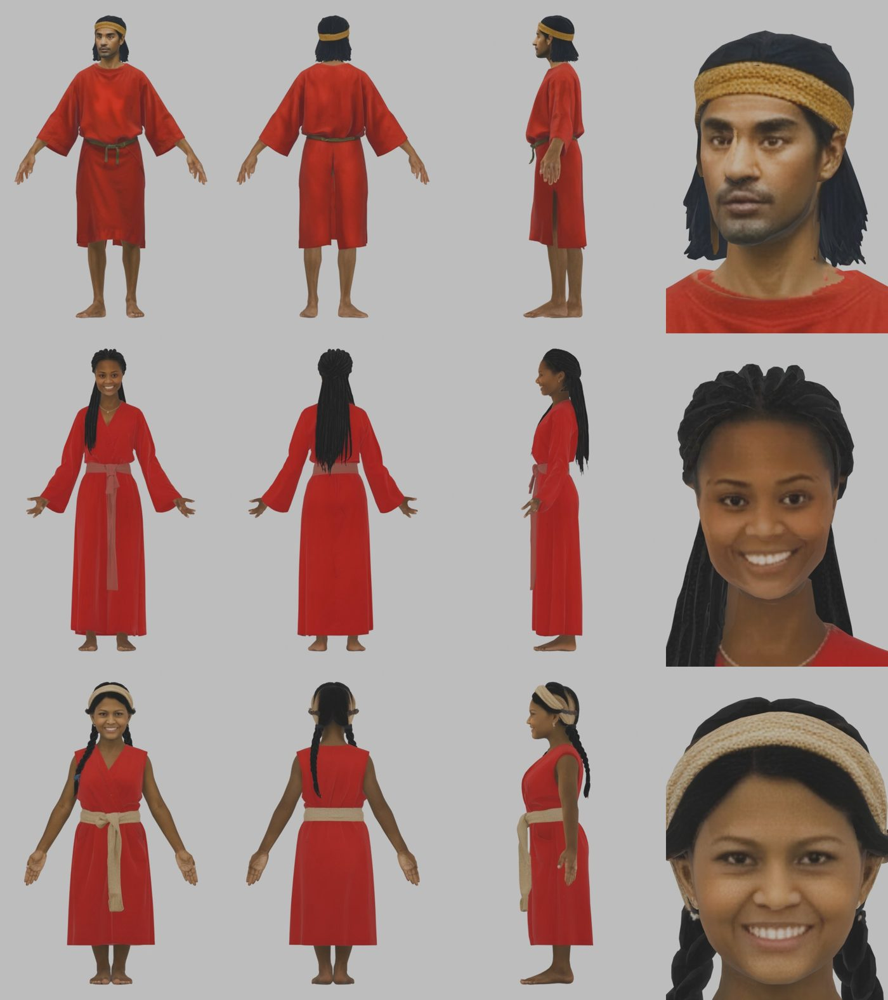

Misma receta (`optimizar_glb` a 15.000 triángulos, `gen3d_rig --normalizar --cabeza-rigida --calor-escala=10`, `mascara_equipo_3d --metodo=rojo`):

| Modelo | Triángulos | Vértices sin peso | Máscara | `luz_ref` | GLB |
|---|---|---|---|---|---|
| `mapuches_m` | 14.999 | 0 | 87 % | 0,084 | 1,4 MB |
| `etiopia_f` | 14.999 | 0 | 45 % | 0,086 | 1,5 MB |
| `mapuches_f` | 15.000 | 0 | 45 % | 0,087 | 1,2 MB |

- Los GLB riggeados salían de 3,2 a 3,6 MB, por encima del tope de 3 MB. La textura se volvió a guardar en JPEG con calidad 80 y croma 4:2:0 (sin pasar por Blender): quedan en 1,2–1,5 MB y no se nota en el juego.
- En las mujeres, la máscara cubre menos superficie porque los brazos, las trenzas y la faja no son rojos. El vestido se tiñe entero (ver abajo).
- Conectados en `por_civ`: `mapuches: { m, f }` y `etiopia.f`. Ya no queda ningún aldeano con la figura de KayKit en los seis pueblos.

En partida, azul contra rojo: talar, picar y cosechar. En la cuarta, la vista general mapuche; la obra etíope:

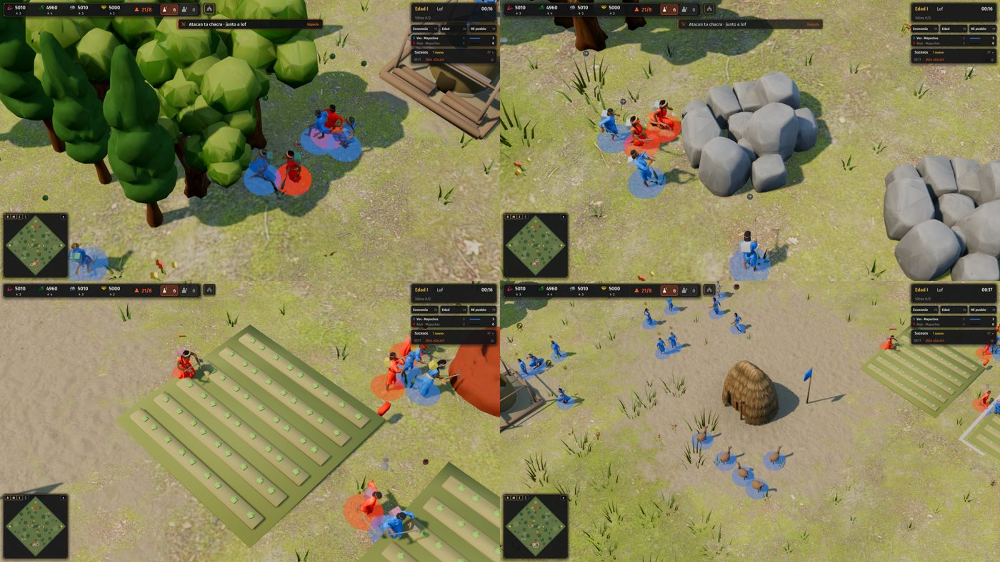

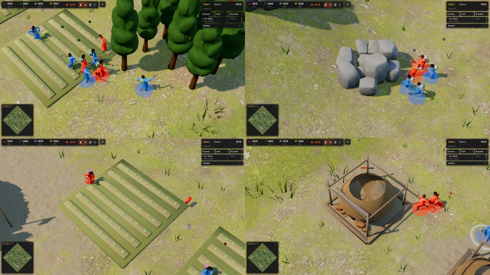

Pruebas: `test_determinism` OK (hash 3059812827, el mismo); autotest con ventana, `--civ=mapuches --terreno=llano`: AUTOTEST OK, 250 comprobaciones.

### Rendimiento (200 aldeanos en pantalla, `--modo=fps`, Tawantinsuyu, llano)

| | FPS (mediana de 5 rondas) | vista (ms/cuadro) | GPU (ms) |
|---|---|---|---|
| Antes (KayKit, 50 % mujeres) | 54,6 | 5,53 | 5,7 |
| Con el inca de Meshy (50 % hombres) | 51,7 | 6,02 | 6,5 |
| Con el inca de Meshy (100 % hombres) | 53,2 | 5,64 | 7,4 |
| Más tarde, otra vez y seguidas: sin modelos | 52,2 | 5,71 | 5,8–12 |
| Más tarde: hombres e incas de Meshy (50 % y 50 %) | 45,9 | 6,17 | 7–17 |

- El costo está en la GPU (16.000 triángulos con piel por figura, contra unos 1.500 de la maqueta): +1,7 ms con 200 hombres. El CPU casi no cambia, porque los coros siguen compartiendo esqueleto.
- Con los 200 de Meshy (hombres y mujeres), el juego pierde un 12 % de los cuadros. Si molesta, lo siguiente es una versión de 6.000–8.000 triángulos para lejos o sacar la sombra de las figuras lejanas.
- Armar un modelo (retarget de las 31 animaciones incluido) tarda de 250 a 400 ms, una vez por partida y por modelo, cuando aparece el primer aldeano de ese pueblo.

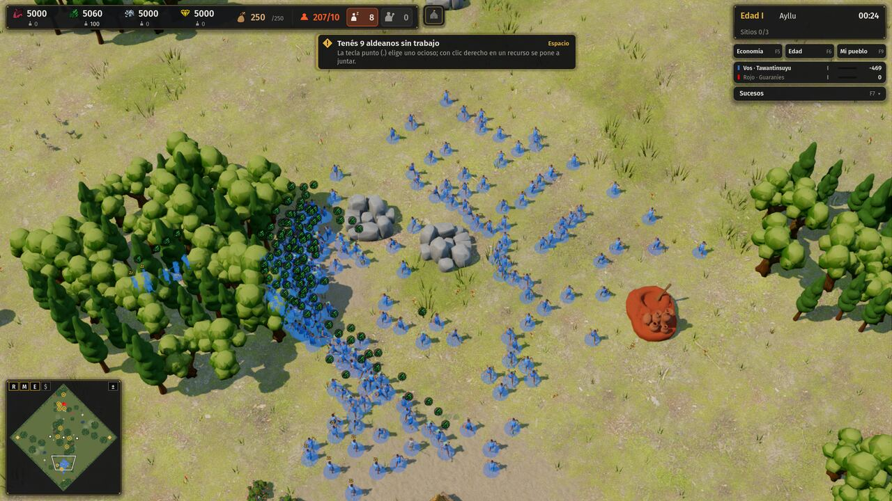

### Pruebas

- `test_determinism`: OK, hash 3059812827 (igual que antes: es solo imagen).
- `iconos`: OK. `grilla`: OK (antes y después de sumar los otros pueblos).
- Autotest con ventana, `--civ=tawantinsuyu --terreno=llano`: AUTOTEST OK, 258 comprobaciones.

### Tropiezos

- Al empezar, la sesión principal ya había abierto `proceso/57` con las hojas de las aldeanas; pisé su README sin querer y lo recuperé de git, con esta parte agregada abajo.
- La RAM disponible no pasó de 5–6 GB en toda la tarea (ComfyUI ocupaba 13 GB). Después de 30 minutos esperando los 7 GB, se corrió igual, de a un proceso y con el tope de 4 GB.
- `godot --headless --import` hubo que correrlo dos veces para que importara los GLB nuevos.
- La primera captura en partida pedía importar el proyecto: el GLB del inca no tenía su `.scn` en `.godot/`.

### Cómo repetirlo

```sh
# receta de proceso/56 con --calor-escala=10 en el rig, de a un proceso y con 7 GB libres
blender --background --python tools/optimizar_glb.py -- .cache/meshy_aldeanos/<x>.glb <x>_opt.glb 15000 2048 solo_color
blender --background --python tools/gen3d_rig.py -- <x>_opt.glb <x>_rig.glb <x>_mixamo.fbx <x>_prueba --normalizar --cabeza-rigida --calor-escala=10
blender --background --python tools/mascara_equipo_3d.py -- <x>_rig.glb <x>_mascara.png --metodo=rojo
# copiar a assets/generados/modelos/meshy_aldeanos/, sumar la entrada en data/arte_animaciones.json → modelos, importar
godot --path . -s tools/aldeanos_animados.gd -- --modo=base --civ=<pueblo> --rival=<pueblo> --terreno=llano --nofog --mute
godot --path . -s tools/aldeanos_animados.gd -- --modo=fps --civ=<pueblo> --terreno=llano --nofog --mute
```

### Commits

- Proceso 57: aldeanos de Meshy en el juego (retarget compartido, handslot, color del equipo); inca hombre conectado
- Proceso 57: hombres de cuatro pueblos y cuatro mujeres de Meshy en el juego; rig con --calor-escala
- Proceso 57: los tres aldeanos que faltaban (hombre y mujer mapuches, mujer etíope) con el remesh de Meshy; cierra C-108
