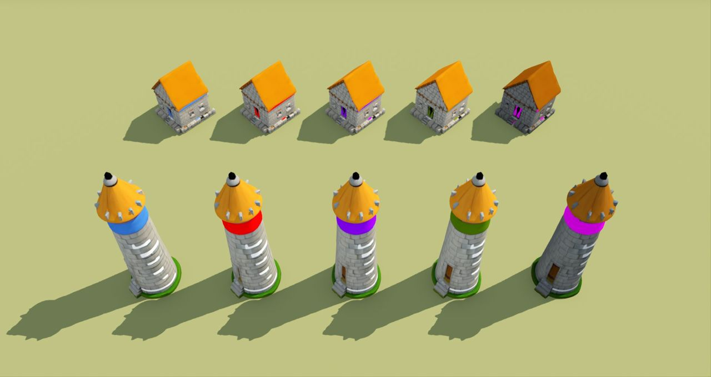
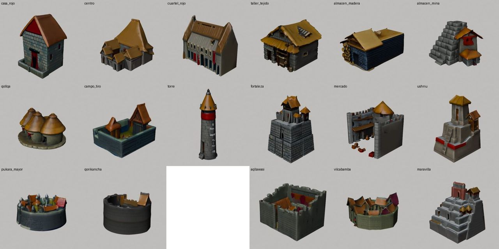
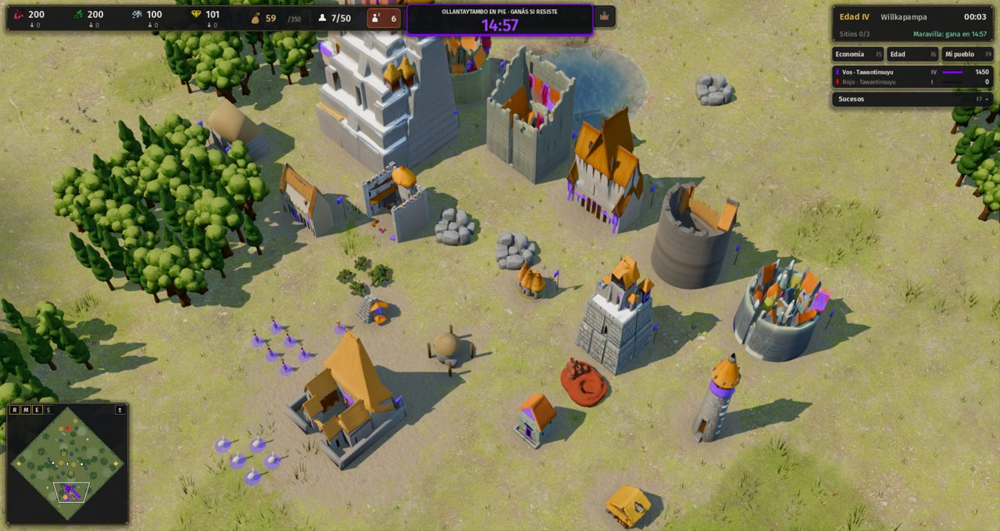
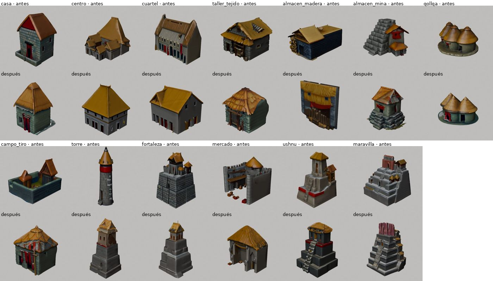

# 58 · Edificios de los seis pueblos con el pipeline local

> **Pedido del autor (2026-11-27):** generar con el pipeline 3D local (gratis) todos los edificios posibles de los seis pueblos y conectarlos al juego. Los soldados, después. «Acordate del color»: los edificios tienen que mostrar el color del equipo.

<!-- INVENTARIO -->

## Color del equipo

**Antes:** los modelos generados (casas y capitales del proceso 54) no tenían color propio. El juego les pone un estandarte (`Meshes.team_banner`) solo a los edificios importantes (`CivMeshes.bandera_para`: centro, hitos, maravilla, fortaleza y producción militar). Una casa o un almacén de otro jugador eran iguales a los propios.

**Método nuevo**, el mismo de los aldeanos (`proceso/56`):

1. **Referencia con rojo plano.** Cada edificio se pinta de nuevo con FLUX (receta gouache de `proceso/42`) para el 3D: un solo cuerpo, tres cuartos, sin suelo ni paisaje, y unos pocos elementos en **rojo plano**, de uso cotidiano o militar:
   - Tawantinsuyu: cortinas tejidas en las puertas y una faja tejida bajo el alero;
   - mapuches: mantas sobre un travesaño y banderolas en las lanzas de colihue;
   - guaraníes: toldos de algodón y fajas atadas a los horcones;
   - Etiopía: toldos de tela y banderolas;
   - Palmares: faja de tela bajo el alero y cortinas;
   - Ayutthaya: banderas rectangulares lisas (la bandera siamesa de la época era roja y lisa) y toldos.

   **Lo sagrado no lleva rojo**: qorikancha, nguillatuwe (`rewe_lonko`), casa del karai, iglesia, monasterio y wat. Esos llevan solo el estandarte del juego.
2. **Máscara.** `tools/mascara_equipo_3d.py --metodo=rojo --edificio`: el rojo saturado de la textura (±15° de tono, saturación ≥ 0,55), sin la detección de manos de los aldeanos. Queda en `<modelo>_mascara.png`, junto al GLB. Es el paso nuevo `mascara` de `tools/gen3d_pipeline.py`, que anota `luz_ref` y la cobertura en `data/modelos_equipo.json`.
3. **Juego.** `WorldView._equipo_edificio`: si el modelo tiene entrada en `data/modelos_equipo.json`, sus superficies pasan a `equipo_3d.gdshader` con el color del dueño (un material por modelo y color). El tono de la edad (`modelo_tinte`) va en el `tinte` del shader. La niebla sigue con `material_overlay`. El estandarte de siempre queda.

**Prueba antes de producir** (`tools/visor_edificios_equipo.gd`): kancha y torre en cuatro colores y la máscara en magenta, con la cámara del juego.

- La faja de la torre se lee bien de lejos.
- En la kancha, con la primera referencia (cortinas y una faja finita), solo se teñían las cortinas: 1,7 % de la superficie. Paint oscurece el rojo y el tono se corre a 10–15°.
- Arreglos: el corte del tono pasó de 10° a 15° (los techos de paja y teja quedan en 20–35°), y el prompt pide los elementos «grandes y visibles desde arriba». La kancha nueva queda en el 10 %.
- Techos y muros no se tiñen en ninguno.

## Pueblo por pueblo

Cada edificio es **un renglón** de `data/civs/<pueblo>.json → estilo.modelos`: `"<tipo>": "local/<pueblo>_<tipo>"`. Lo escribe `tools/conectar_edificios_locales.py <pueblo> [--sin tipos]`, y se vuelve atrás borrando el renglón. Las capturas son una partida real (`--demo=base_completa`, nuevo): todos los edificios del pueblo terminados, en la edad IV y en dos colores (`--colores=i,j`, nuevo).

### Tawantinsuyu

- **16 de 18 conectados**, entre ellos el centro (antes, el de Meshy) y el cuartel (la kallanka de antes queda en `local/tawantinsuyu_kallanka`).
- **Rehechos:** casa, cuartel y kallanka real, porque la referencia salía cortada o vista desde arriba.
- **Sin conectar por ahora:** `campo_tiro` y `almacen_madera`. Paint los pintó con muros azulados que se confunden con el color del equipo; se rehacen en la tanda de reintentos.
- **Flojos:** `pukara_mayor` y `vilcabamba` (recintos con muro).

<!-- PUEBLOS -->

## Segunda pasada: reglas históricas y fidelidad del 3D

**Pedido (2026-11-27, después del Tawantinsuyu):** el juego inca se leía como medieval europeo:
- casas a dos aguas con entramado y tejas naranjas;
- un castillo almenado y una torre redonda con techo cónico;
- recintos redondos que parecen cisternas (qorikancha, pukara).

Una parte venía de las referencias: almenas, torre cilíndrica, fuertes de forma europea. Otra parte, del 3D: Hunyuan y Paint convierten la paja en tejas, la piedra ajustada en gris barroso, y los recintos vistos desde arriba en barriles.

**Pausa de la producción** hasta arreglar el Tawantinsuyu y que el autor lo apruebe. Los mapuches quedaron a medio hacer (casa, lof y cuartel generados) **sin conectar**.

### Reglas por pueblo (se ponen al frente del prompt)

FLUX schnell corta los prompts largos, así que las reglas van antes del encuadre. Cada referencia es **un solo edificio**, en tres cuartos desde poco más arriba de los ojos (no desde arriba), sin suelo ni paisaje. Fuentes: `docs/civs/<pueblo>.md`, `docs/investigacion/<pueblo>.md` y las fichas del arte en `proceso/42` y `proceso/49`.

| Pueblo | Sí | No |
|---|---|---|
| Tawantinsuyu | Muros de pirca o de piedra ajustada (o adobe); puertas y hornacinas trapezoidales; techos empinados de paja de ichu, gruesos y con borde deshilachado; la *kancha* (recinto rectangular con casas alrededor de un patio); la *qollqa* en hileras de depósitos chicos, redondos o rectangulares; el *pukara* como fuerte de terrazas escalonadas en un cerro | Almenas, torres redondas con techo cónico, entramado de madera, tejas o tejuelas, chimeneas, ventanas con marco |
| Mapuches | *Ruka* oval de varas y quincha con techo de paja hasta el suelo, puerta baja al este; empalizadas y corrales de palos sin labrar | Piedra labrada, tejas, almenas, techos a dos aguas de madera |
| Guaraníes | *Óga* larga de horcones, paredes de tacuara y barro, techo de paja o palma hasta el suelo; doble empalizada con fosos; en la misión (II), casas de adobe con galería y **teja marrón oscura** | Tejas rojas fuera de la misión, piedra labrada, almenas |
| Etiopía | *Gojjo bet* redondo de piedra o bajareque con techo cónico de paja; campamentos reales de tiendas; desde Gondar (IV), castillos de piedra parda con torres redondas y cúpulas | Arcos góticos, tejas, almenas de castillo europeo antes de Gondar |
| Palmares | Casas rectangulares de pau a pique con techo empinado de palma; estacadas de troncos aguzados y fosos con estrepes | Piedra, tejas, almenas, iglesias barrocas |
| Ayutthaya | Casas de teca sobre pilotes con techo a dos aguas de puntas curvas; ladrillo encalado con techos escalonados; las almenas en hoja (*bai sema*) de los fuertes; techos de **teja oscura o tejuela** | Techos rojos o naranjas (se confunden con el color del equipo), aldeas enteras alrededor del edificio, imágenes del Buda |

Lo sagrado sigue sin rojo: qorikancha, nguillatuwe, casa del karai, iglesia, monasterio y wat.

### Fidelidad del 3D

- **Dos candidatas por pieza** (semillas 21 y 22). Elijo la que da siluetas distintas entre los edificios del pueblo (abajo, `candidatas_tawantinsuyu.jpg`).
- **Paint a 2048** (antes, 1024): la paja conserva algo de hebra y el GLB pesa 470 KB.
- **Techos de la referencia** (`tools/gen3d_mezcla.py`, paso nuevo `mezcla` del pipeline). Busca la cámara de la referencia por silueta, como el proyector. Las caras que miran hacia arriba y se ven desde esa cámara toman el color del gouache sobre el mismo atlas de Paint; el resto queda con Paint. La paja vuelve a tener hebras y las paredes del fondo no se manchan, como pasaba con el proyector solo.

  
- **Corte del suelo al 6 %** (antes, 3 %): la sombra que pinta FLUX dejaba una lámina al pie.
- **Máscara más ancha para el Tawantinsuyu** (±22°): Paint corre el rojo de las cortinas hacia el carmesí (330–345°). La paja queda en 30–40°.
- **Hunyuan 2mv** con frente y costado de una misma hoja de FLUX (`tawantinsuyu_casa_mv`, `tawantinsuyu_cuartel_mv`): resultado abajo.
- **Recintos amurallados grandes**: qorikancha, pukara mayor, aqllawasi, Vilcabamba y kallanka real **no se rehacen**. Vuelven a su maqueta y pasan a la lista de candidatos a Meshy.

### Más color del equipo (pedido del autor: «tienen que tener algo más, si no ni se nota»)

El autor aprobó el estilo de la segunda pasada, pero las cortinas solas (1–8 % de la superficie) no se veían. Ahora la máscara suma **superficie geométrica**, sin rehacer las formas:

- `--faja=f`: una faja tejida en las paredes, justo bajo el alero o bajo una terraza. Desde cada vértice se tira un rayo hacia arriba y, si toca un alero o una terraza a menos de f × alto, la pared toma el color. Como la malla es cerrada, el rayo toca la cara de abajo del alero.
- `--cumbrera=c`: los techos en el c × alto de más arriba (una faja en la cumbrera; la plataforma en las terrazas).

En el Tawantinsuyu se usa faja 0,15 y cumbrera 0,10 (tono ±22°): la cobertura queda entre el 10 y el 23 %. Las excepciones son la fortaleza (6 %) y la maravilla (4 %): sus terrazas no tienen alero, así que llevan el estandarte. Se rehízo solo el paso `mascara`.

### Resultado en el Tawantinsuyu

- **Se fueron el castillo y la torre medieval.** La torre es ahora un puesto de terrazas con una choza arriba, y la fortaleza un pukara de terrazas escalonadas. El mercado es un galpón abierto, y la casa, el centro y el cuartel son de pirca con paja de ichu y puertas trapezoidales.
- **La paja conserva la hebra** en los techos que ve la cámara (mezcla), y no hay más láminas al pie.
- **Conectados: 12.** Son casa, centro, cuartel, taller de tejido, almacén de piedra, qollqa, campo de tiro, torre, fortaleza, mercado, ushnu y maravilla.
- **Sin conectar (maqueta):**
  - el almacén de leña, que salió como un cartel plano;
  - los cinco recintos, que pasan a la lista de Meshy.
- **El color del equipo se lee menos que en la primera pasada:** las cortinas son chicas y cubren el 1–8 % de la superficie. El estandarte de siempre sigue en los importantes. Si hace falta más color, la faja bajo la paja hay que pedirla más ancha en el prompt.
- **Torre y fortaleza** se parecen: las dos son terrazas escalonadas y el juego las estira al alto de torre (4,5).
- **Hunyuan 2mv no entró en la GPU.** Con el juego abierto en el menú (830 MB de VRAM), le faltaron 20 MB. Además, la hoja de FLUX con frente y costado no salió coherente: el «costado» era otro tres cuartos, con puertas en arco. No sigo por ahí.
- Los modelos de la primera pasada quedan en la historia de git (commit `f4eb41f`); los del proceso 54, como `_v1`.

## Candidatos a Meshy

Recintos amurallados y conjuntos que el pipeline local aplasta en «barriles» o en láminas; quedan con su maqueta hasta decidir:

| Pueblo | Tipo | Por qué |
|---|---|---|
| Tawantinsuyu | `qorikancha` | Recinto curvo: sale un cilindro oscuro |
| Tawantinsuyu | `pukara_mayor` | Anillos de muro: un barril con el interior revuelto |
| Tawantinsuyu | `aqllawasi` | Recinto rectangular visto desde arriba |
| Tawantinsuyu | `vilcabamba` | Conjunto de casas con muro |
| Tawantinsuyu | `kallanka_real` | Pedido del autor junto con los recintos |
| Tawantinsuyu | `almacen_madera` | La pila de leña sale como un cartel plano (dos intentos) |
| Mapuches | `rewe_caballeria` | Cruz en el techo |
| Mapuches | `parlamento` | Medio techo deforme |
| Mapuches | `maravilla` | Campo de parlamento: en planta sale una sola ruka |

## Pruebas (hasta la pausa)

- `test_determinism`: OK, hash 3059812827 (igual que en el proceso 54; el cambio es solo de imagen).
- `civ_smoke`: corre sin errores.
- `iconos`: OK (780 grillas). `grilla`: OK.
- Pendientes para el final: el autotest con ventana (Etiopía) y los FPS de una base tardía.

## Tropiezos

- **ComfyUI del autor con 13 GB tomados**, aun después de `POST /free`: Hunyuan no tenía los 14 GB. El autor aprobó apagarlo, y desde entonces se arranca con `arrancar_aislado.sh` y se apaga (con `pgrep` anclado) antes de cada tanda de Hunyuan.
- **`MemoryHigh=10G` frenaba a FLUX:** con `--cache-none`, cada imagen tardaba 60–85 s, entrando y saliendo del swap. Sin `MemoryHigh` (el tope de 12 GB sigue), tarda unos 30 s. Ahora lo hace `gen3d_flux_lote.py`.
- **FLUX pinta pasto bajo el edificio** aunque el prompt diga «no grass»: la vista recorta el verde (`quitar: verde`), salvo en el pewenal.
- **FLUX pone aldeas enteras alrededor del edificio** (Ayutthaya) y **tejas rojas** (guaraníes, Ayutthaya), que la máscara tomaría como color del equipo. Se rehicieron con «only this one building» y con tejas oscuras.
- **Paint oscurece el rojo y lo corre al carmesí:** corte de tono de 15° (22° en el Tawantinsuyu).
- **Paint pintó muros azulados** en dos edificios incas de la primera pasada: se confunden con el color del equipo.
- **Al mover los GLB viejos a `_v1`,** los `estilo.modelos` de los otros pueblos se apuntaron a `_v1` para que el juego no perdiera sus casas y capitales.
- **Hunyuan 2mv:** sin memoria de GPU con el juego abierto.

<!-- COMMITS -->
