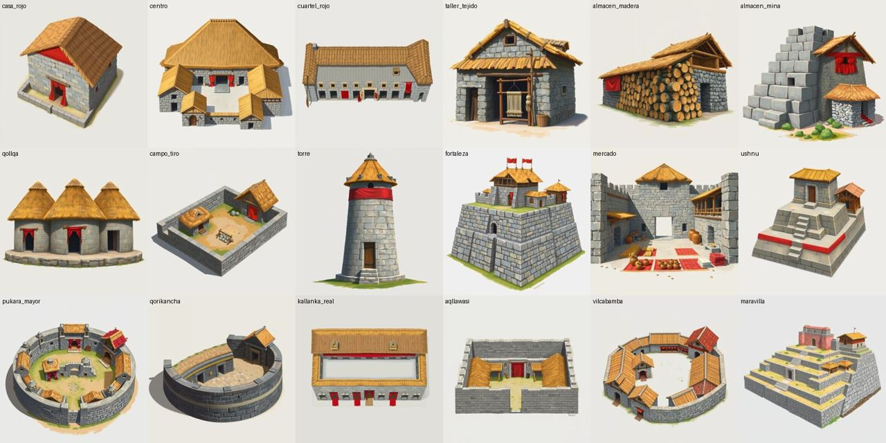

# 58 · Edificios de los seis pueblos con el pipeline local

> **Pedido del autor (2026-11-27):** generar con el pipeline 3D local (gratis) todos los edificios posibles de los seis pueblos y conectarlos al juego. Los soldados, después. «Acordate del color»: los edificios tienen que mostrar el color del equipo.

<!-- INVENTARIO -->

## Color del equipo

**Antes:** los modelos generados (casas y capitales del proceso 54) no tenían color propio. El juego les pone un estandarte (`Meshes.team_banner`) solo a los edificios importantes (`CivMeshes.bandera_para`: centro, hitos, maravilla, fortaleza y producción militar). Una casa o un almacén de otro jugador eran iguales a los propios.

**Método nuevo**, el mismo de los aldeanos (`proceso/56`):

1. **Referencia con rojo plano.** Cada edificio se pinta de nuevo con FLUX (receta gouache de `proceso/42`) para el 3D: un solo cuerpo, tres cuartos, sin suelo ni paisaje, y unos pocos elementos en **rojo plano**, de uso cotidiano o militar:
   - Tawantinsuyu: cortinas tejidas en las puertas y una faja tejida bajo el alero;
   - mapuches: mantas sobre un travesaño y banderolas en las lanzas de colihue;
   - guaraníes: toldos de algodón y fajas atadas a los horcones;
   - Etiopía: toldos de tela y banderolas;
   - Palmares: faja de tela bajo el alero y cortinas;
   - Ayutthaya: banderas rectangulares lisas (la bandera siamesa de la época era roja y lisa) y toldos.

   **Lo sagrado no lleva rojo**: qorikancha, nguillatuwe (`rewe_lonko`), casa del karai, iglesia, monasterio y wat. Esos llevan solo el estandarte del juego.
2. **Máscara.** `tools/mascara_equipo_3d.py --metodo=rojo --edificio`: el rojo saturado de la textura (±15° de tono, saturación ≥ 0,55), sin la detección de manos de los aldeanos. Queda en `<modelo>_mascara.png`, junto al GLB. Es el paso nuevo `mascara` de `tools/gen3d_pipeline.py`, que anota `luz_ref` y la cobertura en `data/modelos_equipo.json`.
3. **Juego.** `WorldView._equipo_edificio`: si el modelo tiene entrada en `data/modelos_equipo.json`, sus superficies pasan a `equipo_3d.gdshader` con el color del dueño (un material por modelo y color). El tono de la edad (`modelo_tinte`) va en el `tinte` del shader. La niebla sigue con `material_overlay`. El estandarte de siempre queda.

**Prueba antes de producir** (`tools/visor_edificios_equipo.gd`): kancha y torre en cuatro colores y la máscara en magenta, con la cámara del juego.

- La faja de la torre se lee bien de lejos.
- En la kancha, con la primera referencia (cortinas y una faja finita), solo se teñían las cortinas: 1,7 % de la superficie. Paint oscurece el rojo y el tono se corre a 10–15°.
- Arreglos: el corte del tono pasó de 10° a 15° (los techos de paja y teja quedan en 20–35°), y el prompt pide los elementos «grandes y visibles desde arriba». La kancha nueva queda en el 10 %.
- Techos y muros no se tiñen en ninguno.

## Pueblo por pueblo

Cada edificio es **un renglón** de `data/civs/<pueblo>.json → estilo.modelos`: `"<tipo>": "local/<pueblo>_<tipo>"`. Lo escribe `tools/conectar_edificios_locales.py <pueblo> [--sin tipos]`, y se vuelve atrás borrando el renglón. Las capturas son una partida real (`--demo=base_completa`, nuevo): todos los edificios del pueblo terminados, en la edad IV y en dos colores (`--colores=i,j`, nuevo).

### Tawantinsuyu

- **16 de 18 conectados**, entre ellos el centro (antes, el de Meshy) y el cuartel (la kallanka de antes queda en `local/tawantinsuyu_kallanka`).
- **Rehechos:** casa, cuartel y kallanka real, porque la referencia salía cortada o vista desde arriba.
- **Sin conectar por ahora:** `campo_tiro` y `almacen_madera`. Paint los pintó con muros azulados que se confunden con el color del equipo; se rehacen en la tanda de reintentos.
- **Flojos:** `pukara_mayor` y `vilcabamba` (recintos con muro).

<!-- PUEBLOS -->

<!-- MESHY -->

<!-- PRUEBAS -->

<!-- TROPIEZOS -->

<!-- COMMITS -->
