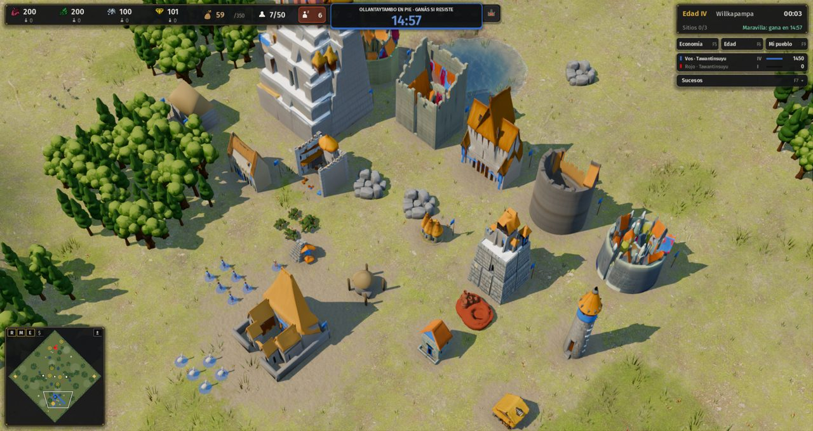
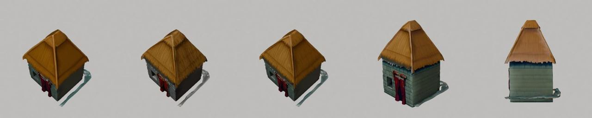
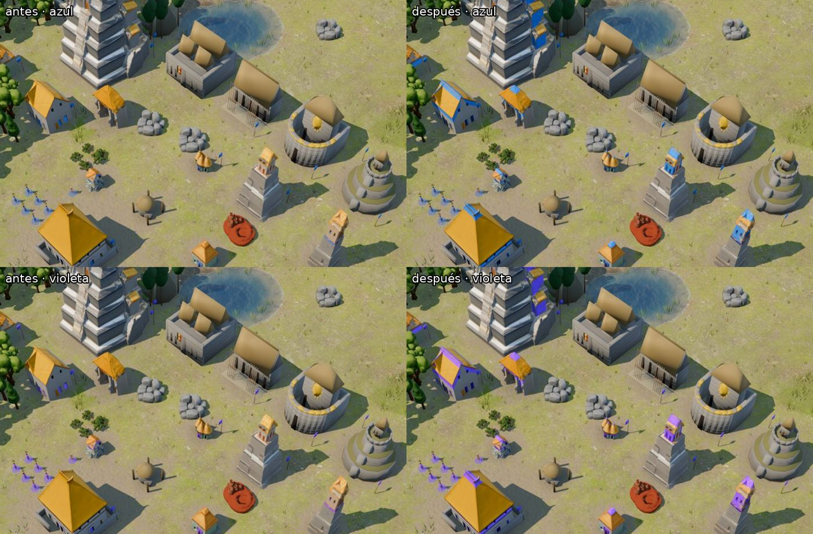
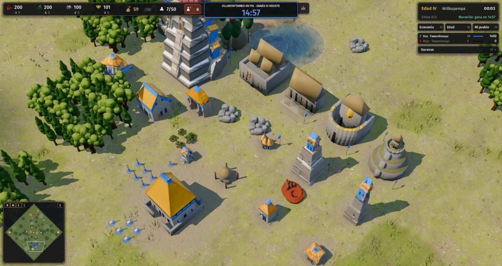
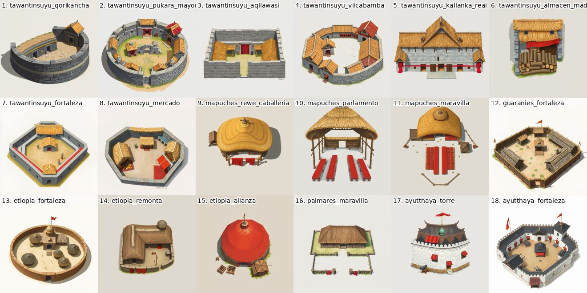

# 58 · Edificios de los seis pueblos con el pipeline local

> **Pedido del autor (2026-11-27):** generar con el pipeline 3D local (gratis) todos los edificios posibles de los seis pueblos y conectarlos al juego. Los soldados, después. «Acordate del color»: los edificios tienen que mostrar el color del equipo.

## Inventario

Por pueblo, todos los edificios que el juego usa: lo que construye el aldeano y los seis hitos.
- «Antes» es el estado al empezar este proceso.
- «Color» es la parte de la superficie que toma el color del jugador.
- Muros, puertas, campos, caminos y andenes se arman por casillas con la maqueta: no usan modelo.
- Lo arma `inventario.py` desde los datos.

#### Tawantinsuyu

| Tipo | Nombre | Huella | Antes | Modelo en el juego ahora | Color | Nota |
|---|---|---|---|---|---|---|
| `taller_tejido` | Taller de tejido | 2×2 | maqueta | `local/tawantinsuyu_taller_tejido` (pipeline, proceso 58) | 20% |  |
| `casa` | Kancha | 2×2 | pipeline (54) | `local/tawantinsuyu_casa` (pipeline, proceso 58) | 20% |  |
| `granja` | Chacra | 2×2 | maqueta | maqueta (tramo de muro, campo o camino) | — | sin modelo: se arma por casillas |
| `almacen_madera` | Llant'a wasi | 2×2 | maqueta | maqueta procedural | — | generado, sin conectar |
| `almacen_mina` | Qhuya wasi | 2×2 | maqueta | `local/tawantinsuyu_almacen_mina` (pipeline, proceso 58) | 22% |  |
| `cuartel` | Kallanka | 3×3 | pipeline (kallanka, 54) | `local/tawantinsuyu_cuartel` (pipeline, proceso 58) | 17% |  |
| `campo_tiro` | Warak'a kancha | 3×3 | maqueta | `local/tawantinsuyu_campo_tiro` (pipeline, proceso 58) | 23% |  |
| `torre` | Pukara | 2×2 | maqueta | `local/tawantinsuyu_torre` (pipeline, proceso 58) | 18% |  |
| `fortaleza` | Hatun pukara | 4×4 | maqueta | maqueta procedural | — | generado, sin conectar |
| `muralla` | Pirca | 1×1 | maqueta | maqueta (tramo de muro, campo o camino) | — | sin modelo: se arma por casillas |
| `puerta_piedra` | Punku | 1×1 | maqueta | maqueta (tramo de muro, campo o camino) | — | sin modelo: se arma por casillas |
| `torre_muralla` | Torreón de pirca | 1×1 | maqueta | maqueta (tramo de muro, campo o camino) | — | sin modelo: se arma por casillas |
| `centro` | Llaqta | 4×4 | Meshy | `local/tawantinsuyu_centro` (pipeline, proceso 58) | 18% |  |
| `camino` | Qhapaq Ñan (camino) | 1×1 | maqueta | maqueta (tramo de muro, campo o camino) | — | sin modelo: se arma por casillas |
| `anden` | Andén | 2×2 | maqueta | maqueta (tramo de muro, campo o camino) | — | sin modelo: se arma por casillas |
| `qollqa` | Qollqa | 2×2 | maqueta | `local/tawantinsuyu_qollqa` (pipeline, proceso 58) | 10% |  |
| `mercado` | Mercado | 4×4 | maqueta | maqueta procedural | — | generado, sin conectar |
| `maravilla` | Ollantaytambo | 6×6 | maqueta | `local/tawantinsuyu_maravilla` (pipeline, proceso 58) | 4% |  |
| `ushnu` | Ushnu y plaza | 4×4 | maqueta | `local/tawantinsuyu_ushnu` (pipeline, proceso 58) | 18% |  |
| `pukara_mayor` | Pukara de frontera | 4×4 | maqueta | maqueta procedural | — | candidato a Meshy |
| `qorikancha` | Qorikancha | 4×4 | maqueta | maqueta procedural | estandarte | candidato a Meshy |
| `kallanka_real` | Kallanka real | 4×4 | maqueta | maqueta procedural | — | candidato a Meshy |
| `aqllawasi` | Aqllawasi | 4×4 | maqueta | maqueta procedural | — | candidato a Meshy |
| `vilcabamba` | Espíritu Pampa | 4×4 | maqueta | maqueta procedural | — | candidato a Meshy |

#### Mapuches

| Tipo | Nombre | Huella | Antes | Modelo en el juego ahora | Color | Nota |
|---|---|---|---|---|---|---|
| `casa` | Ruka | 2×2 | pipeline (54) | `local/mapuches_casa` (pipeline, proceso 58) | 28% |  |
| `granja` | Chacra | 2×2 | maqueta | maqueta (tramo de muro, campo o camino) | — | sin modelo: se arma por casillas |
| `cuartel` | Junta de guerra | 3×3 | maqueta | `local/mapuches_cuartel` (pipeline, proceso 58) | 17% |  |
| `lof` | Lof | 3×3 | Meshy | `local/mapuches_lof` (pipeline, proceso 58) | 19% |  |
| `corral` | Corral | 3×3 | maqueta | maqueta (tramo de muro, campo o camino) | — | sin modelo: se arma por casillas |
| `fortaleza` | Pukara | 4×4 | maqueta | `local/mapuches_fortaleza` (pipeline, proceso 58) | 15% |  |
| `empalizada` | Empalizada con foso | 1×1 | maqueta | maqueta (tramo de muro, campo o camino) | — | sin modelo: se arma por casillas |
| `puerta` | Puerta | 1×1 | maqueta | maqueta (tramo de muro, campo o camino) | — | sin modelo: se arma por casillas |
| `mercado` | Mercado | 4×4 | maqueta | `local/mapuches_mercado` (pipeline, proceso 58) | 15% |  |
| `hoyo` | Hoyo con estacas | 1×1 | maqueta | maqueta (tramo de muro, campo o camino) | — | sin modelo: se arma por casillas |
| `maravilla` | El gran koyagtun | 6×6 | maqueta | maqueta procedural | — | generado, sin conectar |
| `rewe_malon` | Malón del toqui | 4×4 | maqueta | `local/mapuches_rewe_malon` (pipeline, proceso 58) | 17% |  |
| `rewe_lonko` | Nguillatuwe del rewe | 4×4 | maqueta | `local/mapuches_rewe_lonko` (pipeline, proceso 58) | estandarte |  |
| `rewe_caballeria` | Kawellu | 4×4 | maqueta | maqueta procedural | — | generado, sin conectar |
| `rewe_monte` | Pewenal | 4×4 | maqueta | `local/mapuches_rewe_monte` (pipeline, proceso 58) | 28% |  |
| `parlamento` | Parlamento | 4×4 | maqueta | maqueta procedural | — | generado, sin conectar |
| `weichan` | Gran weichan | 4×4 | maqueta | `local/mapuches_weichan` (pipeline, proceso 58) | 30% |  |

#### Guaraníes

| Tipo | Nombre | Huella | Antes | Modelo en el juego ahora | Color | Nota |
|---|---|---|---|---|---|---|
| `casa` | Oga | 2×2 | pipeline (54) | `local/guaranies_casa` (pipeline, proceso 58) | 20% |  |
| `granja` | Kokue (roza) | 2×2 | maqueta | maqueta (tramo de muro, campo o camino) | — | sin modelo: se arma por casillas |
| `almacen_madera` | Tapyi | 2×2 | maqueta | `local/guaranies_almacen_madera` (pipeline, proceso 58) | 21% |  |
| `almacen_mina` | Ñai'ũ renda | 2×2 | maqueta | `local/guaranies_almacen_mina` (pipeline, proceso 58) | 17% |  |
| `cuartel` | Aty de guerra | 3×3 | maqueta | `local/guaranies_cuartel` (pipeline, proceso 58) | 18% |  |
| `campo_tiro` | Guyrapa róga | 2×2 | maqueta | `local/guaranies_campo_tiro` (pipeline, proceso 58) | 22% |  |
| `taller` | Taller de tacuara | 3×3 | maqueta | `local/guaranies_taller` (pipeline, proceso 58) | 18% |  |
| `fortaleza` | Trinchera de tacuara | 4×4 | maqueta | maqueta procedural | — | generado, sin conectar |
| `centro` | Oga guasu | 4×4 | pipeline (54) | `local/guaranies_centro` (pipeline, proceso 58) | 13% |  |
| `empalizada` | Empalizada | 1×1 | maqueta | maqueta (tramo de muro, campo o camino) | — | sin modelo: se arma por casillas |
| `puerta` | Puerta | 1×1 | maqueta | maqueta (tramo de muro, campo o camino) | — | sin modelo: se arma por casillas |
| `mercado` | Mercado | 4×4 | maqueta | `local/guaranies_mercado` (pipeline, proceso 58) | 15% |  |
| `maravilla` | La plaza y el cabildo de la tava | 6×6 | maqueta | `local/guaranies_maravilla` (pipeline, proceso 58) | 24% |  |
| `maravilla_monte` | Aldea grande del monte | 6×6 | maqueta | `local/guaranies_maravilla_monte` (pipeline, proceso 58) | 32% |  |
| `karai_palabra` | Casa del karai | 4×4 | maqueta | `local/guaranies_karai_palabra` (pipeline, proceso 58) | estandarte |  |
| `aty_guasu` | Aty guasu | 4×4 | maqueta | `local/guaranies_aty_guasu` (pipeline, proceso 58) | 18% |  |
| `mision` | Pueblo de misión | 4×4 | maqueta | `local/guaranies_mision` (pipeline, proceso 58) | 20% |  |
| `monte` | Monte libre | 4×4 | maqueta | `local/guaranies_monte` (pipeline, proceso 58) | 23% |  |
| `tava` | Tava fortificada | 4×4 | maqueta | `local/guaranies_tava` (pipeline, proceso 58) | 20% |  |
| `yvy_marane` | Ñande retã | 4×4 | maqueta | `local/guaranies_yvy_marane` (pipeline, proceso 58) | 8% |  |

#### Etiopía

| Tipo | Nombre | Huella | Antes | Modelo en el juego ahora | Color | Nota |
|---|---|---|---|---|---|---|
| `corte_nueva` | Corte nueva (cimiento) | 4×4 | maqueta | `local/etiopia_corte_nueva` (pipeline, proceso 58) | 11% |  |
| `casa` | Gojjo bet | 2×2 | pipeline (54) | `local/etiopia_casa` (pipeline, proceso 58) | 23% |  |
| `granja` | Granja | 2×2 | maqueta | maqueta (tramo de muro, campo o camino) | — | sin modelo: se arma por casillas |
| `almacen_alimento` | Gotära | 2×2 | maqueta | `local/etiopia_almacen_alimento` (pipeline, proceso 58) | 24% |  |
| `almacen_madera` | Inchet bet | 2×2 | maqueta | `local/etiopia_almacen_madera` (pipeline, proceso 58) | 23% |  |
| `almacen_mina` | Dängay bet | 2×2 | maqueta | `local/etiopia_almacen_mina` (pipeline, proceso 58) | 19% |  |
| `cuartel` | Campamento de chewa | 3×3 | maqueta | `local/etiopia_cuartel` (pipeline, proceso 58) | 36% |  |
| `establo` | Färäs bet | 3×3 | maqueta | `local/etiopia_establo` (pipeline, proceso 58) | 12% |  |
| `taller` | Taller de asedio | 3×3 | maqueta | `local/etiopia_taller` (pipeline, proceso 58) | 22% |  |
| `torre` | Torre de la amba | 2×2 | maqueta | `local/etiopia_torre` (pipeline, proceso 58) | 16% |  |
| `fortaleza` | Fortaleza de amba | 4×4 | maqueta | maqueta procedural | — | generado, sin conectar |
| `muralla` | Muro de la amba | 1×1 | maqueta | maqueta (tramo de muro, campo o camino) | — | sin modelo: se arma por casillas |
| `puerta_piedra` | Puerta de la amba | 1×1 | maqueta | maqueta (tramo de muro, campo o camino) | — | sin modelo: se arma por casillas |
| `torre_muralla` | Torre del muro | 1×1 | maqueta | maqueta (tramo de muro, campo o camino) | — | sin modelo: se arma por casillas |
| `centro` | Kätäma (corte) | 4×4 | pipeline (54) | `local/etiopia_centro` (pipeline, proceso 58) | 16% |  |
| `gult` | Gult | 4×4 | maqueta | maqueta (tramo de muro, campo o camino) | — | sin modelo: se arma por casillas |
| `empalizada` | Empalizada | 1×1 | maqueta | maqueta (tramo de muro, campo o camino) | — | sin modelo: se arma por casillas |
| `puerta` | Puerta | 1×1 | maqueta | maqueta (tramo de muro, campo o camino) | — | sin modelo: se arma por casillas |
| `mercado` | Mercado | 4×4 | maqueta | `local/etiopia_mercado` (pipeline, proceso 58) | 23% |  |
| `maravilla` | Fasil Gəbbi | 6×6 | maqueta | `local/etiopia_maravilla` (pipeline, proceso 58) | 24% |  |
| `iglesia` | Iglesia | 4×4 | maqueta | `local/etiopia_iglesia` (pipeline, proceso 58) | estandarte |  |
| `monasterio` | Monasterio | 4×4 | maqueta | `local/etiopia_monasterio` (pipeline, proceso 58) | estandarte |  |
| `amba` | Amba fortificada | 4×4 | maqueta | `local/etiopia_amba` (pipeline, proceso 58) | 6% |  |
| `remonta` | Remonta | 4×4 | maqueta | maqueta procedural | — | generado, sin conectar |
| `gondar` | Recinto de Gondar | 4×4 | maqueta | `local/etiopia_gondar` (pipeline, proceso 58) | 20% |  |
| `alianza` | Alianza con armas de fuego | 4×4 | maqueta | maqueta procedural | — | generado, sin conectar |

#### Palmares

| Tipo | Nombre | Huella | Antes | Modelo en el juego ahora | Color | Nota |
|---|---|---|---|---|---|---|
| `casa` | Casa de palha | 2×2 | pipeline (54) | `local/palmares_casa` (pipeline, proceso 58) | 18% |  |
| `granja` | Roça de mandioca | 2×2 | maqueta | maqueta (tramo de muro, campo o camino) | — | sin modelo: se arma por casillas |
| `almacen_alimento` | Paiol | 2×2 | maqueta | `local/palmares_almacen_alimento` (pipeline, proceso 58) | 28% |  |
| `almacen_mina` | Olaria | 2×2 | maqueta | `local/palmares_almacen_mina` (pipeline, proceso 58) | 29% |  |
| `cuartel` | Casa de guerra | 3×3 | maqueta | `local/palmares_cuartel` (pipeline, proceso 58) | 9% |  |
| `centro` | Cerca real | 4×4 | pipeline (54) | `local/palmares_centro` (pipeline, proceso 58) | 22% |  |
| `mocambo` | Mocambo | 3×3 | maqueta | `local/palmares_mocambo` (pipeline, proceso 58) | 16% |  |
| `fortaleza` | Baluarte da cerca | 4×4 | maqueta | `local/palmares_fortaleza` (pipeline, proceso 58) | 6% |  |
| `empalizada` | Cerca con estrepes | 1×1 | maqueta | maqueta (tramo de muro, campo o camino) | — | sin modelo: se arma por casillas |
| `puerta` | Puerta | 1×1 | maqueta | maqueta (tramo de muro, campo o camino) | — | sin modelo: se arma por casillas |
| `mercado` | Mercado | 4×4 | maqueta | `local/palmares_mercado` (pipeline, proceso 58) | 9% |  |
| `hoyo` | Fojo con estrepes | 1×1 | maqueta | maqueta (tramo de muro, campo o camino) | — | sin modelo: se arma por casillas |
| `maravilla` | Cerca do Outeiro da Barriga | 6×6 | maqueta | maqueta procedural | — | generado, sin conectar |
| `quilombo_central` | Macaco | 4×4 | maqueta | `local/palmares_quilombo_central` (pipeline, proceso 58) | 20% |  |
| `mocambo_guerra` | Mocambo de guerra | 4×4 | maqueta | `local/palmares_mocambo_guerra` (pipeline, proceso 58) | 30% |  |
| `cerca_real` | Cerca real en anillos | 4×4 | maqueta | `local/palmares_cerca_real` (pipeline, proceso 58) | 29% |  |
| `ferraria` | Ferraria grande | 4×4 | maqueta | `local/palmares_ferraria` (pipeline, proceso 58) | 31% |  |
| `pacto_cucau` | Pacto de Cucaú | 4×4 | maqueta | `local/palmares_pacto_cucau` (pipeline, proceso 58) | 12% |  |
| `guerra_zumbi` | Guerra de Zumbi | 4×4 | maqueta | `local/palmares_guerra_zumbi` (pipeline, proceso 58) | 14% |  |

#### Ayutthaya

| Tipo | Nombre | Huella | Antes | Modelo en el juego ahora | Color | Nota |
|---|---|---|---|---|---|---|
| `casa` | Ruean | 2×2 | pipeline (54) | `local/ayutthaya_casa` (pipeline, proceso 58) | 20% |  |
| `granja` | Arrozal | 2×2 | maqueta | maqueta (tramo de muro, campo o camino) | — | sin modelo: se arma por casillas |
| `cuartel` | Cuartel de la guardia | 3×3 | maqueta | `local/ayutthaya_cuartel` (pipeline, proceso 58) | 9% |  |
| `campo_tiro` | Sanam ying thanu | 3×3 | maqueta | `local/ayutthaya_campo_tiro` (pipeline, proceso 58) | 26% |  |
| `taller` | Taller de asedio | 3×3 | maqueta | `local/ayutthaya_taller` (pipeline, proceso 58) | 27% |  |
| `torre` | Fortín de río | 2×2 | maqueta | maqueta procedural | — | generado, sin conectar |
| `fortaleza` | Pom | 4×4 | maqueta | maqueta procedural | — | generado, sin conectar |
| `muralla` | Kamphaeng | 1×1 | maqueta | maqueta (tramo de muro, campo o camino) | — | sin modelo: se arma por casillas |
| `puerta_piedra` | Pratu | 1×1 | maqueta | maqueta (tramo de muro, campo o camino) | — | sin modelo: se arma por casillas |
| `torre_muralla` | Atalaya de la muralla | 1×1 | maqueta | maqueta (tramo de muro, campo o camino) | — | sin modelo: se arma por casillas |
| `centro` | Wang (palacio) | 4×4 | pipeline (54) | `local/ayutthaya_centro` (pipeline, proceso 58) | 14% |  |
| `kraal` | Kraal de elefantes | 3×3 | maqueta | `local/ayutthaya_kraal` (pipeline, proceso 58) | 13% |  |
| `barrio_japones` | Barrio japonés | 3×3 | maqueta | `local/ayutthaya_barrio_japones` (pipeline, proceso 58) | 15% |  |
| `barrio_portugues` | Barrio portugués | 3×3 | maqueta | `local/ayutthaya_barrio_portugues` (pipeline, proceso 58) | 13% |  |
| `barrio_chinos` | Barrio chino | 3×3 | maqueta | `local/ayutthaya_barrio_chinos` (pipeline, proceso 58) | 9% |  |
| `mercado` | Mercado | 4×4 | maqueta | `local/ayutthaya_mercado` (pipeline, proceso 58) | 15% |  |
| `almacen_mina` | Khlang din | 2×2 | maqueta | `local/ayutthaya_almacen_mina` (pipeline, proceso 58) | 16% |  |
| `maravilla` | Krung Si Ayutthaya y Pom Phet | 6×6 | maqueta | `local/ayutthaya_maravilla` (pipeline, proceso 58) | 5% |  |
| `wat` | Wat Mahathat | 4×4 | maqueta | `local/ayutthaya_wat` (pipeline, proceso 58) | estandarte |  |
| `kraal_real` | Kraal real | 4×4 | maqueta | `local/ayutthaya_kraal_real` (pipeline, proceso 58) | 24% |  |
| `puerto_real` | Puerto real | 4×4 | maqueta | `local/ayutthaya_puerto_real` (pipeline, proceso 58) | 26% |  |
| `fortaleza_rio` | Fortaleza de la isla | 4×4 | maqueta | `local/ayutthaya_fortaleza_rio` (pipeline, proceso 58) | 11% |  |
| `junco_tributo` | Junco de tributo | 4×4 | maqueta | `local/ayutthaya_junco_tributo` (pipeline, proceso 58) | 10% |  |
| `guardia_extranjera` | Guardia extranjera | 4×4 | maqueta | `local/ayutthaya_guardia_extranjera` (pipeline, proceso 58) | 14% |  |

## Color del equipo

**Antes:** los modelos generados (casas y capitales del proceso 54) no tenían color propio. El juego les pone un estandarte (`Meshes.team_banner`) solo a los edificios importantes (`CivMeshes.bandera_para`: centro, hitos, maravilla, fortaleza y producción militar). Una casa o un almacén de otro jugador eran iguales a los propios.

**Método nuevo**, el mismo de los aldeanos (`proceso/56`):

1. **Referencia con rojo plano.** Cada edificio se pinta de nuevo con FLUX (receta gouache de `proceso/42`) para el 3D: un solo cuerpo, tres cuartos, sin suelo ni paisaje, y unos pocos elementos en **rojo plano**, de uso cotidiano o militar:
   - Tawantinsuyu: cortinas tejidas en las puertas y una faja tejida bajo el alero;
   - mapuches: mantas sobre un travesaño y banderolas en las lanzas de colihue;
   - guaraníes: toldos de algodón y fajas atadas a los horcones;
   - Etiopía: toldos de tela y banderolas;
   - Palmares: faja de tela bajo el alero y cortinas;
   - Ayutthaya: banderas rectangulares lisas (la bandera siamesa de la época era roja y lisa) y toldos.

   **Lo sagrado no lleva rojo**: qorikancha, nguillatuwe (`rewe_lonko`), casa del karai, iglesia, monasterio y wat. Esos llevan solo el estandarte del juego.
2. **Máscara.** `tools/mascara_equipo_3d.py --metodo=rojo --edificio`: el rojo saturado de la textura (±15° de tono, saturación ≥ 0,55), sin la detección de manos de los aldeanos. Queda en `<modelo>_mascara.png`, junto al GLB. Es el paso nuevo `mascara` de `tools/gen3d_pipeline.py`, que anota `luz_ref` y la cobertura en `data/modelos_equipo.json`.
3. **Juego.** `WorldView._equipo_edificio`: si el modelo tiene entrada en `data/modelos_equipo.json`, sus superficies pasan a `equipo_3d.gdshader` con el color del dueño (un material por modelo y color). El tono de la edad (`modelo_tinte`) va en el `tinte` del shader. La niebla sigue con `material_overlay`. El estandarte de siempre queda.

**Prueba antes de producir** (`tools/visor_edificios_equipo.gd`): kancha y torre en cuatro colores y la máscara en magenta, con la cámara del juego.

- La faja de la torre se lee bien de lejos.
- En la kancha, con la primera referencia (cortinas y una faja finita), solo se teñían las cortinas: 1,7 % de la superficie. Paint oscurece el rojo y el tono se corre a 10–15°.
- Arreglos: el corte del tono pasó de 10° a 15° (los techos de paja y teja quedan en 20–35°), y el prompt pide los elementos «grandes y visibles desde arriba». La kancha nueva queda en el 10 %.
- Techos y muros no se tiñen en ninguno.

## Pueblo por pueblo

Cada edificio es **un renglón** de `data/civs/<pueblo>.json → estilo.modelos`: `"<tipo>": "local/<pueblo>_<tipo>"`. Lo escribe `tools/conectar_edificios_locales.py <pueblo> [--sin tipos]`, y se vuelve atrás borrando el renglón. Las capturas son una partida real (`--demo=base_completa`, nuevo): todos los edificios del pueblo terminados, en la edad IV y en dos colores (`--colores=i,j`, nuevo).

### Tawantinsuyu

- **16 de 18 conectados**, entre ellos el centro (antes, el de Meshy) y el cuartel (la kallanka de antes queda en `local/tawantinsuyu_kallanka`).
- **Rehechos:** casa, cuartel y kallanka real, porque la referencia salía cortada o vista desde arriba.
- **Sin conectar por ahora:** `campo_tiro` y `almacen_madera`. Paint los pintó con muros azulados que se confunden con el color del equipo; se rehacen en la tanda de reintentos.
- **Flojos:** `pukara_mayor` y `vilcabamba` (recintos con muro).

<!-- PUEBLOS -->

## Segunda pasada: reglas históricas y fidelidad del 3D

**Pedido (2026-11-27, después del Tawantinsuyu):** el juego inca se leía como medieval europeo:
- casas a dos aguas con entramado y tejas naranjas;
- un castillo almenado y una torre redonda con techo cónico;
- recintos redondos que parecen cisternas (qorikancha, pukara).

Una parte venía de las referencias: almenas, torre cilíndrica, fuertes de forma europea. Otra parte, del 3D: Hunyuan y Paint convierten la paja en tejas, la piedra ajustada en gris barroso, y los recintos vistos desde arriba en barriles.

**Pausa de la producción** hasta arreglar el Tawantinsuyu y que el autor lo apruebe. Los mapuches quedaron a medio hacer (casa, lof y cuartel generados) **sin conectar**.

### Reglas por pueblo (se ponen al frente del prompt)

FLUX schnell corta los prompts largos, así que las reglas van antes del encuadre. Cada referencia es **un solo edificio**, en tres cuartos desde poco más arriba de los ojos (no desde arriba), sin suelo ni paisaje. Fuentes: `docs/civs/<pueblo>.md`, `docs/investigacion/<pueblo>.md` y las fichas del arte en `proceso/42` y `proceso/49`.

| Pueblo | Sí | No |
|---|---|---|
| Tawantinsuyu | Muros de pirca o de piedra ajustada (o adobe); puertas y hornacinas trapezoidales; techos empinados de paja de ichu, gruesos y con borde deshilachado; la *kancha* (recinto rectangular con casas alrededor de un patio); la *qollqa* en hileras de depósitos chicos, redondos o rectangulares; el *pukara* como fuerte de terrazas escalonadas en un cerro | Almenas, torres redondas con techo cónico, entramado de madera, tejas o tejuelas, chimeneas, ventanas con marco |
| Mapuches | *Ruka* oval de varas y quincha con techo de paja hasta el suelo, puerta baja al este; empalizadas y corrales de palos sin labrar | Piedra labrada, tejas, almenas, techos a dos aguas de madera |
| Guaraníes | *Óga* larga de horcones, paredes de tacuara y barro, techo de paja o palma hasta el suelo; doble empalizada con fosos; en la misión (II), casas de adobe con galería y **teja marrón oscura** | Tejas rojas fuera de la misión, piedra labrada, almenas |
| Etiopía | *Gojjo bet* redondo de piedra o bajareque con techo cónico de paja; campamentos reales de tiendas; desde Gondar (IV), castillos de piedra parda con torres redondas y cúpulas | Arcos góticos, tejas, almenas de castillo europeo antes de Gondar |
| Palmares | Casas rectangulares de pau a pique con techo empinado de palma; estacadas de troncos aguzados y fosos con estrepes | Piedra, tejas, almenas, iglesias barrocas |
| Ayutthaya | Casas de teca sobre pilotes con techo a dos aguas de puntas curvas; ladrillo encalado con techos escalonados; las almenas en hoja (*bai sema*) de los fuertes; techos de **teja oscura o tejuela** | Techos rojos o naranjas (se confunden con el color del equipo), aldeas enteras alrededor del edificio, imágenes del Buda |

Lo sagrado sigue sin rojo: qorikancha, nguillatuwe, casa del karai, iglesia, monasterio y wat.

### Fidelidad del 3D

- **Dos candidatas por pieza** (semillas 21 y 22). Elijo la que da siluetas distintas entre los edificios del pueblo (abajo, `candidatas_tawantinsuyu.jpg`).
- **Paint a 2048** (antes, 1024): la paja conserva algo de hebra y el GLB pesa 470 KB.
- **Techos de la referencia** (`tools/gen3d_mezcla.py`, paso nuevo `mezcla` del pipeline). Busca la cámara de la referencia por silueta, como el proyector. Las caras que miran hacia arriba y se ven desde esa cámara toman el color del gouache sobre el mismo atlas de Paint; el resto queda con Paint. La paja vuelve a tener hebras y las paredes del fondo no se manchan, como pasaba con el proyector solo.

  
- **Corte del suelo al 6 %** (antes, 3 %): la sombra que pinta FLUX dejaba una lámina al pie.
- **Máscara más ancha para el Tawantinsuyu** (±22°): Paint corre el rojo de las cortinas hacia el carmesí (330–345°). La paja queda en 30–40°.
- **Hunyuan 2mv** con frente y costado de una misma hoja de FLUX (`tawantinsuyu_casa_mv`, `tawantinsuyu_cuartel_mv`): resultado abajo.
- **Recintos amurallados grandes**: qorikancha, pukara mayor, aqllawasi, Vilcabamba y kallanka real **no se rehacen**. Vuelven a su maqueta y pasan a la lista de candidatos a Meshy.

### Más color del equipo (pedido del autor: «tienen que tener algo más, si no ni se nota»)

El autor aprobó el estilo de la segunda pasada, pero las cortinas solas (1–8 % de la superficie) no se veían. Ahora la máscara suma **superficie geométrica**, sin rehacer las formas:

- `--faja=f`: una faja tejida en las paredes, justo bajo el alero o bajo una terraza. Desde cada vértice se tira un rayo hacia arriba y, si toca un alero o una terraza a menos de f × alto, la pared toma el color. Como la malla es cerrada, el rayo toca la cara de abajo del alero.
- `--cumbrera=c`: los techos en el c × alto de más arriba (una faja en la cumbrera; la plataforma en las terrazas).

En el Tawantinsuyu se usa faja 0,15 y cumbrera 0,10 (tono ±22°): la cobertura queda entre el 10 y el 23 %. Las excepciones son la fortaleza (6 %) y la maravilla (4 %): sus terrazas no tienen alero, así que llevan el estandarte. Se rehízo solo el paso `mascara`.

### Resultado en el Tawantinsuyu

- **Se fueron el castillo y la torre medieval.** La torre es ahora un puesto de terrazas con una choza arriba, y la fortaleza un pukara de terrazas escalonadas. El mercado es un galpón abierto, y la casa, el centro y el cuartel son de pirca con paja de ichu y puertas trapezoidales.
- **La paja conserva la hebra** en los techos que ve la cámara (mezcla), y no hay más láminas al pie.
- **Conectados: 12.** Son casa, centro, cuartel, taller de tejido, almacén de piedra, qollqa, campo de tiro, torre, fortaleza, mercado, ushnu y maravilla.
- **Sin conectar (maqueta):**
  - el almacén de leña, que salió como un cartel plano;
  - los cinco recintos, que pasan a la lista de Meshy.
- **El color del equipo se lee menos que en la primera pasada:** las cortinas son chicas y cubren el 1–8 % de la superficie. El estandarte de siempre sigue en los importantes. Si hace falta más color, la faja bajo la paja hay que pedirla más ancha en el prompt.
- **Torre y fortaleza** se parecen: las dos son terrazas escalonadas y el juego las estira al alto de torre (4,5).
- **Hunyuan 2mv no entró en la GPU.** Con el juego abierto en el menú (830 MB de VRAM), le faltaron 20 MB. Además, la hoja de FLUX con frente y costado no salió coherente: el «costado» era otro tres cuartos, con puertas en arco. No sigo por ahí.
- Los modelos de la primera pasada quedan en la historia de git (commit `f4eb41f`); los del proceso 54, como `_v1`.

## Candidatos a Meshy

Recintos amurallados y conjuntos que el pipeline local aplasta en «barriles» o en láminas. Quedan con su maqueta hasta que el autor decida sobre la lista entera (los soldados tienen prioridad en los créditos):

| Pueblo | Tipo | Por qué | Referencia |
|---|---|---|---|
| Tawantinsuyu | `qorikancha` | Recinto curvo: sale un cilindro oscuro | n.º 1 |
| Tawantinsuyu | `pukara_mayor` | Anillos de muro: un barril con el interior revuelto | n.º 2 |
| Tawantinsuyu | `aqllawasi` | Recinto rectangular visto desde arriba | n.º 3 |
| Tawantinsuyu | `vilcabamba` | Conjunto de casas con muro | n.º 4 |
| Tawantinsuyu | `kallanka_real` | Pedido del autor junto con los recintos | n.º 5 |
| Tawantinsuyu | `almacen_madera` | La pila de leña sale como un cartel plano (dos intentos) | n.º 6 |
| Mapuches | `rewe_caballeria` | Cruz en el techo | n.º 9 |
| Mapuches | `parlamento` | Medio techo deforme | n.º 10 |
| Mapuches | `maravilla` | Campo de parlamento: en planta sale una sola ruka | n.º 11 |
| Tawantinsuyu | `fortaleza` | Pukara con patio (4×4): una caja de muros lisos | n.º 7 |
| Tawantinsuyu | `mercado` | Plaza con puestos (4×4): caja con muros verde azulado | n.º 8 |
| Guaraníes | `fortaleza` | Patio con empalizada: sale una casa europea con ventanas | n.º 12 |
| Etiopía | `fortaleza` | Muro en anillo alrededor de un patio: barril | n.º 13 |
| Etiopía | `remonta` | Corral amurallado con establo: caja abierta | n.º 14 |
| Etiopía | `alianza` | La tienda real sale roja entera (se tiñe toda) | n.º 15 |
| Palmares | `maravilla` | Cerro con tres anillos de empalizada: sale una casa chica en un cerco | n.º 16 |
| Ayutthaya | `torre` | El fortín sale como una cáscara de techo, sin muros | n.º 17 |
| Ayutthaya | `fortaleza` | Fuerte poligonal con patio: barril | n.º 18 |

Las referencias de todos, numeradas como en la tabla:

**Lo común:** recintos con patio o muro en anillo, conjuntos de piezas sueltas y referencias vistas desde arriba. Hunyuan los cierra en cajas o barriles; con una sola vista no hay cómo dar la profundidad del patio. Mientras tanto, todos usan su maqueta procedural, que sí se adapta a las huellas nuevas. No se gastaron créditos.

## Pruebas

- `test_determinism`: OK. El hash es 3617052205, el mismo que dejó el proceso 60 (movimiento). Lo de acá es solo imagen.
- `civ_smoke`: corre sin errores (0 líneas de error). `iconos`: OK (780 grillas). `grilla`: OK.
- **Autotest con ventana** (`--autotest --civ=etiopia --terreno=llano`): OK, 260 comprobaciones y ninguna falla, a la primera.
- **FPS de una base de la IV entera** (`--demo=base_completa --perf`, todos los edificios del pueblo con sus modelos y la cámara de la captura): 142–145 FPS en Etiopía y en Ayutthaya, con unos 1.310 objetos dibujados. Es el tope del monitor. Las texturas son de 2048, pero un material por modelo y color no se nota.
- **GLB:** 125 en `local/`; el más pesado, 680 KB (tope pedido: 2 MB).

## Tropiezos

- **ComfyUI del autor con 13 GB tomados**, aun después de `POST /free`: Hunyuan no tenía los 14 GB. El autor aprobó apagarlo, y desde entonces se arranca con `arrancar_aislado.sh` y se apaga (con `pgrep` anclado) antes de cada tanda de Hunyuan.
- **`MemoryHigh=10G` frenaba a FLUX:** con `--cache-none`, cada imagen tardaba 60–85 s, entrando y saliendo del swap. Sin `MemoryHigh` (el tope de 12 GB sigue), tarda unos 30 s. Ahora lo hace `gen3d_flux_lote.py`.
- **FLUX pinta pasto bajo el edificio** aunque el prompt diga «no grass»: la vista recorta el verde (`quitar: verde`), salvo en el pewenal.
- **FLUX pone aldeas enteras alrededor del edificio** (Ayutthaya) y **tejas rojas** (guaraníes, Ayutthaya), que la máscara tomaría como color del equipo. Se rehicieron con «only this one building» y con tejas oscuras.
- **Paint oscurece el rojo y lo corre al carmesí:** corte de tono de 15° (22° en el Tawantinsuyu).
- **Paint pintó muros azulados** en dos edificios incas de la primera pasada: se confunden con el color del equipo.
- **Al mover los GLB viejos a `_v1`,** los `estilo.modelos` de los otros pueblos se apuntaron a `_v1` para que el juego no perdiera sus casas y capitales.
- **Hunyuan 2mv:** sin memoria de GPU con el juego abierto.
- **El autor jugó al AoE4** a mitad de la tanda (2,2 GB de VRAM). Se pausó todo lo de GPU con una cola que esperaba a que cerrara el juego.
- **ComfyUI se llenó** (12 GB, swap) después de unas 40 imágenes con `--cache-none`, y bajó a 80 s por imagen: se lo reinicia entre tandas. Dos imágenes fallaron por eso y se rehicieron.
- **FLUX insiste con símbolos:** una cruz en la iglesia etíope y en el techo de un corral mapuche (este llegó al modelo), y una estrella en una tienda. Se rehicieron o se sacaron.
- **Recintos con patio** (fortalezas y mercados de 4×4 del proceso 59): Hunyuan los cierra en cajas. Solo la estacada de Palmares se lee bien.
- **Un script del scratchpad** (`shots.sh`) lo pisó otro agente que usa la misma carpeta: los de este proceso pasaron a `scratchpad/e58/`.

## Huellas nuevas (proceso 59)

Los modelos se escalan con el `tam` de los datos, así que toman solos las huellas nuevas. Pueden quedar desproporcionados:
- **maravillas de 6×6 a 4×4:** el lado baja y el alto mínimo de maravilla (620) las estira; Ollantaytambo y el Fasil Gəbbi quedan más altos que anchos;
- **rewe, parlamento y weichan mapuches de 3×3 a 4×4:** son rukas sueltas que se agrandan parejo y quedan como una casa gigante;
- **kraal de Ayutthaya de 4×4 a 3×3:** la estacada se achica bien.

## Commits

- `f4eb41f` primera pasada del Tawantinsuyu y color del equipo
- `50dbfcc`, `8c9d642` segunda pasada (reglas históricas) y pausa
- `a2aa377` faja y cumbrera en la máscara
- `799f658` mapuches · `ae10ddb` guaraníes · `a7e4f10` Etiopía · `0f9dcb3` Palmares · `3cb095b` Ayutthaya
- (este) pruebas finales, estado e índice
