# 59 · Tamaños, escala y cámara: el AoE4 como referencia

> **Pedido (2026-11-28):** el autor sacó 18 capturas del AoE4 (Inglaterra, construyendo todo) y pidió: (1) medir el tamaño de cada edificio con la casa y la granja de 2×2 como regla, y aplicar sus tamaños (centro 4×4; casa, granero, minero, maderero, **granja** y torre 2×2; cuartel, arquería, taller y establo 3×3; «lo grande» 4×4); (2) comparar escala, arte e interfaz con el nuestro y escribir notas de dirección de arte sin copiar el AoE4; (3) aplicar los tamaños en `data/` con todo lo que depende de ellos; (4) pruebas y un torneo. Después sumó dos pedidos: la **escala relativa** (alto de los edificios al lado de un aldeano) y la **perspectiva** de la cámara («en el AoE4 lo lejano se ve claramente más chico»).
>
> Las capturas del AoE4 no están en el repositorio (son arte de otro juego): acá se describen con palabras. Las imágenes de esta página son todas del nuestro.

## Resultado

- **Tamaños** (D-033): granja 3×3 → **2×2**; fortaleza 3×3 → **4×4**; mercado 3×3 → **4×4**; hitos mapuches (rewe, parlamento, weichan) 3×3 → **4×4**; kraal de Ayutthaya (su establo) 4×4 → **3×3**; andén inca (su granja) 3×3 → **2×2**; yerbal y capuera (quedan en el lugar de la roza) 3×3 → **2×2**. Lo demás ya estaba como pide la regla.
- **Escala relativa:** la gente pasa de 0,75 a **0,625 casillas** (`escala_visual.unidad_pct` 60 → 50) y los altos mínimos de cada categoría salen de los del AoE4 medidos en aldeanos (tabla abajo).
- **Cámara:** lente de 30° → **55°**, inclinación 54° → **52°**, la cámara más cerca. El zoom se sigue midiendo como la escala del centro de la pantalla, así que el aldeano del centro mide lo mismo; el inicial baja de 28 a **24** para que, con la gente más chica, siga midiendo unos 32 px a 1080p. Todo en `data/interfaz.json → camara`.
- **Determinismo igual** (3059812827): en los 3000 ticks de la prueba (5 minutos) nadie hace granjas, mercados, fortalezas ni hitos mapuches. Los torneos sí cambian.

## 1 · Medición

### Cómo se midió

- **Regla:** la casa (el fantasma de colocación sobre la grilla del AoE4 cubre 2×2 celdas) y la granja (`granja2x2`). En la misma captura y a la misma profundidad, el lado del rombo de la granja mide lo mismo que el de la casa (≈117 px en la imagen a 1600 de ancho). Una casilla, ≈58 px de lado de rombo en el centro de la pantalla.
- **Por edificio:** el lado del rombo de su huella (el cimiento de obra, la línea punteada de colocación o el contorno del modelo con su patio) contra la casa, la granja o el centro **a la misma altura de la pantalla**: con la perspectiva del AoE4, lo de abajo se ve hasta 1,2 veces más grande que lo del medio (ver «Cámara»). Error de ±0,5 casilla.
- **El centro** sirve de segunda regla: su muralla mide 1,9 veces la granja (≈4 casillas), y aparece en casi todas las capturas.

### Tabla

| Edificio | AoE4 (medido) | Nuestro antes | Ahora | Nota |
|---|---|---|---|---|
| Centro | ≈4 (muralla 220 px contra granja 117) + huertas cercadas ≈1 casilla alrededor | 4×4 | 4×4 | Las huertas no bloquean: son adorno |
| Casa | 2 (regla); la casita llena ≈60 %, el resto es el corral de gallinas | 2×2 | 2×2 | |
| Granja | 2 (regla) | 3×3 | **2×2** | Ver «Economía» |
| Granero (molino) | ≈2 | 2×2 | 2×2 | |
| Campamento minero y maderero | ≈1,5–2 (compactos, pegados al recurso) | 2×2 | 2×2 | |
| Torre (puesto de madera) | ≈1,5–2 | 2×2 | 2×2 | |
| Cuartel | ≈3 (cimiento: 9 aldeanos de lado) | 3×3 | 3×3 | |
| Arquería y caballeriza | ≈3 (caballeriza 170 px contra centro 240) | 3×3 | 3×3 | La casa del arco guaraní sigue en 2×2 (C-111) |
| Taller de asedio | ≈3,4 (el cimiento está abajo, más cerca: corregido) | 3×3 | 3×3 | |
| Herrería | ≈2–2,5 el edificio, ≈3 con el patio | — | — | No tenemos herrería aparte (está en el cuartel); la *ferraria* de Palmares es hito (4×4) |
| Mercado | ≈3,5–4 (puestos y toldos; 280 px contra centro 325, y el suelo pisado más grande) | 3×3 | **4×4** | El neutral del mapa queda en 3×3 (C-112) |
| Monasterio | ≈4 (contorno de 244 px contra el centro de 220 a la misma altura) | — | 4×4 | El monasterio y la iglesia etíopes ya eran hitos de 4×4 |
| Fortaleza (castillo) | ≈4–5 | 3×3 | **4×4** | |
| Hito chico (Abadía de los Reyes) | ≈3 (cimiento en cruz, 0,73 del ancho del centro) | 4×4 | 4×4 | La regla del autor: los hitos, 4×4 |
| Hito grande (palacio de la III) | ≈5 (andamio más ancho que el centro) | 4×4 | 4×4 | |
| Hitos mapuches | — | 3×3 | **4×4** | Rewe, parlamento y weichan |
| Kraal (establo de elefantes, Ayutthaya) | — | 4×4 | **3×3** | Es su establo |
| Andén inca | — | 3×3 | **2×2** | Es su granja |
| Lof mapuche, mocambo | — | 3×3 | 3×3 | Centros chicos a propósito (C-109) |
| Maravilla | no está en las capturas | 6×6 | 6×6 | En AoE4 es más grande que un hito (C-110) |
| Empalizada y muralla | 1 de grosor; la puerta, ≈1×4 con dos torres | 1×1 por tramo | igual | |

### Separación y apiñamiento

En el AoE4 los edificios **se tocan**: la herrería contra la abadía, la casa contra la muralla del centro, el campamento minero pegado al oro. El aire entre edificios no lo da una regla de separación sino lo que cada huella tiene adentro (patios, cercos, corrales) y el **suelo pisado** de cada edificio, que sale ≈0,5 casilla de la huella y se une con los vecinos en caminos. El centro tiene huertas cercadas alrededor que no bloquean. La granja se pega al molino y a otras granjas (ocho alrededor de un molino). En el nuestro también se puede apiñar (la IA deja una casilla de paso con `_site_near`); lo que falta es el suelo (ver notas de arte).

### Escala relativa: alto contra un aldeano

El aldeano del AoE4 mide **≈0,57 casillas** (≈30 px a 1080p, con la granja de 2 casillas a ≈180 px de ancho y la inclinación medida en el rombo de la granja). El nuestro medía 0,75: al lado de una granja o de una casa se veía 30 % más grande. Altos en aldeanos (el cuerpo, sin estandartes; en el nuestro, el mínimo de `escala_visual.altura_min_cm`; los modelos más altos que el mínimo no se achican):

| Categoría | AoE4 | Antes (aldeano 0,75) | Ahora (aldeano 0,625) | `altura_min_cm` |
|---|---|---|---|---|
| Casa | 2,2–2,5 (alero ≈1,1) | 2,5 | 2,4 | 190 → 150 |
| Producción (cuartel, taller) | 2,8–3 (alero ≈1,7) | 3,2 | 3,0 | 240 → 190 |
| Mercado | 2,5–3 (los puestos, ≈1,3) | 3,2 | 2,9 | 240 → 180 |
| Capital | 3–3,5 la sala, bajo y ancho | 5,1 | 4,2 | 380 → 260 |
| Torre | 4,5 (madera) a 6 (piedra) | 6,0 | 5,1 | 450 → 320 |
| Hito | 5 (abadía) a 7 (palacio) | 6,4 | 6,7 | 480 → 420 |
| Maravilla | — | 9,6 | 9,9 | 720 → 620 |

La capital queda un poco más alta que la del AoE4 a propósito: la nuestra es un solo cuerpo, sin el recinto amurallado que allá le da presencia.

### Cámara

**Cómo se midió:** el mismo centro aparece en tres capturas al mismo zoom en tres alturas de la pantalla. Su ancho pasa de 300 px (arriba, a 0,43 de la mitad) a 365 (en el medio, 0,11) y a 405 (abajo, −0,18): de arriba al medio crece 1,22 veces y del medio a abajo 1,11. Con nuestra cámara de antes (lente de 30°, 54°) el mismo corrimiento crecía 1,07 y 1,05: casi un plano. El rombo de la granja (alto/ancho 0,73) da la inclinación local. Lo que mejor cierra con las dos cosas: **inclinación de 50–55° y lente vertical de 55–60°**. Con 55° y 52°, el nuestro da ahora 1,16 y 1,12.

**Cómo quedó:** `RtsCamera` lee todo de `data/interfaz.json → camara`. La distancia real es `zoom × tan(15°) / tan(fov/2)` (0,51 con 55°): con el mismo zoom, el centro de la pantalla se ve igual que antes, así que lo que escala con 40/zoom (barras de vida, carteles, el alcance del sonido, el radio de selección) y las capturas con `--cam` no cambian. Lo que mide distancias a la cámara (la animación de la gente lejana) pasa por el mismo factor (`WorldView._anim_k`). La selección, la caja de selección y el trapecio del minimapa ya usaban los rayos de la cámara y son exactos con cualquier lente; la niebla está en el suelo y no depende de la cámara. El zoom mínimo vuelve a 16 (la cámara queda a 8 casillas, sin tocar los hitos); el máximo, 70.

**Lo que se pierde:** arriba de la pantalla entra más mapa y las cosas se ven más chicas, como en el AoE4. Con el zoom más cerca (16–20) los edificios altos de abajo se abren hacia afuera; con 52° de inclinación no hace falta más: arriba no queda apretado. Si el autor lo quiere más plano, basta con bajar `fov_deg` en el JSON.

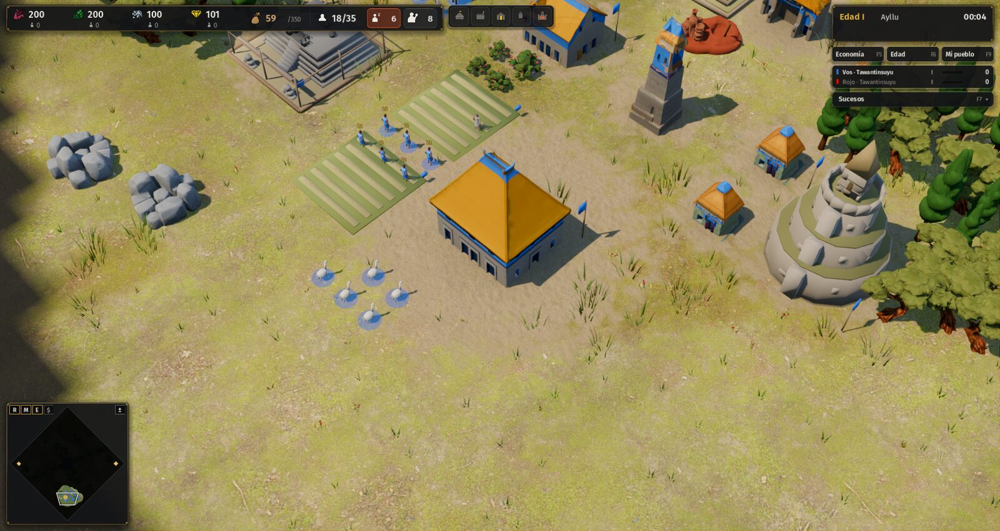

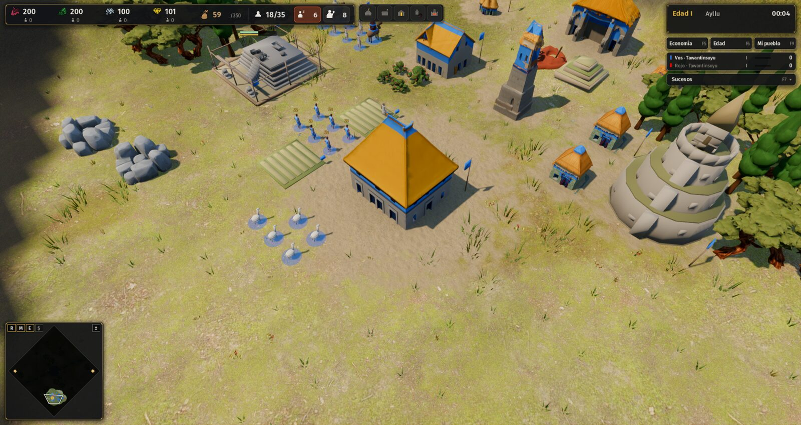

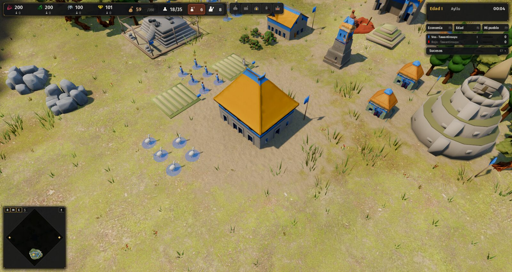

## 2 · Comparación de arte y notas de dirección

Las capturas del AoE4 se describen; no se copian ni modelos ni diseños. La identidad del nuestro es el gouache, los seis pueblos y las reglas históricas de `proceso/58`.

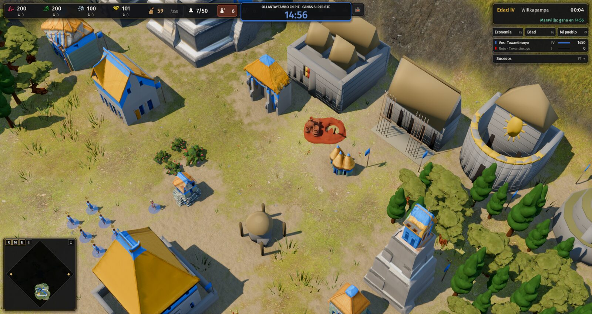

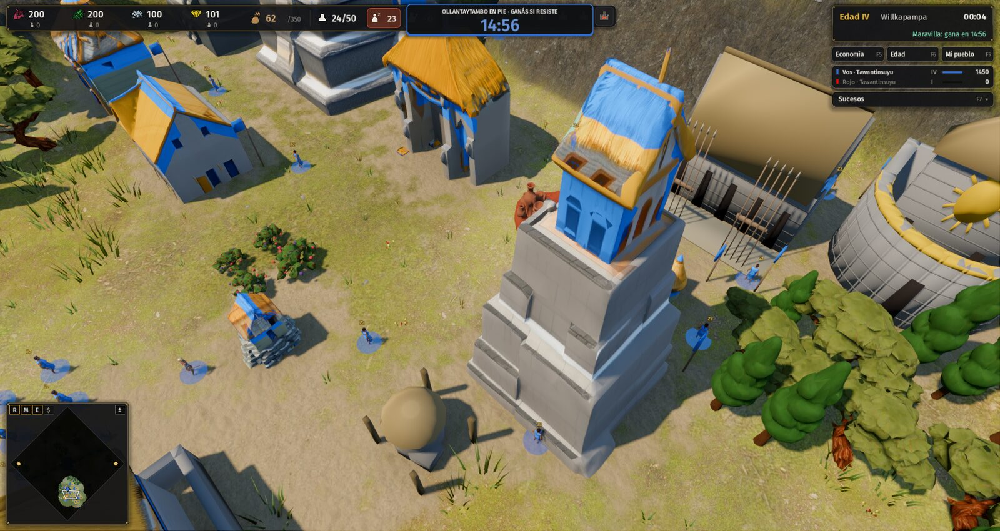

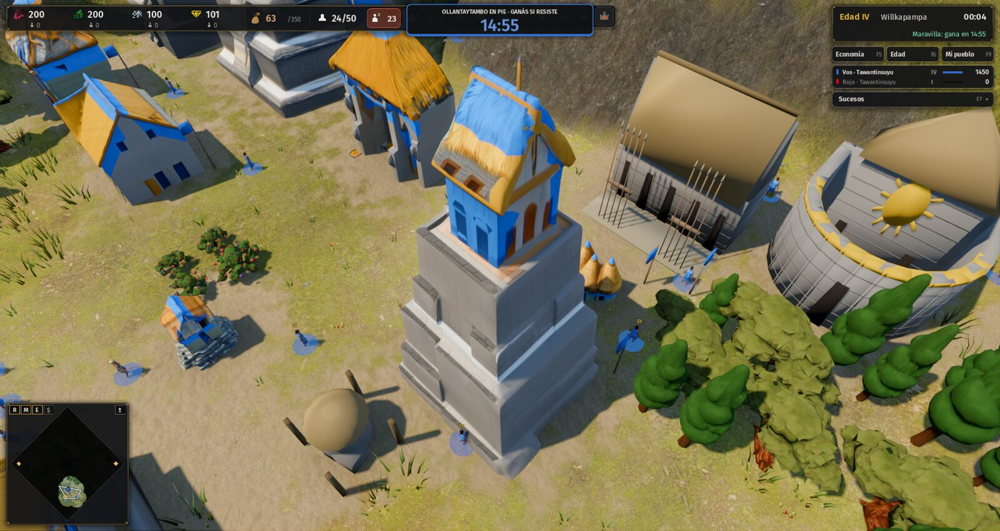

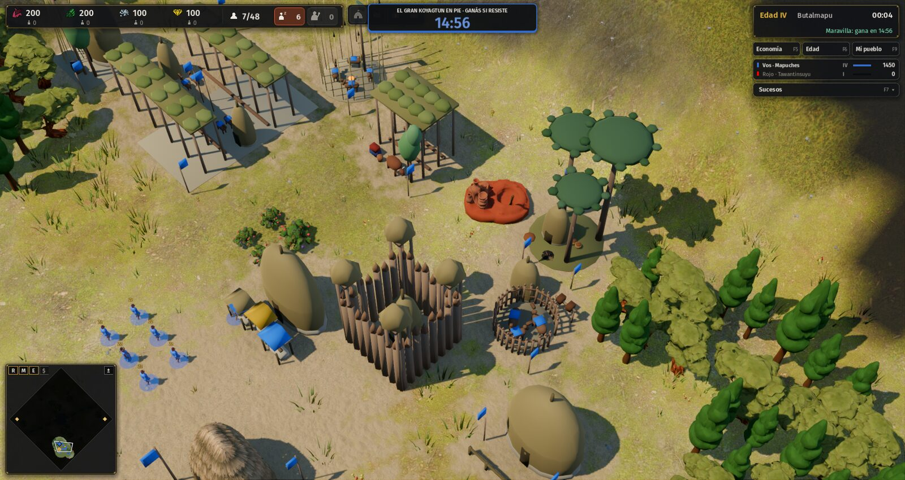

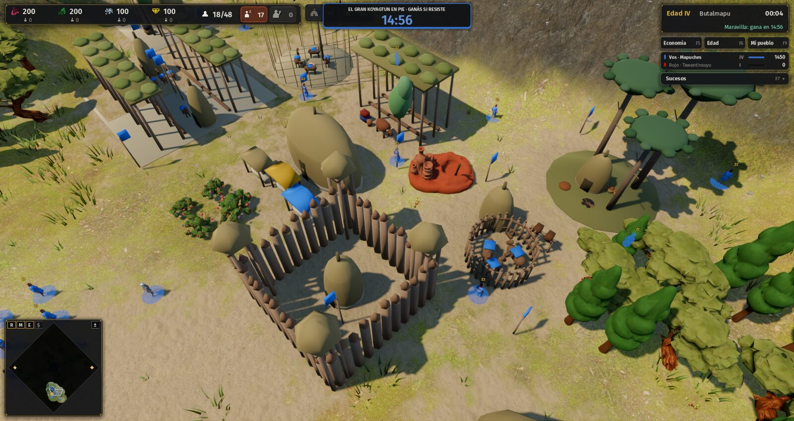

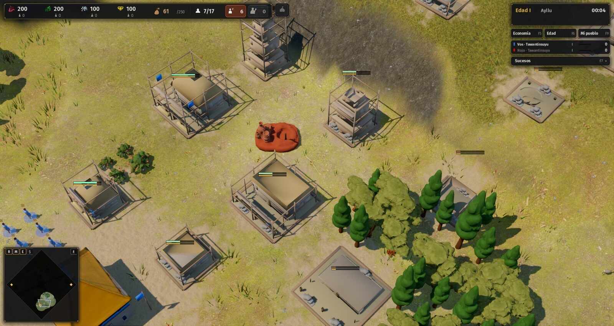

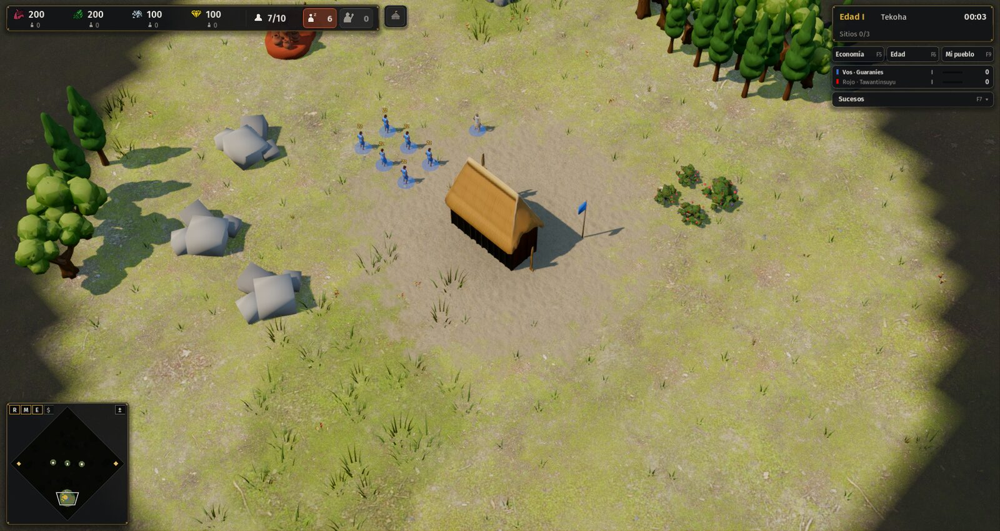

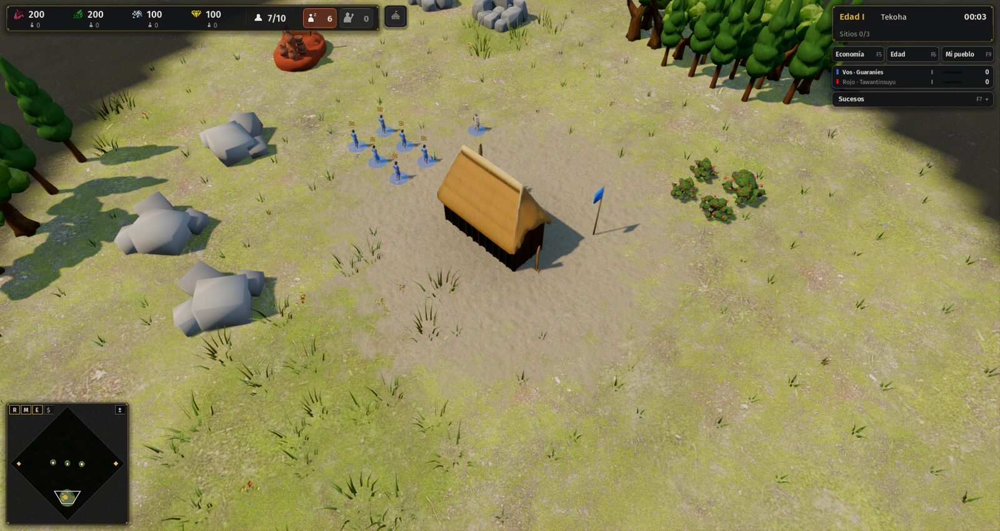

### Qué hace el AoE4 (en palabras)

- **Alto contra huella:** la casa y el cuartel son bajos (alto ≈ la mitad del lado de la huella); el centro es bajo y ancho; las torres miden 2 a 3 veces su lado; el palacio y el castillo, ≈1,3 veces.
- **Cuánto llena el modelo:** 60–80 % de la huella. El resto son patios con cerco, corrales, pilas de leña, bolsas, carros: la huella se lee por el patio, no por un bloque.
- **Techos:** 40–55 % del alto, con alero hondo y de valor oscuro (paja, pizarra, teja). La silueta la da el techo.
- **Silueta:** cada función tiene la suya y se reconoce sin color: nave larga (cuartel), patio con cerco (establo), molino con aspas, torre fina, castillo con torres en las esquinas, tiendas blancas (mercado).
- **Color, valor y saturación:** suelo desaturado de valor medio (tierra, arena, pasto seco), edificios más oscuros que el suelo (paja marrón, madera, piedra gris), luz cálida de costado con sombras largas. La saturación queda casi solo para el color del jugador.
- **Color del jugador en los edificios:** integrado a la arquitectura: una **faja al pie** de los muros de piedra y de la empalizada, **paños colgados** en las caras de las torres y las puertas, **banderines chicos** en las cumbreras del centro y de los hitos, toldos y lonas de la obra. Sin mástiles sueltos en los edificios chicos. La gente lleva la ropa del color; los animales del jugador, una marca.
- **Suelo y cimientos:** cada edificio tiene su suelo pisado (tierra) que sale de la huella y se une con los vecinos en senderos; el centro tiene huertas; las minas, un claro de piedras.
- **Obra:** (1) cimiento: tierra limpia, pilas de tablas y el contorno dorado del edificio terminado; (2) postes del armazón; (3) andamio por pisos con paños del color del jugador colgados, y el edificio sube adentro.
- **Interfaz:** todo abajo: recursos en columna abajo a la izquierda (con cuántos aldeanos en cada uno), retrato y datos de la selección, grilla de órdenes QWER/ASDF/ZXCV, pestañas de construcción por edad I–IV y minimapa abajo a la derecha. Arriba: el avance de edad en el centro y los ociosos arriba a la izquierda.

### Notas para el nuestro, por prioridad

1. **Suelo y cimientos (lo que más se nota).** Cada edificio sobre un suelo pintado que salga ≈0,5 casilla de la huella, con senderos hacia los vecinos y hacia el centro. Hoy todo está sobre el mismo pasto. Por pueblo: piedra asentada y tierra apisonada en los incas, tierra negra y pasto pisado en los mapuches, tierra roja en guaraníes y Palmares, tierra parda en Etiopía, ladrillo y barro en Ayutthaya. Es una calcomanía en gouache, no un modelo.
2. **Valor:** bajar un punto el valor del suelo y sacarle saturación; oscurecer techos y muros. El gouache cálido se queda, pero el color fuerte queda para el color del jugador y para lo sagrado o lo propio (el oro inca, el rojo de las vasijas). Hoy el naranja de los techos incas y el azul del equipo compiten sobre un suelo claro.
3. **Color del jugador en la arquitectura, no en mástiles:** faja al pie y un paño por cara visible, banderín en la cumbrera solo en el centro y los hitos. La máscara de `proceso/58` (telas y fajas en rojo plano) va por ese camino; falta llevarla a las maquetas (una faja en el zócalo) y achicar el estandarte suelto de los edificios chicos.
4. **Llenar la huella con patio, no con bloque:** los modelos llenan la huella menos 30 cm por lado, como un bloque. Pedir a la referencia (FLUX) el edificio con su patio: corral, cerco de palos, pilas de leña, vasijas, telar al aire. El modelo, 60–80 % de la huella.
5. **Obra en tres etapas que se lean:** primero el cimiento (tierra limpia, piedras o palos apilados según el pueblo, el contorno del edificio terminado); después los postes; al final el andamio con un paño del color del jugador y el edificio subiendo adentro. Hoy la jaula de andamio y el cuerpo gris aparecen desde el primer momento.
6. **Silueta por función:** que cada pueblo tenga una regla de silueta por función (nave larga para el cuartel, patio con cerco para el establo y el kraal, torre fina, plaza abierta con puestos para el mercado) y que se reconozca en gris. Las maquetas de hoy son cajas parecidas.
7. **Techos:** alero más hondo y valor más oscuro; el techo a la mitad del alto. El techo a cuatro aguas naranja de la capital inca de maqueta es el caso más claro.
8. **Interfaz:** la nuestra (recursos arriba, minimapa abajo a la izquierda, paneles arriba a la derecha) ya está pensada y se lee; no se cambia por parecerse. Dos cosas para tomar: el número de aldeanos por recurso más visible al lado de cada uno, y las pestañas de construcción por edad.

### Modelos para rehacer con las proporciones nuevas

El escalado es automático (`WorldView._model_for`: el lado mayor del modelo = el lado menor de la huella − 2 × 30 cm, y después sube hasta `altura_min_cm`), y anda igual con los del pipeline y los de Meshy. Pero estos quedan desproporcionados:

| Modelo | Por qué |
|---|---|
| `local/tawantinsuyu_fortaleza` | Es una torre; en 4×4 crece 1,4 veces en todo y queda en ≈9 aldeanos de alto. Hace falta un pukara bajo y ancho (recinto con muros en terrazas) |
| `local/tawantinsuyu_mercado` | Un edificio compacto pensado para 3×3; en 4×4 tiene que ser una plaza abierta con puestos (llenando ≈60 %) |
| Los mercados, fortalezas y hitos mapuches que se generen para los otros cinco pueblos (`proceso/58`, en espera) | Pedirlos ya para 4×4, con patio |
| Cualquier modelo de granja o andén que se haga | Para 2×2 |

El lof mapuche y las casas no cambian de tamaño. La maqueta procedural se arma con la huella y no necesita nada.

## 3 · Lo que se cambió

- `data/edificios.json`: granja 2×2, fortaleza 4×4, mercado 4×4. `data/recursos.json`: yerbal y capuera 2×2. `data/civs/`: kraal 3×3 (Ayutthaya), rewe, parlamento y weichan 4×4 (mapuches), andén 2×2 (Tawantinsuyu).
- `data/reglas.json → escala_visual`: `unidad_pct` 50 y los `altura_min_cm` nuevos.
- `data/interfaz.json → camara` (nuevo) y `src/game/rts_camera.gd`, que lo lee: lente, inclinación, giro, zoom mínimo, máximo e inicial, rueda, desplazamiento, borde, arrastre y planos de recorte.
- `src/game/world_view.gd`: la distancia de la animación lejana en la escala de la lente de referencia.
- `src/game/ui/mundo_colocacion.gd`: los lugares para granjas alrededor de un depósito son todos los que entran pegados (8 alrededor de un granero de 2×2, 12 alrededor de un centro de 4×4; antes siempre 8).
- `src/game/main.gd`: `--demo=base_completa` pone un aldeano al lado de cada edificio.
- `tests/escenarios_caben.gd` (nuevo): por misión, los edificios iniciales, la base de cada rival y los blancos de los objetivos de destruir entran en el mapa.
- **La IA, el generador y las campañas** no necesitaron cambios: buscan lugar con el `tam` de los datos. Las 30 misiones arman todo lo que piden. Murallas y puertas no cambian (1×1 por tramo). El mercado neutral sigue en 3×3 (su generador tiene el 3 escrito; C-112).

### Economía: la granja de 2×2

La tasa es por aldeano (`unidades.json → tasa.granja`, 0,75 por segundo), cada granja tiene un granjero, cuesta lo mismo (60 de madera) y no se agota: **el alimento por aldeano es el mismo**. Lo que cambia es el lugar: entran 12 granjas alrededor de un centro (eran 8 con huecos) y 8 alrededor de un granero, y el viaje al depósito es más corto, así que rinde apenas más. No se tocó ningún número de balance; el torneo dice si hace falta.

## 4 · Pruebas

| Prueba | Resultado |
|---|---|
| `test_determinism` | OK, hash **3059812827, igual**: en los primeros 3000 ticks nadie construye granjas, mercados, fortalezas ni hitos mapuches ([salida](pruebas/determinismo.txt)) |
| `bench` | 8,72 ms de promedio, peor 59,8 ([salida](pruebas/bench.txt)) |
| `civ_smoke` | OK, sin errores ([salida](pruebas/civ_smoke.txt)) |
| `campaign_smoke` | OK, las 30 ([salida](pruebas/campaign_smoke.txt)) |
| `escenarios_caben` (nueva) | 30 de 30 ([salida](pruebas/escenarios_caben.txt)) |
| `arte_guerra` | Las cinco ganadas ([salida](pruebas/arte_guerra.txt)) |
| `tutorial_letra` (letra e indefenso) | Victoria a las 10:07; derrota con motivo a las 8:42 ([letra](pruebas/tutorial_letra.txt), [indefenso](pruebas/tutorial_indefenso.txt)) |
| `salud_ia` | Tres pueblos sin mercado al minuto 15, como en `proceso/53` (que tenía cuatro avisos) ([salida](pruebas/salud_ia.txt)) |
| `casillas`, `grilla` | OK ([casillas](pruebas/casillas.txt), [grilla](pruebas/grilla.txt)) |
| Torneo (30 partidas) | Ver abajo ([salida](pruebas/torneo_59.txt)) |
| Autotest con ventana (guaraníes, llano) | OK, 251 controles, después de dos arreglos del propio autotest (ver «Tropiezos») ([salida](pruebas/autotest_guaranies.txt)) |

### Torneo del hito

`tests/torneo.gd -- --minutes=30 --seeds=2`, 30 partidas, contra el torneo 53 (`proceso/53`, mismas semillas). Con 10 partidas por pueblo, cada partida mueve 10 puntos.

| Pueblo | Torneo 53 | Torneo 59 |
|---|---|---|
| Ayutthaya | 60 % | **90 %** |
| Guaraníes | 60 % | 70 % |
| Mapuches | 80 % | 60 % |
| Etiopía | 40 % | 30 % |
| Palmares | 40 % | 30 % |
| Tawantinsuyu | 20 % (40 % con la mit'a en 150) | 20 % |

Partidas que terminan antes de los 30 minutos: 2 (eran 9); el resto se define por puntos. Victorias por hitos: solo los mapuches, 2.

**Lectura:** el que más se mueve es Ayutthaya. La causa probable es el arrozal de 2×2: su +35 % vale a 2 casillas del agua o menos, y en la franja junto al khlong ahora entran más arrozales con el bono (la IA los busca ahí primero, `_farm_site_search`). No se tocó: es una hipótesis para la próxima ronda de balance, que se mide con una prueba dirigida (arrozales con bono por partida, antes y después) y no con otro torneo. Los mapuches bajan de 80 a 60 (sus hitos crecieron a 4×4); el resto se mueve una o dos partidas, dentro del ruido.

## Tropiezos

- La importación de Godot en la copia de trabajo se colgó (un error de hilos con la fuente FiraSans, señal 11). Se copió el `.godot` del repositorio principal y la segunda importación pasó en segundos.
- Medir la perspectiva del AoE4 con la grilla de colocación no anduvo: las ondas de la arena y las piedritas tapan las líneas en una transformada de Hough. Sirvió más el mismo centro visto en tres capturas al mismo zoom.
- El autotest falló en cuatro controles la primera vez, y no por el juego: (1) el control de la granja buscaba el texto «de 8 lugares libres» y ahora son 12 alrededor del centro (se busca «lugares libres»); (2) los tres del arrastre con rumbo usaban puntos a 12 y 16 casillas de la base, que con la lente nueva y el zoom de 24 quedaban fuera de la pantalla: el autotest ahora centra la cámara en el trazo. Además faltaba la carpeta `screenshots/` en la copia de trabajo.
- El hash de determinismo no cambia porque la prueba es corta; los cambios de tamaño se ven recién en el torneo.

## Commits

<!-- COMMITS -->
