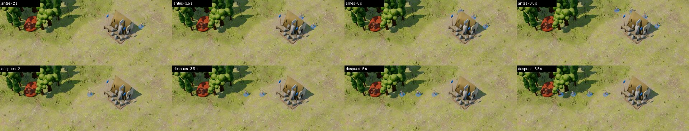
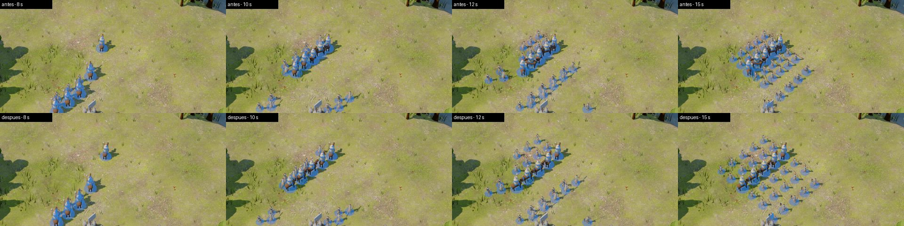

# 60 · Calidad del movimiento (como AoE4)

> **Pedido del autor (2026-11-28):** mejoras grandes de comodidad en el movimiento, aprendiendo de AoE4.
> 1. **Salir del lado de la reunión.** Si el punto de reunión está, por ejemplo, a la izquierda, la unidad tiene que aparecer en el borde del edificio más cerca del punto e ir derecho. Hoy sale del otro lado y rodea el edificio. Para todo edificio que produce (y lo que sale de muros y puertas), con o sin reunión (salida por defecto), en una casilla libre y alcanzable.
> 2. **Nunca trabadas.** Ni contra edificios, recursos u otras unidades, ni en animaciones repetidas (caminar–frenar–caminar, girar, oscilar alrededor del destino, aldeanos bailando junto al depósito). Encontrar las fallas con una prueba de situaciones apretadas y medir tiempo trabado, vaivén y órdenes cumplidas.
> 3. **Choques suaves y llegada rápida.** Que no se empujen tanto y que un grupo que llega se acomode enseguida.
> 4. **Partes pisables de los edificios**, en datos y para cualquier `tam` (otro agente cambia las huellas en el proceso 59): granjas enteras, y que no se rodee un edificio entero por una esquina.

## Prueba nueva: `tests/movimiento_qol.gd`

Siete situaciones en un lugar despejado del medio del mapa (capa común, sin civilización):

| Caso | Qué arma |
|---|---|
| `deposito_40` | 40 aldeanos talando una franja de 48 árboles a 5 casillas de un solo depósito, 3 minutos |
| `hueco_60` | 60 militares en grupo cruzan un hueco de 2 casillas en una pared de torres |
| `multitud_40` | 40 militares mixtos (con jinetes) mandados en grupo a un punto |
| `multitud_suelta_40` | los mismos, sueltos (Alt) |
| `bosque_centro` | un centro rodeado de bosque, abierto solo en una esquina, con dos árboles pegados que arman un bolsillo; salen 12 aldeanos hacia la reunión de afuera |
| `puerta_30` | 30 (aldeanos, guerreros, honderos) salen por la puerta de una empalizada |
| `reunion_izq` | centro, cuartel, campo de tiro y establo con la reunión 7 casillas a la izquierda; 3 unidades de cada uno |

Mide, por unidad y por tick:

- **trabada**: tiene orden (no está inactiva ni trabajando) y no se movió 0,3 casillas en 2 s; segundos de unidad y la peor racha;
- **vaivén**: el paso va contra el anterior y ya había vuelto atrás hace 10 ticks o menos (caminar–frenar–volver, girar en el lugar, bailar junto al árbol); por unidad y minuto caminando. La vuelta de un viaje al depósito no cuenta;
- **temblor**: lo que se mueven las unidades ya inactivas (empujadas por otras), en casillas;
- **cumplidas**: llegaron (o siguen juntando);
- **asentarse**: desde que todas terminaron la orden hasta que ninguna se mueve;
- en `reunion_izq`, cuántas salen **en la columna de la izquierda** del edificio y lo caminado contra la recta.

`--estricto` falla si un caso pasa los topes (`TOPES` en la prueba, los de después de este proceso).

## Fallas encontradas (antes)

[`pruebas/movimiento-antes.txt`](pruebas/movimiento-antes.txt):

1. **Grupo contra la pared.** En `hueco_60` y `puerta_30` las unidades iban en línea recta a su lugar en la formación. Si el lugar quedaba del otro lado de la pared, se apretaban contra ella y se deslizaban sin avanzar: el deslizamiento no cuenta como choque (`stuck`), así que nunca se rendían ni buscaban camino. 4483 y 2240 s de unidad trabada; rachas de 69 y 85 s; 141 s para pasar todas.
2. **Lugares sobre la pared al ancla.** Los que tenían el lugar encima de algo sólido iban todos al ancla, que estaba en el hueco: se apiñaban justo ahí.
3. **Ir y volver junto al recurso.** El camino al árbol termina en el centro de una casilla del costado; en una casilla en diagonal ese centro queda fuera de alcance (707 contra 640). Cada tick volvía al centro de la casilla y al siguiente se acercaba al borde: vaivén eterno de los aldeanos junto al árbol y al depósito (23 por minuto).
4. **Empujón y vuelta en el lugar.** Los miembros del grupo daban un paso hacia su lugar exacto en cada tick aunque estuvieran a milímetros; la separación los sacaba y volvían.
5. **Destinos encimados.** La orden suelta reparte destinos a 750 fijos; dos jinetes (radio 380) quedaban superpuestos y se empujaban: 33 casillas de temblor de los que ya habían llegado.
6. **Salida del lado de abajo.** `_spawn_tile` probaba siempre primero la fila de abajo, de izquierda a derecha: 0 de 12 salían a la izquierda con la reunión a la izquierda; rodeaban el edificio.
7. **Aldeanos que dejaban de trabajar.** Un aldeano empujado fuera de alcance mientras juntaba volvía a caminar (y el vecino lo empujaba de nuevo).

## Arreglos

Parámetros nuevos en `data/reglas.json`, con su `_doc`: `movimiento.salida`, `movimiento.llegada`, `movimiento.rodeo`, `movimiento.separacion` y `huella_pisable`.

- **Salida hacia la reunión** (`Sim._spawn_tile`, `reglas.movimiento.salida`). Casillas libres en anillos alrededor del edificio, ordenadas por distancia al punto de reunión (al recurso o edificio de la reunión, si hay; si no hay reunión, a la salida por defecto, `defecto` = abajo). De cada anillo se prueba el camino de las más cercanas: gana la primera que llega al punto (las de un bolsillo entre el edificio y el bosque quedan afuera) y que no tiene a nadie parado encima. Vale para todo lo que sale de un edificio: entrenar, `spawn_near` y lo que se aloja (`_eject`, `eject_crafts`), que además se reparte de a cuatro por casilla (`_spawn_pos`) en lugar de salir todos en el mismo punto.
- **Sin avance** (`Sim._follow`, `reglas.movimiento.llegada`). Si en 12 ticks no se acerca 0,15 casillas al destino ni pasa de casilla del camino: con orden de mover y a 1,5 casillas o menos del destino, ya llegó (otro ocupa el lugar); lejos, recalcula el camino desde donde está, hasta 2 veces. Después, la orden de mover sigue esperando su turno (cola de un paso angosto) y las demás (juntar, entregar, construir) se rinden como el que choca.
- **Llegada del grupo** (`SimGroups.member_step`). Con el grupo llegado, el miembro que no se acerca a su lugar en esos 12 ticks ya llegó si está a 1,8 casillas o menos. Antes empujaba hasta 10 s y después iba solo.
- **Rodeo** (`reglas.movimiento.rodeo`). Si entre un miembro y su lugar hay algo sólido (`SimMap._clear_line`, cada 4 ticks), va a la casilla más adelantada del camino del grupo que ve en línea recta: el camino del ancla está libre y pasa por el hueco o la puerta. Los lugares sobre una pared van a la casilla libre más cercana, no al ancla. Un primer intento con un A* por miembro andaba igual de bien en la prueba pero subía el bench un 50 % (peleas entre bosques): se cambió por las casillas del camino del grupo, sin A*.
- **Zona quieta del grupo** (`rodeo.quieto`). A 0,12 casillas de su lugar no da pasos, y con el grupo esperando, tampoco dentro de la holgura.
- **Directo al borde** (`Sim._approach`). Con el camino terminado y a una casilla o menos de su final, va derecho al borde del recurso o edificio, sin volver al centro de la casilla.
- **Holgura de trabajo** (`llegada.trabajo_holgura`). Quien ya junta o construye aguanta 0,25 casillas más antes de volver a acercarse. Al cambiar de fuente se pierde.
- **Destinos según el radio** (`Sim._cmd_move`). La grilla de la orden suelta separa al menos dos radios del más grande más el hueco del grupo.
- **Choques suaves** (`Sim._separate`, `reglas.movimiento.separacion`). Se tolera una superposición de 0,03 casillas sin empujar; de lo que sobra se corrige el 60 % por pasada. La inactiva le abre paso a la que camina (se lleva el 80 % y se corre de costado, perpendicular a la marcha); dos que se cruzan de frente se esquivan cada una por su derecha. La que pelea o trabaja no se corre de costado: en las peleas corría los blancos de casilla y los perseguidores recalculaban. Cada unidad guarda su último paso (`mv_x`, `mv_y`, `mv_tick`) para saber quién camina y hacia dónde.
- **Huella pisable** (`reglas.huella_pisable`, `Sim.walkable_mode` y `Sim._open_walkable`). Modos `esquinas`, `anillo`, `todo` y `nada`, elegidos por `pisable` en el edificio, por `por_tipo` o por el lado menor de `tam` (desde 3, esquinas; desde 7, anillo). Así sirve para las huellas nuevas del proceso 59 sin tocar `edificios.json`. Granjas y demás transitables, enteras; muros, puertas y torres, nada. Las casillas abiertas siguen ocupadas (no se construye encima) y se vuelven a abrir cuando el pasillo entre edificios re-marca la huella. Para los depósitos grandes con patio (centro y hitos de 4×4 del 59) alcanza con pasarlos a `anillo` en `por_tipo` cuando el modelo deje el borde libre; hoy quedan en esquinas para que nadie camine por encima del modelo.

## Números

### `tests/movimiento_qol.gd`

| Caso | Trabada (s de unidad) | Peor racha | Vaivén (/unidad·min) | Temblor (casillas) | Cumplidas | Otro |
|---|---|---|---|---|---|---|
| `deposito_40` | 10,3 → **0** | 12,2 → **0** s | 23,0 → **8,9** | 0 → 0 | 100 → 100 % | madera en 3 min: 2010 → **2290** |
| `hueco_60` | 4483 → **116** | 68,6 → **6,0** s | 52,5 → **13,2** | 7,3 → 6,3 | 100 → 100 % | todas pasan: 141,7 → **36,4** s |
| `multitud_40` (grupo) | 0 → 0 | 0 → 0 | 5,3 → **1,1** | 4,0 → 3,9 | 100 → 100 % | |
| `multitud_suelta_40` | 0 → 0 | 0 → 0 | 15,1 → **2,1** | 33,3 → **17,1** | 100 → 100 % | |
| `bosque_centro` | 0 → 0 | 0 → 0 | 37,8 → **8,2** | 12,1 → 10,0 | 100 → 100 % | la última llega: 13,2 → **8,3** s |
| `puerta_30` | 2240 → **0** | 85,4 → **0** s | 56,3 → **3,7** | 4,0 → 3,4 | 100 → 100 % | todas pasan: 141,0 → **19,6** s |
| `reunion_izq` | 0 → 0 | 0 → 0 | 61,6 → **4,3** | 9,0 → 5,0 | 100 → 100 % | salen a la izquierda: 0/12 → **12/12**; recorrido/recta 1,25 → **1,08** |

Archivos: [`pruebas/movimiento-antes.txt`](pruebas/movimiento-antes.txt) y [`pruebas/movimiento-despues.txt`](pruebas/movimiento-despues.txt) (con `--estricto`: OK). Lo que queda en `hueco_60` es la cola de 60 unidades por dos casillas (la peor espera, 6 s).

### Tiras de cuadros

Salida hacia la reunión: un cuartel con la reunión a la izquierda de la pantalla entrena guerreros seguidos (`--demo=reunion`; en esta escena el entrenamiento dura 1,5 s). Antes salían abajo a la derecha y rodeaban el cuartel por arriba; ahora salen por el lado izquierdo y van derecho.

Una multitud suelta llega a un punto (`--demo=llegada`, 30 de tropa con jinetes). Antes quedaban encimados en el centro y se seguían empujando; ahora cada uno queda en su lugar, a dos radios del vecino.

Se sacan con `godot --path . -- --demo=reunion --civ=guaranies --terreno=llano --seed=5 --nofog --shot=x.png --serie=2,3.5,5 --shot-at=6.5` (opción nueva `--serie`: capturas intermedias sin pausar, en `x_1.png`, `x_2.png`…).

### Rendimiento

- **4v4 de 40 minutos** (`tools/perfil_sim.gd --partida=4v4 --plano`, semilla 42, las dos corridas en la misma sesión): promedio 35,63 → **35,44** ms, p95 77,4 → **72,8**, peor 166 → **144** ms, ticks de más de 100 ms 129 → **50**, ×4 alcanza hasta el minuto 13 → **14**. No empeora; el proceso 45 medía 30,1 de promedio con el código y la máquina de entonces. [`pruebas/plano-antes.txt`](pruebas/plano-antes.txt), [`pruebas/plano-despues.txt`](pruebas/plano-despues.txt).
- **Bench** (200 unidades peleando): 8,5 → **9,6–10,2** ms de promedio (presupuesto 100). La pelea cambia (quedan 122 vivas en lugar de 148): con choques más suaves se juntan más, pelean más unidades a la vez y hay más persecuciones (3112 → 3989 caminos de persecución). Con asedio, 7,9 ms. [`pruebas/bench.txt`](pruebas/bench.txt).

### Determinismo

`tests/test_determinism.gd`: OK. El hash cambia, **3059812827 → 3617052205** (3000 ticks), porque cambian las posiciones: la casilla de salida, los choques, la llegada, los destinos sueltos y las esquinas pisables. Todo sigue en enteros, sin trigonometría ni azar, en orden de id; el camino que se prueba para la salida usa la misma caché de caminos (es estado y da lo mismo en las dos partidas). El 4v4 termina en 3502364449.

### Otras pruebas

- `civ_smoke`: sin errores. `campaign_smoke`: sin errores. `arte_guerra`: OK (las cinco, arte-5 con oro). `tutorial_letra`: OK en `--modo=letra` y en `--modo=indefenso` (derrota con motivo, como se espera). `grupos`: OK (llegada 0,7 s, dispersión 4 casillas). `ordenes`: OK.
- `salud_ia`: 3 pueblos con avisos (antes del cambio, 4): Tawantinsuyu ya tiene mercado al minuto 15 y todos suben a la II antes. Quedan guaraníes sin mercado, Palmares con recursos parados y Ayutthaya con ejército chico, que no vienen del movimiento. [`pruebas/salud_ia.txt`](pruebas/salud_ia.txt), [`pruebas/salud_ia-antes.txt`](pruebas/salud_ia-antes.txt).
- Autotest con ventana (`--autotest --civ=tawantinsuyu --terreno=llano`): OK.

## Tropiezos

- `data/reglas.json` ya tenía un bloque `movimiento` (frenado y caminos): el nuevo lo pisaba y `SimMods.speed` fallaba. Los parámetros nuevos van dentro del mismo bloque.
- La prueba con mapuches y guaraníes no tenía `deposito`, `torre` ni `centro` (cada pueblo los renombra): usa la capa común.
- El primer bosque del depósito tenía árboles del medio sin lado libre: 14 aldeanos quedaban sin árbol (uno por árbol) y parecía una falla del movimiento. La franja de dos de ancho deja los 48 con un lado libre.
- La métrica de vaivén contaba la vuelta de cada viaje al depósito; ahora cuenta dos vueltas atrás en menos de 1 s. «Asentarse» contaba la diferencia de llegada por velocidades (lancero contra jinete); ahora empieza cuando todas terminaron la orden.
- Una regla de «fila» (el de atrás frena y el de adelante no es empujado) empeoró el hueco (48 s y vaivén 97): se sacó.
- El rodeo con un A* por miembro subió el bench de 8,5 a 13 ms (2347 caminos más en una pelea): se cambió por las casillas del camino del grupo.
- `--demo=reunion` en la base caía entre árboles con una civilización sin cuartel: la escena va al medio del mapa, despejado, y con `--civ=guaranies`. La cámara mira hacia +x+y: la izquierda de la pantalla es +x −y.

## Commits

- Proceso 60: movimiento como AoE4 (salida hacia la reunión, sin trabas, choques suaves, huella pisable) y `tests/movimiento_qol.gd`.
