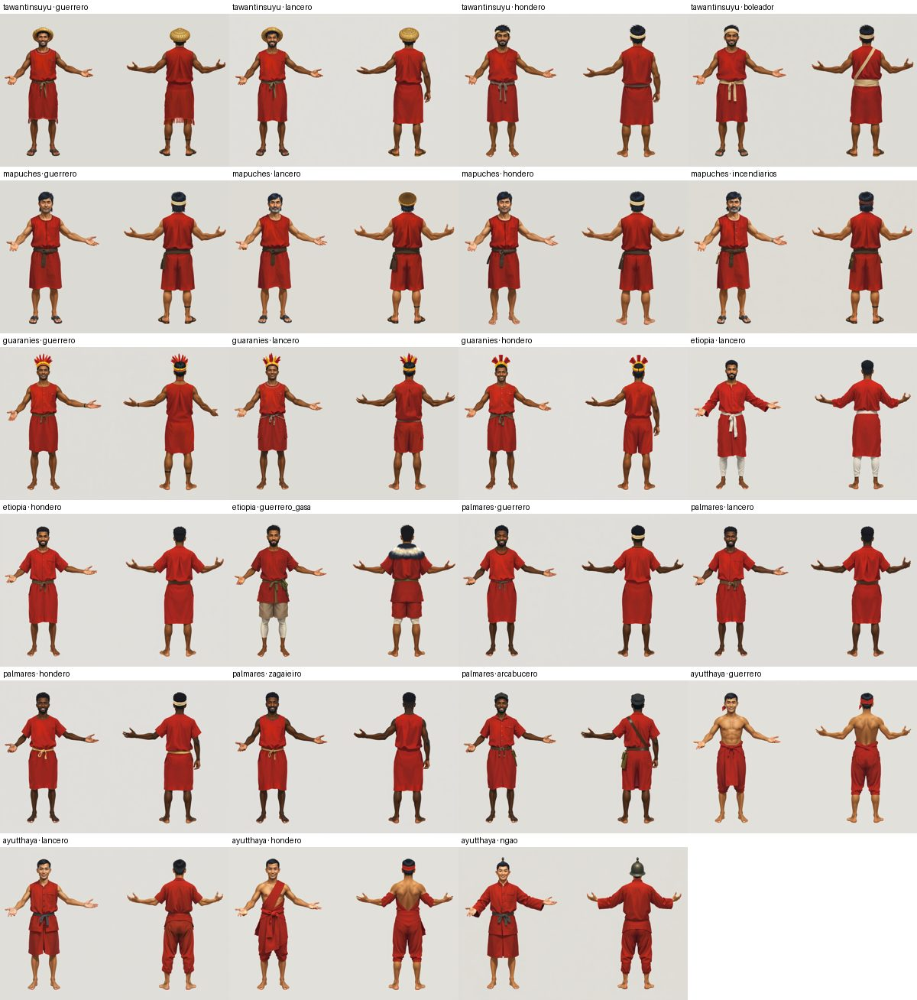
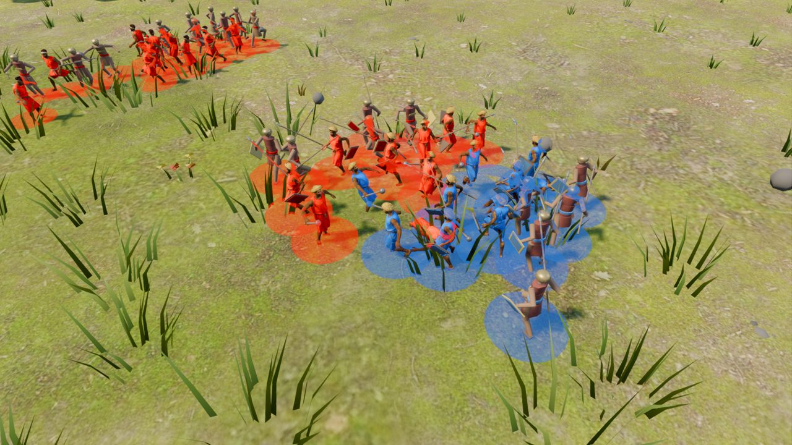
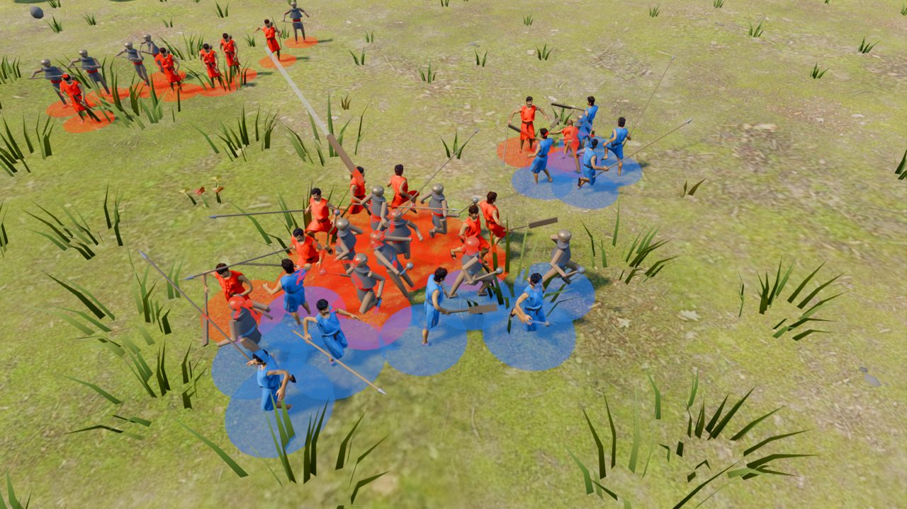
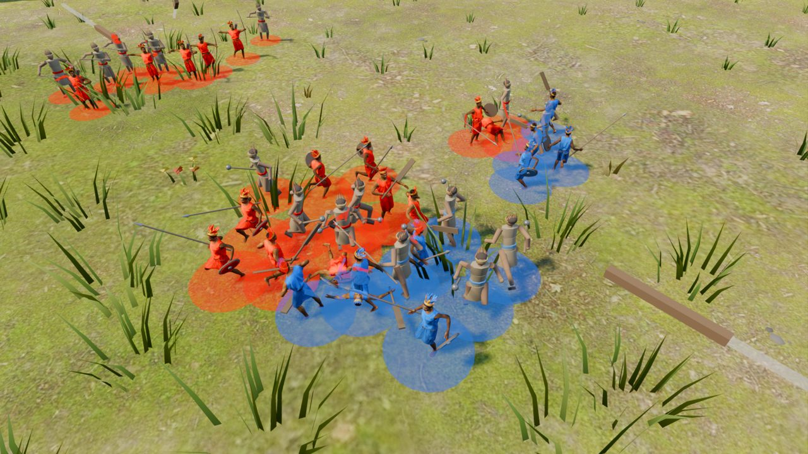

# 62 · Soldados de Meshy

## Pedido

El autor aprobó los soldados con la misma receta que los aldeanos (`proceso/56` y `proceso/57`): malla de Meshy, **nuestro** rig con las animaciones de KayKit, la ropa del equipo en rojo plano (máscara y `equipo_3d.gdshader`) y las armas como piezas en `handslot.r` y `handslot.l`. Cada unidad tiene su aspecto propio por pueblo (decisión del 2026-11-17).

- Presupuesto: ~700 créditos, a 30 por modelo: **23 modelos como máximo**.
- Primero las 3 tropas de a pie más usadas de cada pueblo (18), después las propias o montadas más usadas hasta 23.
- Hojas de referencia con FLUX (ComfyUI local), del mismo formato que `hoja_aldeano_e1_31.png`.
- **Acá no se llama a Meshy:** los modelos los genera la sesión principal.

## 1. Inventario y prioridad

### Cuánto se entrena cada unidad

No había registros por tipo de unidad (el torneo y `salud_ia` cuentan el ejército entero). Se jugaron seis partidas de IA contra IA de 22 minutos, en ronda (cada pueblo, dos partidas), contando el evento `trained` (script de una vez, fuera del repo):

| Pueblo | Infantería común | Propias y otras (de a pie) | Montados y elefantes |
|---|---|---|---|
| Tawantinsuyu | hondero 110, guerrero 47, lancero 28 | **boleador 42**, galgueros 6 | — |
| Mapuches | hondero (arquero) 86, guerrero (weichafe) 74, lancero (lanza larga) 18 | **incendiarios 6** | infantería montada 18, jinete 9 |
| Guaraníes | hondero (arquero) 121, guerrero 34, lancero 33 | arcabucero 0 | — |
| Etiopía | hondero (jabalinero) 58, lancero (chewa) 0, arcabucero 0 | **guerrero de gaša 26** | **guerrero (jinete noble) 78**, färäsäñña 8 |
| Palmares | hondero (flecheiro) 183, guerrero 9, lancero 5 | **zagaieiro 19**, **arcabucero (espingardeiro) 11**, guarnição 2 | — |
| Ayutthaya | guerrero (dap) 112, hondero (arquero) 67, lancero 9 | **ngao 10** | chang suek 7, elefante del rey 6 |

### Los 23 elegidos

- **Comunes (18):** guerrero, lancero y hondero de cada pueblo. En **Etiopía** el guerrero común es el jinete noble (montado): sus tres de a pie son lancero, hondero y **guerrero de gaša**, la propia más entrenada.
- **Propias (5):** boleador (Tawantinsuyu), zagaieiro y espingardeiro (Palmares), ngao (Ayutthaya) e incendiarios (Mapuches), por orden de uso entre las de a pie que quedan.

| Pueblo | Modelos |
|---|---|
| Tawantinsuyu | guerrero, lancero, hondero, boleador |
| Mapuches | guerrero, lancero, hondero, incendiarios |
| Guaraníes | guerrero, lancero, hondero |
| Etiopía | lancero, hondero, guerrero_gasa |
| Palmares | guerrero, lancero, hondero, zagaieiro, arcabucero |
| Ayutthaya | guerrero, lancero, hondero, ngao |

### Afuera: montados y elefantes

El jinete noble etíope (la unidad militar más entrenada de Etiopía), la infantería montada y el kona mapuches, el färäsäñña y los elefantes de Ayutthaya **no entran**:

- Meshy daría jinete y animal en una sola malla; nuestro rig (`gen3d_rig.py`) es de persona. Existe `tools/gen3d_rig_cuadrupedo.py` (proceso/47), pero solo trae caminar y quieto, sin ataque ni muerte.
- El juego no anima montados (`AldeanoAnimado.usa` los excluye): falta el jinete sentado con el golpe encima, el paso del caballo y colgar un esqueleto del otro (ver `proceso/27-animaciones/02-soldados.md`, sección 4).

## 2. Hojas de referencia

**Salida:** `comfyui/output/<civ>_gouache/hoja_<unidad>_soldado_31.png` (`incas_gouache` para el Tawantinsuyu), con su `_mascara.png` y su `_meta.json`. Las descartadas quedan como `_v1` y `_v2`. Generador: [`hojas_soldados.py`](hojas_soldados.py).

**Receta:** FLUX schnell, semilla 31, 1152×768, frente a la izquierda y espalda a la derecha, pose A con las manos vacías, **sin arma, sin escudo y nada en la espalda** (el arma, el escudo y el carcaj van después como piezas). La cara es la del aldeano de cada pueblo (de su `hoja_aldeano_e1_meta.json`), compacta, con «a grown man about thirty-five years old, not a boy». Unas 170–185 palabras (FLUX corta el prompt cerca de 256 tokens).

**Ropa de guerra por pueblo** (las piezas de `proceso/42` y `proceso/49`; nada sagrado, sin estereotipos):

- **Tawantinsuyu:** unku rojo sin mangas; casco de caña tejida (guerrero y lancero), flecos bajo la rodilla (guerrero), la honda trenzada atada a la cabeza (hondero), vincha y faja crema (boleador); ojotas.
- **Mapuches:** makuñ rojo corto hasta el muslo, faja oscura; trarilonko (guerrero, hondero), gorro de cuero crudo (lancero), vincha oscura (incendiarios). Sin machi, rewe ni kultrun.
- **Guaraníes:** tipoy rojo corto y vincha de plumas de loro; el guerrero con pintura en los antebrazos, el lancero con bandas bajo las rodillas. Sin yvyra'i ni mbaraka.
- **Etiopía:** túnica roja larga; pantalón blanco ajustado y faja blanca (lancero); piel de colobo en los hombros (gaša). Sin cruces.
- **Palmares:** túnica roja corta; vincha crema (guerrero, flecheiro), cinto de fibra de palma, gorro oscuro y bandolera (espingardeiro). Gente que pelea, sin cadenas.
- **Ayutthaya:** chong kraben rojo; pecho desnudo y paño en la cabeza (dap), chaqueta roja (lancero, ngao), banda cruzada (arquero), casco redondo (ngao). Sin sak yant ni nada del templo.

**Intentos:**

1. Primer lote: los mapuches salieron de frente con túnica roja y de espalda con el chiripá oscuro (o al revés, con el pecho desnudo), y el boleador con la manta solo de espalda. Se cambió la ropa mapuche a un makuñ corto, igual en las dos vistas, y la manta del boleador por una faja.
2. Segundo intento con la semilla 32 para cuatro hojas con el tocado solo de espalda (Palmares guerrero y flecheiro, ngao y lancero de Ayutthaya): la 32 rompe la pose A (de perfil o con los brazos abajo). Quedaron las de la semilla 31; las de la 32 están como `_v2`.

**Vistas que no coinciden** (para Meshy, solo la de frente):

| Hoja | Qué cambia |
|---|---|
| mapuches guerrero, lancero, hondero, incendiarios | el tocado (trarilonko o gorro) solo de espalda |
| etiopia guerrero_gasa | de frente, pantalón corto crudo y sin la piel; de espalda, con la piel de colobo |
| palmares guerrero, hondero | la vincha solo de espalda |
| ayutthaya guerrero | el paño de la cabeza solo de espalda |
| ayutthaya lancero | de frente, faldón; de espalda, pantalón |
| ayutthaya ngao | el casco solo de espalda |
| guaranies lancero, hondero | de frente, faldón; de espalda, pantalón corto |
| tawantinsuyu boleador | una correa cruzada solo de espalda |

**Tropiezos:**
- ComfyUI se traba en el VAE a la tercera hoja: el `scope` aislado llega al tope (12 GB de `MemoryHigh` y 2 GB de swap) y el proceso queda frenado. `POST /free` no alcanza. Se lo reinició cada dos hojas.
- Al reiniciarlo desde un script en segundo plano, la primera hoja fallaba con un `KeyError` con el nombre del `scope`. Con `setsid` dejó de pasar.
- Varias caras salen sonrientes o con barba (inca, mapuche), por las «smile lines» del prompt. Todas son de 30 a 40 años.

## 3. En el juego

### Cómo se conectan

- **Interruptor** (`data/arte_animaciones.json → modelos`): `soldados[pueblo][tipo]` apunta a una entrada de `lista` (`sol_<pueblo>_<tipo>`); **una línea por unidad**, y sin la línea vuelve la figura de KayKit con su equipo. `soldados_activo: false` los apaga a todos (los aldeanos siguen).
- **`AldeanoAnimado.modelo_tropa(civ, tipo)`** arma el modelo una vez (el mismo `_armar_modelo` de los aldeanos: copia del esqueleto, biblioteca retargeteada compartida, material `equipo_3d.gdshader` por color de equipo). `crear()` se lo pone al soldado en lugar de la malla de KayKit.
- **El arma, el escudo y el carcaj** son las piezas de siempre (`TropaAnimada._arma`, `_escudo`, `_carcaj`, con lo de `tropas.tipos`, `por_forma` y `por_civ`): se arman en la plantilla y `AldeanoAnimado.llevar()` (lo que antes hacía `malla_modelo` para las herramientas) las pasa al hueso del modelo, `handslot.r` y `handslot.l`. El centro del escudo toma el color del equipo.
- La ropa, el tocado y el casco ya vienen en la malla: con modelo, el cambio de edad no cambia el soldado (sí en la figura de KayKit).
- Armas nuevas en los datos: el zagaieiro tira **jabalina** (antes, la honda de su función) y el guerrero de gaša lleva **lanza y escudo redondo** (antes, maza), como en sus piezas de `proceso/49`. Vale también para la figura de KayKit.

### Receta por modelo

[`procesar.sh`](procesar.sh) `<pueblo>_<unidad>`: espera 7 GB libres; `optimizar_glb` a 15.000 triángulos y 2048 px; `gen3d_rig --normalizar --cabeza-rigida --calor-escala=10`; `mascara_equipo_3d --metodo=rojo`; la textura a JPEG 80 con [`glb_jpeg.py`](glb_jpeg.py) (sin Blender). Blender con tope de 4 GB, de a un proceso. [`conectar.py`](conectar.py) agrega la entrada y la línea en los datos.

| Modelo | Triángulos | Vértices sin peso | Máscara | `luz_ref` | GLB |
|---|---|---|---|---|---|
| `tawantinsuyu_guerrero` | 15.000 | 0 | 51 % | 0,065 | 1,4 MB |
| `tawantinsuyu_lancero` | 14.999 | 0 | 35 % | 0,071 | 1,4 MB |
| `tawantinsuyu_hondero` | 14.999 | 0 | 36 % | 0,062 | 1,2 MB |
| `tawantinsuyu_boleador` | 14.999 | 0 | 30 % | 0,056 | 1,4 MB |
| `mapuches_guerrero` | 14.999 | 0 | 34 % | 0,075 | 1,4 MB |
| `mapuches_lancero` | 14.999 | 0 | 32 % | 0,064 | 1,3 MB |
| `mapuches_hondero` | 14.999 | 0 | 46 % | 0,053 | 1,3 MB |
| `mapuches_incendiarios` | 15.000 | 0 | 41 % | 0,050 | 1,4 MB |
| `guaranies_guerrero` | 15.000 | 0 | 41 % | 0,094 | 1,3 MB |
| `guaranies_lancero` | 15.000 | 0 | 58 % | 0,066 | 1,3 MB |
| `guaranies_hondero` | 15.000 | 0 | 41 % | 0,080 | 1,4 MB |

### Por pueblo

Batalla de cerca de cada pueblo contra sí mismo, azul contra rojo (`tools/aldeanos_animados.gd --modo=batalla --civ=X --rival=X --terreno=llano --seed=7 --sin_hud --pitch=42 --zoom=8`). Las unidades que no son de Meshy (leva, arcabuceros, galgueros…) siguen con la figura de KayKit.

**Tawantinsuyu:** guerrero con porra, lancero con lanza y escudo cuadrado, hondero con honda y boleador con las boleadoras, todos de Meshy.

**Mapuches:** weichafe con macana a dos manos, lanza larga de colihue sin escudo y arquero con arco y carcaj. Los incendiarios (asedio) no entran en la batalla de la herramienta; están conectados igual. El weichafe montado (que pelea a pie) sigue con la figura de KayKit.

**Guaraníes:** guerrero con macana a dos manos, lancero con lanza y escudo redondo, arquero con arco y carcaj. El ka'aguygua y la milicia arcabucera siguen con KayKit. (El palo grande abajo a la derecha es una flecha en vuelo, cerca de la cámara.)

