# 63 · Montados y animales animados

**Pedido:** que los jinetes, los elefantes y los animales (rebaños y caza) se animen en el juego, sin gastar créditos de Meshy (quedan 48): rig general de cuadrúpedo con quieto, caminar, galope, ataque, golpeado y morir hecho en Blender y con los tiempos del andar en datos; el soldado de Meshy del pueblo sentado en la silla, con los golpes de KayKit en el cuerpo de arriba; color del equipo en el jinete y en una manta; el elefante de Ayutthaya con mahout y howdah; una línea por unidad en `data/arte_animaciones.json`; las animaciones compartidas por tipo.

**Estado:** hecho. Los nueve montados de los cinco pueblos que los tienen (Palmares no tiene) y el jinete común de los rivales andan, galopan, pelean, reaccionan y caen con sus jinetes. Los rebaños de los seis pueblos y la caza pastan, caminan, corren y caen. Hash de la simulación sin cambios.

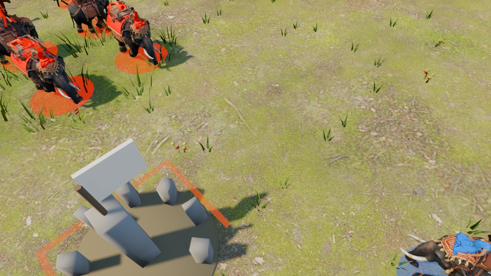

## 1. Inventario

Lo que había antes en cada pueblo y lo que hay ahora. «Maqueta»: la figura procedural de `CivMeshes` (caballo y jinete de cajas, con vaivén). «Meshy fijo»: un modelo sin esqueleto, de una pieza, que se mecía entero.

| Pueblo | Unidad | Antes | Ahora (montura + jinete) |
|---|---|---|---|
| Tawantinsuyu | `jinete_manco` (choque) | maqueta | caballo criollo + guerrero de Meshy (maza) |
| Mapuches | `jinete` (choque) | Meshy fijo (`mapuches_jinete`) | caballo + lancero de Meshy (lanza larga, estocada a dos manos) |
| Mapuches | `kona_waiki` (línea) | maqueta | caballo + lancero de Meshy |
| Guaraníes | `caballeria_mision` (choque) | maqueta | caballo + lancero de Meshy |
| Etiopía | `guerrero`, jinete noble | Meshy fijo (`etiopia_jinete`) | caballo + guerrero de gaša de Meshy (lanza y escudo) |
| Etiopía | `farasanna` (choque) | maqueta | caballo + lancero de Meshy |
| Etiopía | `caballeria_corte`, jinete oromo | maqueta | caballo + jabalinero de Meshy (tira) |
| Ayutthaya | `chang_suek`, elefante de guerra | Meshy fijo (`ayutthaya_elefante`, el del rey) | elefante de guerra (el de Meshy sin el busabok) + howdah + manta + mahout + ngao de Meshy |
| Ayutthaya | `elefante_rey` (carga) | Meshy fijo | el mismo modelo con esqueleto (el busabok y el mahout que trae van rígidos con el lomo) |
| Rivales (Adal, birmanos, invasores…) | `jinete` | maqueta | caballo + lancero de KayKit con el equipo de su forma |
| Palmares | — | no tiene montados | — |
| Los seis | `rebano` (13 especies por pueblo: llama, chilihueque, búfalo, cebú, pecarí, cerdo…) | silueta procedural fija | la misma silueta con esqueleto: quieto, pastar, caminar, galope, golpeado, morir |
| Todos | caza (`venado`) y sueltos (`rebano_salvaje`), 18 especies | silueta fija | quieto y pastar; cae al empezar a carnearlo |

Animales de carga: no hay en la simulación (el comerciante lleva la carga él mismo); las llamas de oro del Qorikancha son parte del hito y quedan fijas.

## 2. Rig y ciclos (Blender, sin créditos)

`tools/gen3d_rig_cuadrupedo.py` pasó de un rig para el caballo con dos ciclos a uno general para cualquier cuadrúpedo, con todo lo que cambia de un animal a otro en `data/arte_cuadrupedos.json`:

1. Normaliza: el largo sobre x con la cabeza en +x (o lo que diga `cabeza` del modelo), apoyado en el suelo, alto 1.
2. Recorta, si el modelo lo pide, lo que trae arriba del lomo (`recortar_desde_pct`): así el elefante del rey de Meshy da también el de guerra, sin el busabok.
3. Busca las cuatro patas (los vértices bajos), la cabeza, la cola y, en el elefante, la trompa, y arma 21 huesos (25 con la trompa y el asiento del mahout): `root`, `hips`, `spine`, `chest`, `neck`, `head`, `tail.1-2`, tres por pata, `silla` y `cuello_asiento`.
4. Pesos con bone heat; si falla en más del 5 % de la malla (las de Meshy, grandes y abiertas), **por zonas**: lo que está bajo la panza y cerca de la columna de una pata va a esa pata, la trompa a la trompa y el resto al cuerpo, con los dos huesos más cercanos. Lo montado (`rigido_desde_pct`) va entero al lomo.
5. Arreos: la **manta** (material `equipo`, el color del jugador, con orilla dorada `equipo_borde`) se arma con el corte del lomo en la silla, y el **howdah** de madera del elefante de guerra; los dos cuelgan del hueso `silla`.
6. Siete clips en pistas NLA: `quieto`, `pastar`, `caminar` (paso de cuatro tiempos), `galope` (transverso; en el elefante, ambladura rápida), `ataque` (el caballo se encabrita y manotea, el elefante levanta la mano y la trompa y pisa, los demás embisten con la cabeza), `golpeado` y `morir` (se le doblan las manos y cae de costado).

Para los animales del mapa, `tools/exportar_animales.gd` exporta la silueta procedural de cada especie a GLB y `tools/rig_animales.py` la riggea con el tipo de su forma (camélido → llama, bovino → buey, ciervo → venado, cabra, cerdo y tapir → cerdo). Son 18 GLB de 100 a 200 KB en `assets/generados/modelos/animales/`, con los colores de siempre.

### Datos del andar

En `data/arte_cuadrupedos.json → tipos.<tipo>.clips`: `ciclo_s` (largo del ciclo), `fases` (en qué momento levanta cada pata: trasera izq., delantera izq., trasera der., delantera der.), `pierna_grados`, `doblez_grados`, `lomo_grados`, `rebote_pct` y `cabeceo_grados`. Y en `juego`: `galope_desde` (casillas por segundo desde las que galopa), `ataque_cada` y los topes de la animación `vel_min_pct` y `vel_max_pct`.

| Tipo | Caminar | Galope | Galopa desde | Ataque |
|---|---|---|---|---|
| caballo | 0,9 s, 4 tiempos, 22° | 0,42 s, transverso, 40° | 1,3 casillas/s | encabritar, cada 4 golpes |
| elefante | 1,2 s, 4 tiempos, 20° | 1,0 s, ambladura | 1,3 | pisotón, cada golpe |
| llama | 1,0 s, de a pares del mismo lado | 0,6 s | 0,5 | cabezazo |
| buey, venado, cabra, cerdo | 0,7 a 1,2 s | 0,4 a 0,65 s | 0,5 | cabezazo |

### Paso contra velocidad

En el juego el paso sigue a la distancia recorrida, como la gente: `CuadrupedoAnimado.paso()` mide en cada clip a qué velocidad va hacia atrás la pata apoyada (recorrido hacia atrás sobre el tiempo yendo hacia atrás, de las cuatro patas) y el tiempo de animación es distancia / esa velocidad. `tools/montados.gd --modo=paso` lo compara con la velocidad de cada unidad en la simulación ([pruebas/paso.txt](pruebas/paso.txt)):

- Primera medida: los ciclos pedían de 2 a 7 veces su ritmo (el caballo caminando pedía 0,29 casillas/s y los jinetes van a 1,75–2,25): en el juego todo se mueve a unas tres alturas del cuerpo por segundo. Con los topes, patinaban hasta el 76 %.
- Ajuste en los datos: galope más largo y más rápido para el caballo, paso más largo para el elefante, y los rebaños (0,81 casillas/s, que para una llama de 0,55 es trote) galopan.
- Ahora: los jinetes galopan a ritmo 1,31–1,68, los elefantes caminan a 1,40–1,42 y los rebaños corren entre 0,71 y 1,59. **Ninguno patina** (peor patinada 0,0 %).

### Tiras de cuadros

Galope, ataque y morir de cada tipo (Blender, de tres cuartos):

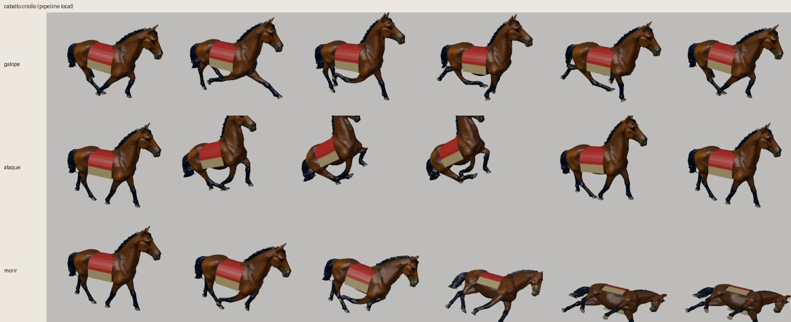
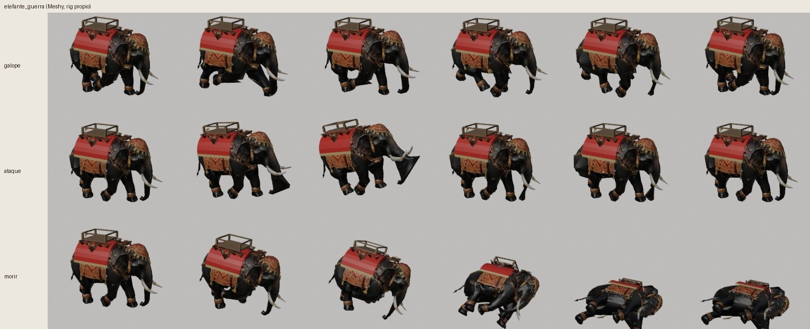
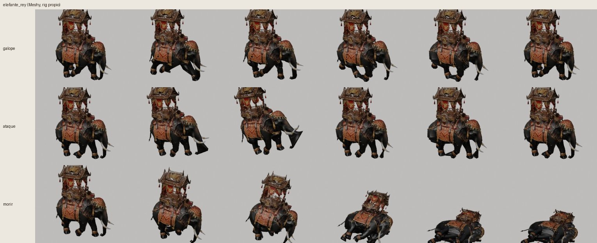
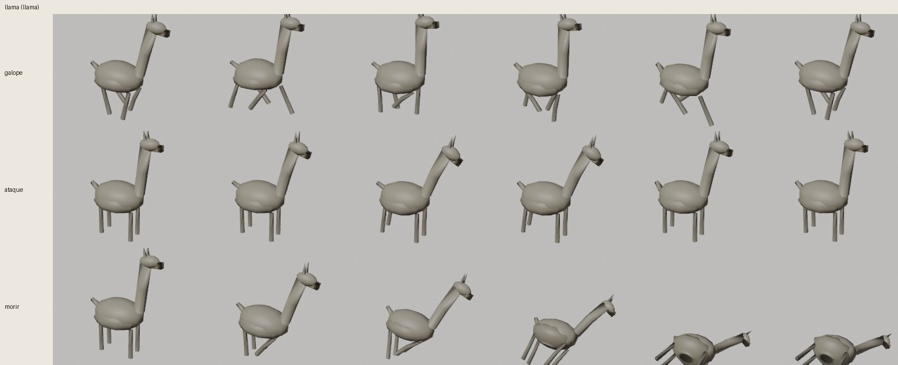
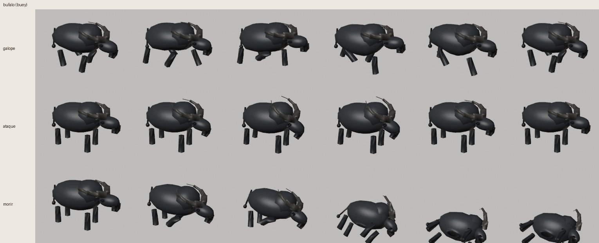
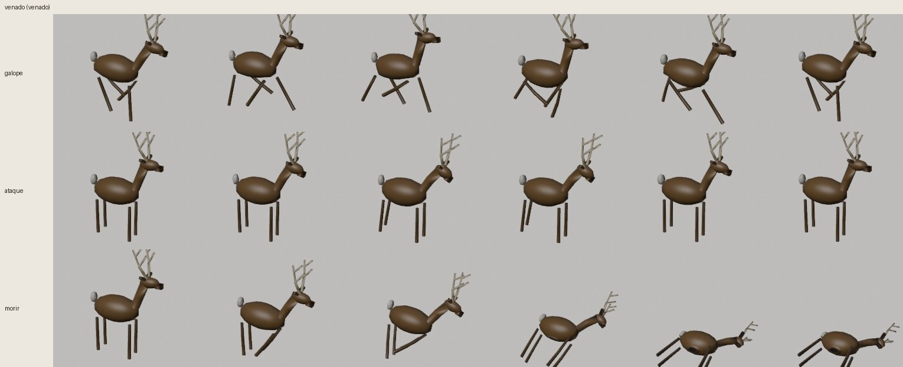
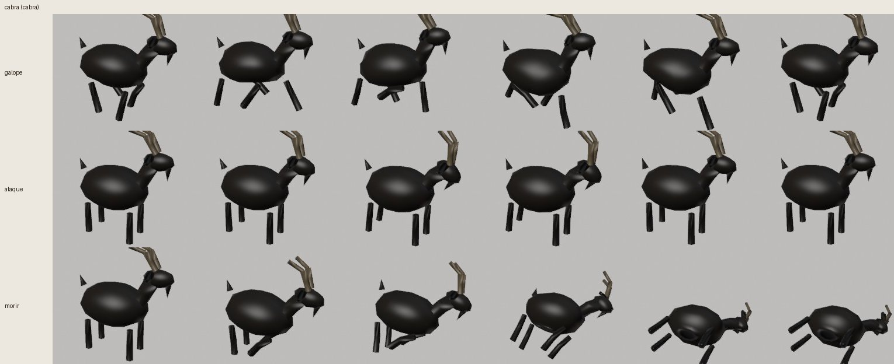
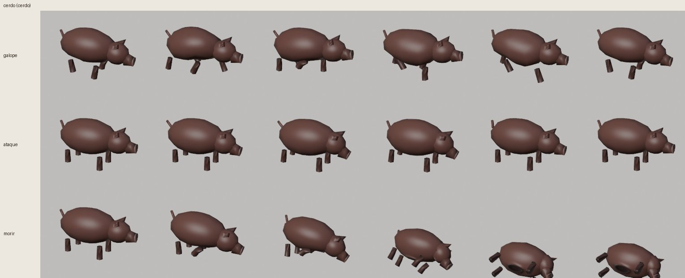
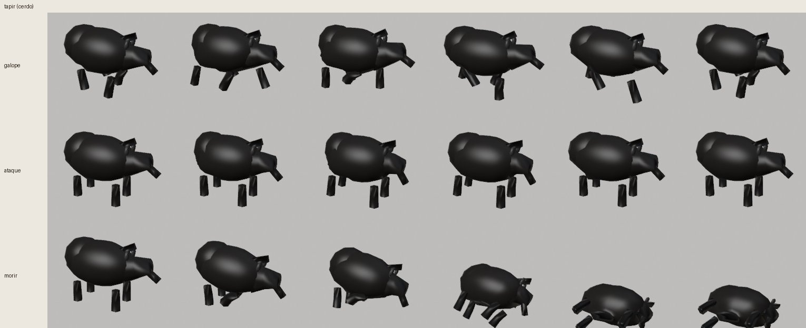

## 3. Jinetes

El jinete es la misma figura de `AldeanoAnimado` que el soldado a pie del pueblo (el modelo de Meshy del proceso 62, con su máscara roja que toma el color del equipo, o la figura de KayKit con su equipo), creada con `crear_jinete` y colgada de un `BoneAttachment3D` en el hueso `silla`:

- **Sentado:** de cada animación que puede hacer montado (`montados.jinete.acciones`) se arma una variante `<animación>@m` con las piernas a horcajadas (`muslo_grados` 72 hacia adelante, `piernas_abiertas_grados` 30, la canilla colgando) y la cadera quieta; el cuerpo de arriba es el de KayKit: golpe de maza, estocada con lanza, arco, jabalina, arcabuz. Las variantes se arman una vez y se retargetean a cada modelo de Meshy con el resto de la biblioteca.
- **Sincronía:** el vaivén lo da el lomo del animal (el jinete cuelga del hueso). El jinete pega con el reloj de ataque de la gente (cada golpe de la simulación lo lleva al momento del impacto); el animal hace su ataque cada `ataque_cada` golpes y si no, se queda quieto. Al morir, el animal cae de costado y el jinete cae sentado con él. La reacción al golpe va en los dos.
- **Color del equipo:** el jinete (máscara roja del modelo de Meshy, o la tela de KayKit) y la manta.

## 4. Elefantes de Ayutthaya

- **Chang suek:** el elefante de Meshy con el busabok recortado, howdah de madera y manta del equipo; el **mahout** es un aldeano del pueblo (modelo de Meshy del proceso 57) sentado en `cuello_asiento`, y en el howdah va el **ngao** (guja, estocada a dos manos).
- **Elefante del rey:** el modelo de Meshy entero, con esqueleto; el busabok, la bandera y el mahout que trae van rígidos con el lomo.

## 5. Conexión y rendimiento

- `data/arte_animaciones.json → montados.unidades`: una línea por unidad (`"chang_suek": { "montura": "elefante_guerra", "jinete": "ngao", "mahout": true }`); `civ:tipo` pisa a `tipo` (el jinete noble etíope). Sin la línea, la figura de antes. `montados.activo: false` o `--montados=0` apaga todo; `animales.activo: false` deja los animales como antes.
- `src/game/cuadrupedo_animado.gd`: carga cada GLB una vez; la `AnimationLibrary` de la escena importada la comparten todas las instancias del mismo modelo (y la de los jinetes, todas las figuras del mismo soldado, como antes). Cada animal tiene su esqueleto y su reproductor, avanzado a mano: fuera de la pantalla no se anima, lejos a la mitad de cuadros, y con más de `rendimiento.max_por_cuadro` (30) en pantalla, por turnos.
- **FPS** ([pruebas/fps_montados_1.txt](pruebas/fps_montados_1.txt), [sin montados](pruebas/fps_montados_0.txt)): 60 jinetes y 10 elefantes en pantalla, la mitad peleando y la otra marchando: **58,5 fps** (vista 3,8 ms por cuadro, animales 0,74 ms) contra 53,9 fps con las maquetas (vista 2,5 ms; las dos medidas con el torneo de la etapa 35 corriendo al lado). Sin presupuesto por cuadro eran 52 fps y 2,1 ms.

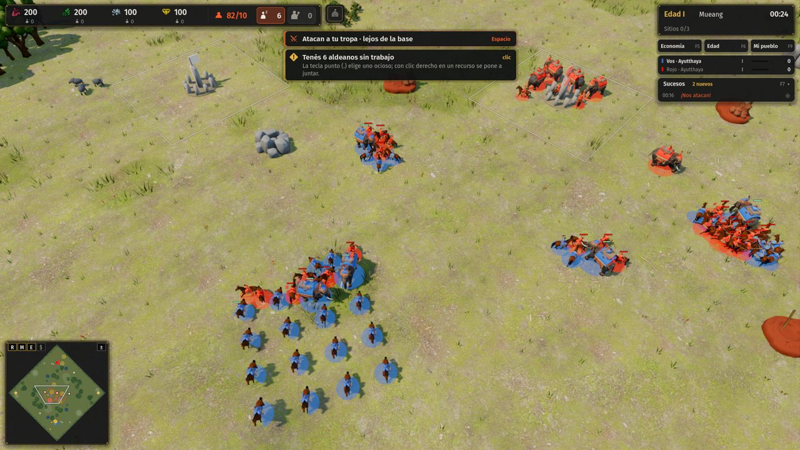

## 6. Batallas por pueblo

Los montados de cada pueblo, en dos equipos, a los 4,5 s del choque (`tools/montados.gd --modo=batalla`):

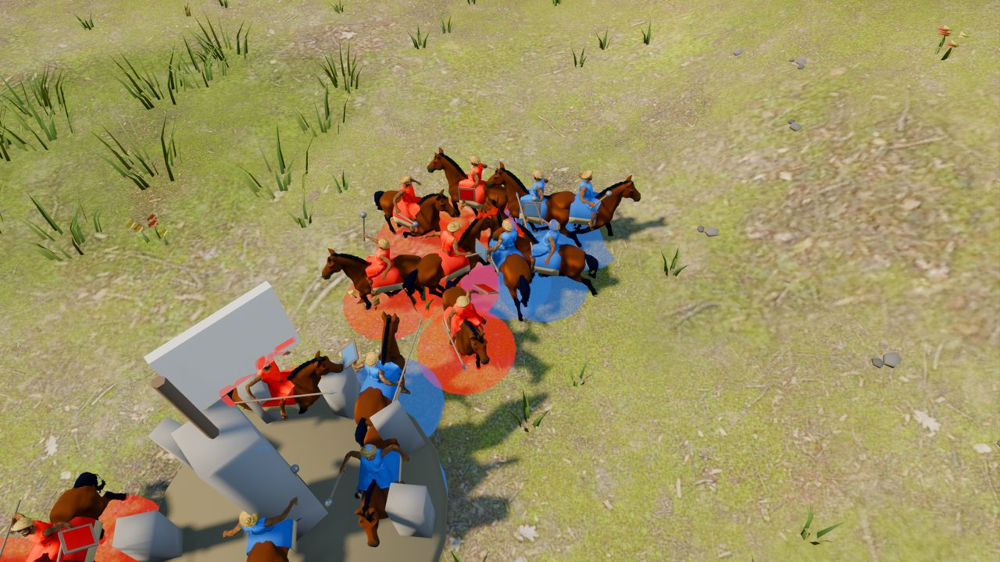
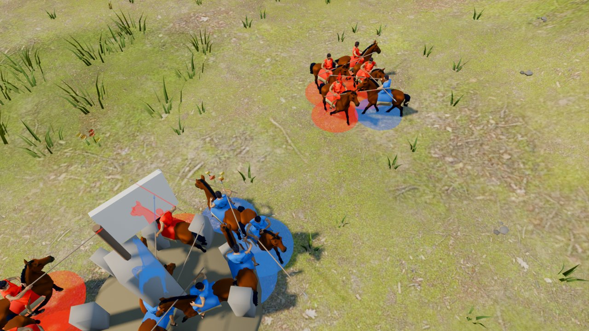
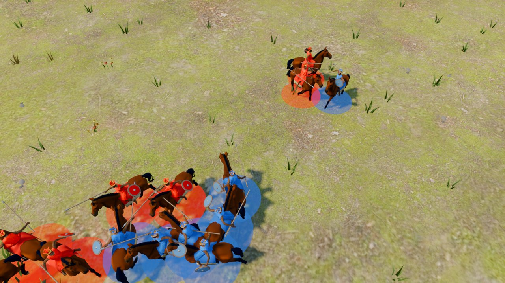
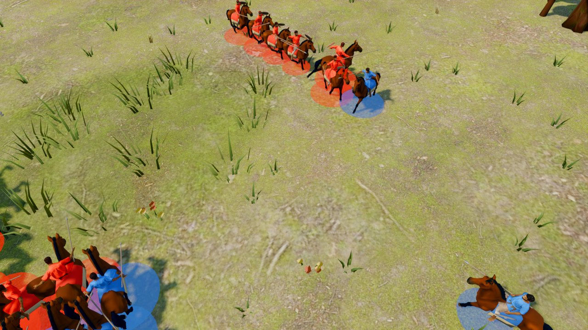
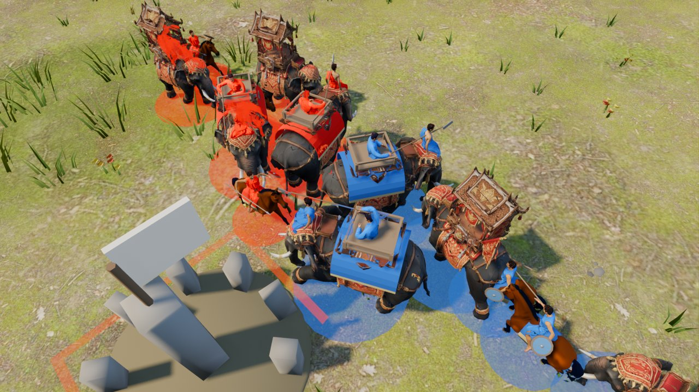

Rebaños al empezar la partida (búfalos de Ayutthaya, llamas del Tawantinsuyu):

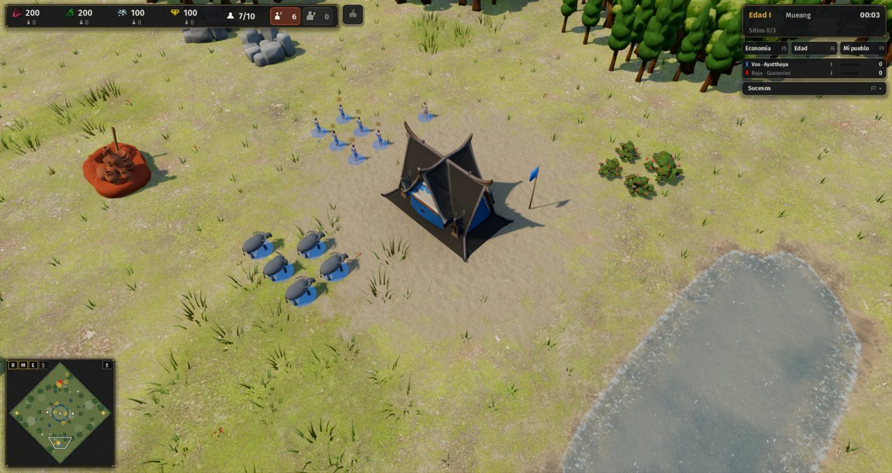
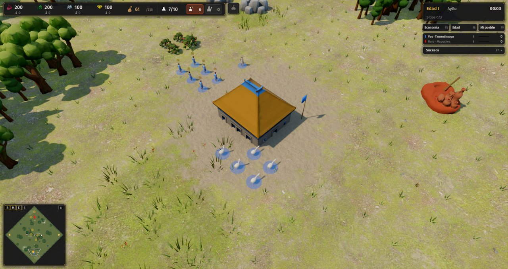

## 7. Tropiezos

- **GPU ocupada:** el pipeline local (FLUX + Hunyuan) iba a hacer el elefante de guerra, la llama, el buey, el venado, la cabra y el cerdo. FLUX pintó la referencia del elefante, pero Hunyuan se quedó sin VRAM: dos ventanas del juego abiertas por agentes usaban 3,7 GB de los 8. No se pudieron cerrar desde acá, así que los animales salen de la silueta procedural del juego, exportada y riggeada (sin GPU), y el elefante de guerra del de Meshy recortado. Las seis piezas quedan listas en `data/gen3d_piezas.json` para cuando la GPU esté libre: `tools/gen3d_pipeline.py elefante_guerra,llama,buey,venado,cabra,cerdo`; después basta con apuntar `modelos` o `especies` a los GLB nuevos.
- **Bone heat** no pudo con el elefante de Meshy (17 370 vértices, ninguno con peso): con el hueso más cercano salían púas de la tela que cuelga entre las patas. Se agregaron los pesos por zonas.
- **La cabeza del elefante:** el extremo más alto era la bandera del busabok, no la cabeza; el modelo dice ahora hacia dónde mira (`cabeza: -y`).
- **La manta no seguía al lomo:** el hueso `silla` no deformaba; ahora deforma solo los arreos.
- **Medir el paso:** primero se tomaba como apoyada la pata en lo más bajo de su recorrido, pero al doblar la rodilla el menudillo casi no sube y contaba también la vuelta; se mide lo que va hacia atrás.
- **Los elefantes salían naranjas:** la silueta del equipo (que se ve cuando un árbol tapa a la unidad) se disparaba con el propio cuerpo del elefante, más grande que el margen de 0,35 casillas; ahora el margen va con el alto del animal.
- **Otro agente en la misma carpeta** (etapa 65, recintos) tenía cambios sin commitear en `world_view.gd` y `main.gd`: los commits de esta etapa llevan solo sus propios bloques.

## 8. Mallas para mejorar (candidatos a Meshy)

1. **Caballos por pueblo** (el criollo del pipeline sirve para todos, pero tiene la cara simple y no lleva arreos propios): el caballo etíope enjaezado y el mapuche con su apero.
2. **Elefante de guerra limpio**: el recortado conserva la gualdrapa roja del elefante del rey; uno con el lomo desnudo dejaría ver mejor el howdah y la manta.
3. **Llama y búfalo**, los rebaños que más se ven, y **un ciervo**: hoy son las siluetas procedurales con esqueleto. Con el pipeline local (gratis) cuando la GPU esté libre; Meshy solo si no alcanza la calidad.

## Pruebas

| Prueba | Resultado |
|---|---|
| `tests/test_determinism.gd` | OK, hash **3617052205**, el mismo de antes: es solo imagen ([salida](pruebas/determinismo.txt)) |
| `tests/civ_smoke.gd` | sin errores ([salida](pruebas/civ_smoke.txt)) |
| `tests/iconos.gd` | OK, 780 grillas ([salida](pruebas/iconos.txt)) |
| `tests/grilla.gd` | OK ([salida](pruebas/grilla.txt)) |
| Autotest con ventana, Ayutthaya en llano | AUTOTEST: OK ([salida](pruebas/autotest_ayutthaya.txt)) |
| Paso contra velocidad | peor patinada 0,0 % ([salida](pruebas/paso.txt)) |
| FPS, 60 jinetes y 10 elefantes | 58,5 fps ([salida](pruebas/fps_montados_1.txt)) |

## Commits

- `c3602b4` rig general de cuadrúpedo, datos del andar y modelos riggeados
- `b7a51a2` montados y animales animados en el juego
- `7f9b879` presupuesto por cuadro y silueta propia de los animales grandes
- este: proceso, índice y estado
