# 64 · Terreno, caminos y árboles

## Pedido (2026-11-28)

Lo que el autor vio jugando:

1. **Todavía no es 3D:** los caminos (el Qhapaq Ñan), los muros, las puertas, las torres del muro, las granjas y los andenes seguían siendo la maqueta procedural. A eso se suman 18 edificios que esperan créditos de Meshy (lista de `proceso/58`), que **no** entran acá.
2. **Terreno:** los caminos no siguen el suelo cuando hay desnivel, y los edificios tampoco. Todo tiene que adaptarse al terreno.
3. **Árboles:** la escala se ve mal al lado de la gente. En `proceso/59` se achicaron la gente y los edificios; los árboles no.

Tareas: piezas por casillas en 3D con un estilo por pueblo (caminos, muros y empalizadas con tramos, esquinas, puertas y torres, campos con el cultivo de cada pueblo, andenes en terrazas), sin Meshy; todo apoyado en el terreno; los árboles medidos en aldeanos contra el AoE4 y contra el tamaño real; una medición de FPS con una base grande.

## Resultado

- **Piezas por casillas en 3D**, armadas en Godot con texturas (`src/game/piezas.gd`, estilos en `data/arte_piezas.json`). Cada pieza mira a sus vecinas y se une: tramo, esquina, T, punta y diagonal salen solas del mismo código.
  - **Muros de piedra** con talud, que entran en el suelo y siguen la ladera con el techo inclinado: pirca de piedra de campo y lajas arriba (Tawantinsuyu), piedra parda de la amba con torres redondas (Etiopía), ladrillo con almenas en hoja, *bai sema* (Ayutthaya), sillares (la común) y el Jugol revocado (Adal).
  - **Empalizadas** por pueblo (reglas de `proceso/58`): palos sin labrar, desparejos y atados, sobre el terraplén del foso (mapuches); doble empalizada de tacuara con terraplén (guaraníes); estacada de troncos aguzados con estrepes al pie (Palmares); troncos aguzados (la común).
  - **Puertas** de piedra con jambas, dintel y hojas de madera (trapezoidal en la portada inca) y de palos con travesaño; **torres** sobre el muro. Las dos llevan **paños del color del jugador** en las caras, sin mástiles (nota de arte 3 de `proceso/59`).
  - **Caminos** pintados en el suelo: siguen el terreno al centímetro, se unen solos entre casillas (también en diagonal y en cruce) y llegan hasta las puertas. El **Qhapaq Ñan es empedrado** (losas y cordón de piedras al borde); los demás pueblos, **huella de tierra** con rodadas. En obra se ve la huella de tierra.
  - **Campos** que siguen el suelo, con surcos y el **cultivo de cada pueblo**, que crece por etapas (brote, verde, espiga, maduro) con el mismo ciclo de antes: maíz (Tawantinsuyu y guaraníes), quinua (mapuches y andenes), mandioca (Palmares), tef (Etiopía) y **arrozales con agua** entre los bordos (Ayutthaya). El crecimiento lo hace el shader (`cultivo.gdshader`): cada mata queda apoyada en su suelo.
  - **Andenes**: tres terrazas de pirca que suben con la ladera, con su cordón de piedra en el filo; en el llano, escalones bajos.
- **Terreno:**
  - Caminos, campos, andenes y muros siguen la malla del terreno (`WorldView.height_tri`, los mismos dos triángulos por casilla que dibuja el suelo).
  - **Edificios:** un edificio nuevo ya no le mueve el suelo a uno viejo (antes el aplanado del segundo dejaba al primero flotando o hundido de un lado): las huellas aplanadas quedan fijas y el vecino toma su altura. Cada edificio tiene un **cimiento** hundido del tamaño de la huella, que no se ve en el llano y tapa el aire donde el suelo no se pudo aplanar (la orilla, el borde de otro edificio). Los modelos no se estiran para esto.
  - **Suelo pisado** bajo cada edificio (nota de arte 1 de `proceso/59`): una calcomanía de borde irregular que sale media casilla de la huella, sigue el terreno y tiene el color de cada pueblo (tierra apisonada en los incas, negra en los mapuches, roja en guaraníes y Palmares, parda en Etiopía, ladrillo y barro en Ayutthaya). Solo pinta el terreno, no la gente.
  - **Suelo un punto más oscuro y menos saturado** (nota de arte 2): `data/ambiente.json → suelo.valor` 92 % y `saturacion` 84 %.
  - Árboles, arbustos y piedras de alrededor vuelven a apoyarse en el suelo cuando un edificio lo aplana (antes quedaban flotando o enterrados), y los campos y muros vecinos se rehacen.
- **Árboles:** medían 4,5 a 5,8 aldeanos (hasta 7,8 los más grandes); ahora **3,8 a 4,8** (copa plana 2,7), como el AoE4 (3,5 a 5). Copas más angostas (de 2,2 a 1,9 casillas) y arbustos de 1,2 a 0,9 aldeanos. Entre los árboles se ve más suelo y la gente se distingue.
- **Rendimiento:** con una base de 30×30 (120 tramos de pirca, puertas, torres, 60 caminos, 44 granjas y 72 andenes con cultivo) y bosque alrededor, **31,7 fps contra 31,3 con la maqueta**, y la mitad de objetos dibujados (los caminos no tienen malla).
- **Determinismo igual** (3617052205, el mismo de `proceso/61` y `62`): todo es imagen.

## Inventario: lo que sigue siendo maqueta

| Qué | Pueblos | Por qué |
|---|---|---|
| Los 18 edificios de la lista de Meshy (`proceso/58`) | Todos | Esperan créditos; no entran acá |
| Corral | Mapuches | Recinto con animales; sigue la caja con cerco de palos |
| Gult | Etiopía | Finca de 4×4 con choza; podría ir al campo con tef y una choza (queda para otra etapa) |
| Hoyo con estacas, fojo con estrepes | Mapuches, Palmares | Trampa de 1×1 que casi no se ve; sin cambios |
| Sitios sagrados | Mapa | Son del mapa y tienen su propio arte |
| Caminos de otros pueblos | — | Solo el Tawantinsuyu construye caminos; la huella de tierra está lista para quien los tenga (C-113) |

Pasaron a 3D: muralla (pirca, amba, ladrillo, sillar, Jugol), puerta de piedra, torre del muro, empalizada (cuatro estilos), puerta de palos, camino, granja (seis cultivos, arrozal con agua) y andén.

## Paso a paso

### 1. Capturas de antes

`--demo=piezas` (nuevo, en `main.gd`) busca la ventana más quebrada cerca de la base propia, la despeja y arma un recinto de muro (o empalizada) con puertas en el medio de cada lado y torres en las esquinas, un tramo en diagonal, caminos en cruz que salen por una puerta, granjas y andenes en los cuatro cuartos, casas en la orilla y en la ladera, y aldeanos (uno por campo, así el cultivo crece). `--lado=N` cambia el tamaño del recinto; `--piezas=0` dibuja todo con la maqueta de antes, sin cimiento ni suelo pisado, para comparar en la misma escena.

### 2. Piezas por casillas (`src/game/piezas.gd`)

- **Uniones:** la vista guarda qué pieza de muro o camino ocupa cada casilla (`WorldView._pieza_en`). Una pieza se une con sus vecinas de los cuatro lados y con las diagonales que no tienen una esquina en L (así un trazo en diagonal se une punta con punta). Cuando aparece, se va o cambia una pieza, las vecinas se rehacen. Los muros se unen con los del mismo dueño; los caminos, con cualquier camino y con las puertas.
- **Muros:** cada unión es medio lienzo del centro de la casilla al borde (o a la esquina, en diagonal), muestreado cada 12,5 cm: la base entra 45–50 cm bajo el punto más bajo del costado y el techo va a la altura del muro sobre el suelo de cada punto. En las esquinas, T y puntas, un pilar tapa la junta. El dibujo de la cara (`pieza_muro.gdshader`: sillar, pirca, ladrillo, revoque, tierra, madera) sale del largo a lo largo del muro y del alto en el mundo, así sigue sin corte de una casilla a la otra; el grano, de la textura de roca en triplanar.
- **Caminos:** una textura sobre el mapa (6 píxeles por casilla) guarda en cada píxel la distancia al eje del camino más cercano: R para las losas, G para la huella de tierra. `ground.gdshader` dibuja las losas (Voronoi), el cordón y las rodadas. Así no hay costuras, ni pelea de profundidad entre casillas vecinas, ni objetos de más.
- **Campos:** una malla de 6×6 puntos por casilla sobre el terreno; los surcos y el agua de los arrozales los dibuja `pieza_campo.gdshader` con la posición dentro del campo. El cultivo es una malla por campo, de matas apoyadas cada una en su suelo; `BaseLinda` le pasa al shader el alto y el color de la etapa (antes escalaba el nodo entero, que en la ladera hundía o levantaba las matas).
- **Andenes:** el eje que sube sale de la pendiente de la huella; cada terraza toma el punto más alto de su franja y queda por lo menos `escalon_min_cm` sobre la anterior; los muros de contención bajan hasta debajo del suelo.

### 3. Terreno y edificios

- `WorldView.height_tri`: la altura exacta de la malla del terreno (la bilineal de `height_at` queda hasta unos centímetros arriba o abajo dentro de cada casilla, y un camino pegado al suelo parpadeaba).
- `_flatten_footprint`: los vértices de una huella aplanada quedan fijos (`_bloqueado`); el aplanado de un vecino no los toca, y si la huella nueva toca una vieja toma su altura. Después, `_suelo_cambio` vuelve a apoyar árboles, arbustos, piedras, muros, caminos y campos del área.
- `_settle_building`: el suelo pisado del pueblo (`Decal` con `cull_mask` solo para el terreno, que ahora está en la capa visual 2) y el cimiento (`Piezas.cimiento`). Los muros, caminos y campos ya no aplanan el suelo: lo siguen.

### 4. Árboles

`tools/medir_paisaje.gd` mide cada modelo del paisaje en aldeanos con la escala de los datos y la variación de cada instancia ([salida](pruebas/medir_paisaje.txt)).

| Modelo | Antes (aldeanos) | Ahora | AoE4 (capturas del autor) | Real (adulto 1,6 m) |
|---|---|---|---|---|
| Ciprés andino | 5,3 | **4,4** | árbol de copa: ≈3,5 | 10–15 m: 6–9 |
| Latifoliada | 4,5 | **3,8** | ≈3,5 | 8–15 m: 5–9 |
| Araucaria | 5,4 | **4,5** | — | 30–50 m |
| Palmera (pindó) | 5,8 | **4,8** | palmera: ≈4,5 | 10–20 m: 6–12 |
| Queñua (copa plana) | 3,2 | **2,7** | — | 4–8 m: 2,5–5 |
| Arbusto de bayas | 1,2 | **0,9** | ≈0,8 | 1–2 m: 0,6–1,2 |
| Piedra, arcilla, peñasco | 1,5 · 2,4 · 1,9 | igual | mina: ≈1 de alto, 2–3 de ancho | — |

**Cómo se midió el AoE4** (las capturas no se copian ni se suben): en la de la casa con la grilla a la vista, el aldeano mide ≈30 px; la palmera junto al corral, ≈135 px de la base a la copa (≈4,5 aldeanos) y ≈1,4 casillas de copa; el árbol de copa redonda junto a los aldeanos, ≈105 px (≈3,5) y ≈1,8 casillas de copa; los arbustos de bayas, 20–25 px (≈0,8). En la de la empalizada de madera, los postes miden ≈2 aldeanos y la palmera del fondo ≈5. Los árboles del AoE4 son más bajos que los reales: un RTS los comprime a la mitad para que la base se lea. El nuestro queda en el medio del rango del AoE4, con la araucaria y la palmera arriba (son los árboles altos de su paisaje).

**Cambio en datos** (`data/reglas.json → escala_visual`): `arbol_alto_pct` 150 → 125, `arbol_ancho_pct` 125 → 105, `arbusto_alto_pct` 75 y `arbusto_ancho_pct` 95 (nuevos). Densidad del bosque: la misma (una casilla por árbol); con las copas más angostas se ve el suelo entre los troncos y la gente se lee, con la silueta del color del equipo cuando la tapa un árbol (`proceso/24`).

## Capturas

Antes y después en la misma escena. Las de «maqueta» son con `--piezas=0` en el mismo código.

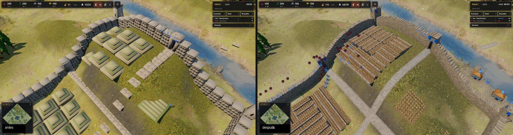

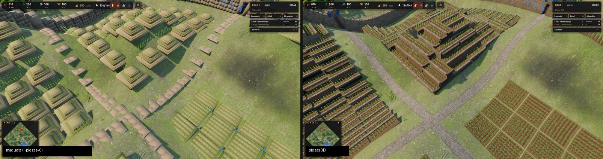

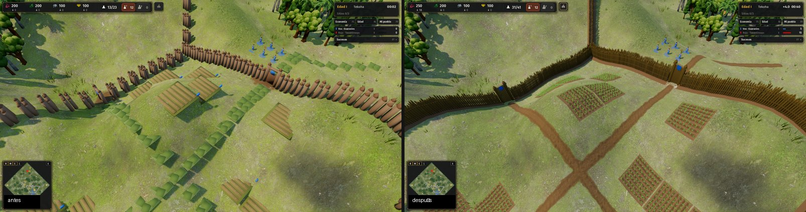

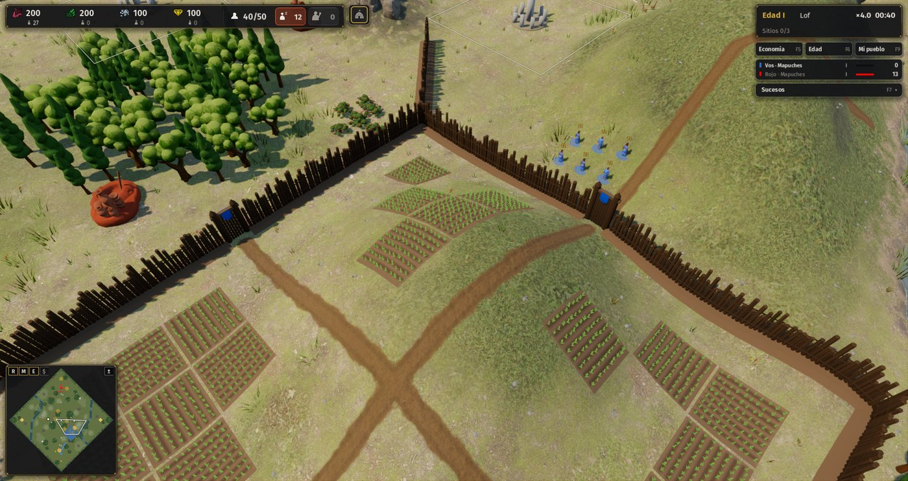

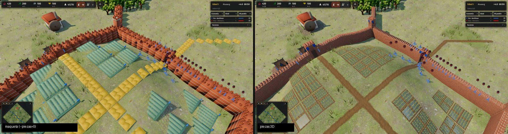

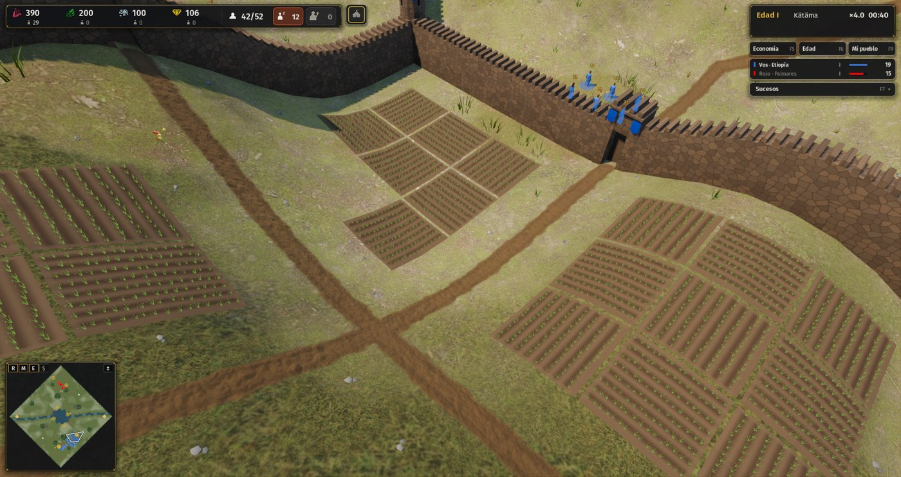

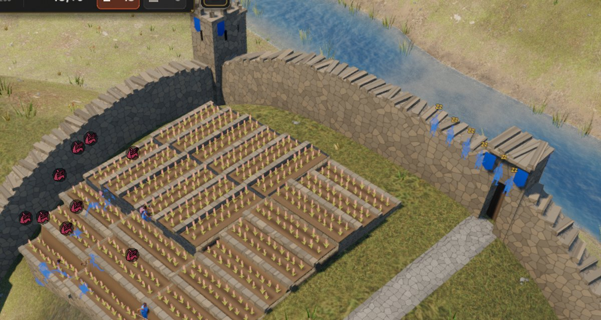

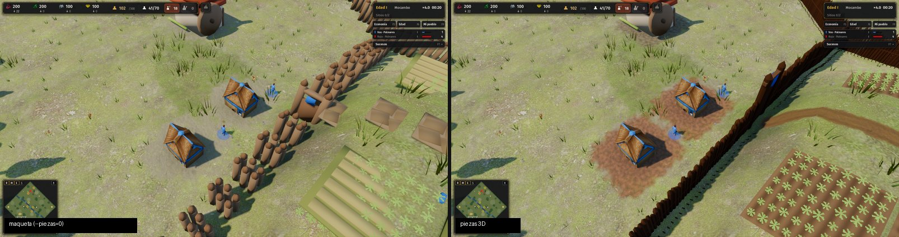

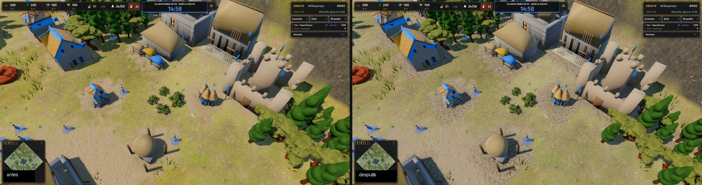

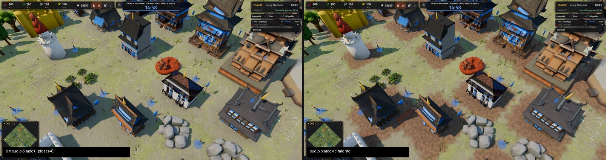

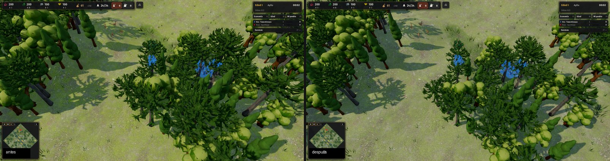

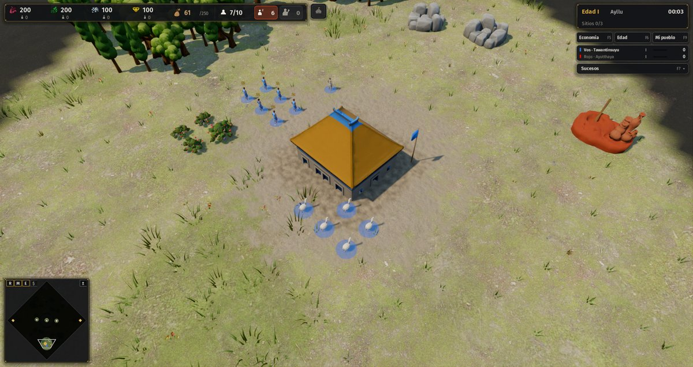

## Rendimiento

`--demo=piezas --lado=30 --civ=tawantinsuyu --terreno=sierra --perf`, dos corridas alternadas con y sin piezas ([salida](pruebas/fps.txt)). En la misma GPU estaban el juego del autor y una prueba de FPS de otro agente, así que los valores absolutos son bajos; lo que importa es la comparación.

| | FPS (media de 16 muestras) | Objetos dibujados |
|---|---|---|
| Maqueta (`--piezas=0`) | 31,3 | 5.000–5.800 |
| Piezas 3D | **31,7** | **2.400–3.300** |

Cada tramo de muro es una malla propia (antes era la misma malla repetida): el mismo número de objetos, y menos superficies porque cada pieza tiene uno o dos materiales. Los caminos no agregan objetos.

## Pruebas

| Prueba | Resultado |
|---|---|
| `test_determinism` | OK, hash **3617052205, igual** al de `proceso/61` y `62` ([salida](pruebas/determinismo.txt)) |
| `civ_smoke` | OK, sin errores ([salida](pruebas/civ_smoke.txt)) |
| `iconos` | OK, 780 grillas ([salida](pruebas/iconos.txt)); los avisos de `_ubicar_investigaciones` son de antes |
| `grilla` | OK ([salida](pruebas/grilla.txt)) |
| `casillas` | OK, 628 grillas ([salida](pruebas/casillas.txt)) |
| Autotest con ventana (Tawantinsuyu, llano) | OK, **258 controles**, a la primera ([salida](pruebas/autotest_tawantinsuyu.txt)) |
| Capturas en lomas | valle, sierra, montaña y río, con los seis estilos (arriba) |

## Tropiezos

- La clase nueva (`Piezas`) no la veía nadie hasta reimportar el proyecto (`godot --headless --path . --import`): Godot guarda los `class_name` en una caché.
- El estilo del muro mezclaba los datos de `arte_edades.json` (donde `piedra` es el color) con una marca propia que se llamaba igual: los muros salían sin color. Ahora la marca es `es_piedra`.
- El primer cimiento salía 12 cm por fuera del cuerpo y asomaba 6 cm: bajo los modelos del pipeline, que llenan menos que la huella, se veía como un piso de tablas. Ahora es del tamaño de la huella y queda 3 cm por debajo del suelo: solo se ve donde hace falta.
- Los andenes con escalones mínimos de 24 cm parecían pirámides en el llano; quedaron en 12 cm. Las lajas sueltas en el filo se leían como tejas: las reemplaza un cordón continuo.
- Los arrozales salían como baldosas de vidrio (agua clara y muy brillante): agua más turbia y verde, y el arroz más alto.
- Las caras de doble lado: Godot da vuelta la normal en la cara de atrás según el orden de los vértices; los shaders nuevos la vuelven a poner, así no hace falta cuidar el orden.
- Los círculos rojos con un ícono que aparecen junto a los muros en algunas capturas también salen con `--piezas=0`: no son de esta etapa.
- No hubo captura de una casa justo en la orilla (la demo la busca, pero en las semillas probadas no quedó ninguna pegada al agua); el muro inca del valle baja por la orilla del río y queda apoyado.

## Commits

- `5b8eb61`: piezas por casillas, terreno, cimiento, suelo pisado y árboles.
- Este commit: capturas, FPS, pruebas, índice, estado y consultas C-113 y C-114.
