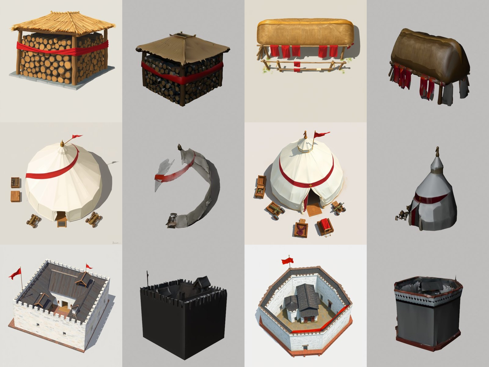
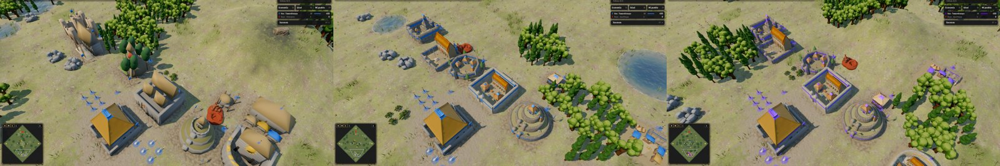
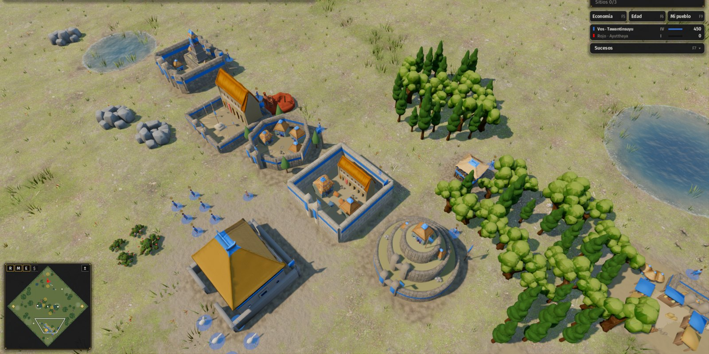
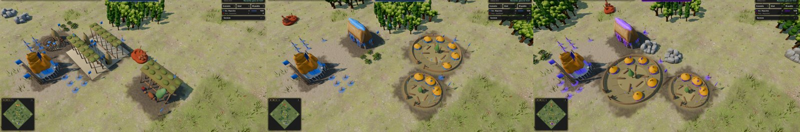
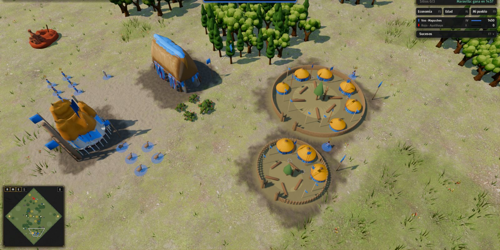
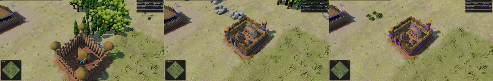
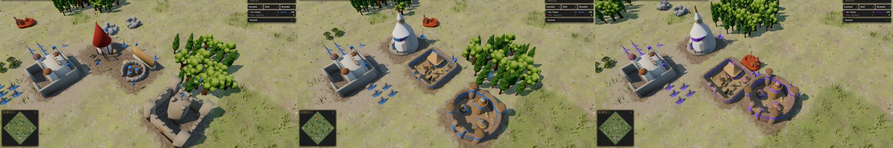
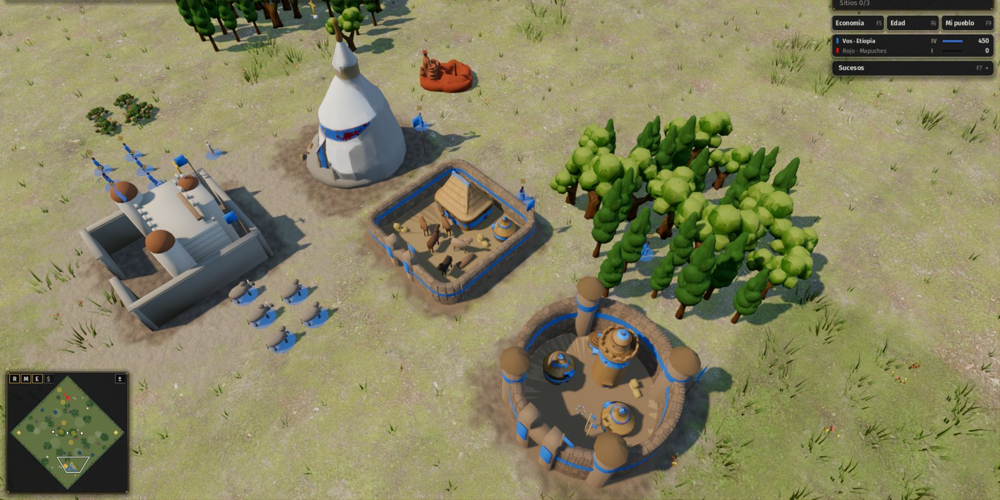
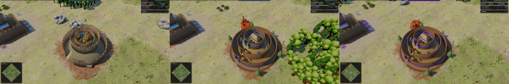
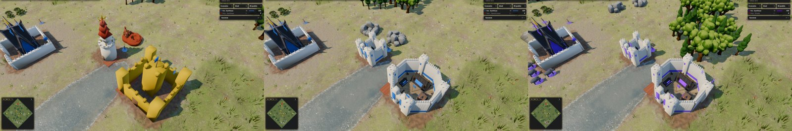

# 65 · Recintos armados por partes y reintentos locales

> **Pedido del autor (2026-11-28):** hacer en local, sin Meshy, los 18 edificios que quedaron como «candidatos a Meshy» en `proceso/58`. Hunyuan convierte los patios amurallados y los anillos en barriles o cajas, así que **no se le pide el conjunto entero**: el recinto se arma por partes (un cerco procedural que sigue la huella, de una a seis piezas del pipeline adentro y la utilería del patio). Los cuatro edificios sueltos que fallaron se reintentan con el pipeline, dos veces como mucho, con una referencia mejor. Cada pieza entra con un renglón y en la escala de su huella; capturas por pueblo en dos colores.

## Resultado

- **Los 18 candidatos de `proceso/58`, en el juego**, cada uno con un renglón de `data/civs/<pueblo>.json → estilo.modelos`:
  - **15 recintos armados por partes** (`"<tipo>": "recinto/<clave>"`): qorikancha, pukara mayor, aqllawasi, Vilcabamba, kallanka real, fortaleza y mercado incas; parlamento y maravilla mapuches; fortaleza guaraní; fortaleza y remonta etíopes; maravilla de Palmares; fortaleza y fortín de río de Ayutthaya.
  - **3 modelos del pipeline rehechos** (`"<tipo>": "local/<modelo>"`): la leñera inca, el kawellu mapuche (sin cruz) y la tienda de la alianza etíope (blanca, con una sola faja del color).
  - El fortín de Ayutthaya falló dos veces en el pipeline (las dos veces, una caja de muros negros) y pasó a recinto.
- **Color del equipo** en una faja sobre el muro y en los paños de la puerta. Lo sagrado no lleva color: el Qorikancha va sin faja, y las telas rojas de sus salas toman un dorado fijo.
- **Muros de las piezas modulares del proceso 64:** al entrar `src/game/piezas.gd` a main, los muros macizos usan su material (`Piezas.mat_muro`: pirca, sillar, revoque) con el dibujo continuo a lo largo del anillo.
- **Prueba de rendimiento:** mismo FPS con los recintos que con las maquetas. El hash no cambia (3617052205).

## Método

### El recinto por partes (`src/game/recintos.gd`, `data/arte_recintos.json`)

Hunyuan cierra en barriles o cajas los patios y los anillos vistos desde arriba: con una sola vista no hay cómo dar la profundidad del patio (`proceso/58`). Por eso el conjunto no se le pide al 3D: se arma en el juego con tres partes, todas por datos.

1. **Cerco procedural.** Uno o varios anillos que siguen la huella, con la forma que corresponde:
   - rectángulo, con o sin esquinas redondeadas;
   - elipse;
   - polígono regular o irregular;
   - **D** (frente recto y fondo curvo: el muro curvo del Qorikancha);
   - **dientes** (los muros en zigzag de Saqsaywaman).
   
   Cada anillo lleva su material, su alto, su puerta (jambas, dintel, en la piedra inca trapezoidal), torres, terrazas rellenas (el pukara) y la faja del equipo. Los materiales:
   - muros macizos: pirca, piedra fina (con la faja de oro fija del Qorikancha), pirca parda, ladrillo encalado con almenas en hoja (*bai sema*);
   - empalizada (con foso y estrepes), tacuara;
   - cerco bajo de palos (mapuche).
   
   Un cerro (`monte`) levanta el suelo de los anillos, las piezas y la utilería: así sale Palmares.
2. **Piezas del pipeline local**, de 1 a 7 por recinto: casas, salas, depósitos y torres ya generados en `proceso/58` (`WorldView.glb_edificio`), con su color del equipo. Cada pieza se pone por datos: posición, lado, giro (o «mirando al centro»), alto, escala y color. Con `"equipo": false` va sin color; con `"#rrggbb"`, sus telas rojas toman un color fijo, que es lo que se usa en lo sagrado.
3. **Suelo y utilería.** El patio (enlosado, apisonado) y la tierra pisada de borde suave. La utilería:
   - puestos con techo de paja o paño del equipo;
   - pilas de leña, piedras, vasijas, fardos;
   - fogones, troncos para sentarse, lanzas con banderola, estandartes;
   - rewe, canelo, pila de agua con borde de oro, telares;
   - cañones, caballos, llamas, abrevadero, platea (ushnu chico).

- **Un renglón por pieza:** `proceso/65-recintos-locales/conectar.py <pueblo> tipo=recinto/<clave>`. Para volver a la maqueta, `-tipo`.
- **Escala:**
  - el recinto mide lo mismo que el cuerpo del edificio (el lado menor de la huella menos el margen), y el pisado sale un poco más;
  - no se estira hasta el alto de la categoría: los muros quedan a la escala de la gente (un aldeano mide 62; la pirca, 90; la empalizada, 115);
  - tampoco lleva los adornos de la edad;
  - el estandarte del juego queda.
- **Caché:** cada recinto se arma una vez por tamaño. `WorldView._precalentar_recintos` arma los de los pueblos en juego al cargar la partida, así el primer recinto terminado no traba un cuadro (de 15 a 450 ms por tipo, sobre todo por cargar los GLB).
- **Para cambiar los muros por otros:** cada material de muro es una rama de `Recintos._tramo`. Si `materiales.<x>.patron` está puesto, la cara del muro es la de las piezas modulares del proceso 64 (`Piezas.mat_muro`), y la U del dibujo sigue el largo del anillo. Las torres, las puertas y la empalizada siguen siendo propias, porque las de `piezas.gd` se arman por casilla con sus vecinos y con la altura del terreno (`SimEntity` y conexiones). Para usar las de `piezas.gd` en un contorno curvo, habría que darles una función que arme un tramo entre dos puntos cualesquiera.

### Reintentos con el pipeline (`proceso/65-recintos-locales/piezas.py`, `piezas_65.json`)

- **Referencia más legible.** Vista de tres cuartos desde unos 40° (que se vean el techo, el frente y un costado), un solo cuerpo, y lo que tiene que tomar el color, en rojo plano y chico.
- **Dos semillas por pieza** (31 y 32), sin tocar `data/gen3d_piezas.json`. Los pasos:
  - `tools/gen3d_flux_lote.py --archivo …` (opción nueva) pinta las referencias;
  - `tools/gen3d_pipeline.py --piezas …` arma el modelo.

| Pieza | Intento | Resultado |
|---|---|---|
| Leñera inca (`almacen_madera`) | b (32) | **Entra.** Una pila cúbica de troncos con techo bajo de ichu en cuatro horcones y la faja en los postes (29 % de color). La a no salió: FLUX se quedó sin memoria de video. |
| Kawellu mapuche (`rewe_caballeria`) | b (32) | **Entra.** Galpón bajo de palos con techo de paja, sin cruz ni remate, y mantas en la baranda (24 %). Se estiraba hasta el alto de hito como un bloque: tope propio de 110 % en `reglas.escala_visual.estirar_modelo_max_por_modelo`. |
| Tienda de la alianza (`alianza`) | a (31) | **Entra.** Tienda blanca con una faja y banderolas (3 % de color, solo la faja). El intento b salió como una cáscara hueca. |
| Fortín de río de Ayutthaya (`torre`) | a y b | **No entra.** Las dos veces, una caja con muros negros: Paint no copia el encalado. Pasa a recinto (`recinto/ayutthaya_torre`): cuadrado encalado con *bai sema*, baluartes, la sala de la guardia, un cañón y banderas. |

## Pueblo por pueblo

En cada hoja: antes (la maqueta procedural, o el modelo que había), después en azul y después en violeta. Las capturas son de una partida real (`--demo=base_completa` con `--tipos=…`, nuevo: solo esos edificios), en la edad IV.

### Tawantinsuyu

- **Qorikancha:** muro en D de piedra fina con la faja de oro, dos salas y una kallanka adentro, pila de agua y vasijas en el patio enlosado. Sin color del equipo.
- **Pukara mayor:** tres anillos de pirca en terrazas, con casas y qollqa en cada terraza y la puerta abajo.
- **Aqllawasi:** kancha rectangular de piedra fina con la kallanka al fondo, el taller de tejido y una sala a los costados, y telares en el patio.
- **Vilcabamba:** muro irregular de pirca, cuatro casas y una qollqa, fogones y árboles alrededor.
- **Kallanka real:** la kallanka larga al fondo de una plaza con platea, lanzas y pirca baja.
- **Fortaleza:** muro en dientes y una terraza con la atalaya, casas y depósitos.
- **Mercado:** plaza abierta con cinco puestos de paja (dos con paño del equipo), qollqa, vasijas y llamas.
- **Leñera:** del pipeline.

### Mapuches

- **Parlamento:** campo abierto con cerco bajo de palos, tres rukas al fondo mirando al centro, canelo y rewe, troncos y lanzas.
- **Gran koyagtun** (maravilla, 6×6): seis rukas en ronda alrededor del campo.
- **Kawellu:** del pipeline, sin cruz.

### Guaraníes

- **Trinchera de tacuara:** empalizada de troncos con foso y estrepes, una segunda de tacuara y dos atalayas, con la casa de guerra y dos óga en el patio.

### Etiopía

- **Fortaleza de amba:** anillo de piedra parda con cuatro torres redondas de techo de paja, la torre del señor, dos gojjo bet y un granero.
- **Remonta:** corral de pirca parda con el färäs bet, caballos, fardos y bebedero.
- **Alianza:** la tienda nueva del pipeline.

### Palmares

- **Cerca do Outeiro da Barriga:** el cerro con tres anillos de estacada (el de afuera con foso y estrepes), la casa grande arriba y casas de pau a pique en las laderas.

### Ayutthaya

- **Pom:** octógono de ladrillo encalado con *bai sema*, cuatro baluartes, el cuartel, el polvorín, una casa y cuatro cañones.
- **Fortín de río:** el mismo muro en chico (2×2).

## Lo que todavía se ve flojo (y le vendría bien Meshy más adelante)

- **Las piezas de adentro son las del proceso 58, más chicas.** En el recinto, una casa mide la mitad que suelta. Las que ya se veían europeas, como la kallanka con ventanas del aqllawasi y del Qorikancha, se siguen viendo así. Un templo inca propio para el Qorikancha (sala de piedra fina con hornacinas) o un modelo de Meshy por pieza lo mejorarían.
- **La piedra fina** se lee como sillería pareja, no como el aparejo poligonal inca. Haría falta un patrón «poligonal» en `pieza_muro.gdshader`.
- **Torres y puertas** son cajas y cilindros con color por vértice, más planas que los muros con dibujo.
- **La tienda de la alianza** queda alta (se estira hasta el alto de hito) y lleva un broche dorado chico en la faja.
- **El fortín de Ayutthaya** es candidato a Meshy de verdad: el pipeline local no da el encalado.
- **El kawellu** es un galpón bajo y largo: con el tope de estiramiento queda bajo para un hito de 4×4.
- **El gran koyagtun**: en 6×6 las rukas quedan chicas.

## Pruebas

| Prueba | Resultado |
|---|---|
| `test_determinism` | OK, hash **3617052205, igual** (todo esto es solo imagen) ([salida](pruebas/determinismo.txt)) |
| `civ_smoke` | Sin errores ([salida](pruebas/civ_smoke.txt)) |
| `iconos` | OK, 780 grillas ([salida](pruebas/iconos.txt)) |
| `grilla` | OK ([salida](pruebas/grilla.txt)) |
| Autotest con ventana (`--autotest --civ=palmares --terreno=llano`) | OK, 250 controles, a la primera ([salida](pruebas/autotest_palmares.txt)) |
| FPS, base de la IV entera (`--demo=base_completa --perf`) | Tawantinsuyu: 94–101 FPS con los 7 recintos y 92–96 con las maquetas (1640 contra 1783 objetos dibujados). Palmares: 95–101. Durante la medición corría un torneo de 8 hilos de otro agente ([salida](pruebas/fps.txt)) |

## Tropiezos

- **FLUX sin memoria de video** en dos imágenes (la leñera a y la alianza a): otro agente sacaba capturas con Godot al mismo tiempo. La alianza a se repintó sola después. Hunyuan también falló una vez por lo mismo (la leñera), y se repitió al quedar libre la GPU.
- **Colores lavados** en la primera captura: el color por vértice de Godot se toma como lineal. Hizo falta `vertex_color_is_srgb`.
- **Rayas en los muros:** las tapas de cada tramo de 14 cm se pisaban con las del vecino. Se sacaron, porque los extremos los tapan las jambas.
- **Clase nueva sin registrar:** una `class_name` nueva pide `godot --headless --import` antes de correr scripts. Mientras tanto, `main.gd` no carga; lo mismo pasó con la clase nueva del agente de los montados.
- **Archivos compartidos con otros agentes:** `world_view.gd` y `main.gd` estaban a medio editar por el agente de los montados en la misma copia. Se esperó a su commit antes de commitear.
- **Proceso 64 en main a mitad de camino:** se pausó para el merge y después los muros pasaron al material de sus piezas modulares.

## Commits

- `1dad244` WIP: recintos y reintentos (antes del merge del proceso 64)
- (este) recintos con los muros del proceso 64, por pueblo, pruebas, índice y estado
