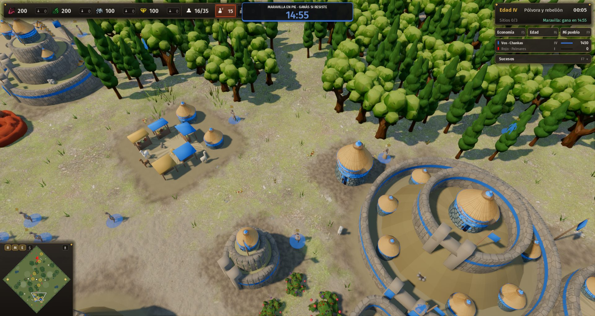
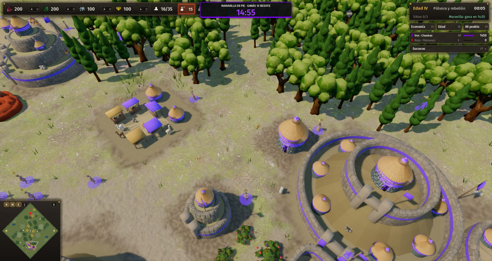
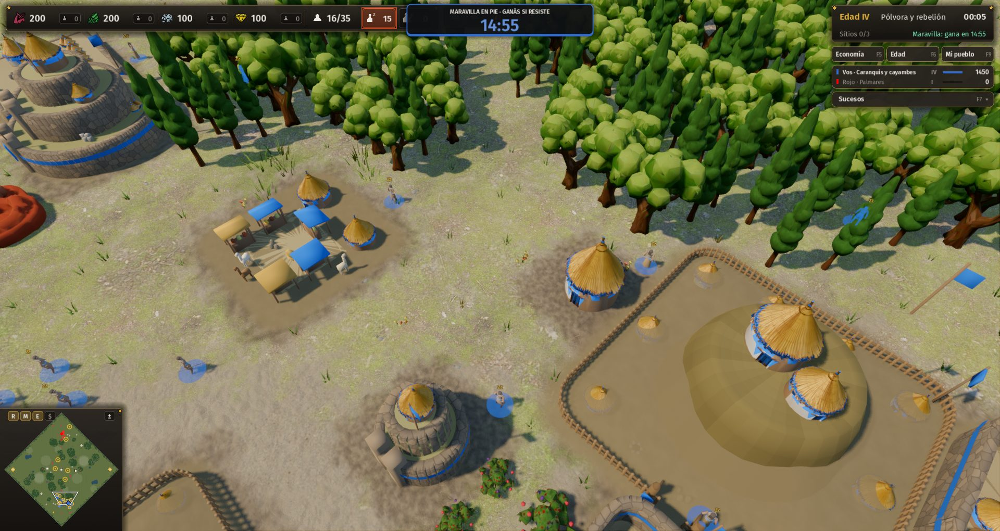
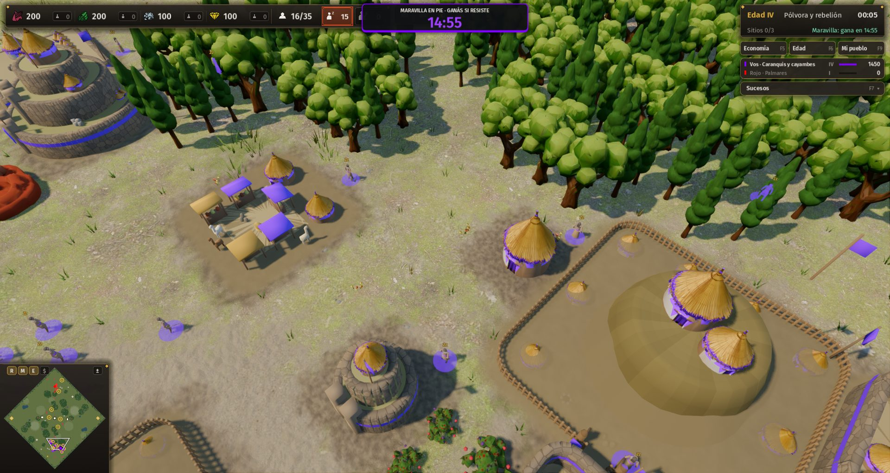
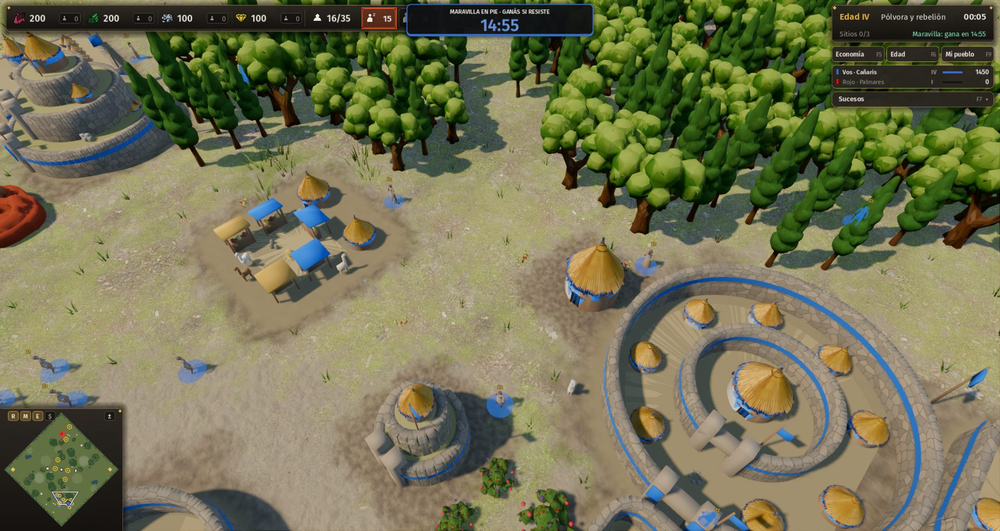
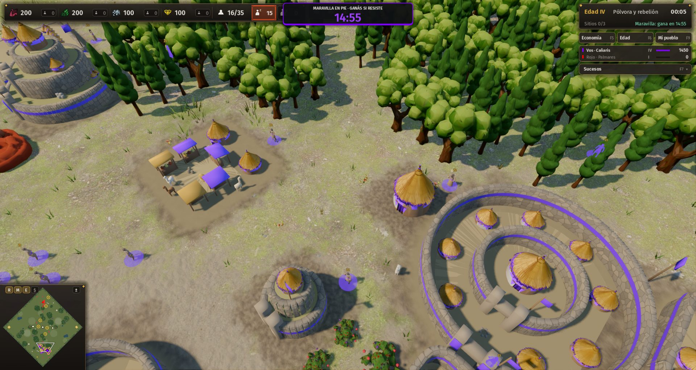
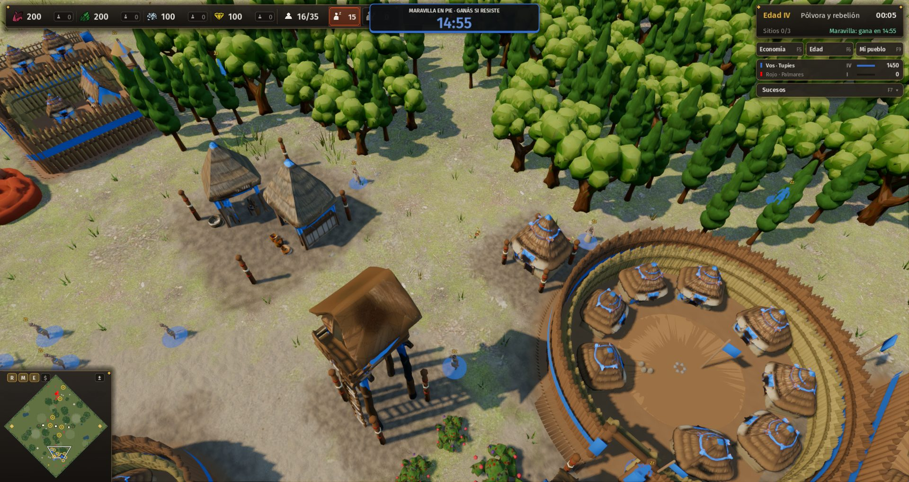
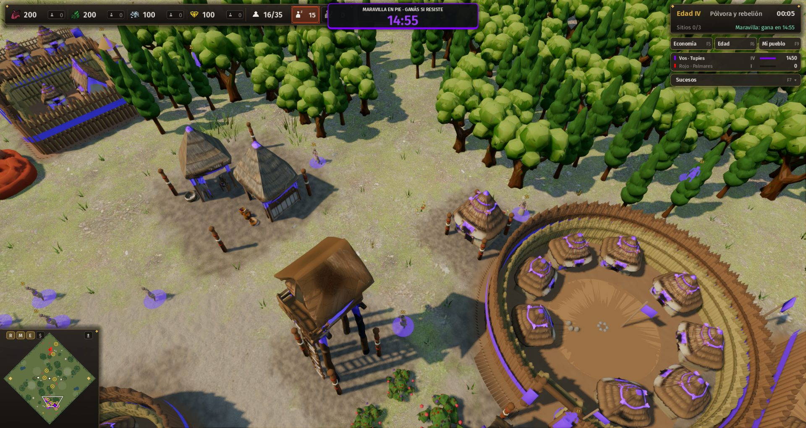

# 66 · Todo en 3D, en local

> **Pedido del autor (2026-11-28):** hacer en 3D LOCAL (gratis) todo lo que faltaba, aprovechando al máximo el pipeline local, y DOCUMENTAR qué es cada pieza y cómo se hizo, para poder rehacerla en Meshy más adelante. Inventario de todos los edificios de los 18 pueblos y de los neutrales; primero los neutrales y las sobras del proceso 64, después los seis jugables y por último los rivales solo de IA, con juegos compartidos (andinos sobre el inca, tupíes cerca del guaraní, un juego colonial común con detalles por potencia; Adal y Birmania propios). Catálogo de todas las piezas 3D (`docs/catalogo-3d.md` y `data/catalogo_3d.json`). Capturas por grupo en dos colores.

*(En curso: este README se completa grupo por grupo.)*

## Inventario

`inventario.py` arma la tabla desde los datos. Qué cuenta como «lo que el pueblo levanta de verdad»:
- **jugables:** `construye` más los seis hitos;
- **solo IA:** el `construye` del aldeano de `data/unidades.json` más fortaleza, maravilla y los dos hitos comunes (la IA los levanta: `src/sim/sim_ai.gd`), menos `sin_edificios`; las potencias que heredan de `invasores` toman lo de la base. Las campañas no agregan tipos: los rivales de las misiones (`faccion`) juegan con la IA y arrancan con su centro;
- **neutrales** (dueño -1): la feria en sus tres estilos (por terreno), el ingenio, el sitio sagrado y Lalibela.

Antes de este proceso ([tabla entera](pruebas/inventario_antes.md)): **local 86, recinto 15, pieza por casillas 94, maqueta 130**. Las 130 maquetas: 120 de los doce rivales (10 tipos cada uno), las 6 neutrales y 4 sobras de los jugables (corral y hoyo mapuches, gult etíope, fojo de Palmares).

## Método

- **Piezas sueltas con el pipeline** (`piezas.py` → `piezas_66.json`): un edificio por referencia, reglas históricas al frente del prompt, lo que toma el color en rojo plano y lo sagrado sin rojo.
- **Conjuntos con `recintos.gd`** (`recintos_66.py` → `data/arte_recintos.json`, 93 recintos nuevos): cerco, piezas del pipeline y utilería. Utilería nueva en `Recintos._prop`: bandera de colores fijos (por potencia), estacas (trampas), ovejas, caña, barriles, tienda, surcos, piedras paradas, muelle, canoa, agua e iglesia en cruz (Lalibela). Las piezas aceptan `"tinte"` (la misma casa con otro material).
- **Un renglón por edificio** (`conectar_66.py <grupo>`): en `data/civs/<pueblo>.json → estilo.modelos`; los neutrales en `data/arte_base.json → modelos_neutrales` (nuevo: `WorldView._modelo_de` los busca para el dueño -1). Solo conecta lo que existe.
- **Capturas** (`capturas.py <grupo>`): partida real con `--demo=base_completa --tipos=…`, edad IV, en azul y violeta. Nuevo en el demo: `--neutrales=…` (edificios del dueño -1) y la cámara al medio de lo puesto cuando hay `--tipos`.

## Grupos

### Andinos (chankas, caranquis, cañaris)

Casa redonda propia (los cañaris construían en planta circular, los incas en rectángulo): de piedra para los chankas, de bahareque para caranquis y cañaris. Lo demás, recintos con pirca, depósitos redondos (la qollqa inca) y lo propio de cada uno: la aldea de cumbre chanka y la imagen de Uscovilca (huaca sin color); la tola caranqui (cerro con la casa del señor) y el fuerte de cresta de Pambamarca; Guapondélig cañari.

### Tupíes

Oca, cuartel, depósito y mercado guaraníes (pueblos parientes); propios: la taba (ocas en ronda con doble empalizada), la caiçara, los hitos y el mirador de palos (pipeline).

### Sobras del proceso 64

Corral mapuche (palos, caballos, ovejas, bebedero), gult etíope (campo de tef en surcos con el gojjo bet), hoyo con estacas y fojo con estrepes (recintos de 1×1).

## Commits

- (este) inventario, herramientas, andinos, tupíes y sobras
