# 67 · Interfaz como AoE4

> **Pedido (2026-11-28):** que la interfaz de la partida se vea mejor, como la captura del AoE4 que sacó el autor (`aoe screens/UI.png`, fuera del repo). Aprender del AoE4 la disposición, la jerarquía y la terminación, no su aspecto: se quedan el gouache, los seis pueblos, la paleta apta para daltonismo, la escala de 1366×768 a 4K, el texto grande, las teclas y todo lo que ya hace el HUD. La captura del AoE4 **no** está en el repo: acá se describe con palabras.

## La referencia, con palabras

La captura es la esquina de abajo a la izquierda del AoE4 con un molino elegido (unos 1050 × 420 px).

- **Una sola banda abajo.** Tres bloques pegados al borde de la pantalla, del mismo alto y alineados arriba: la columna de recursos, el panel de la selección y la grilla de órdenes. Entre bloque y bloque hay apenas una ranura; se leen como una pieza.
- **Material.** Pizarra azul muy oscura, casi opaca, con un degradé leve; un filete claro de 1 px como borde y esquinas casi rectas. El fondo del panel de la selección lleva, muy apagado, el escudo de la civilización en relieve, como una marca de agua. La banda no deja ver el mundo, pero tiene poca altura (menos de un cuarto de la pantalla).
- **Cabecera de la selección.** Arriba del panel, una franja con un medallón redondo de borde dorado (el ícono del edificio) que se monta sobre el borde; al lado, la bandera de la civilización y el nombre en mayúsculas, y debajo, en cursiva y otro color, la categoría («Economy Building»). La franja se apaga hacia la derecha.
- **Datos.** Debajo de la cabecera: corazón + «750/750» y una barra fina del color del jugador; armaduras con ícono y número. Abajo de todo, el nombre del jugador en su color. Los números son grandes y blancos; las etiquetas, casi no hay: los íconos dicen qué es cada número.
- **Recursos.** Columna a la izquierda: población «7/20» con el contador de ociosos (ícono de aldeano con «zZ»), y los cuatro recursos uno debajo del otro, cada uno con su número y, al lado, una casilla con un aldeano y cuántos trabajan en él; la casilla se enciende cuando hay alguien.
- **Grilla.** 5 × 3 casillas cuadradas hundidas, oscuras; las disponibles con fondo verde azulado lleno; la tecla en una pastilla chica abajo a la derecha de cada casilla; «Delete» con calavera en la esquina.
- **Densidad.** Poca: cada bloque muestra tres o cuatro datos grandes, con aire alrededor. La jerarquía la dan el tamaño (nombre > números > etiquetas) y el color (blanco, dorado para lo propio, el color del jugador).

## Lo nuestro, antes

Capturas propias a 1920×1080 y 1366×768, guaraníes en llano, a los 25 s, con el centro o los aldeanos elegidos.

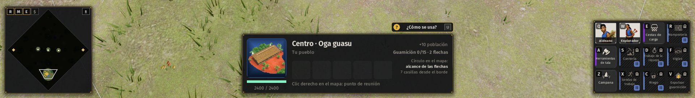

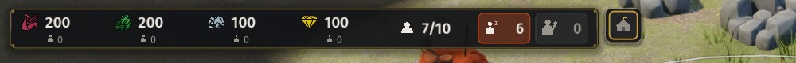

## Análisis por zona y lista por prioridad

| Zona | AoE4 | Nosotros (antes) | Qué tomar |
|---|---|---|---|
| Panel inferior: marco y material | Una banda pegada abajo, un material, bloques del mismo alto | Tres paneles sueltos que flotan a 12 px del borde: minimapa a la izquierda, selección al centro (172 px de alto) y grilla a la derecha (210 px); negro neutro con un marco dorado de 9 cortes | **Banda única** pegada abajo, selección y grilla juntas y del mismo alto, un solo marco |
| Selección: retrato y jerarquía | Medallón sobre la cabecera, nombre en mayúsculas, categoría en cursiva, franja que se apaga | Retrato pintado (lo nuestro) con el nombre al lado en 20 px, sin franja; el color del dueño solo en el borde del retrato | **Cabecera** con el color del dueño apagándose hacia la derecha; el retrato monta sobre ella como medallón cuadrado (se queda el gouache) |
| Datos | Íconos en lugar de etiquetas, números grandes | Etiquetas («Ataque», «Armadura») y números de 17 px: se lee bien | Se queda (las etiquetas ayudan al que empieza; C-30 y la ronda 4 lo pidieron) |
| Grilla | Casillas vacías hundidas, tecla abajo a la derecha | Casillas vacías casi invisibles (2,5 % de blanco); tecla arriba a la izquierda | **Casillas vacías hundidas**; la tecla se queda donde está (las pruebas y la costumbre) |
| Cola de producción | (no se ve en la captura; en el AoE4, íconos con el tiempo encima) | Cinco casillas iguales; la que se hace, con una barra de 3 px | **La que se hace, marcada** con borde dorado, barra más gruesa y los segundos que faltan |
| Recursos y aldeanos por recurso | Casilla al lado del número, encendida si hay alguien | Número de 13 px gris debajo, apagado aunque haya gente | **Pastilla al lado**, con el color del recurso si hay gente |
| Ociosos | Ícono con «zZ» al lado de la población | Botón con fondo rojizo cuando hay | **Pastilla del marco que late** cuando hay ociosos |
| Minimapa | (en el AoE4 va a la derecha) | Abajo a la izquierda con marco propio y botones cuadrados negros | Mismo marco que la banda, **pegado a la esquina**, botones como pastillas |
| Edad, tiempo y puntaje | Arriba al centro | Arriba a la derecha | Mismo marco (la disposición se queda: `proceso/59`, nota 8) |
| Avisos | Cartel arriba al centro | Pila de avisos con fondo por tipo | Sin cambios en esta etapa |
| Ayudas | Panel con título, costo y texto | Panel gris más claro, tecla «[Z]» suelta | Mismo marco, **título sobre una franja** con divisor y la tecla en una pastilla |
| Sobre el mundo | Opaco, sombra corta | 90 % opaco, sombra de 10 px | Degradé de tierra oscura (94 %), sombra un poco más larga hacia arriba |

**Prioridad** (por cuánto se nota y cuánto cuesta):

1. Banda de abajo única y pegada (selección + grilla del mismo alto, un solo marco). **Hecho.**
2. Un solo marco para todos los paneles del HUD, dibujado con código (fondo en degradé, filete dorado, brillo arriba, sombra, rombos en las esquinas), con los valores en datos. **Hecho.**
3. Cabecera de la selección con el color del dueño y el retrato como medallón. **Hecho.**
4. Aldeanos por recurso en una pastilla al lado del número. **Hecho.**
5. Cola de producción con la que se hace marcada y los segundos que faltan. **Hecho.**
6. Ociosos: pastilla que late. **Hecho.**
7. Minimapa con el mismo marco, pegado a la esquina, botones como pastillas. **Hecho.**
8. Ayudas con el mismo marco, título y tecla en pastilla; diálogos y paneles F5–F9 con el mismo tono (vía `Hud.panel_box`). **Hecho.**
9. Íconos en lugar de etiquetas en los datos de la unidad (ataque, armaduras). Pendiente: pide íconos de ataque y de armadura en el estilo de `proceso/28`.
10. Marca de agua del pueblo en el fondo del panel (como el escudo del AoE4, pero con un motivo pintado de cada pueblo). Pendiente: pide arte en gouache por pueblo; hoy el panel es liso.
11. Avisos con el mismo marco. Pendiente.

## Qué cambió

- **`src/game/ui/marco_hud.gd`** (nuevo): `panel()` dibuja el marco común (degradé, borde, brillo, sombra, rombos; los lados pegados al borde de la pantalla van sin borde ni esquina redonda); `cabecera()`, `casilla_vacia()`, `pastilla()`, `rombo()` y `divisor()`. Todo lo visual sale de **`data/interfaz.json → hud_estilo`**: colores, alfas, radios, sombra, banda (`margen_abajo`, `separacion`, `margen_lado`, `minimapa_margen`, `grupos_sobre`), selección (`ancho`, `cabecera_alto`, `cuerpo_dy`, `multi_y`) y barra (`celda`, `pastilla_ancho`, `pastilla_alto`).
- **`src/game/hud.gd`**:
  - `_place_band()`: la selección (600 px) y la grilla forman una banda del alto de la grilla, pegada abajo y centrada; si no entra (escala 125–150 % o pantalla angosta) se corre a la derecha del minimapa. Se recalcula cada cuadro (sigue al botón de tamaño del minimapa). Los grupos de control quedan encima, centrados sobre la selección.
  - Selección: cabecera con el nombre (20 px), el dueño debajo y, a la derecha, función o población y guarnición; el retrato con filete dorado y rombo; el cuerpo, 6 px más arriba que antes (`cuerpo_dy`). Varias unidades: el tipo y «N elegidas» van a la cabecera. La columna del alcance de las flechas se achica sola con texto grande para no pisar la cola.
  - Cola: vacías hundidas, ocupadas con borde y la que se hace con borde dorado, barra de 4 px y los segundos que faltan.
  - Barra de recursos: celdas de 150 px, número centrado en alto y la pastilla de aldeanos al lado (con el color del recurso si hay alguien); separadores finos. Ociosos con pastilla que late (reloj de la interfaz).
  - Grilla, reloj y ayuda con el marco común; la ayuda con título sobre una franja y la tecla en pastilla.
  - `panel_box()` (diálogos, paneles F5–F9, ficha, menú) toma el tono y el borde del marco.
- **`src/game/minimap.gd`**: marco común, pegado a la esquina (`minimapa_margen` 0), botones de filtro y tamaño como pastillas.
- Sin cambios en la simulación: hash **3617052205**, igual.

## Antes y después

A 1920×1080 (reducidas a 1600 de ancho), centro elegido:

La banda de cerca:

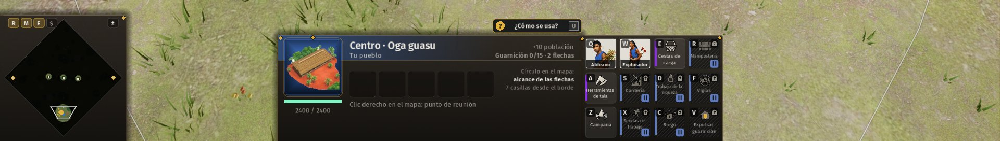

La barra de recursos de cerca:

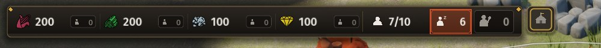

Seis aldeanos elegidos:

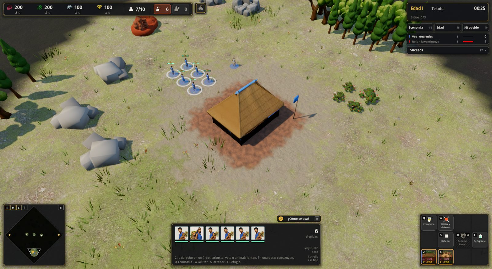
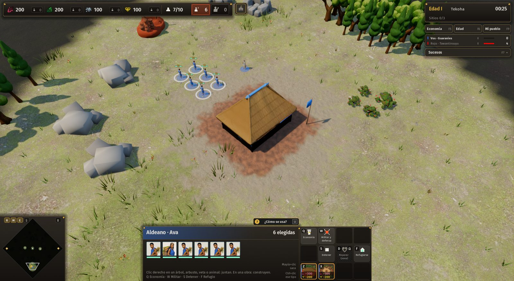

A 1366×768:

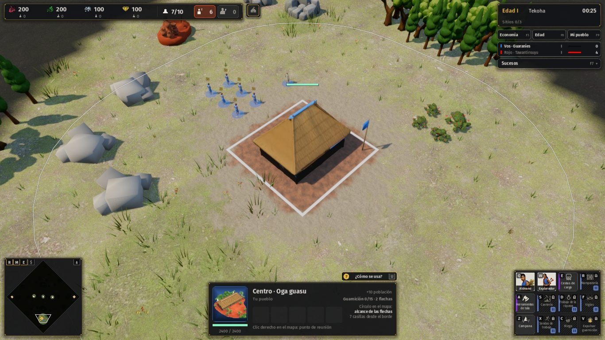
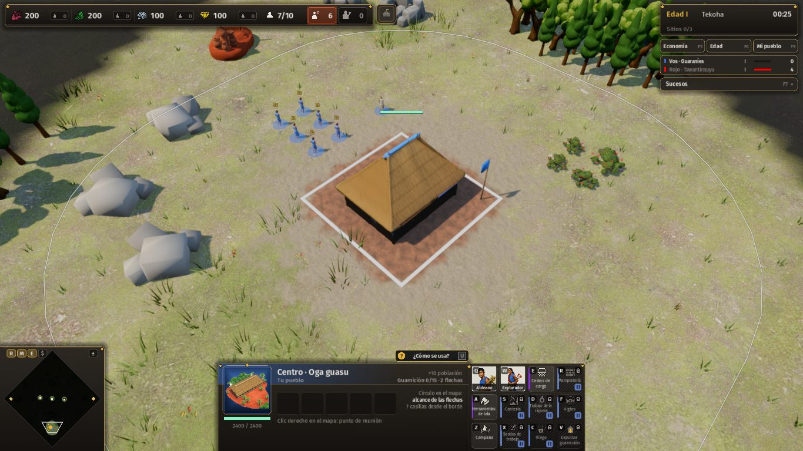

Texto grande, 1080p y 1366×768:

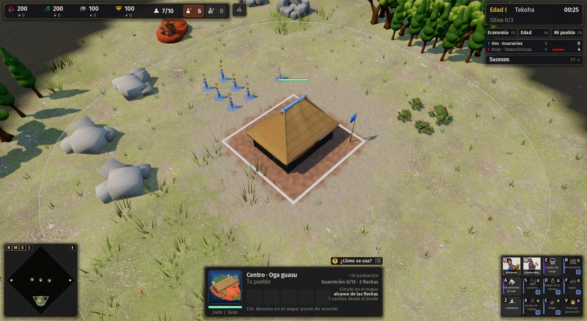
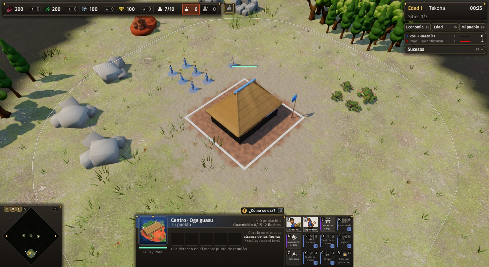
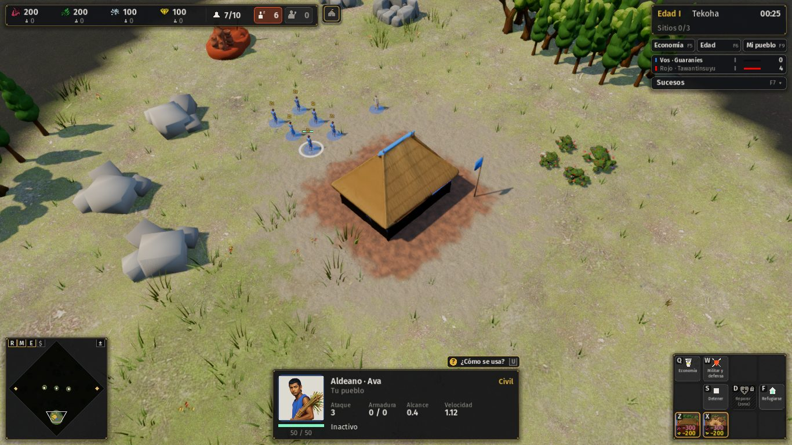
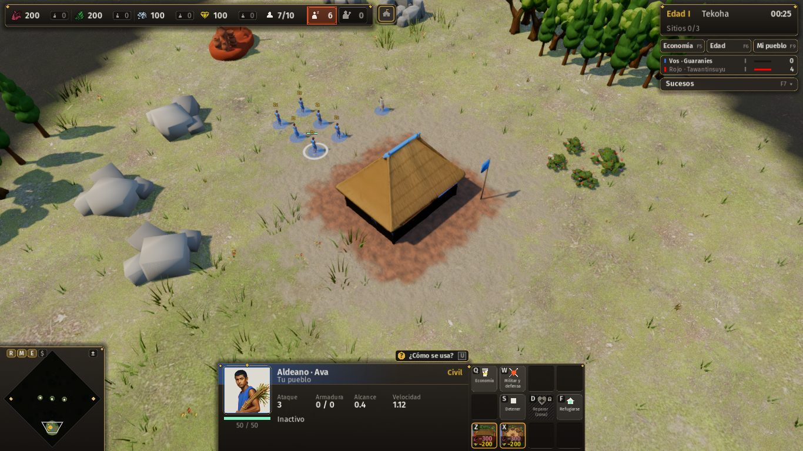

Escala 125 % a 1366×768 (la banda se corre a la derecha del minimapa) y la ficha de Z con el tono nuevo:

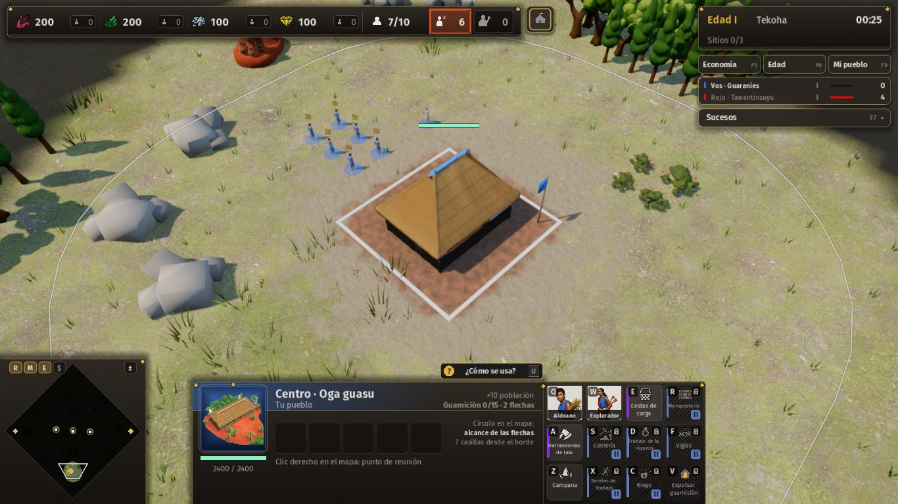
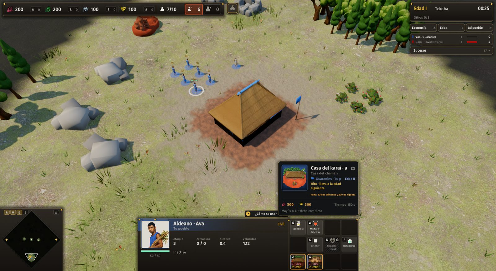

## Pruebas

Resultados en [`pruebas/`](pruebas/).

| Prueba | Resultado |
|---|---|
| `tests/iconos.gd` | OK (780 grillas, 145 íconos) |
| `tests/grilla.gd` | OK |
| `tests/casillas.gd` | OK (628 grillas) |
| `tests/test_paleta.gd` | OK (el fondo de las casillas vacías, `0d0b09` al 55 % sobre el panel, es más oscuro que el `FONDO` de la prueba) |
| `tests/test_opciones.gd` | OK |
| `tests/test_determinism.gd` | OK, hash 3617052205 (igual) |
| Autotest con ventana, guaraníes en llano | AUTOTEST: OK (251 chequeos, ninguno falló) |

## Tropiezos

- El worktree no tenía `.godot/`: hubo que importar antes de la primera captura.
- La primera versión dejaba 2 px de pasto entre la selección y la grilla, y la sombra de la grilla oscurecía el borde derecho de la selección. Quedó un solo panel: sin separación, sin borde ni sombra del lado de la unión, un divisor con rombo, y la grilla dibujada después de la selección.
- Con texto grande, «7 casillas desde el borde» pisaba la quinta casilla de la cola (ya pasaba antes); ahora esa columna se achica.
- El rombo de la esquina quedaba teñido por la franja de la cabecera: se vuelve a dibujar encima.

## Commits

- `Proceso 67: interfaz como AoE4 (banda de abajo, marco común, cabecera, pastillas de aldeanos, cola con tiempo)`
