# 68 · Interfaz pintada

> **Pedido (2026-11-28):** la interfaz nueva (`proceso/67`) está mejor, pero sigue viéndose como **colores planos fijos** y pierde el aura. El autor quiere imágenes o un diseño más rico que un color plano: que los paneles parezcan tela, cuero o madera pintados, con una faja tejida, en nuestra identidad de gouache. Base neutra para todos (gouache sobre papel hecho a mano o algodón tejido); en el borde, una faja con un dibujo inspirado en el tejido o la artesanía de **cada pueblo**, elegida con las reglas de los historiadores (`proceso/25`, `proceso/58`: nada sagrado como adorno, nada de estereotipos), con la fuente anotada. El HUD lleva la faja del pueblo del **jugador**. Texturas locales con FLUX y Pillow; lo geométrico, en código. Hacer también, si entran, los pendientes de `proceso/67`: íconos de ataque y armadura, marca de agua de cada pueblo y avisos con el mismo marco. La lectura y la accesibilidad no se pueden perder: contraste de `test_paleta`, texto grande, escala de 1366×768 a 4K y modos de daltonismo.

## El concepto

- **Papel pintado.** Todos los paneles son la misma hoja de papel hecho a mano con una aguada oscura de tierra (tierra de sombra y siena tostada). Tiene fibra, pigmento que se junta y pinceladas: nada se lee como un color plano. Es oscura a propósito: el texto claro se lee como antes.
- **Faja tejida del pueblo.** El borde de cada panel es una faja tejida hilo por hilo, con el dibujo y los tintes del pueblo del jugador. Monta sobre el borde (la mitad cae afuera), así no tapa el contenido. En las esquinas de arriba, una pieza tejida en rombo; entre secciones, un cordón de dos cabos.
- **Latón y tinta.** El retrato va en un medallón de latón pintado. En el panel de la selección, la marca de agua del pueblo: su arte en gouache (`proceso/48`) hecho tinta hundida en el papel, solo con trazos y un filo de luz.
- **Lo que significa algo, se queda.** El color del dueño en la cabecera, el color del tipo de aviso y los fondos de color de las filas elegidas no se tapan con la pintura: ahí va solo el grano.

Las piezas sobre el papel, al doble de resolución (de arriba abajo: común, Tawantinsuyu, mapuches, guaraníes, Etiopía, Palmares y Ayutthaya; a la izquierda, el marco de 9 cortes; al medio, la tira ampliada; a la derecha, la pieza de esquina y la marca de agua; abajo, los cuatro botones, el medallón y el cordón):

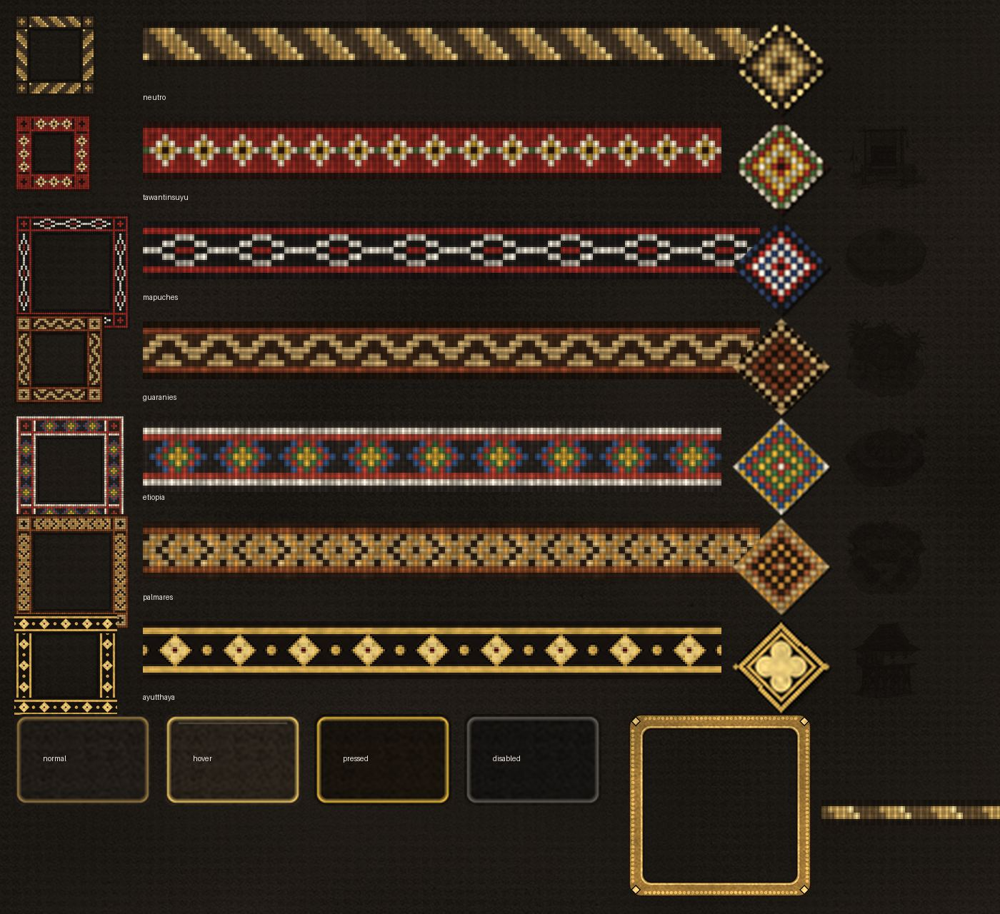

## Las fajas y sus fuentes

| Pueblo | Faja | Fuente y por qué se puede usar |
|---|---|---|
| Tawantinsuyu | Rombos encadenados (contorno blanco, amarillo y centro oscuro) sobre rojo de cochinilla, rayas oscuras | El *pallay* es el campo de dibujo de las fajas (*chumpi*) y mantas (*lliklla*) del sur andino (Cusco, Q'ero, Chinchero); los rombos son de uso diario. **No es tocapu**: los cuadros con signos de la élite inca tienen un sentido discutido y no se usan. |
| Mapuches | Rombos escalonados encadenados, blanco y rojo sobre negro | Geometría del *witral* (telar) en las fajas (*trariwe*) y mantas (*makuñ*), en las técnicas *ñimin* y *trarikan*. Sin el *lukutuwe* ni el *wünyelfe* (estrella de ocho puntas), que tienen sentido ceremonial. |
| Guaraníes | Sarga en espiga: tiras naturales horizontales y teñidas verticales | Cestería de tacuara y fibras (canastos *ajaka*, *panakũ*): es la técnica del tejido, sin figuras. |
| Etiopía | Guarda oscura con rombos de colores entre rayas rojas, sobre algodón blanco | El *tibeb* es la guarda tejida de la *netela* y el *gabi*, de los tejedores de algodón de Shewa y Gondar. Hay tibeb con cruces: **acá no**, solo rombos (la primera prueba dejaba entre rombo y rombo una forma en X; se cambió por fondo liso). |
| Palmares | Entrelazado de rombos y zigzag en rafia natural, óxido y oscuro | Inspiración general en la rafia tejida de África centro-occidental (kongo, mbundu), de donde vino buena parte de la gente de Palmares, y en la cestería de palma de Pernambuco. **No es un motivo documentado en Palmares** y así se dice. Sin el cosmograma kongo (*dikenga*). |
| Ayutthaya | Flor de cuatro pétalos en rombo, oro sobre laca negra, filetes de oro | *Lai prajam yam*: motivo de los textiles (*pha nung*) y de la cerámica *benjarong*. Sin Buda, sin deidades y sin el *kranok* de los frontones de templo. |
| Común | Cordón torcido ocre y tierra | Menús y diálogos fuera de la partida, sin pueblo. |

Las fuentes quedan también en los datos (`hud_estilo.pintado.pueblos.<pueblo>.faja.fuente`) y en `docs/catalogo-ui.md`. Las fajas siguen la regla de siempre: lo sagrado no es adorno. Para Palmares y los mapuches, que son pueblos vivos, la consulta a comunidades (C-74) también vale para estas fajas.

## Cómo se hace

`tools/interfaz_pintada.py` lee `data/interfaz.json → hud_estilo.pintado` y escribe todo en `assets/ui/hud/` (unos 500 KB).

1. **FLUX, una sola sesión** (768×768, 4 imágenes en 4 min, con la GPU libre; ComfyUI apagado y verificado con `pgrep` anclado al terminar). Cuatro fuentes en `proceso/68-interfaz-pintada/fuentes/` (fuera de Godot, en JPG): dos papeles, un algodón y una faja *lai thai* para comparar. Se usan `papel_8` (el centro: el borde salió barbado) y la trama de `algodon_7` mezclada suave; `papel_7` salió como una mancha naranja sobre papel blanco y no sirve; la faja *lai thai* de FLUX trajo flores de cinco pétalos con zarcillos, que no son el *prajam yam* ni repiten exacto: queda la hecha en código. Los prompts están en `FLUX` del script:
   - `papel_7`: «flat top-down scan of a sheet of handmade paper painted with a dark umber and burnt sienna gouache wash, visible paper fibres and deckle texture, uneven pigment pooling, soft brush marks, even lighting, no objects, no text, no border, seamless texture»
   - `papel_8`: «flat top-down scan of thick handmade cotton rag paper with a dark brown earth pigment gouache wash, subtle fibres, granulating pigment, dry brush streaks…»
   - `algodon_7`: «flat top-down macro scan of handwoven undyed cotton cloth dyed dark walnut brown, coarse plain weave, irregular handspun threads…»
   - `laithai_7`: «flat horizontal decorative border strip, traditional Thai lai prajam yam four-petal flower pattern, gold paint on black lacquer… no figures, no buddha, no temple»
2. **Superficie sin costuras.** La foto se mezcla con su copia corrida media vuelta (los bordes quedan con el centro, que sí continúa). El papel de FLUX es muy parejo: se le suma una aguada de baja frecuencia (pigmento que se junta) y la trama del algodón. Del valor se toma la variación (±11 %) y del color, un tercio del viraje. Se recorta para que ningún píxel pase el `FONDO` de `test_paleta` (percentil 99,8).
3. **Fajas tejidas en código.** Cada faja es una matriz de hilos (filas × período) que sale del motivo y los colores de los datos. Cada hilo se pinta como un cilindro con su sombra, el tinte varía un poco por hilo y por columna (como los tintes naturales), y en la cestería la tira va horizontal o vertical según el color. Después se multiplica por el grano del papel y una aguada leve. Se arma en 9 cortes: la esquina (las rayas dan la vuelta y adentro va un rombo chico) y los lados (tres repeticiones de la tira; la izquierda es la tira traspuesta). Lo geométrico no va a FLUX: inventa signos (cruces, budas, tocapus) y no repite exacto.
4. **Lo demás.** Pieza de esquina (tejida, recortada en rombo con sombra), cordón divisor, medallón (dibujado con Pillow y el grano del papel), botones en cuatro estados (papel algo más claro sin pasar el `FONDO`, filete de pincel) y la marca de agua (bordes del gouache del pueblo en tinta oscura, al 70 %, con un filo de luz).
5. **Doble resolución.** Todo va al doble y el juego lo dibuja a escala 0,5: a 4K se ve nítido.

## En el juego

- **`src/game/ui/marco_hud.gd`** (segunda mitad): `panel_pintado()` (sombra, papel en mosaico, faja de 9 cortes escalada a `faja_px` y piezas de esquina), `faja()` (los lados pegados al borde de la pantalla o al panel vecino se recortan de la textura con `region_rect`), `superficie()`, `cordon()`, `medallon()`, `marca()`, `boton()` y `aviso()`. Todo con el `RenderingServer` sobre el RID del CanvasItem, para que lo use igual un panel dibujado a mano que un StyleBox. `panel()` y `divisor()` lo llaman si `pintado()`; si no, queda el marco de `proceso/67` tal cual (la reserva).
- **`src/game/ui/estilo_pintado.gd`** (nuevo): el StyleBox que devuelve `Hud.panel_box()` para diálogos, paneles F5–F9, ficha, menú, listas y el menú desplegable. Tiene las mismas propiedades que se le tocaban al StyleBoxFlat (`bg_color`, `border_color`, sombra, radios), así los 20 lugares que lo usan no cambian. Fondo oscuro y neutro: papel y faja fina. Fondo de color (una fila elegida): ese color con el grano encima.
- **`src/game/hud.gd`**: la faja del pueblo del jugador (`MARCO.set_pueblo` en `setup`; el menú vuelve a la común); barra de recursos, reloj y ayudas con la faja fina; la cabecera de la selección empieza debajo de la faja; medallón del retrato; marca de agua; botones pintados en el tema. **Íconos en lugar de etiquetas** (pendiente 9 de `proceso/67`): ataque, armadura, alcance y velocidad con su ícono de `proceso/39` y el número al lado; al pasar el ratón, la ayuda dice qué es cada uno.
- **`src/game/ui/avisos.gd`**: los avisos con el mismo marco (papel, faja fina) y la franja del color del tipo a la izquierda (pendiente 11).
- **`src/game/ui/opciones.gd`**: botones pintados en el diálogo de opciones y en el menú.
- **`data/interfaz.json → hud_estilo.pintado`**: rutas, grosores (`faja_px` 20, `faja_fina_px` 9, `faja_fuera` 0,5), alfas, la marca y las fajas de cada pueblo con su fuente.

## Antes y después

«Antes» es el marco de `proceso/67` (`pintado.activo` en `false`, que es también la reserva); los íconos de los datos ya están en las dos. Ventana de 1920×1052 (el monitor no da 1080 justos), recortadas a la banda de abajo.

Etiopía, un aldeano (faja *tibeb*):

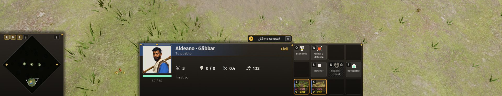
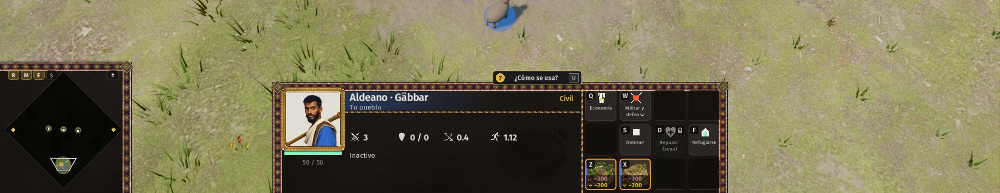

De cerca, al doble: la faja, el medallón, la cabecera debajo de la faja y los íconos con el número:

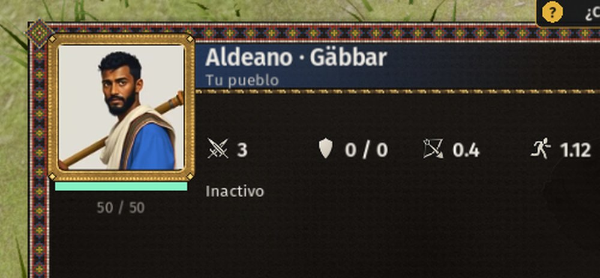

Tawantinsuyu, el centro (*pallay*):

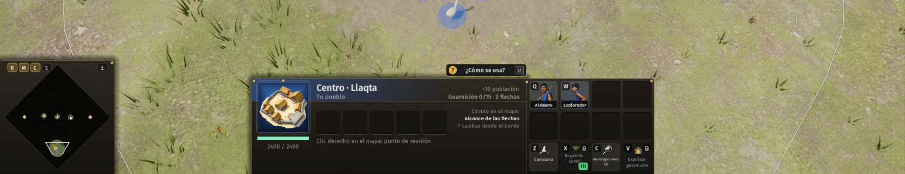
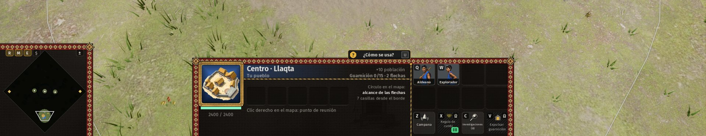

Ayutthaya, varios aldeanos (*lai prajam yam*):

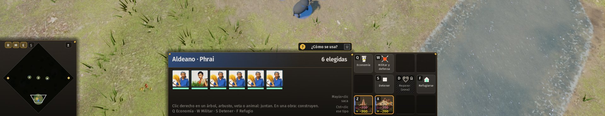
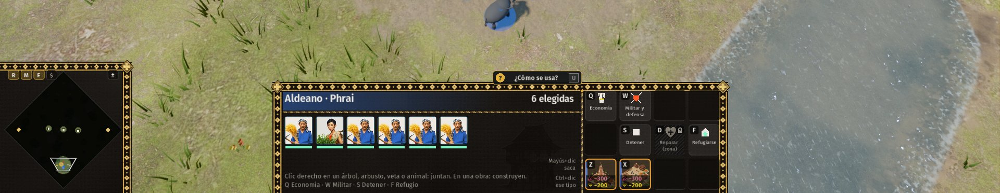

Palmares con texto grande (rafia):

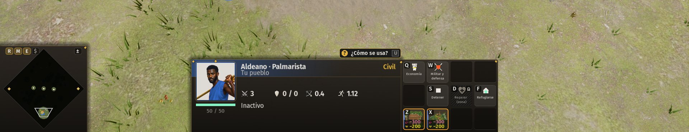
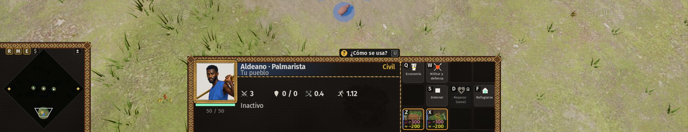

La barra de arriba con la faja fina:

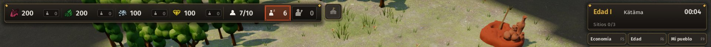
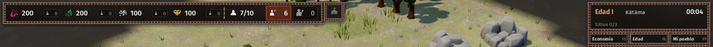

A 1366×768, guaraníes (sarga) y mapuches con texto grande (*witral*):

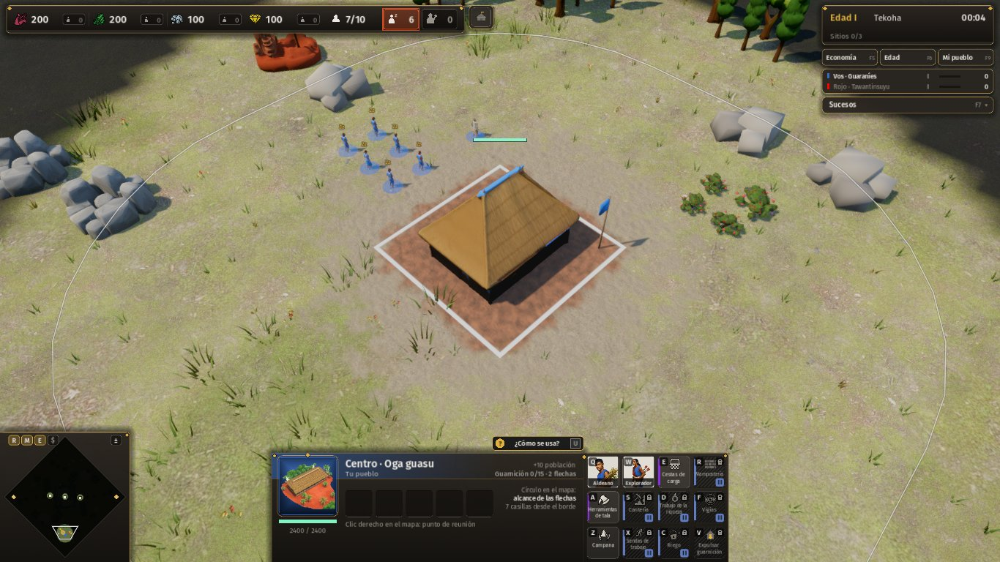
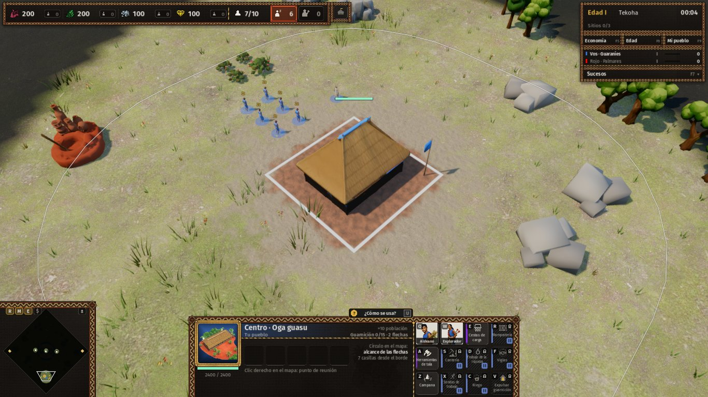
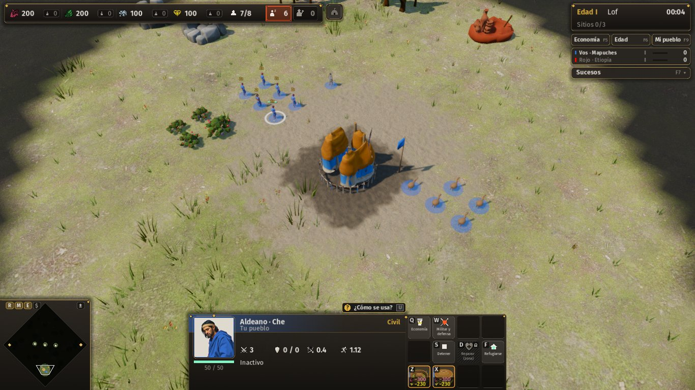
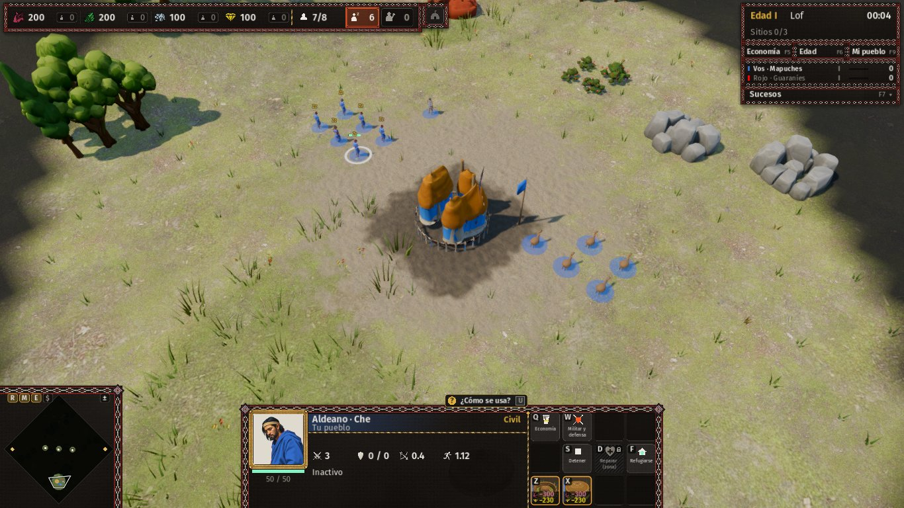

Escala 125 % a 1366×768, la ficha de una casilla, el diálogo de opciones (botones pintados), deuteranopía y el menú (faja común):

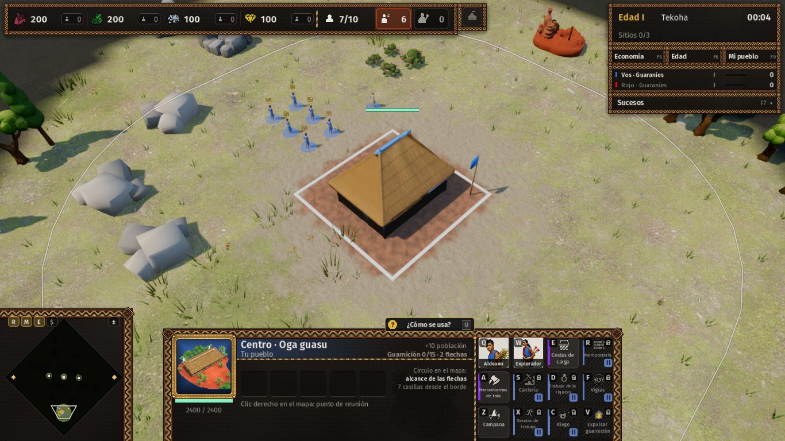
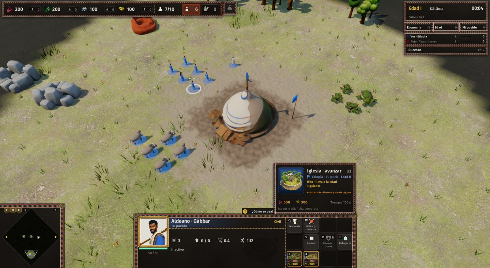
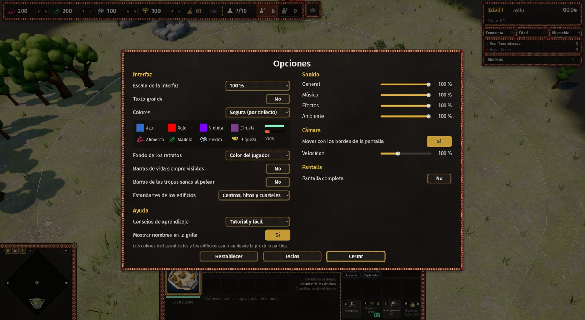
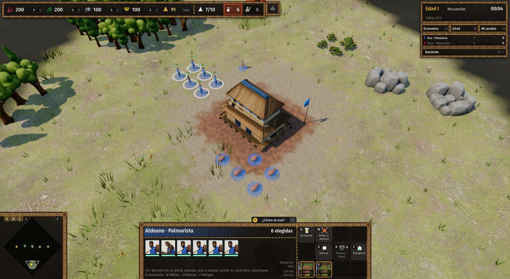
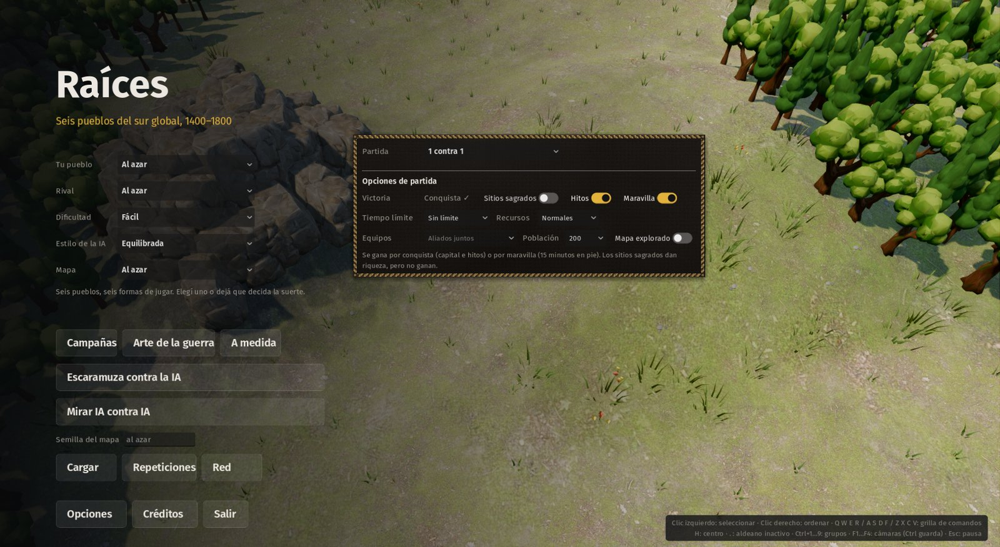

## Pruebas

Resultados en [`pruebas/`](pruebas/).

| Prueba | Resultado |
|---|---|
| `tests/test_paleta.gd` | OK. **Nueva medida:** luminancia de las texturas que van debajo del texto. Papel 0,0142 (p99,5), botones de 0,0077 a 0,0189 (sin el filete), marcas de agua sobre el papel de 0,0109 a 0,0123; tope, el `FONDO` (0,0210). Los contrastes WCAG de antes valen sobre todas |
| `tests/test_opciones.gd` | OK |
| `tests/iconos.gd` | OK (780 grillas, 145 íconos) |
| `tests/grilla.gd` | OK |
| `tests/casillas.gd` | OK (628 grillas) |
| `tests/test_determinism.gd` | OK, hash **3617052205** (igual: solo interfaz) |
| Autotest con ventana, Etiopía en llano | AUTOTEST: OK, a la primera |

A 4K no se pudo sacar captura (el monitor es de 1080). Todo se dibuja en unidades de la interfaz (base 1920×1080) y las texturas van al doble, así que a 4K quedan 1:1.

## Tropiezos

- **La GPU.** El `pgrep` del pedido (`main.py --listen|hy3dgen|blender`) no ve el Hunyuan del otro agente (`gen3d/venv_hy/bin/python tools/gen3d.py`): ComfyUI arrancó con 4 GB ocupados y FLUX se quedó sin memoria en la primera imagen. Lo apagué al momento (verificado con `pgrep` anclado). La espera siguiente miró `nvidia-smi --query-compute-apps` (procesos de python o blender en la GPU) cada 2 min y arrancó con dos chequeos libres seguidos (40 min de espera). Un primer intento de espera con `pgrep -f` se encontraba a sí mismo en la línea de comandos.
- **Faja demasiado fina.** Con 11 hilos en 11 px, el dibujo se leía como puntitos. Quedaron 9 hilos (11 en el *tibeb*, que necesita el algodón blanco) en 20 px, con la mitad afuera del panel para no tapar el nombre ni el retrato.
- **Lados pegados.** Con `expand_margin` la faja del lado de la unión entre la selección y la grilla se metía en el panel vecino. Ahora ese lado se recorta de la textura (`region_rect`) con margen 0.
- **Tibeb con una X.** La primera versión dejaba entre rombo y rombo una forma blanca en X: podía leerse como cruz. Se cambió por el fondo oscuro de la guarda.
- **Diálogos.** `Hud.panel_box()` devolvía un `StyleBoxFlat` al que 20 archivos le cambian `bg_color` y otros valores. Un StyleBox nuevo con las mismas propiedades (`EstiloPintado`) evitó tocar esos archivos.
- **El menú** de inicio tiene sus propios botones (`menu.gd`, `campaign_ui.gd`, `partida_a_medida.gd`): siguen planos; solo sus paneles toman el papel y la faja común. Queda para otra etapa.
- El worktree no tenía `.godot/`: hubo que importar antes de las capturas, y otra vez cada vez que cambiaron las texturas.

## Commits

- `Proceso 68: interfaz pintada (papel con gouache, fajas tejidas por pueblo, medallón, marca de agua, avisos y botones)`
